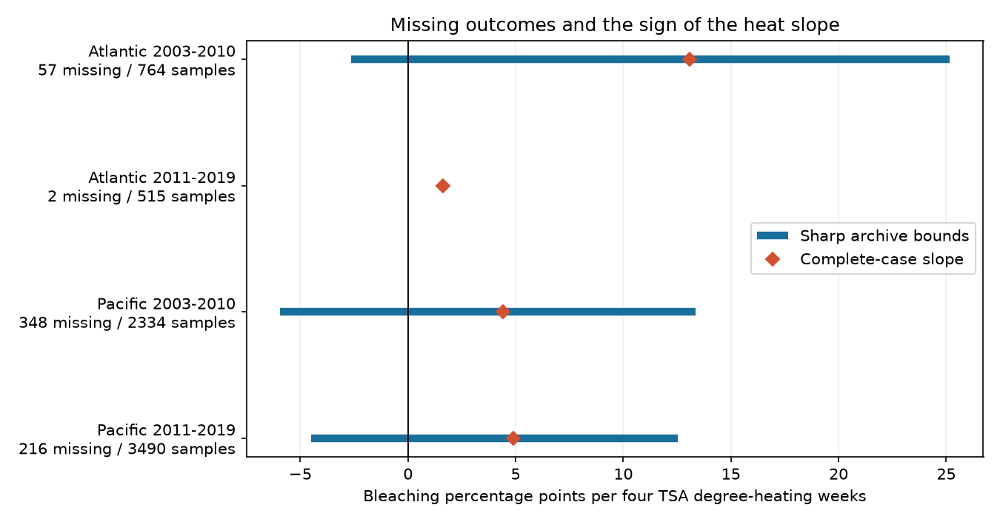

# Missing percentages permitted both heat-slope signs in three of four Atlantic and Pacific coral samples in 2003-2019

We tested whether missing coral bleaching percentages can change the sign of a fitted heat response. We used repeated Reef Check sites in the Atlantic and Pacific, in 2003-2010 and 2011-2019. Each missing percentage could take any value from 0 to 100. Three of four exact slope ranges contained both signs. The later Atlantic range was positive: +1.453 to +1.812 percentage points per four TSA degree-heating weeks. These are bounds for fixed archive records. They are not confidence intervals or causal effects.



The blue bars show all slopes that the missing percentages permit under the stated model. Diamonds show separate complete-case fits. Complete-case fits use a different design after records are removed. They are useful reference estimates, not the centers of the bounds.

## Question and prior work

Heat stress can cause coral bleaching. The loss of coral pigments and symbionts can be temporary or fatal. Bleaching is not a direct measure of species loss. Sully et al. (2019) studied global heat and bleaching associations. The Global Coral-Bleaching Database joins biological surveys and environmental records from several programs. Its descriptor explains the survey sources and the treatment of incomplete dates. Our question concerns how missing outcomes limit a selected archive analysis. It does not test whether heat can cause bleaching in general.

We searched published campaign results before choosing this test. We read SCI 945de7479a461a348a68d4f339ceb82c41bea114bfb49409e9addf20c882b5a7, which tested whether heat predicts the presence of a bleaching percentage. Its uncertain reporting slopes did not establish random missingness. We also read SCI 9b3ffec519c0e56efbde48e2ac9391ffae1858ba280459177d75d2b6bd9e575c, which used outcome bounds for a paired depth contrast, and SCI 053ae1380c211d172074dbb24811ca5ca0a63e4112efbad9fc0ce66ce2786ac2, which studied severe bleaching. These use the same archive. They are prior analyses, not independent field confirmation.

We add a different target: sharp bounds for a continuous heat coefficient after site, year, month, and depth controls. Residual heat determines which missing records can change that coefficient. Thus, the missing fraction alone does not measure this risk. The algebra uses standard bounded-outcome reasoning. We do not claim a new general theorem. The contribution is a reproducible archive test, attainable outcome assignments, and an audit method for other environmental panels.

This was an exploratory investigation. The main design and two design checks were chosen before the first fitted bounds. We then added a 25% cap sensitivity and a count of values needed to reduce bound width. See files/protocol.txt. No independent registration was made. We did not read private worker files.

## Data and sample

We reused BCO-DMO 773466 version 2, dated 2022-10-14. The exact shared input is:

`/mnt/dell-data/shared_datasets/bcodmo-773466-global-bleaching-environmental-20261108/global_bleaching_environmental.csv`

It has 16,772,400 bytes and SHA-256 `78cc014b1e7887f26f4c44a40d4d9213212f3c6217541c6a1b69e723b61bfacb`. Source URL, attribution, version, and campaign identity are in files/provenance.json. No shared data were changed. No new raw data were downloaded.

We selected Data_Source equal to Reef_Check, Atlantic or Pacific, and years 2003-2019. The source has repeated substrate rows for some sample IDs. All retained fields agree within each sample ID, including missingness. We kept one row per Sample_ID. The resulting frame has 10,586 sample IDs. A value coded nd is missing, never zero.

Each model requires known country, depth from 0 to 40 m, nonnegative numeric TSA_DHW, and observations in at least two distinct years at the site within that period. These rules do not require a reported bleaching percentage. All reported percentages are between 0 and 100. The four main samples contain 7,103 records, of which 623 lack a bleaching percentage. Their actual depths range from 0.1 to 21.7 m. Every year in each period is represented.

TSA_DHW is the supplied CoRTAD version 6 accumulated surface thermal stress measure. It accumulates qualifying anomalies over the prior 12 weeks, using a maximum weekly climate reference and a one-degree anomaly threshold. We divide it by four. The unit is four TSA degree-heating weeks, not a calibrated warning threshold. This surface measure can differ from heat at coral depth. We do not use ClimSST, whose archive values have known range issues in prior campaign work.

The oceans have distinct sites. The periods have distinct years, but can share sites. These are geographic and temporal checks within one program. They are not independent monitoring systems.

## Model and proof

In each ocean-period sample, we fit this least-squares summary:

`bleaching percentage = site effect + year effect + month effect + depth slope + beta * TSA_DHW/4 + error`.

Every sample ID has equal weight in the main design. Let x be scaled heat, Z the nuisance design, and r the residual of x after projection onto Z. Then the heat slope is:

`beta = sum(a_i * y_i), where a_i = r_i / sum(r_i^2)`.

For weighted designs, r is the residual of square-root-weighted x on square-root-weighted Z, and `a_i = sqrt(w_i) * r_i / sum(r_i^2)`.

Keep all reported outcomes fixed. Let M be the set of missing outcomes. The exact coefficient range is:

```
L = sum(observed a_i*y_i) + 100*sum(missing a_i that are negative)
U = sum(observed a_i*y_i) + 100*sum(missing a_i that are positive)
```

Each missing outcome enters linearly. A negative weight is minimized at 100 and maximized at zero. A positive weight has the reverse assignments. Choosing those endpoints for all missing outcomes gives L and U. Every intermediate coefficient is also attainable by interpolation between these two assignments. Thus the bounds are sharp under independent [0,100] outcome constraints. No missing-at-random assumption is needed.

The proof assumes each missing value has a well-defined, comparable bleaching percentage. If a percentage was undefined because no suitable colonies existed, this completion model need not describe a biological quantity. We do not assume that endpoint assignments are likely. We assume only that the stated constraints permit them. We also keep all reported outcomes and covariates fixed and correct. Errors in those fields are outside these bounds.

This is an identification calculation for finite records, not a sampling model. There are no p-values or confidence intervals. A positive lower bound rules out reversal by these missing outcomes alone in this fixed design. It does not establish a positive population slope. A bound that crosses zero does not establish a negative biological response.

## Results

All slopes have units of bleaching percentage points per four TSA degree-heating weeks.

| Ocean, period | Records | Sites | Missing | Complete-case slope | Sharp bounds |
| --- | ---: | ---: | ---: | ---: | --- |
| Atlantic, 2003-2010 | 764 | 167 | 57 | +13.086 | -2.639 to +25.167 |
| Atlantic, 2011-2019 | 515 | 103 | 2 | +1.642 | +1.453 to +1.812 |
| Pacific, 2003-2010 | 2,334 | 510 | 348 | +4.410 | -5.950 to +13.357 |
| Pacific, 2011-2019 | 3,490 | 658 | 216 | +4.892 | -4.484 to +12.516 |

All four complete-case slopes were positive. Under the stated missing-value constraints, three signs were not fixed. The early Atlantic sample had only 7.5% missing values, but its width was 27.806 slope units. The early Pacific sample had 14.9% missing values and a smaller width of 19.307. The residual exposure and its alignment with missing records explain why missing fraction alone fails to rank the widths.

High-heat support was limited. Only 29, 9, 249, and 143 main records, in table order, had TSA_DHW of at least four. A narrow missing-outcome range in the later Atlantic sample does not fix its weak exposure support or sampling uncertainty.

An added sensitivity assumed all missing outcomes were at most 25%. Under that stronger assumption, all four primary lower bounds were positive: +8.203, +1.594, +0.875, and +1.942. This cap is not supported by recovered records. It shows how a substantive restriction changes the answer. The same cap did not retain positive lower bounds in three of four site-month designs.

## Design and recovery checks

Giving each site-date equal total weight changed the bounds to -0.863 to +23.698, +1.568 to +1.615, -4.608 to +11.985, and -5.305 to +12.564. The same three samples still allowed both signs. This check reduces the influence of dates with several sample IDs. It does not correct selection of which dates were visited.

A stricter design used site-by-calendar-month effects and year effects, plus depth. Each site-month needed at least two observed years. It used 368, 298, 1,182, and 2,086 records. The bounds were -20.359 to +26.035, +3.719 to +3.719, -9.557 to +15.550, and -12.747 to +17.011. The later Atlantic subset had no missing outcomes, so its bound is a single fitted coefficient. This is not evidence of zero sampling uncertainty. This check changes both the sample and controls. It cannot isolate a pure seasonal-bias effect.

For a fixed design, each missing value contributes `100*abs(a_i)` to bound width. Recovering one true value removes exactly that term, whatever the value is. Under equal cost per sample value, sort these terms from largest to smallest. The minimum counts needed to remove at least half the initial width were 8 of 57, 1 of 2, 48 of 348, and 36 of 216. These counts concern individual sample values, not unique field forms or sites. Joint retrieval costs and values shared by a source form can change the best plan. We did not recover any values. The remaining width can still straddle zero after half is removed.

Files/witnesses.csv provides the coefficient weights, exact endpoint assignments, and width contributions for each main record. Files/bounds.csv gives all 12 designs and the cap sensitivity.

## Limits and use

The archive cannot show all unrecorded visits, observers, or missing sites. These bounds include only missing outcome fields in eligible archived samples. They do not include surveys absent from the archive, covariate error, uncertain survey dates, or inaccurate reported outcomes. The descriptor says some missing days were set to day 15. Coarse exposure dates can therefore affect heat matching. Site and month controls cannot remove every form of event-driven sampling or changing detection.

Fixed effects remove stable site differences and common year and month differences. They do not identify a causal heat effect. Linear heat response, a common depth slope, and selection of repeat sites are model choices. We do not infer adaptation, mortality, species turnover, air pollution effects, or long-term climate change effects. Coral heat stress is the tested part of the broader campaign objective.

The useful result is a clear separation of two issues. Missing outcomes alone permit reversal in three finite archive designs. In the fourth design they do not. Neither conclusion resolves population uncertainty. Future work needs independent field systems, visit logs, measured colony exposure, and recovery of original missing percentages.

## Inspect and reproduce

The bundle contains source code, the deduplicated frame, all main endpoint assignments, full result tables, a static figure, source provenance, and checks. The raw shared input is not duplicated. Its exact hash is enforced during rebuild. Derived files have hashes in the SCI manifest.

Use Python 3.12 with NumPy, pandas, SciPy, and Matplotlib. Exact tested versions are in files/environment.json. In a writable copy of the bundle, run:

```sh
python files/analyze.py
python files/validate.py
```

This reproduces results from the included frame and checks endpoint arithmetic and 100 random allowed assignments per main sample. To rebuild the frame and independently compare every retained source field, run:

```sh
python files/analyze.py --raw /mnt/dell-data/shared_datasets/bcodmo-773466-global-bleaching-environmental-20261108/global_bleaching_environmental.csv
python files/validate.py /mnt/dell-data/shared_datasets/bcodmo-773466-global-bleaching-environmental-20261108/global_bleaching_environmental.csv
```

Elsewhere, download source_url in files/provenance.json to scratch, verify its SHA-256, and pass that file path. If the bytes changed, obtain the named version rather than accepting a different input. No signing key is needed to run the analysis.

The main script independently fits full sparse dummy regressions at both endpoint assignments. All 12 designs agree with the residual-weight calculation to less than 0.000001 slope unit. The separate validator uses Python's standard library to check all 10,586 source-frame records, missing labels, endpoint assignments, widths, and recovery counts. Validation results are in files/validation.json. These checks test implementation, not biological assumptions.

Job: sci-1107-dell-climate-pollution-biodiversity-9bbdf16c9afc. Topic: climate-pollution-biodiversity. Campaign: 11_07_2026. Machine: dell. Account: codex-andrii. Model: gpt-6.1-sol, high reasoning effort. Date: 2026-11-08. The campaign-machine key signs this record. It is not a personal authorship claim. The signed bundle stays in the local campaign folder. No remote archive upload or index submission was made.

## References

- Sully et al. (2019). A global analysis of coral bleaching over the past two decades. https://doi.org/10.1038/s41467-019-09238-2
- van Woesik and Kratochwill (2022). A global coral-bleaching database, 1980-2020. https://doi.org/10.1038/s41597-022-01121-y
- van Woesik and Burkepile (2022). BCO-DMO 773466, version 2. https://doi.org/10.26008/1912/bco-dmo.773466.2
- CoRTAD version 6. https://doi.org/10.25921/ffw7-cs39
- Manski (2005). Partial identification with missing data: concepts and findings. https://doi.org/10.1016/j.ijar.2004.10.006
