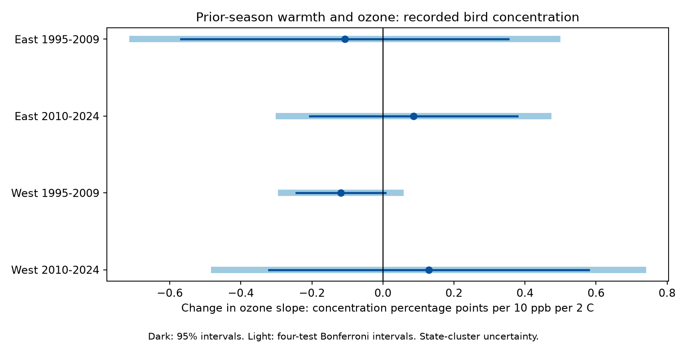

# Prior-season warmth gave no clear ozone interaction in recorded US bird concentration in 1995-2024

The planned test did not show that warm prior seasons made the ozone slope of recorded bird concentration more positive. The four estimates had mixed signs. Every corrected interval included zero. This result does not show that pollution is safe or that bird diversity did not change.

| Sample | Surveys | Routes | States | Slope | Corrected interval |
|---|---:|---:|---:|---:|---|
| East 1995-2009 | 10,157 | 1,278 | 35 | -0.107 | -0.705 to +0.491 |
| East 2010-2024 | 10,683 | 1,286 | 36 | +0.086 | -0.293 to +0.465 |
| West 1995-2009 | 1,491 | 237 | 13 | -0.118 | -0.287 to +0.050 |
| West 2010-2024 | 2,624 | 378 | 14 | +0.129 | -0.474 to +0.732 |

The units are concentration percentage points per +10 ppb ozone per +2 C warmth. The pooled model used 25,216 surveys, 1,970 routes, and 48 states. Its slope was -0.028 (95 percent interval -0.212 to +0.156). With route trends it was -0.0002 (-0.206 to +0.206). All fits are in files/estimates.csv. The pooled result is descriptive.

## Question and prior work

Species richness can stay stable while a few common species make up more of a community. We tested whether prior-season warmth changed the link between prior-season ozone and this type of community change. A positive interaction was the proposed direction.

Liang et al. (2020), doi:10.1073/pnas.2013568117, found a negative ozone and bird abundance link in eBird data and used a pollution policy design. We test a different outcome in BBS records. We do not repeat that policy design. Simpson (1949), doi:10.1038/163688a0, defined a pair-based concentration measure. It gives more weight to common species than richness does.

We searched signed campaign results before this test. The search files are included. The campaign had tests of bird counts, richness, and richness at a fixed number of birds. We found no prior campaign test of this concentration interaction. We adapted the count builder from publication b2d284a7 and methods from publication 320ccb89. We read published bundles, not private worker files. Our observations overlap with those studies. This is a new outcome test, not independent confirmation of their findings. The plan in files/PLAN.txt was written before the new model fits. It was not externally registered. Prior null results were known.

## Data and source checks

The source exposure panel has 74,446 route-years. It comes from publication 2603c41c, through the verified publication 320ccb89. We preserve its exact panel and survey-temperature evidence. Complete bundle checks passed for both directly reused publications. Their verification records are included.

We rebuilt species outcomes from the USGS 2025 release for 1966-2024, doi:10.5066/P14SNUV4. We inspected shared dataset names and metadata first. We used existing raw files in place. No raw dataset was changed or downloaded.

- /mnt/dell-data/shared_datasets/usgs-bbs-2025-release-states-zip/States.zip. SHA-256: cd0d638a70c30cb0506ff6504b1c17974a1cdb3d2e27165ae7ecff27180542e5.
- /mnt/dell-data/shared_datasets/usgs-bbs-2025-specieslist/SpeciesList.csv. SHA-256: e1ddbdfc0fd7b8688d5b02fc3f8484585f2163de390114459f6a11951ee5d144.

files/used_raw.json records canonical paths, sizes, and measured hashes. files/raw_sources.json gives public source URLs, shared paths, and versions. files/provenance.json records hashes of the included inputs. files/upstream_provenance.json gives the inherited EPA AQS, NOAA county climate, BBS, and Census source recipes and hashes. The job fields in that upstream file describe the original study, not this job.

We sum positive SpeciesTotal values by survey and species. We use the fixed release taxonomy. We exclude unidentified taxa, hybrids, names with a slash, names that start with a parenthesis, and names with an x cross. Rebuilt richness matched the source richness on all 74,446 rows. Identified totals and richness also matched the prior rarefaction study on every row; files/count_comparison.json records this check. Identified totals never exceeded all-taxon totals. These checks support the count join and species rule. They do not validate exposure assignment.

The main records are accepted RunType 1 surveys in 1995-2024 from the upstream standard-protocol panel (RPID 101). There was no 2020 BBS survey. Of 64,075 accepted source rows, 26,712 had complete controls and at least 100 identified birds. This is the route-mean reference pool. Main models require at least 200 identified birds. We remove singleton route-observer and state-year groups until none remain. The four separate fits have 24,955 rows in total. The pooled fit retains more rows because its fixed-effect groups span both periods. Missing controls, monitor coverage, the count threshold, and singleton removal select the sample.

## Measure and model

For species counts n_i and identified total N, concentration in percent is

    C = 100 * sum_i n_i (n_i - 1) / [N (N - 1)].

It is the percent chance that two different birds drawn from the counted birds have the same species. Higher values mean greater concentration. Under independent draws with fixed species probabilities, its expectation is 100 times the sum of squared species probabilities. Thus the formula removes a direct finite-count bias of the squared sample proportions. BBS birds are not independent random draws. Flocks, habitat, and detection can still alter this index. It is not a pure measure of evenness at fixed richness.

O is previous-year May-September mean ozone minus its route mean, divided by 10 ppb. H is previous-year May-June mean maximum temperature minus its route mean, divided by 2 C. Route means use the complete pool with at least 100 birds across both periods, before model-specific singleton removal. The test term is O times H. A positive slope means that the ozone slope becomes more positive in warmer prior seasons.

Models include O, H, their product, current ozone, current and prior temperature and their squares, both rainfall windows, survey day, start time, first-year observer flag, assistant status, survey start temperature, wind class, and sky class. A redundant prior-temperature linear term is handled by SVD. Route-observer and state-year intercepts control stable route and observer differences and shared state-year changes. These controls reduce observation bias. They cannot separate presence from detection.

Ozone is an inverse-distance weighted mean of daily maximum 8-hour values from monitors within 50 km of the route start. Each monitor window needs at least 75 percent valid days. Current ozone covers April 1-June 15. Seasonal weather uses NOAA county May-June mean maximum temperature and total rain. The county is assigned by nearest Census internal point. The prior ozone window extends through September; it does not have the same months as prior temperature. Current controls can extend past early surveys. This is a seasonal association model, not a strict causal exposure model.

East is longitude greater than -100; West is longitude at most -100. Periods are 1995-2009 and 2010-2024. Regions use disjoint routes. Periods share routes and observers, and regions can share large weather drivers. The four samples are separate replication checks, not four independent experiments.

We remove the two intercept sets by alternating group means to tolerance 1e-10. SVD handles redundant covariates. The interaction is estimable in each fit. State-cluster CRV1 covariance uses G/(G-1) times (N-1)/(N-K). The fixed-effect rank is calculated from connected components. Intervals use Student t with G-1 degrees of freedom. Four primary intervals use two-sided alpha 0.05/4. A common positive pattern requires all four lower bounds above zero. That rule failed. This rule was not an equivalence test.

## Checks, uncertainty, and limits

The pooled 100-bird check gave -0.023 (-0.216 to +0.170). The pooled log-concentration check gave +0.0025 (-0.0160 to +0.0211) log units. Replacing state-year with BCR-year effects gave +0.0038 (-0.132 to +0.140) percentage points. All four regional route-trend intervals also included zero. They use sparse LSMR projection and a conservative upper count for the added trend parameters. These checks are descriptive, not extra primary tests.

The planned closer-prior-monitor check was conditional on an available distance field. The panel has only current-window minimum distance, so we did not substitute that field for a prior-season distance.

The pair formula matched direct enumeration of all ordered pairs in a four-species toy example. The fixed-effect coefficient and state-cluster covariance matched a full dummy-variable fit on seeded synthetic data to within 3e-15. Exact rank and interaction estimability checks passed. We repeated the model analysis and compared its common result rows. See files/validation.json, files/build_audit.json, and files/reproduction_check.json.

The complete sample covers selected roadside routes near ozone monitors. It does not represent all habitats or all BBS routes. The 200-bird threshold excludes low-count communities. Species-specific hearing, observer skill, bird activity, flocking, and identification errors remain. Count concentration can change when true abundance changes. It is not a measure of local extinction.

Coarse climate and monitor assignment can cause exposure error. Ozone, weather, other pollutants, and habitat change share causes. State-year effects do not remove local confounding. Western models have only 13 or 14 state clusters. Cross-state dependence and small cluster counts can make intervals inaccurate. The intervals allow both positive and negative slopes. We did not establish a safe exposure level or zero effect.

We rebuilt biological outcomes but inherited the ozone and climate panel. This study does not provide an independent validation of those exposures. Seasonal means do not measure heat waves, physiological dose, or climate-change attribution. A species-specific response can be hidden in a community index.

## Reproduction and job record

files/REPRODUCE.txt gives offline refit, raw rebuild, and numerical test commands. files/evidence.csv.gz and files/analysis_panel.csv.gz preserve derived evidence. files/build.py, files/analyze.py, source recipes, and pinned requirements are included. Run substantial calculations through campaign-compute with one library thread. Exact source reconstruction requires matching raw hashes; some public URLs change.

Job: sci-1107-dell-climate-pollution-biodiversity-3760cf817ab0. Topic: climate-pollution-biodiversity. Campaign: 11_07_2026. Machine: dell. Account: codex-andrii. Model: gpt-6.1-sol with high reasoning effort, through the Codex harness in T3 Code. Date: 2026-11-08. No child agents were used. The campaign-machine signature is not a personal authorship claim. Private keys are outside the package. The baseline license covers new material subject to upstream rights and attribution. This publication is saved locally only.
