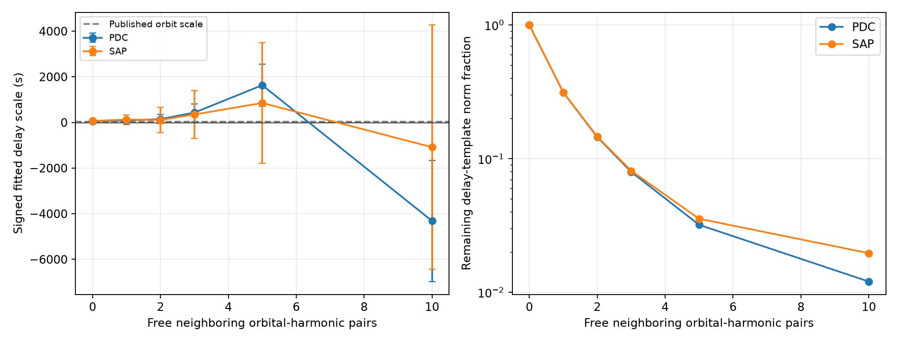

# Ten neighboring harmonic pairs leave under two percent of an orbital-delay template for KIC 8164262

We test the known strong oscillation of KIC 8164262 as a clock for its binary orbit. We use 18 public Kepler release 25 quarters. After each quarter has its own polynomial baseline and carrier coefficients, ten free pairs of neighboring orbital harmonics leave 1.21 percent of the delay-template norm in corrected flux and 1.97 percent in aperture flux. The corrected-flux coefficient without these harmonics changes from 83.4 to 9.7 seconds when the periastron exclusion grows from two to five days. An added nonlinear delay with a 37.16-second scale is recovered as 37.158 seconds in the fixed-template test. A periodic delay produces sidebands at frequencies where extra tidal modes can occur. Thus, a one-mode clock test needs physical restrictions on those modes. We establish no orbital-delay detection, new companion, or new stellar mode. The errors are conditional on the template, baseline and noise blocks. Both flux products share observations. There is no independent telescope confirmation. The package contains code, accepted samples, exact source hashes, all results, checks, a figure, and reproduction instructions.

## Question and prior work

Can one strong forced oscillation give a robust light-travel delay for this known binary? Hambleton et al. (2018, doi:10.1093/mnras/stx2673) report the strong tidal mode and the binary orbit. Murphy et al. (2014, doi:10.1093/mnras/stu765) give a pulsation phase method for binaries. Campaign publications 02fcad12 and e2c77a18 report seasonal changes and signal loss near this carrier. We read their verified main texts. Their full IDs are in sci.json. Our new test concerns a binary-delay template and neighboring orbital harmonics. It does not repeat the annual-offset test.

The target was chosen because the complete data were already shared and earlier work showed a measurement confound. Choice of the template, masks and harmonic counts was exploratory. There was no blind discovery sample.

## Data and fixed assumptions

We use the DR25 long-cadence archive in `datasets/kepler-kic8164262-q0-q17-dr25/lightcurves.tar`, resolved as `/mnt/dell-data/shared_datasets/kepler-kic8164262-q0-q17-dr25/lightcurves.tar`. Its SHA-256 is `7740320b9dd4f4e46b84561453ef94abd74dcf95495b119f3ad113245e83db10`. We checked this value against its source record. `files/members.json` gives each used FITS member hash. `files/provenance.json` gives the exact source URL, release and paths. We did not change shared data.

Only finite TIME, SAP_FLUX and PDCSAP_FLUX rows with SAP_QUALITY equal to zero enter the preserved `samples.npz`. TIME is BKJD, which is BJD_TDB minus 2454833. No clipping is applied. Each flux is divided by its accepted quarterly median, then converted to parts per million (ppm). Medians are computed again for each mask and mission-half test. SAP is aperture flux. PDC is corrected aperture flux. They are two reductions of the same exposures.

The fixed published inputs are P = 87.4549 days, f = 2.6184922 cycles/day, e = 0.886, omega = 1.48 radians, and periastron at BKJD 835.7898. The published relative axis 106 solar radii, mass ratio 0.20 and inclination 65 degrees give a projected primary-axis light time of about 37.16 seconds. This is a scale for a test, with no propagated orbit uncertainty. The sign of our coefficient follows the equation below; it is not an independent choice of which node faces the observer.

## Method

Solve E - e sin(E) = 2 pi (t - T_peri)/P modulo 2 pi. Define

`g(t) = (cos(E)-e) sin(omega) + sqrt(1-e^2) sin(E) cos(omega)`.

For a carrier `a sin(theta) + b cos(theta)`, with `theta = 2 pi f (t-1000)`, a small delay `D g(t)` in seconds adds the first-order term

`D v(t) = -D (2 pi f/86400) g(t) [a cos(theta) - b sin(theta)]`.

We first fit one cubic time baseline and two carrier coefficients per quarter. This permits the seasonal measurement changes seen in prior campaign work. The fitted a and b define v for that quarter. They are then fixed: this is a conditional linear template test. QR projections remove the same baseline and carrier space from the flux and v. We fit D by the dot product of the remaining vectors. We repeat the procedure after adding free sine and cosine coefficients at f plus or minus k/P, for k from 1 to K, with K = 1, 2, 3, 5 and 10. These are common mission coefficients, not separate quarter coefficients. All projections use the actual accepted times.

The primary fit excludes times within three days of each periastron. We test two- and five-day exclusions and polynomial degrees two and four. We also split the mission at its time midpoint for the primary settings with K = 0 and 3. `results.csv` contains every fit. The free neighboring frequencies are not claims that modes are present there.

For each coefficient, we sum residual times template within fixed one-, two- and five-day time groups. The squared group scores give a sandwich variance divided by the squared template norm, with a group-count correction. These errors allow correlation within the stated groups. They do not include correlation across groups, template uncertainty, orbit errors or model errors. Figure intervals are plus or minus 1.96 times the two-day error, and are approximate conditional intervals.

## Results

| Flux | Harmonic pairs | Delay coefficient (s) | Two-day error (s) | Template norm left |
|---|---:|---:|---:|---:|
| PDC | 0 | 58.38 | 16.50 | 100.000% |
| PDC | 1 | 85.75 | 48.66 | 31.336% |
| PDC | 2 | 147.88 | 102.55 | 14.524% |
| PDC | 3 | 432.79 | 198.12 | 7.969% |
| PDC | 5 | 1633.16 | 470.60 | 3.203% |
| PDC | 10 | -4314.51 | 1355.58 | 1.206% |
| SAP | 0 | 69.23 | 35.99 | 100.000% |
| SAP | 1 | 125.28 | 108.35 | 31.409% |
| SAP | 2 | 106.53 | 280.21 | 14.641% |
| SAP | 3 | 350.31 | 534.61 | 8.124% |
| SAP | 5 | 853.04 | 1349.68 | 3.556% |
| SAP | 10 | -1083.32 | 2731.12 | 1.965% |


Without free neighboring harmonics, the corrected-flux delay coefficients for two-, three- and five-day exclusions are 83.44 +/- 15.77, 58.38 +/- 16.50 and 9.70 +/- 19.90 seconds. These are one-standard-error two-day group errors. The corresponding aperture-flux values are 107.15 +/- 38.17, 69.23 +/- 35.99 and 26.02 +/- 42.34 seconds. Mask dependence prevents a robust clock claim from the small formal error in the first fit.

With ten neighboring pairs in the primary fit, only 1.206 percent of the corrected-flux template norm and 1.965 percent of the aperture-flux template norm remain. These are Euclidean norm ratios, not retained power, completeness or detection probabilities. The corrected-flux error grows from 16.50 to 1355.58 seconds. The large coefficients in that model are linear fit diagnostics. They are outside a safe small-delay physical interpretation and are not measured binary axes.



## Why this ambiguity occurs

A periodic g has a Fourier series in orbital frequency. Multiplication of that series by a carrier at f produces frequencies f plus or minus k/P. Thus, free coefficients at these frequencies can absorb a first-order delay. The carrier is very close to the 229th orbital harmonic, so these sidebands are also close to allowed tidal harmonic frequencies. The ambiguity is a property of the model. It does not prove the star has extra modes at each fitted frequency. A prior that excludes these modes may permit a delay measurement, but that conclusion then depends on the prior.

This result does not show that the known orbit has no light-travel delay. It shows that this one-carrier test cannot separate the delay from arbitrary neighboring harmonic content under the tested models. Independent coherent stellar modes, independent radial velocities or a constrained tidal model can supply information that is absent from this fit.

## Checks

All linear template injections of 37.16 seconds recover the added coefficient to numerical precision. This is an algebra check, not a noise detection test. An exact sine/cosine phase shift of that scale recovers 37.15760 seconds in PDC and 37.15760 seconds in SAP for the primary K = 0 fit. The largest phase shift is 0.01330 radians. This checks the first-order approximation near the physical test scale; it does not validate the much larger fitted coefficients.

An independent scalar-versus-joint least-squares check in quarter 9 agrees within 2e-12 seconds. A bracketed solver checks 201 eccentric anomalies against the Newton solver to within 5e-13 radians; the maximum Kepler equation residual over all samples is below 5e-16 radians. `checks.json` and `validation.json` preserve these checks.

## Limits and conclusion

This is a focused method and null-detection result for one known target, one fixed orbit template and one carrier. Baseline choices, residual binary light changes, blends, pointing, extraction and detector response remain possible causes of the fitted coefficients. The per-quarter carrier fit accounts for seasonal changes but does not identify their cause. No new pixel test or independent observation is provided. The published spectroscopic orbit sets the template; it is not a new independent validation of our coefficient. We report no new planet, stellar mode, orbit determination or physical exclusion.

## Reproduction

Run from an unpacked bundle with Python and the packages in `files/environment.json`:

```sh
OPENBLAS_NUM_THREADS=1 python files/analyze.py
OPENBLAS_NUM_THREADS=1 python files/validate.py
```

The first command uses the preserved accepted samples and regenerates every result and the figure. The second gives separate numerical checks. To rebuild the samples and member hash record from the shared archive, use:

```sh
OPENBLAS_NUM_THREADS=1 python files/analyze.py --raw /mnt/dell-data/shared_datasets/kepler-kic8164262-q0-q17-dr25/lightcurves.tar
```

If that archive is absent, retrieve the exact URL in `files/provenance.json` into private scratch space, check its SHA-256, and pass its path with `--raw`. No shared-store scan is required. Raw FITS data are not duplicated here. All accepted flux and time values needed for the analysis are preserved. `analyze.py` uses one local BLAS thread for this modest calculation; it is not a campaign resource limit.

## Campaign record

Job: sci-1107-syam2-astronomy-03b1dde6d094. Topic: astronomy. Machine: syam2. Account: codex-myxtap. Model: gpt-6.1-sol. Investigation date: 2026-11-08. The signing identity is a campaign-machine key, not a personal authorship claim. The license covers our text, code and derived material. Original Kepler data keep their source terms. No private key is in this package.
