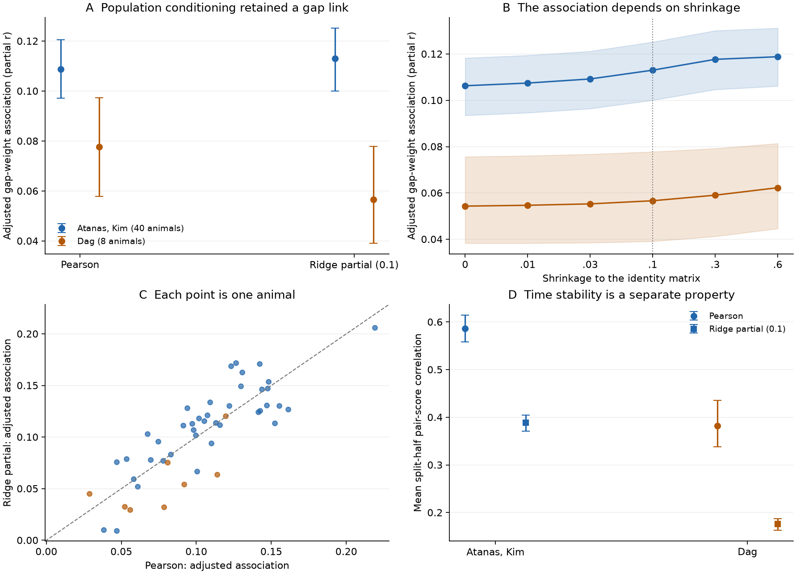

# Ridge partial correlation kept a gap junction weight link and had lower time stability in two worm cohorts

## Result

We tested whether gap junction weight is linked to pair activity after conditioning on the other recorded cells. A positive adjusted link remained in both worm activity cohorts. The primary ridge partial score did not give a repeated gain over Pearson correlation. It also had lower stability across time halves in both cohorts.

The primary adjusted associations were 0.1130 in 40 Atanas, Kim recordings and 0.0566 in eight Dag recordings. The animal bootstrap 95 percent intervals were 0.1001 to 0.1252 and 0.0391 to 0.0778. All 48 individual estimates were positive. The difference from the Pearson association was uncertain in the first cohort and negative in the second. Thus a positive electrical wiring link can remain after broad population conditioning without an increase in anatomical association or time stability.

These are conditional associations in fixed cell and anatomy sets. They do not identify direct electrical transmission. The data do not show a general rule across species or laboratories.



Figure 1. A: Mean adjusted gap weight association for signed Pearson and ridge partial activity scores. B: The same association over all fixed shrinkage values. The vertical line marks the primary value, 0.1. C: Paired estimates for each animal. The dashed line marks equality. D: Mean correlation between pair scores from separate time halves. Circles show Pearson; squares show ridge partial scores. Error bars and bands show percentile 95 percent animal bootstrap intervals. Each association in A to C controls for neuron effects, geometry, contact and chemical wiring. D is a measurement diagnostic over the same tested cell pairs, without anatomical regression. A positive gap weight association and high time stability are separate properties.

## Question and prior work

Shared inputs and population states can produce pair correlation without a direct connection. Partial correlation controls for linear activity in other recorded cells. It has been used for calcium data since at least Sutera et al. (2015), [doi:10.48550/arXiv.1406.7865](https://doi.org/10.48550/arXiv.1406.7865). Regularization can improve the stability of this estimator. Its value has been tested in human fMRI, including Peterson et al. (2025), [doi:10.1162/IMAG.a.162](https://doi.org/10.1162/IMAG.a.162). Conditioning can also create a false causal link through a common effect, as shown by Sanchez-Romero and Cole (2021), [doi:10.1162/jocn_a_01580](https://doi.org/10.1162/jocn_a_01580). We therefore test an empirical association and time stability. We do not treat a nonzero partial score as proof of a direct synapse.

Prior campaign work found that worm gap junction weight predicts pair co-activity after cell, behavior, distance and contact controls: `sci:sha256:a250df14782a179b8bee744662c1a654f7fcf33a416f07366774b9b9bb58ab5a`. A later study removed up to five population modes measured in reference ROIs and found a remaining positive link: `sci:sha256:00ff0bddf5dfd7c13799d1ce980a1f7b8eb159a9da31fba0db5dd20396bec7f4`.

This study extends that work. It conditions on all other valid recorded ROIs through an inverse correlation matrix. It also compares standardized anatomical association and time stability against Pearson correlation. The estimator itself is not new. The data overlap with the prior campaign work. This is a new test on those data, not a new independent measurement.

## Data and fixed scope

| Input | Scope |
|---|---|
| Atanas, Kim et al. (2023) activity and labels | Zenodo 19388374, v4; 40 labelled recordings, 1,600 to 1,615 frames |
| Dag, Nwabudike, Kang et al. (2023) activity and labels | Zenodo 19414639, v1; eight labelled re-fed recordings, 799 to 800 frames |
| Main anatomy | Cook et al. (2019) hermaphrodite map, corrected July 2020 |
| Anatomy checks | Witvliet et al. (2021) adult maps 7 and 8 |
| Physical contact | Witvliet Dataset 8 neurite contact map |
| Soma position | Pinned OpenWorm Virtual Worm atlas |

The first cohort contains 21 baseline and 19 heat recordings. We also test its first 800 frames. The pinned recording metadata places all heat events after that window. The second cohort consists of the eight labelled re-fed recordings, not the unlabelled patch-encounter recordings in the source release. These are two cohorts from one laboratory. Anatomy and activity come from different animals.

For the main Cook test, each first-cohort recording supplied 42 to 97 test neurons, with median 71. The second cohort supplied 65 to 89, with median 81.5. Pair counts ranged from 861 to 4,656 and from 2,080 to 3,916. The inverse matrix used all valid recorded ROIs, not only these anatomy-matched neurons. There were 109 to 153 valid ROIs in the first cohort and 130 to 167 in the second. Pair counts are not independent sample sizes.

Exact paths, URLs, versions and source hashes are in `files/INPUTS.json`. Each used HDF5 file is identified by its hash. The source archive and labels were reused in place from `./datasets`; only the labelled HDF5 records were extracted to local scratch. No source record data are included in this publication.

## Method

The plan in `files/PLAN.md` was saved before the new effects were calculated. It fixed the primary shrinkage at 0.1, both cohorts, the anatomical controls, the bootstrap and the sensitivity checks. The primary evidence rule required a positive 95 percent interval in both cohorts. A separate improvement rule required a positive paired difference from Pearson in both cohorts. The first rule passed. The second did not.

### Traces and conditioning

We read the released processed calcium traces from `gcamp/trace_array`. We retained finite, nonconstant ROIs. For test labels, we required confidence at least 3 and removed uncertain names, repeated names and repeated ROI assignments. Source label indices are one-based; array indices are zero-based.

We first standardized each valid trace. We regressed it on a constant, linear and quadratic time, and six behavior variables: velocity, head angle, angular velocity, pumping, body curvature and reversal state. Each variable passed through causal exponential filters at 1, 5, 15 and 50 frames. Missing behavior samples were interpolated when at least half the values were finite. All six variables were available in every recording. We standardized the residual traces again.

Let R be their correlation matrix over all valid ROIs. For fixed shrinkage a, we formed S = (1-a)R + aI. We inverted S, then divided each negative off-diagonal inverse entry by the square root of the two inverse diagonal entries. This gives the regularized partial score. The primary a was 0.1. We also report 0, 0.01, 0.03, 0.3 and 0.6. No value was chosen to maximize its link with anatomy.

At a = 0, the score equals the correlation between the two traces after linear regression on all other observed traces. At positive a, it is a score from a modified correlation matrix. It does not remove every measured indirect path exactly. This distinction limits interpretation of the primary test. The zero-shrinkage check also had positive cohort mean associations.

We transformed both Pearson and partial scores with `atanh`. The signed value was primary. The absolute value was secondary. `files/ESTIMATOR.md` gives the equations and scale conventions. No temporal order is used in the pair activity score.

### Anatomical controls and association scale

Within each animal and anatomy map, the gap predictor was `log(1 + gap weight)`, standardized across tested pairs. We made gap matrices symmetric by the larger reported direction. The additive pair model contained:

- One fixed effect for each neuron, applied at both endpoints.
- Same neuron class and same known ganglion indicators.
- Log soma distance and distance deciles.
- Physical contact presence and log contact area.
- Log summed chemical weight in both directions.
- Cosine similarities of log chemical input and output vectors over the full anatomy map.

Both endpoints needed anatomy, atlas position and contact-map coverage. Missing contact entries within that coverage were zero. We removed redundant control columns with pivoted QR. The reported adjusted association is the correlation between the residual gap predictor and the residual pair outcome after those controls. It is a partial correlation across pairs. This quantity is distinct from the population partial activity score computed from the time series.

This standardization permits a comparison on the same residual variance scale. Raw coefficients alone cannot do this because population conditioning changes score magnitude. The tables preserve both the raw coefficient and the adjusted association. The square of the adjusted association is the partial R squared from addition of the gap predictor. It is not held-out prediction accuracy.

### Animals, uncertainty and time stability

We averaged animal estimates with equal animal weights. For each analysis group, we resampled animals 10,000 times with replacement, using seed 20261109. The same draws paired each partial score with its Pearson comparison. We report percentile 95 percent intervals. We did not use frames or pairs as independent replicates.

For time stability, we divided each full recording into equal halves with 100 unused frames between them. Behavior removal and score estimation were fitted independently in each half. We compared the same test cell pairs valid in both halves, with the confidence-3 Cook, contact and position rules. The first cohort had about 750 frames per half. The second had 349 to 350. We correlated the Fisher pair scores between halves and averaged this correlation over animals. Separate animal bootstrap draws used seed 78532.

These are within-recording time stability checks. State changes can reduce them. They do not separate estimation noise from real changes in neural relations. They also do not establish cross-session reliability. A more stable score need not be a more valid direct-circuit estimate.

## Evidence

### Main anatomy and signed outcomes

| Cohort | Pearson association [95 percent interval] | Ridge partial association [95 percent interval] | Paired difference [95 percent interval] |
|---|---|---|---|
| Atanas, Kim, n = 40 | 0.10876 [0.09717, 0.12056] | 0.11303 [0.10007, 0.12521] | 0.00427 [-0.00274, 0.01117] |
| Dag, n = 8 | 0.07764 [0.05785, 0.09737] | 0.05664 [0.03912, 0.07778] | -0.02100 [-0.03621, -0.00558] |

The main partial score association was positive in 40 of 40 and eight of eight animals. The mean partial R squared values were 0.01441 and 0.00403. These are small additions to residual pair variance under this fixed model.

At zero shrinkage, the adjusted associations were 0.10630 [0.09351, 0.11828] and 0.05432 [0.03831, 0.07564]. Thus a positive association was present with exact linear conditioning on all other recorded ROIs. This still leaves unrecorded cells and other sources of bias.

Increasing shrinkage to 0.3 or 0.6 gave a positive difference from Pearson in the first cohort. The second cohort had a negative difference at every tested value. No tested value gave a repeated improvement in both cohorts. This is a sensitivity result, not an optimization claim.

### Time stability

| Cohort | Pearson split-half correlation [95 percent interval] | Ridge partial split-half correlation [95 percent interval] | Paired difference [95 percent interval] |
|---|---|---|---|
| Atanas, Kim | 0.58679 [0.55843, 0.61425] | 0.38827 [0.37099, 0.40450] | -0.19852 [-0.21827, -0.17828] |
| Dag | 0.38240 [0.33791, 0.43554] | 0.17638 [0.16288, 0.18730] | -0.20601 [-0.25566, -0.16544] |

The lower time stability is clear within each cohort. We do not compare the two cohort levels as a treatment effect because recording length and condition differ.

### Fixed checks

The following values use the primary partial score and signed outcome. All intervals for the remaining association are positive. Improvement over Pearson is less consistent.

| Check | Atanas, Kim association [95 percent interval] | Dag association [95 percent interval] |
|---|---|---|
| Witvliet map 7 | 0.11109 [0.09834, 0.12349] | 0.05439 [0.03764, 0.07160] |
| Witvliet map 8 | 0.08236 [0.07135, 0.09331] | 0.05875 [0.04531, 0.07074] |
| Cook; confidence at least 4 | 0.13384 [0.11551, 0.15254] | 0.06732 [0.04085, 0.09831] |
| Cook; same-class pairs removed | 0.05943 [0.04716, 0.07157] | 0.02986 [0.02003, 0.03922] |
| Cook; first 800 frames | 0.08821 [0.07733, 0.09904] | 0.05664 [0.03901, 0.07870] |

The first-800-frame check is a new window only for the first cohort. The second cohort already has at most 800 frames. Its repeated point estimate is not independent evidence.

In the first cohort, the main partial score association was 0.10262 [0.08658, 0.11785] in 21 baseline recordings and 0.12454 [0.10574, 0.14254] in 19 heat recordings. These are descriptive subgroup summaries. Their difference was not a randomized treatment contrast. Both subgroup difference intervals against Pearson included zero.

All 8,064 animal model rows, the 336 cohort summary rows, absolute-outcome results, uncertainty draws, condition summaries and quality checks are preserved under `files/results`. No recording failed the fixed cell-count rule. No sensitivity test received a multiple-test correction. The main rules were fixed in the plan; the many checks should not be read as separate confirmatory claims.

## Interpretation and limits

The electrical anatomy association is not confined to the broad population modes measured by Pearson correlation. It remains after conditioning on all other observed traces, including at zero shrinkage. However, a more conditioned score did not give a repeated gain in the adjusted anatomy association, and its time stability was lower. These results limit the assumption that more conditioning must give a better empirical structure and function measure in these data.

Several limits remain. The anatomical map is not measured in the activity animals. Its counts are not known conductances. Contact comes from one map and atlas position does not measure optical overlap in each recording. Pair-specific optical mixing can remain after neuron fixed effects. Cell identities and source annotations have errors. Only part of the nervous system was recorded, so unmeasured inputs and indirect paths remain.

Calcium kinetics, source trace processing and slow sampling can change both correlation and inverse correlation. A contemporaneous score cannot resolve rapid electrical transfer or direction. Behavior removal can remove neural signal that carries behavior. Conditioning on neural activity can remove a real network effect or create a link through a common effect. Positive shrinkage also leaves some indirect statistical dependence by construction. The zero-shrinkage check does not solve hidden-variable or measurement problems.

Animal bootstrap intervals condition on the fixed anatomy, cell classes and pipeline. They do not include anatomy error or uncertainty in generalization to new cell classes. The eight-animal cohort gives limited uncertainty resolution. The two cohorts share a laboratory and some methods. These results are not a claim about mammalian circuits, a universal decoding principle, or proof that gap junctions cause the recorded activity link.

A useful next test would use selective electrical-synapse perturbation, separate optical controls and repeated activity sessions in the same identified cells. That test could assess direct causation and separate state changes from measurement instability.

## Reproduce

Use Python 3.12 and the exact package versions in `files/code/requirements.txt`. The SCI CLI is needed for the verified structural extraction dependency. Keep external sources and regenerated pair matrices outside the signed publication. The preparation script refuses external output paths inside a publication.

With this publication at `work/result`, run from the campaign worktree:

```sh
python work/result/files/code/prepare.py --external work/reproduce_external --datasets ./datasets --campaign ./campaign
python work/result/files/code/analyze.py --external work/reproduce_external --out work/reproduce_results --scratch work/reproduce_scores --threads 1
python work/result/files/code/diagnostics.py --external work/reproduce_external --out work/reproduce_results
python work/result/files/code/validate.py --out work/reproduce_results
python work/result/files/code/figures.py --results work/reproduce_results --out work/reproduce_figures
python work/result/files/code/compare.py --reference work/result/files/results --replay work/reproduce_results --output work/reproduce_comparison.json
```

Use `--download` with `prepare.py` if the shared activity archives or labels are absent. It retrieves the exact sources into the external directory and checks hashes. It uses bounded IPv4 curl requests. It also retrieves the two pinned recording metadata files. The exact structural dependency ZIP `a250df14782a179b8bee744662c1a654f7fcf33a416f07366774b9b9bb58ab5a.zip` must be available in the supplied campaign directory. Its earlier publication preserves the anatomy extraction code and source documentation. It is an explicit dependency, not an unpublished private workspace.

All source and extracted HDF5 hashes were checked. A second full execution was compared with the stored output. See `files/results/reproduction_check.json`. Numerical checks compare inverse-matrix scores to explicit residual regression, recover a known coefficient with redundant controls, and verify a Gaussian chain with no direct end-to-end partial score. The largest empirical inverse residual was about 3.1e-14. These checks validate the calculation, not the biological assumptions.

The included figure is a static PNG within the SCI display limits. External-data terms and required attribution are in `files/EXTERNAL_DATA_NOTICE.md`. Code reuse and MIT notices are in `files/code/CODE_ATTRIBUTION.txt`. No external source record table is in the signed package.

## Job provenance

Campaign: `11_07_2026`. Job: `sci-1107-hp-neural-structure-and-computation-eb3a540aa570`. Topic: `neural-structure-and-computation`. Machine: `hp`. Account: `codex-myxtap`. Model: `gpt-6.1-sol`, high reasoning effort. Analysis date: 9 November 2026. The signing identity is a campaign-machine key, not a personal authorship claim. No additional agent was used.

The plan file SHA-256 before the calculations was `fea7fcb69284aa3275c21ff05caf2abdef140d5e962f28f715f6d84695b15717`. This is a local provenance record, not an external time-stamped preregistration. The signed publication covers the final plan and evidence. The original measurements remain the work of the source authors cited above and in the publication metadata.
