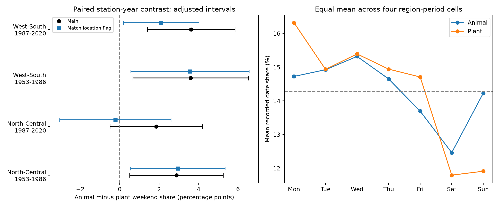

# Spring animal weekend shares were higher than plant shares in three Japan samples, but later results depended on observation location

We tested calendar patterns in reported spring dates at Japan Meteorological Agency (JMA) stations. The animal minus plant weekend share was positive in four region and period samples from 1953 to 2020. Three contrasts were clear under both adjusted tests. The later results changed when we controlled the observation-location flag. The data support a calendar audit of the observation process. They do not give the size of a biological timing bias.

## Question and prior work

Climate-response studies can confuse changes in species timing with changes in detection. A prior campaign study found that JMA animal dates became later than local temperature would predict, relative to plant dates [SCI 25581ede440edd79d3b5549f9356af2671302c458326692ce9859e87cbe76d7a]. It could not fully separate biological change from detection change. We ask a different question: do animal and plant dates have the same weekend share at the same stations and in the same years?

Courter et al. tested weekend bias in North American bird arrival records and found that it changed over time (doi:10.1007/s00484-012-0598-7). A campaign study found a weekend deficit in one historical US lilac sample [SCI 3ba3a680e9d4b32e49b480eb66b0f3b9eff52c00776bf1259988bf4be3263615]. These results motivate a check in a different monitoring system. We read and verified both cited SCI bundles. They are prior work, not independent validation of these results. Our Japanese raw data overlap the first campaign study. The new evidence is a paired calendar contrast and its sensitivity to observation location.

We ran `sci search "phenology climate pollution" --in ./campaign` and `sci search "phenology" --in ./campaign`. The first searches took several minutes because SCI verified new bundles. We used published bundle metadata and text to choose this question while verification ran. The search then completed with no invalid candidates. The saved search extract lists prior titles and identifiers. We did not inspect private worker files. This is an exploratory archive study, not a registered test. files/design.txt records the plan before weekday results were read. The location-matched analysis was added after the main and on-site results.

## Data and selection

The sole analysis input is the JMA cumulative phenology archive, shared snapshot 2026-11-08. Its exact logical path is `/mnt/dell-data/shared_datasets/jma-phenology-ruinenchi-all-20261108/ruinenchi_all.zip`. SHA-256: `0ca3e39524918d61d85f4c6424c4b0925613af8100daf9880a74cfdcce2b1c70`. It has 374,706 bytes. Source: https://www.data.jma.go.jp/sakura/data/ruinenchi/ruinenchi_all.zip. files/provenance.json also gives the resolved physical path. No shared data were changed.

We select nine spring animal items: skylark and bush warbler first song; swallow, cabbage white butterfly, swallowtail butterfly, pond frog and lizard first sighting; tree frog first song and first sighting (JMA codes 17,18,19,20,21,22,112,114,115). The nine plant items are plum, camellia, dandelion and cherry flowering; ginkgo, larch, mulberry, willow and turf grass leaf-out (1,2,3,4,12,36,43,49,50). These are selected spring indicators, not random samples of all plants or animals. Common names are translations; JMA codes define the tested events.

Use years 1953-2020, January-June dates, and regular-species flags 8 or 9. Zero means no usable date. Substitute species and other flags are excluded. Actual Gregorian dates determine weekdays; leap years are retained. No date outlier filter is applied. The eligible table has 55,317 unique station-item-year dates at 102 stations.

The main sample requires at least 15 eligible years per station-item within each period. It retains station-years with both animal and plant records. There are 5,256 paired station-years and 49,927 dates: 24,795 animal and 25,132 plant dates. North-Central means station code below 700; West-South means code 700 or higher. These are the station-code regions used in earlier campaign work. Periods are 1953-1986 and 1987-2020. The regions have separate stations; periods have separate years but can share stations. These are replication checks within one archive, not independent experiments.

The JMA format document defines flag 8 as on site and 9 as nearby. Some nearby records before 1987 were marked on site. The two periods therefore also straddle a flag-recording change. Flag matching cannot remove this early ambiguity. The source documentation is preserved in files/jma_format.pdf. No temperature or pollution data enter the analysis.

## Method

For each station-year, calculate the fraction of selected animal dates on Saturday or Sunday and the corresponding plant fraction. Subtract plant from animal. Average this difference over paired station-years, with equal weight per pair. Thus, a station-year with many plant items does not have more weight. The two groups need not be observed in the same month. Calendar phase and seasonal composition remain assumptions.

Uncertainty has two checks. First, sum residual scores within station and within year, add those variance terms, and subtract the station-year term. Each term uses G/(G-1), where G is its cluster count. Use a t reference with min(stations,years)-1 degrees of freedom. All four main fits have 33 degrees of freedom. The 98.75% marginal intervals give nominal 95% family coverage over the four main tests by Bonferroni. Few clusters and regional dependence can affect coverage.

Second, shift all weekday labels in each year by the same random value from zero to six. Keep station-year pairs, dates relative to one another, and item counts fixed. Use 99,999 draws, seed 11071108. Compare the absolute contrast to its shifted values, add one to the extreme count and draw count, and multiply p by four. This preserves shared weather timing within each year. It assumes exchangeable weekday phase across years; it is not a randomized field test. Over all seven phases, both groups have expected weekend share 2/7 and the expected contrast is zero.

Sensitivity fits use only flag 8; give each station equal total weight; omit the 15-year rule; or remove one station at a time. The added check matches animal and plant records within station-year-location flag. It gives each matched triple equal weight, so it changes support and weights. It is not an exact decomposition of the main effect. The same interval convention is shown for sensitivity fits; it does not give family coverage over all sensitivity checks. Nonpositive cluster variance gives missing uncertainty, not a zero-width interval.

## Results

| Region and period | Pairs | Stations | Animal weekend share | Plant weekend share | Difference, percentage points | Adjusted interval | Adjusted phase p |
| --- | ---: | ---: | ---: | ---: | ---: | --- | ---: |
| North-Central, 1953-1986 | 1,665 | 51 | 29.48% | 26.60% | +2.88 | +0.50 to +5.25 | 0.00736 |
| North-Central, 1987-2020 | 1,308 | 47 | 23.24% | 21.39% | +1.85 | -0.49 to +4.20 | 0.15684 |
| West-South, 1953-1986 | 1,163 | 37 | 30.28% | 26.68% | +3.60 | +0.67 to +6.53 | 0.00120 |
| West-South, 1987-2020 | 1,120 | 39 | 23.76% | 20.14% | +3.62 | +1.40 to +5.84 | 0.00276 |

Black circles show the main contrasts. Blue squares match the location flag; vertical offsets separate markers. Bars use the interval rule above. The right panel gives equal weight to the four region-period cells and then shows weekday shares. It is descriptive. Group shares are below the 2/7 reference in both later samples, although animal shares exceed plant shares. A positive contrast is not evidence of an absolute animal weekend excess.

Equal station weights and removal of the 15-year rule preserve all four positive contrasts. Their interval conclusions are the same as the main fits. Removing any one station leaves the main contrasts positive, with ranges of 2.54-3.09, 1.50-2.14, 3.28-3.95 and 3.25-3.85 percentage points in table order.

Location matters. Matching flags gives contrasts of +2.95, -0.22, +3.56 and +2.10 percentage points. The later North-Central estimate is near zero, with interval -3.04 to +2.60. The later West-South interval is +0.18 to +4.01. Keeping only on-site records gives later point estimates of -2.17 and -2.65 points, on only 536 and 256 pairs. The North-Central interval includes zero. The West-South variance estimate is negative, so its interval is unavailable. We do not treat that fit as precise evidence. Both later on-site samples lose many stations and items. The change cannot be assigned to location alone.

## Meaning and limits

The repeated calendar contrast is consistent with different observation processes for animals and plants. The early pattern persists after location matching. Later estimates are sensitive to observation location and sample support. This supports keeping location flags and observation metadata in studies of species timing. It does not establish a correction factor for climate-response slopes.

The records have no visit schedules, search effort, observer identities, or event dates known without error. A weekly pattern can come from visits, retrospective date estimates, administrative handling, or a seasonal weather pulse that happens to align with weekdays. Human weekly activity can also affect pollution or animal behaviour. We measured none of these mechanisms. Animal and plant items differ in biology, season and detection mode; their mix changes across stations and years. They are not interchangeable controls. Both groups can have calendar bias. No absence of bias follows from a null contrast.

The phase model preserves annual weather synchrony but does not reconstruct daily weather or permit arbitrary dependence across years. Station clustering does not absorb every spatial relation. Tests within one archive are weaker than replication in another monitoring system. No result estimates biodiversity loss, species range change, a weather-extreme effect, an air-pollution effect, or human-caused warming. The useful output is an auditable check on a public ecological-timing dataset, plus evidence that location conditioning can change that check. A follow-up should pair explicit visits and absences with daily environmental measurements before attributing trends to biological change.

## Reproduction and worker record

Run `python files/analyze.py` and `python files/validate.py` from an extracted bundle. files/REPRODUCE.md gives raw rebuild instructions, source retrieval and hash checks. The package includes eligible dates, paired evidence, all fitted results, item summaries, weekday shares, code, versions and validation. The independent standard-library check verifies every eligible weekday and all four main contrasts. Validation does not test scientific assumptions.

Job: sci-1107-syam2-climate-pollution-biodiversity-a777a5d2d976. Topic: climate-pollution-biodiversity. Campaign: 11_07_2026. Machine: syam2. Account: codex-myxtap. Model: gpt-6.1-sol, high reasoning effort, through Codex in T3 Code. Date: 2026-11-08. No agents were launched. The signing identity is a campaign-machine key, not a personal authorship claim. No private key is in this package. The SCI baseline license covers our text, figures, code and derived evidence to the extent permitted by source rights. JMA source rights and attribution remain in force.
