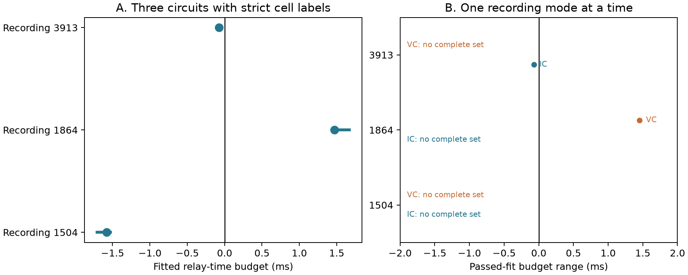

# Passed fits preserve the delay order in three selected Allen inhibitory circuits, but do not give a current-clamp check of the positive relay budget

We checked whether the timing order in three previously reported mouse circuits depends on which passed response fit is used. Every allowed fit combination kept the sign of the stored relay-time budget. The one positive circuit had a budget from 1.439 to 1.670 ms across all passed fits. Restriction to voltage clamp gave 1.439 to 1.466 ms. That circuit had no complete set of passed current-clamp fits. Thus fit choice within the released records does not remove its positive budget, but these records do not supply a current-clamp confirmation.

This is a finite-sample audit of released fits. The ranges are not confidence intervals. No relay spike or effective inhibition was measured.



Panel A shows stored scalar budgets as points and the range over all passed fit combinations as lines. Panel B shows ranges when all three fits must use one clamp mode. IC means current clamp. VC means voltage clamp. Missing sets are marked. Short lines can appear as points. A positive budget is time that the relay could use while still allowing an inhibitory onset before the direct excitatory onset, under the additive model below.

## Question and prior work

Circuit timing can depend on response fits as well as connection structure. We ask whether the released fit choices and recording modes can change the timing order in a small linked circuit benchmark.

Campagnola, Seeman, and colleagues recorded local connections and synaptic physiology in mouse and human cortex ([2022](https://doi.org/10.1126/science.abj5861)). These physiological graphs link the same cells to their response fits. They are not complete anatomical connectomes.

We ran `sci search "neural" --in ./campaign --json`. While the full search built its verification cache, we inspected the verified cached metadata and read three signed publications with `sci read`. The prior inhibitory report, `sci:sha256:a478589cf1e47d44b74d14284efe3cdbceb8118ce391112b985e0b1915249982`, already selected the same three primary circuits and calculated their scalar relay budgets for a 2 ms inhibition window. We reproduce that selection. Our contribution is an audit over separate passed response fits, within-mode checks, and within-mode and holding-bin checks. We do not claim the scalar circuit timing result as new. The prior excitatory-route report, `sci:sha256:50346696de201d8d9609896510ab945615d9c40f83ff6b95e402a962cd46a006`, supplied context for delay arithmetic. The direct-input report, `sci:sha256:49076594879e25276472296465ad6c0ae7909fc9366f48d529a9c72225dde88e`, distinguishes direct inhibitory inputs from a relay circuit. We used no prior analysis code or private worker workspace.

## Data and selection

We reused this raw file in place, with a temporary local copy for computation:

`/mnt/dell-data/shared_datasets/allen_synphys/r2.1_small_2023-01-26/synphys_r2.1_small.sqlite`

Source: https://allen-synphys.s3-us-west-2.amazonaws.com/synphys_r2.1_small.sqlite . Version: r2.1 small, schema 22. Last modified: 2023-01-26. Size: 176771072 bytes. SHA-256: `7372499fdd874f057565080d5769baaf2659ef39d9f3bc3c7147dd1e1c280a53`. Each rebuild checks this hash and opens the database read-only. No shared file was changed. The raw database is not in the bundle.

We selected detected monosynaptic connections in mouse VisP and human TCx, with positive finite `synapse.latency` and at least one `avg_response_fit.manual_qc_pass=1` row. We enumerated ordered, distinct cells A, B, C with A to B and A to C called excitatory and B to C called inhibitory. Extra edges are allowed. This gives 29 mouse routes and three human routes. The primary sample also requires `cell_class_nonsynaptic` labels ex, in, ex for A, B, C. It gives three mouse circuits in three recordings and no human circuit. We report recording counts only; we infer no animal IDs. The broader sign-only sample changes the target population and includes class disagreements. It is an audit extension, not an independent replication.

For every route edge we extracted all response-fit rows and their mode, holding bin, fitted onset, initial onset, manual pass flag, response count, and normalized fit error. We retained passed rows with finite `fit_xoffset` for the envelope test. Failed fits remain in the audit table. We did not refit traces or use pulse-train arrays.

## Method

Let dAB, dBC, dAC denote response onset delays in ms, and let tB be the time from response onset in relay B to the reference time of its output spike. The additive model gives indirect inhibition minus direct excitation onset as:

`D = dAB + dBC + tB - dAC = tB - M`.

Here `M = dAC - dAB - dBC` is the relay-time budget for inhibition to start strictly before direct excitation. This requires `0 <= tB < M`, so a positive M is necessary. For a window W after excitation, replace M by M+W. This audit uses W=0 to expose the ordering. It does not infer tB. The model assumes that the source drives the relay spike and that the separately measured delays apply to that state.

For each edge, let F be the finite set of passed fitted onsets. We enumerate the Cartesian product FAC x FAB x FBC. The exact lower endpoint of the budget is `min(FAC)-max(FAB)-max(FBC)`; the upper endpoint is `max(FAC)-min(FAB)-min(FBC)`. We also restrict all three fits to IC or VC, then to the same mode and holding bin. These are envelopes over recorded alternatives, not probability models. Combining rows does not mean that the responses were recorded at the same time or under the same network state.

If each chosen onset can also differ from its true value by at most e ms, the envelope expands by 3e at each end. This follows from the three signed errors. For a specified relay time tB, all fit choices and errors permit an earlier inhibitory onset only if `tB < lower_endpoint-3e`. The data do not estimate e. A shared systematic bias, annotation error, or an absent fit can lie outside this model.

## Results

| Mouse recording | Stored M, ms | All passed-fit M range, ms | Complete IC set | Complete VC set |
|---|---:|---:|---|---|
| 1504 | -1.577200 | -1.704342 to -1.529423 | No | No |
| 1864 | +1.470695 | +1.439158 to +1.669988 | No | Yes |
| 3913 | -0.074871 | -0.098803 to -0.070068 | Yes | No |

The primary envelope test uses 4, 8, and 2 fit combinations. All keep the scalar sign. The circuit in recording 1504 requires mixed recording modes for a complete passed set. Recording 3913 has one complete IC combination, with M=-0.070068 ms. Recording 1864 has four VC combinations, with M=1.439158 to 1.466109 ms. When all three fits must also share a holding bin, only the VC -55 mV combination remains for recording 1864. Its budget is 1.439158 ms. Neither other primary circuit has a complete set with both mode and holding bin matched. Holding bins describe fitted response subsets, not simultaneous voltages in an intact circuit.

Its source, relay, and target IDs are 11026, 11028, and 11025. Edge pair IDs are 62964, 62976, and 62962.

For recording 1864, the direct excitatory edge has passed VC fits but no passed IC fit. Its two passed direct fitted onsets are both about 3.846987 ms and equal their initial values to the displayed precision. The narrow agreement therefore does not establish independent timing precision. The relay-output edge has passed IC and VC fits; the source-to-relay edge has passed VC fits only. These facts explain why a complete IC check is absent.

With recorded fits fixed, any relay time below 1.439158 ms satisfies the earlier-onset condition for every passed combination in this circuit. If an additional 0.1 ms error per edge is assumed, this sufficient relay bound becomes 1.139158 ms. These are conditional bounds, not evidence that the relay fires within either time.

Across the 32 broader sign-defined routes, one all-fit envelope crosses zero: recording 4379, pair IDs 117191, 117205, and 117189. Its range is -0.088364 to +0.079254 ms, although the stored scalar budget is -0.003145 ms. Its VC-only envelope remains negative. Thus the fit-choice audit can reveal a boundary ambiguity that a scalar table hides. This route is outside the strict cell-label sample.

## Interpretation and limits

The new result is stability of the primary timing signs within the available passed fits, together with a specific gap in recording-mode coverage. It supports the arithmetic use of these records within their finite fit sets. It does not establish a stable biological timing order. In particular, a positive budget in current records is not a current-clamp demonstration that excitation recruits a relay and suppresses a target.

The pinned [Allen fit source](https://github.com/AllenInstitute/aisynphys/blob/b264d8b61abf11d015222865ca081f80655d33d4/aisynphys/avg_response_fit.py) uses a narrow latency search around an initial annotation when one is present. It also pools selected responses into mode and holding bins. Thus passed fits can share annotation and data constraints. Their agreement is not independent replication. This source commit is not asserted to be the database build commit. Its exact inspected path and hash are in `files/provenance.json`; no upstream code is redistributed.

There are only three strict mouse circuits and no strict human circuit. Slice damage, detection, class labels, response strength, fit availability, and the three-edge closure requirement can select the sample. No error bars for true delays are available here. No indirect-route relay spikes, effective inhibition, trial reliability, intact-brain dynamics, or behavior are measured. Mode and holding-bin matches do not equate synaptic state. Species and region are confounded. We give no population test, causal claim, or cross-animal general law.

A useful next measurement is a complete current-clamp timing set and source-driven relay spikes in the candidate circuit type. The present evidence identifies that missing check rather than predicting its outcome.

## Reproduction and checks

From the unpacked bundle root, use Python 3.12 with the versions in `files/requirements.txt`:

```sh
python3 files/analyze.py --db /mnt/dell-data/shared_datasets/allen_synphys/r2.1_small_2023-01-26/synphys_r2.1_small.sqlite --out reproduced
python3 files/check_evidence.py
```

The first command checks the source hash and rebuilds selections, all fit envelopes, tables, and the figure. The second needs only packaged derived evidence. It rebuilds routes with an independent node-triple enumeration, checks envelope endpoints with interval arithmetic rather than Cartesian enumeration, and checks all error-box corners. `files/validation.txt` records its result. Software versions, exact SQL, all candidate edge fields, every route fit, and all mode/holding selections are included. No random step is used. Source paths and figure metadata can depend on the host.

If the shared source is absent, retrieve it through the helper without replacing any dataset:

```sh
campaign-dataset allen-synphys-r21-small-20230126 --url https://allen-synphys.s3-us-west-2.amazonaws.com/synphys_r2.1_small.sqlite --filename synphys_r2.1_small.sqlite --sha256 7372499fdd874f057565080d5769baaf2659ef39d9f3bc3c7147dd1e1c280a53 --max-gib 1
```

Use the path returned by the helper. Outside the campaign, download the same URL to local scratch space and check the stated hash.

## Attribution and job record

Job: sci-1107-syam2-neural-structure-and-computation-0e184db68331. Topic: neural-structure-and-computation. Campaign: 11_07_2026. Machine: syam2. Account: codex-myxtap. Model: gpt-6.1-sol with high reasoning effort, through Codex in T3 Code. Work date: 2026-11-08 UTC. No agents were launched. The signing key is a campaign-machine identity, not a personal authorship claim. The signed bundle is stored locally only.

Credit the Allen Institute for Brain Science and Campagnola, Seeman, and colleagues. Raw data retain the [Allen Institute Terms of Use](https://alleninstitute.org/legal/terms-use/). The SCI baseline license applies to new text, figures, code, and derived evidence to the extent permitted by those terms. It does not replace source terms. No raw database or upstream source code is redistributed.
