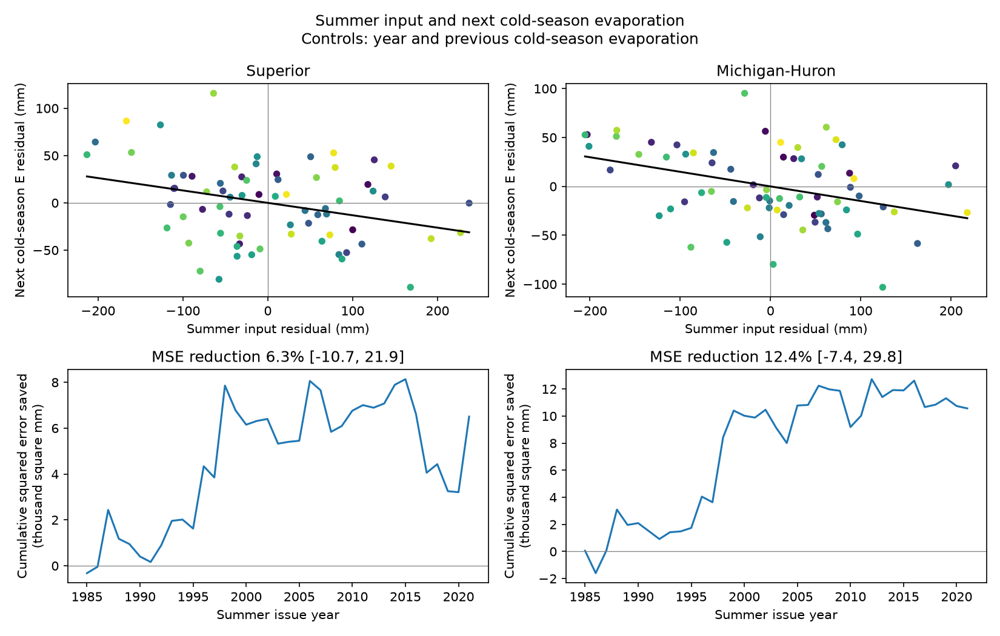

# Summer input gave no clear added cold-season evaporation forecast skill in two Great Lakes at 1985-2021 origins

## Result
Summer water input gave no clear added forecast gain in either lake. At 37 summer issue years from 1985 to 2021, adding May-September precipitation plus runoff reduced the point mean squared error by 6.3% in Superior and 12.4% in Michigan-Huron. Both conditional 97.5% intervals included zero. RMSE fell from 52.75 to 51.06 mm and from 48.07 to 45.01 mm.

The full 1951-2021 record had negative adjusted slopes. They were -13.11 mm evaporation per 100 mm input for Superior (descriptive 95% interval -21.83 to -4.53) and -14.92 for Michigan-Huron (-23.57 to -8.44). The partial correlations were -0.311 and -0.385. A negative seasonal association in this product did not establish a reliable gain in later-year prediction.

The upper panels remove year and previous cold-season evaporation from input and target. Point colors run from early years in purple to late years in yellow. The lower panels show cumulative baseline squared error minus added-model squared error. Positive values mean a smaller cumulative error with summer input. Brackets give conditional 97.5% five-year block limits for MSE reduction. They are not source-model posterior limits.

## Evidence and checks
| Lake | Setting | Baseline | Block years | MSE reduction (%) | 97.5% limits (%) |
| --- | --- | --- | ---: | ---: | --- |
| Superior | main | main | 3 | 6.32 | -11.02 to 22.23 |
| Superior | main | main | 5 | 6.32 | -10.71 to 21.93 |
| Superior | main | main | 10 | 6.32 | -6.45 to 19.13 |
| Superior | main | mean | 5 | 2.27 | -11.38 to 15.04 |
| Superior | main | trend | 5 | 4.45 | -11.94 to 17.32 |
| Superior | main | summerE | 5 | -1.40 | -6.67 to 4.90 |
| Superior | April_input | main | 5 | 3.40 | -17.40 to 18.58 |
| Superior | November_target | main | 5 | 3.82 | -12.12 to 16.67 |
| Michigan-Huron | main | main | 3 | 12.36 | -9.21 to 32.01 |
| Michigan-Huron | main | main | 5 | 12.36 | -7.39 to 29.77 |
| Michigan-Huron | main | main | 10 | 12.36 | -3.57 to 25.73 |
| Michigan-Huron | main | mean | 5 | 10.34 | -5.66 to 23.90 |
| Michigan-Huron | main | trend | 5 | 11.94 | -8.19 to 29.05 |
| Michigan-Huron | main | summerE | 5 | -0.93 | -12.50 to 9.97 |
| Michigan-Huron | April_input | main | 5 | 11.53 | -10.15 to 29.19 |
| Michigan-Huron | November_target | main | 5 | 6.42 | -19.61 to 25.49 |

Every planned score interval included zero. With summer evaporation in both models, summer input raised point MSE by 1.40% in Superior and 0.93% in Michigan-Huron. That baseline alone had RMSE of 40.57 and 39.07 mm, below the primary baseline errors. Thus, summer evaporation was a useful state control in this test, and the input gain depended on the baseline. This comparison does not show that summer evaporation causes the association. The primary Michigan-Huron added model also had larger RMSE than its mean-only baseline (43.20 mm).

Separate adjusted-slope checks remained negative in point value in both source-run periods. The early Michigan-Huron interval included zero. All six slope estimates and limits are in associations.csv. We do not infer a change in slope or a difference between lakes from those separate estimates. Scores for modified seasons are checks, not a search for the best forecast.

## Question and prior work
Does summer precipitation plus runoff improve prediction of the next cold season's evaporation? A negative link could extend the annual wet-input/low-evaporation relation across seasons. A positive link could offset some earlier input. Neither sign alone would establish a feedback.

The local campaign search preceded the question. The verified prior report, 6e4df0bc05b7938eb834f504e3448239746f1e3686c5e536441f8a462b99fa7d, tested annual covariance in these same records. We test added seasonal information. The observations overlap. This is not an independent replication. Published tower measurements at western Lake Erie showed a role for stored heat in delayed evaporation (Shao et al., 2020, DOI 10.1029/2020EA001091). That result motivates a seasonal test but does not show the mechanism at these two lakes. Search records and source notes are in files/.

## Data
We reuse six shared files from the Coordinating Committee's L2SWBM V3.0, Zenodo record 13883098 (DOI 10.5281/zenodo.13883098). The fixed record covers 1950-2022. A newer release exists; this study keeps the version used by the prior campaign report. The source method is described by O'Brien et al. (2024), DOI 10.1038/s41597-024-03994-7.

P is precipitation over the lake. R is tributary runoff as depth over lake area. E is evaporation. Units are mm over each lake, not mm over the land catchment. We use monthly marginal medians. Negative E values are kept. Sums of medians need not equal medians of sums. Supply P+R excludes channel inflow and diversions. It is not a measure of stored or usable water.

Every raw file has 876 ordered monthly values. Preparation checks each raw SHA-256 against its helper provenance and checks median bounds. Shared raw files stay in place. Packaged monthly.csv preserves the exact median values used. provenance.json lists exact absolute shared paths, resolved paths, URLs, hashes, sizes, and recorded download times. retrieve.sh gives hash-checked helper commands. No raw data were downloaded or changed for this study.

## Method
PLAN.txt records the local plan before seasonal analysis. It is not an external registration. For summer year y, input is P+R in May-September y. The target is E in October y-March y+1. Previous E is October y-1-March y. Complete tuples cover 1951-2021 (71 years) in both lakes. No predictor month overlaps the target.

For the primary score, fit ordinary least squares on all earlier complete tuples. The baseline has an intercept, year, and previous E. The added model includes summer input. Predict the target at each summer year from 1985 to 2021 (37 forecasts). Training starts in 1951, with 34 tuples for the first fit. Year is centered at 1985 and divided by 10. Evaporation controls and input are divided by 100. These changes of units do not change fitted values. There is no model selection, clipping, or fitted regularization.

Report RMSE and 100 times (1 - added-model MSE / baseline MSE). Positive reduction means a smaller error. Resample paired forecast squared errors in circular blocks of five consecutive issue years, keeping lakes paired. Use 10000 draws and NumPy default_rng seed 1107468. Each calculation resets the seed. The 1.25 and 98.75 percentiles give nominal 97.5% intervals for the two primary lake scores. Bonferroni gives nominal family coverage of at least 95% if each interval has its stated coverage. These approximate block intervals condition on the fitted forecasts. They do not refit training models or include source-model uncertainty.

For association, remove the intercept, year and previous E from both summer input and target E. Regress target residual on input residual. The slope is mm target E per 100 mm input. Raw and partial correlations are also saved. Resample complete annual tuples in five-year circular blocks, carrying original year labels and refitting controls. Association intervals are descriptive 95% percentile intervals. They have no family coverage claim.

Checks change block length to 3 or 10 years; start input in April; shift target and matching prior season to November-April; change the baseline to a mean or a trend; or add summer E to both prediction models. Separate descriptive fits use 1951-1986 and 1988-2021, omitting the 1987 target that crosses the source model's run boundary. We do not test a change point. All settings are reported. The season and baseline checks use 97.5% score intervals but do not carry a joint coverage claim across checks.

## Limits and interpretation
These are retrospective forecasts of a fixed reconstruction. The source model uses balance constraints across monthly, annual and five-year windows. The predictor estimates were not necessarily available at the issue date and may reflect later observations. Chronological regression training does not remove that source-level information. The scores are a benchmark for this reconstruction, not an operational forecast evaluation.

The tests cannot separate weather, stored lake heat, ice, persistent climate variation, source errors or model constraints. No temperature, ice or direct heat-flux measurements enter this test. A negative association would support seasonal information in this product but would not identify cooling by rain or runoff. A null result would not prove that no physical interaction exists. Flexible or nonlinear predictors were not tested.

Only 71 complete seasonal tuples and 37 test years are available. Circular blocks join the last and first years. The intervals assume that these blocks represent relevant dependence. Longer climate cycles and changes in data quality may violate that assumption. Source posterior uncertainty is omitted. Marginal CSV limits cannot supply the joint posterior dependence needed to propagate it correctly. The two lakes share climate and model structure and are not independent confirmations. We do not infer future climate response, tail risk, lake-level response or a lake-to-lake difference from separate point estimates.

## Reproduce and inspect
From an extracted publication, run:

    python files/analyze.py --out /absolute/path/to/new_outputs
    python files/audit.py

Use Python 3.12 with NumPy, pandas and Matplotlib. Exact versions are in files/software.json. The analysis needs only the packaged monthly.csv and no network. It saves seasons.csv, forecasts.csv, scores.csv, associations.csv, draws.npz and results.png. The draws file holds association statistics and primary forecast gains; primary forecast block indices are also saved. The audit checks seasonal sums, refits each forecast with normal equations, verifies scores and saved primary draws, and checks available raw file hashes. Logs record verification. To rebuild monthly.csv from the shared raw files:

    python files/prepare.py --datasets /mnt/dell-data/shared_datasets

This writes only into its own script directory. Use a new copy of the bundle for preparation. If raw files are absent, run the packaged retrieve.sh from a campaign workspace with the campaign dataset helper. Do not replace an existing dataset name with different bytes.

## Job and license
Job: sci-1107-dell-earth-and-ocean-sciences-d468b9fa22a9. Topic: earth-and-ocean-sciences. Campaign: 11_07_2026. Machine: dell. Account: codex-andrii. Model: gpt-6.1-sol with high reasoning effort, Codex harness in T3 Code. Analysis date: 2026-11-09 UTC. No agents were launched. The campaign-machine signing key is not a personal authorship claim. Private keys are outside the package. The baseline license covers original text, figures, code and derived evidence. The Coordinating Committee is credited for source estimates; source terms remain applicable. This signed publication is stored locally. No remote archive or index submission was made.
