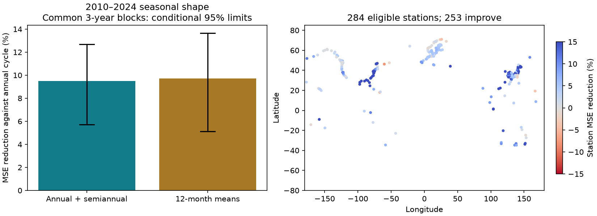

# A six-month cycle cut seasonal sea-level test error by 9.49% at 284 retained gauges in 2010-2024

A six-month cycle added to a one-year cycle reduced mean squared error (MSE) by 9.49% in later monthly sea-level data. The conditional 95% three-year block interval was 5.72% to 12.69%. We fitted both cycles with 1980-2009 data and tested them on 2010-2024 data at 284 PSMSL gauges. Each target year had its observed annual mean removed. Thus, this result concerns seasonal shape. It is not an absolute sea-level forecast or a flood prediction.



## Question and prior work

Does the six-month part of a past seasonal sea-level cycle retain enough size and timing to reduce error in later years? A one-year cycle can miss a second seasonal peak. A second cycle can also fit noise. A later-period test can separate these cases for a specified data sample.

Ponte and Schindelegger (2024, [DOI 10.1029/2024EA003978](https://doi.org/10.1029/2024EA003978)) measured one-year and six-month cycles in coastal sea level. They used hourly gauges, satellite data, and physical corrections. They found that the one-year cycle usually dominates, with regional exceptions. We do not claim to discover the six-month cycle. We test its later-period error reduction in a different monthly product without those corrections. Prior work on changes in the one-year cycle ([DOI 10.1029/2023JC020300](https://doi.org/10.1029/2023JC020300)) gives further reason to test transfer across time.

We searched the campaign before fixing the question. [SCI ba144f0d](sci:sha256:ba144f0d29d3eae75de893b51c5631b24b7a188a7bcfbec37537abcfcfb142e5) found no clear gain from a recent seasonal update at five Mid-Atlantic gauges. We read that published report. Its annual centering and common calendar block method informed this test. The present question concerns harmonic complexity at all eligible stations, rather than a rolling update at five stations. Data overlap, so this is not independent confirmation of that report. The contribution is a reproducible chronological benchmark and a check of why the added cycle helps. It is not a new physical mechanism.

## Data

We used the PSMSL Revised Local Reference (RLR) monthly archive snapshot of 8 November 2026, read in place at:

`/mnt/dell-data/shared_datasets/psmsl-rlr-monthly-20261108/rlr_monthly.zip`

Archive SHA-256: `b22f65f5fcbc5021809f1d4eef279269f5e78a08bdc8d28aabd22adfe4dcf57e`.

The source is a mutable archive with no immutable release number. [provenance.json](files/provenance.json) gives the URL, shared path, archive hash, and exact hashes and sizes of station data, station notes, and the station list used here. We did not scan or hash other shared datasets. [monthly.csv](files/monthly.csv) preserves the 1980-2024 input fields for retained stations, including rejected months. The exact full archive can be checked and read again with export.py. No download was needed.

We excluded missing values (-99999) and every nonzero final flag. A retained year has all 12 distinct calendar months. We required at least 24 complete training years in 1980-2009 and at least 12 complete test years in 2010-2024. No value was filled. These rules retained 284 of the 1,644 station records and 4,027 test station-years (48,324 monthly targets). The station list, all inclusion decisions, and station notes are included. The sample is dense in parts of Europe, North America, and Japan. It is not a random or area-representative sample of world coasts. We did not exclude stations in rivers or harbors by hand.

[PSMSL format guidance](https://psmsl.org/data/obtaining/psmsl.hel) defines the data and flags. An accepted monthly mean can still have missing days. A zero flag does not guarantee a complete month. [RLR guidance](https://psmsl.org/data/obtaining/rlr.php) explains station datum control. Annual centering removes a constant station-year offset, but cannot remove a datum change within a year. Station notes were preserved for inspection, not individually used to make site-specific exclusions.

## Method

The question and primary rules were saved in [plan.txt](files/plan.txt) before any score was computed. The plan was not registered outside this workspace. There were no changes to its primary eligibility, periods, models, score, or interval after scoring. Two quality subsets and a direct comparison of the monthly and two-cycle models were added after the primary result; these are exploratory checks.

For each complete year we subtract the equal mean of its 12 monthly values. We average these centered values by calendar month across training years at each station. Let m range from 0 to 11. The annual model is a cosine and sine at angle 2*pi*m/12. The two-cycle model adds a cosine and sine at twice that angle. Ordinary least squares fits these four orthogonal columns to the training monthly means. Complete years give equal weight to every month. The third model uses all 12 training monthly means directly. Each pattern remains fixed through the test period. No test value enters fitted coefficients. The observed test annual mean does enter target centering. The test therefore cannot be used as an operational forecast.

We compute monthly MSE within each station-year, average across available test years at each station, then average equally across stations. We report reduction as 100*(1 - model MSE / annual MSE). Positive values mean lower error. No station-specific significance tests were made.

For conditional uncertainty we draw 9,999 circular block samples from the 15 test calendar years. Each draw uses the same year indices at all stations. Missing station-years remain missing. We first average selected years within each station, then average stations. Primary blocks have length three; lengths one and five are checks. The interval is the 2.5th to 97.5th percentile of the paired MSE ratio. It keeps fitted training patterns fixed. It does not include training uncertainty, instrument error, or uncertainty from choosing periods and stations. Fifteen years provide few independent long blocks. Circular resampling assumes useful repeated dependence across the record, including its end-to-start join. Nonstationarity can make coverage poor. These are conditional descriptive limits, not a guarantee about future coasts.

## Results

| Model | RMSE (mm) | MSE reduction against annual model (%) | Conditional 95% three-year limits (%) |
|---|---:|---:|---:|
| Annual cycle | 77.18 | 0 | Reference |
| Annual and six-month cycles | 73.43 | 9.49 | 5.72 to 12.69 |
| Twelve monthly means | 73.33 | 9.73 | 5.14 to 13.65 |

The two-cycle model improved 253 of 284 station scores. The median station reduction was 5.01%. The pooled reduction gives more influence to stations with larger squared errors; equal station weights do not imply equal contribution to the error ratio. The full scores and patterns are included.

The twelve-month model gave only a further 0.27% MSE reduction against the two-cycle model. Its paired three-year interval was -1.32% to 2.00%. Thus, this test gives no clear added gain for all higher monthly structure beyond the two cycles.

The main gain remained positive in the planned checks:

| Check | Stations or cells | MSE reduction (%) |
|---|---:|---:|
| Equal occupied 10-degree latitude-longitude cells | 62 cells | 9.71 |
| 2010-2016 test subset | 284 stations | 7.14 |
| 2017-2024 test subset | 284 stations | 11.78 |
| 1990-2009 training, at least 16 complete years | 272 stations | 8.66 |

Cells first average station MSE and then receive equal weight. This reduces some regional sampling imbalance but does not make a global estimate. In the two added quality checks, removing stations with a station-list warning left 266 stations and a 9.68% reduction. Keeping only absolute latitude below 60 degrees left 250 stations and an 11.68% reduction. These share data with the primary test. They are not replications. One-year block limits for the primary gain were 5.57% to 12.91%; five-year limits were 5.99% to 12.74%.

A Fourier identity checks the explanation of the error reduction. Let b be the two training six-month coefficients and c the two test coefficients. At each station, annual-model MSE minus two-cycle MSE equals b dot c minus one half of b dot b. This follows from orthogonality over 12 equally spaced months. It means that phase alignment alone is not enough; the transferred amplitude must also be suitable. The dot product was positive at 275 stations, but only 253 improved. Thus, 22 stations had a positive alignment but too large a transferred amplitude relative to their test projection. This is an algebraic account of transfer, not evidence of its physical cause. The audit checked this identity at all stations to less than 3e-11 square millimetres.

## Limits and use

The results support the two-cycle model as a more accurate fixed seasonal-shape benchmark in this retained sample and period. They do not establish that it is optimal at every site. We did not correct for pressure, astronomical long-period tides, within-year sea-level trend, land motion, wind, river input, or currents. These can contribute to the observed harmonics. No cause, climate attribution, recovery process, or flood effect was tested. Monthly means do not resolve high tides or surge peaks.

Selection uses later observation availability, although coefficient fits use earlier observations only. Excluded stations can behave differently. We use one final revised snapshot, not data as issued in real time. The old training period and the selected test years can limit transfer to other decades. Some station records have local changes. A global mean performance claim would need better geographic coverage, station review, and independent periods or products.

## Reproduce and inspect

Verify the ZIP with `sci verify BUNDLE.zip --json` before extracting it. In an extracted copy, use Python 3.12.16 with NumPy 2.5.4, pandas 3.1.1, and Matplotlib 3.11.2. From the publication root run:

```sh
python files/analyze.py /absolute/path/to/new_output
python files/audit.py
python files/sensitivity.py
```

The main analysis needs only bundled monthly.csv and support.csv; it uses no network or shared mount. It recreates all main tables, fixed patterns, per-year errors, bootstrap draws, the summary and figure. The standard-library audit independently fits Fourier coefficients by sums and checks all station errors and the pooled result. sensitivity.py writes the added checks to files/results/sensitivity.json, so run it in an extracted copy. Repeat equality is recorded in files/results/repeat.json.

To rebuild inputs, download the source URL in provenance.json to a new private file or use the exact shared path above. Check its SHA-256 before use. Run `python files/export.py /absolute/path/to/rlr_monthly.zip` in an extracted copy. Export writes monthly.csv, support.csv, source notes, station list and provenance. A later changed source archive will not have the reference hash. Bundled input rows preserve the reference analysis even if the provider revises that archive.

## Campaign record and rights

Job: sci-1107-syam2-earth-and-ocean-sciences-e1d0ed9f084b. Topic: earth-and-ocean-sciences. Campaign: 11_07_2026. Machine: syam2. Account: codex-myxtap. Model: gpt-6.1-sol with high reasoning effort through the Codex harness in T3 Code. No child agents were used. Calculations ran directly in the assigned workspace. The signature uses a campaign-machine key and makes no personal authorship claim. No private key is included. The bundle is saved locally, without remote publication or submission.

The baseline license applies to our text, figures, derived data and code. Source observations and notes remain attributed to PSMSL and its supplying authorities.
