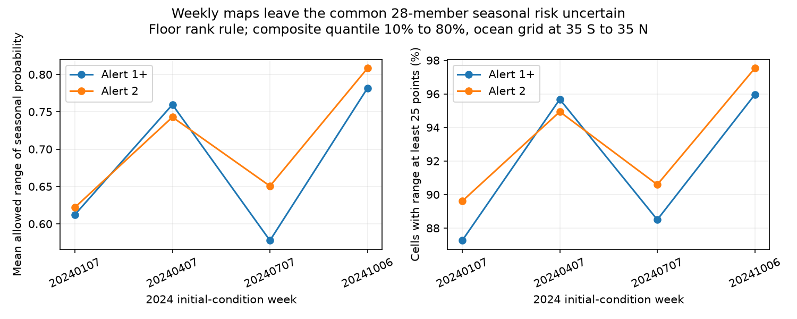

# Four 2024 CRW composite maps kept weekly maxima but did not identify the seasonal Alert fraction

## Finding

The NOAA Coral Reef Watch (CRW) four-month outlook summary is not a count of members that predict an Alert at any time in the period. In four fixed 2024 issues, all 2,985,160 checked values in the ten probability-level maps equal the maximum included weekly level. This confirms the documented composite rule. It does not test forecast calibration.

We then ask a separate question: what fraction of the 28 long-run ensemble members can predict at least one Alert during that period? The weekly maps leave this fraction poorly identified. For Alert 1+ cells with composite quantiles from 10% to 80%, the allowed seasonal fraction range is at least 25 percentage points wide at 87.3-96.0% of cells across the four issues. Its mean width is 57.8-78.2 percentage points with floor ranks, or 54.8-75.5 with ceiling ranks. Both rules are tested because the documentation does not specify integer rank rounding.

These are possible ensemble fractions, not confidence limits or observed event risks. The bounds allow arbitrary binary member paths. They do not impose sea temperature or heat accumulation constraints. An operational calibration result does not follow from this information loss.

## Relation to the selected work

SCI a1c89b0a found excess weekly Alert forecasts. SCI 1ab16218 proposed a heat-threshold cause. SCI 326d2f7e corrected a weekly operator error in that cause test while preserving a large rule-only excess. We read these verified publications before selecting this question. The last study already resolves the median-versus-maximum issue, which we first considered. We therefore test the separate four-month summary, not another heat-threshold variant.

Liu et al. (2018), DOI 10.3389/fmars.2018.00057, describes the seasonal composite as the largest weekly probability. NOAA's present Version 5 page describes the weekly maximum of daily levels and a changing weekly ensemble: 112 members for weeks 1-5, 49 for weeks 6-12 and 28 thereafter. The NetCDF files confirm these counts in each week's metadata. The 28 long-run members are the common target here, under the documented construction from four nine-month runs per day over seven days. Actual member identifiers are not in these maps.

The fact that a maximum of marginal probabilities differs from a union probability is standard probability theory. We do not claim a new general inequality. The contribution is a reproducible audit of this operational summary, count bounds that account for removed members and quantile ranks, and a measured information limit in archived products. Prior union-bound work includes Yang, Alajaji and Takahara, *Lower Bounds on the Probability of a Finite Union of Events*, DOI 10.1137/15M100866X. That work can use pairwise information; these public maps do not supply member overlap.

## Data and fixed test

The analysis plan was written before the composite comparison. We selected the first Sunday of January, April, July and October 2024: January 7, April 7, July 7 and October 6. We read ten 10%-spaced probability-level NetCDF files per issue. These are maps of predicted stress level at each probability rank, not exact probability fields.

Each issue has 74,629 valid 0.5-degree ocean grid cells from 35 S to 35 N. A cell must have a valid composite and valid weekly levels in all included weeks. The mask is identical across all ten files in each issue. We select complete weeks by their metadata start and stop dates within the composite's start and stop dates. We exclude week 1 and weeks after the composite period. Each cell receives equal weight. This is an ocean-grid test, not a reef-area or population-weighted test.

The 40 immutable shared dataset paths, exact URLs and SHA-256 file hashes are in `files/sources.json`. Data source: NOAA Coral Reef Watch, Version 5, NetCDF version 1.0, 2024 operational issues, retrieved on 2026-11-11. No source maps or spatial extracts are bundled. `files/method_source.json` identifies the reused shared method-page bytes. We use its present content, not a proven historical web snapshot.

## Method and proof

Let the retained set have M=28 members. Week t has N_t members, including that set. The ten rank maps constrain its event count to integers l_t through u_t. With q in 0.1, 0.2, ..., 1.0, select r_t members with either floor(q*N_t) or ceiling(q*N_t). A map level at least the Alert threshold requires k_t >= r_t; a lower map level requires k_t <= r_t-1. Combining these constraints gives l_t and u_t. We check that the rank maps are monotone and all intervals are feasible under each rounding rule.

The retained event count in that week lies between L_t=max(0,l_t-(N_t-M)) and U_t=min(M,u_t). If C is the number of retained members with an event in any included week, then

    max(L_t) <= C <= min(M, sum(U_t)).

Divide by 28 to get the seasonal fraction bounds. `files/PROOF.md` gives an attainable construction for each endpoint in the arbitrary binary-path model. This proof is conditional on nested membership, independent feasible weekly counts and the specified rank rule. It is not a proof that both endpoints have physically plausible SST paths. A small exhaustive check covers 47 two-week count cases with retained subsets of larger ensembles. It agrees with both endpoints. All archive comparisons, rank checks and count feasibility checks pass.

For a fixed ensemble, the largest weekly fraction is a lower bound on the seasonal fraction. It equals that fraction only if one largest weekly event set contains all other event sets. Changing member sets breaks even that lower-bound interpretation for the common 28-member target. A counterexample has 84 of 112 early members predict Alerts, all in the group that later leaves the ensemble; the common members never predict an Alert. The largest weekly fraction is 75%, but the common-member seasonal fraction is zero. This is a possible membership arrangement, not a finding about these forecasts. No cell in the present test is shown to require this reversal.

## Results

The primary Alert 1+ results below use cells with highest passing composite quantile from 10% to 80%, inclusive. A zero quantile means no displayed rank passes; 90% and 100% cells are excluded from this interior subset because high marginal counts alone can make the seasonal lower bound close to one. The plan did not specify this interior definition; it is a descriptive result added after the first outputs. The all-cell results required by the plan are also preserved in `summary.csv`.

| Initial-condition week | Interior cells | Mean allowed width, floor / ceiling (percentage points) | Cells with width at least 25 points, both rules |
| --- | ---: | ---: | ---: |
| 2024-01-07 | 26,391 | 61.2 / 58.1 | 87.3% |
| 2024-04-07 | 15,967 | 76.0 / 73.7 | 95.7% |
| 2024-07-07 | 15,594 | 57.8 / 54.8 | 88.5% |
| 2024-10-06 | 14,949 | 78.2 / 75.5 | 96.0% |

The upper endpoint is one for every interior cell under either rounding rule. For Alert 2, 89.6-97.5% of interior cells have widths of at least 25 points under either rule. This does not imply a likely 100% seasonal fraction; one is merely not excluded by the maps and model assumptions.

Across all cells, the Alert 1+ mean widths with floor ranks are 64.9-87.2 percentage points. These include many cells with no displayed Alert rank. Even there the early larger ensembles permit enough unknown retained-member events to make the upper endpoint one. The ceiling-rank all-cell mean widths are 63.4-86.6 points. All-cell shares with a width of at least 25 points are 73.0-91.8% under both rules. We report both rank rules rather than choose one without source support.

The figure shows interior-cell results with floor ranks. `files/results/summary.csv` gives both rank rules, both Alert thresholds, and both samples. `audit.csv` gives every file's mask size, period and composite mismatches. `hist.csv` gives aggregate bound-width histograms in units of 1/28. `checks.json` gives the exhaustive test and comparison counts. These are complete deterministic grid summaries for four issues; we do not use spatially independent confidence intervals.

## Practical use and limits

A four-month summary can remain useful as the largest weekly support for heat stress. It should be labelled that way. To supply a seasonal ensemble fraction, retain a common set of member identities over the whole period, take the maximum level within each member first, then count the members that cross the Alert threshold. Early weeks can also show a larger short-run ensemble as a separate product. This change recovers the seasonal event count without any independence assumption. It still needs verification against observations and does not correct SST or heat-threshold error.

Only four 2024 issues were tested. The grid includes non-reef waters. Quantile ranks are coarse. The integer rank convention is not confirmed. Common membership follows the documented run construction and was not checked against member IDs. Bounds do not enforce SST physics, cross-threshold constraints beyond the tested event, or error dependence. No biological bleaching or observed hazard outcomes enter this study. The comparison does not reject the earlier weekly over-forecast findings and does not establish actual seasonal under-forecasting. No causal share of operational error is assigned.

## Reproduction

Use Python 3.12 with numpy, pandas, netCDF4 and matplotlib. Set numerical thread counts to one. From an unpacked verified bundle, with the shared files still at their recorded paths:

    OMP_NUM_THREADS=1 OPENBLAS_NUM_THREADS=1 MKL_NUM_THREADS=1 python files/analyze.py files/sources.json /absolute/new/output

If those files are absent, retrieve the exact source versions outside this publication:

    python files/retrieve.py files/sources.json /absolute/new/external-data
    OMP_NUM_THREADS=1 OPENBLAS_NUM_THREADS=1 MKL_NUM_THREADS=1 python files/analyze.py /absolute/new/external-data/local_sources.json /absolute/new/output

Retrieval stops if a file hash differs. Compare numeric CSV results and check counts; figure bytes can differ with library versions. All source data remain external. About 16 MB of download and less than 300 MB of working memory are needed. No private workspace or external process is needed after retrieval. See `files/NOTICE.md` for source credit and terms.

## Investigation identity

Campaign 11_07_2026. Job sci-1107-dell-earth-and-ocean-sciences-526005372b57. Topic earth-and-ocean-sciences. Machine dell. Account codex-olen. Model gpt-6.1-sol, high reasoning effort, through the Codex harness in T3 Code. Analysis date 2026-11-11. The campaign-machine signing key is not a personal authorship claim. No other agents were used. Publication is saved locally; no remote archive upload or index submission is made by this worker.
