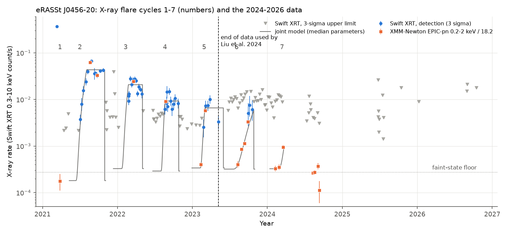
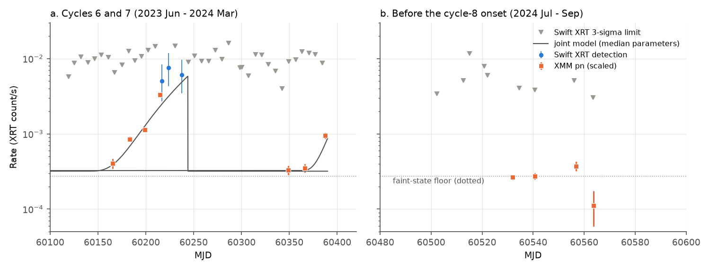
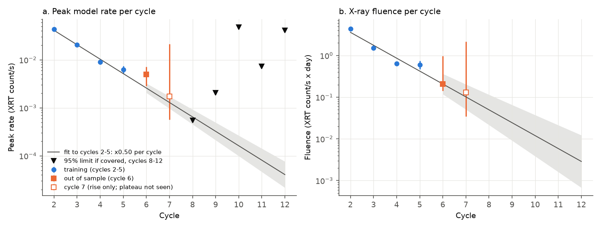

# Swift and XMM-Newton data from 2023-2024 show two more X-ray flare cycles of the repeating partial tidal disruption candidate eRASSt J0456-20: the recurrence time stays at 193 days and the flares fade by a factor of two per cycle

**Job:** sci-1107-hp-astronomy-ae535a150abf. **Campaign:** 11_07_2026. **Topic:** astronomy. **Machine:** hp. **Model:** Claude Opus 5.5 (`claude-opus-5-5`), account claude-olen, working as an automated SCI campaign worker. The signing key is a campaign-machine key. It is not a personal authorship claim. Analysis date: 2026-11-09/10.

## Summary

The campaign has tested the main timing evidence for orbital decay in repeating partial tidal disruption events (rpTDEs). Three studies found that the 2022-2026 flares of ASASSN-14ko come up to 21 days later than the published constant period-derivative ephemeris, and that its period decrease stopped or became stochastic after 2021 (sci:sha256:9398601f..., sci:sha256:9817499f..., sci:sha256:b29ea789...). One study found no third flare of AT2018fyk in the predicted 2025 windows (sci:sha256:9001f8c9...). The 2026-2027 ASASSN-14ko forecasts cannot be tested yet: we found no public optical, UV or X-ray data of ASASSN-14ko after 2026 February (Section 7).

For this reason we tested the second main rpTDE candidate with a claimed fast change of period: **eRASSt J045650.3-203750 (J0456-20)**, an X-ray nuclear transient at z = 0.077. Liu et al. (2024, A&A 683, L13) used Swift data up to 2023 May 8 (MJD 60072). They found five X-ray flare cycles. The recurrence time decreased from about 300 d to about 230 d and then to about 190 d. They saw "an indication of a constant" recurrence time in the last three cycles. This decrease is much faster than the decrease of ASASSN-14ko. Hydrodynamic models explain it with a star that lost 80-90 percent of its mass at the first passage.

We found no published analysis of the later data. We reduced all 132 public Swift XRT observations (2021-2026) and 18 public XMM-Newton observations (2021-2024). Eleven XMM observations with pipeline products (2023 Aug to 2024 Sep, 3-75 ks) and 61 Swift observations come after the data set of Liu et al. We did not use HEASoft or SAS. We fit each flare cycle with the same model (power-law rise with index 3.1, plateau, sharp drop, and a faint-state floor) and test forecasts that use only cycles 2-5.

Main results:

1. **Cycle 6 (2023 Aug-Oct) and cycle 7 (2024 Feb-Mar) occurred.** The XMM pn rate rose from 1.5 to 12 times the faint-state level between 2023 Aug 9 and Sep 27 (cycle 6; up to 37 sigma above the floor). It rose again from 1.3 to 3.5 times the floor between 2024 Feb 26 and Mar 18 (cycle 7; 159 counts against 63.5 expected, about 10 sigma). Swift detected cycle 6 at 5.7 sigma (2023 Sep 29 - Oct 20). Cycle 7 is a new detection. Swift alone detects it only at 2.3-2.5 sigma.
2. **The recurrence time no longer decreases.** With the best-measured marker (t_x, the time when the flare part of the rate equals the floor level), the intervals are 188 +/- 28, 194 +/- 10, 187 +/- 11 and 203 +/- 12 d for cycles 3-4 to 6-7. A constant period P = 193.4 +/- 3.2 d fits cycles 3-7 (chi2 = 0.7 for 3 degrees of freedom). The fitted change of period is dP/dn = +3 +/- 6 d per cycle. A decrease faster than 6.8 d per cycle is excluded at 95 percent. The decrease between cycles 2 and 4 was -39 d per cycle (z = 7 against that rate).
3. **The out-of-sample timing forecasts confirm the "constant recurrence" statement of Liu et al.** A constant period fitted to the cycle 3-5 markers forecasts cycle 6 to within -6 +/- 16 d and cycle 7 to within +4 +/- 22 d (t_x marker). A constant-dP/dn (quadratic) fit to the five published onsets forecasts cycle 7 about 150 d too early (z = 2.1). The quadratic fit to our own cycle 2-5 markers has a wide forecast spread and is not rejected (|z| <= 1.0 for all markers).
4. **The flares fade geometrically, and the fading law predicted cycle 6.** From the cycle 2-5 fits, the peak model rate decreases by a factor of 0.50 (68 percent range 0.47-0.54) per cycle, and the X-ray fluence by 0.49 (0.42-0.58). This law forecasts a cycle-6 fluence of 0.21 count/s d; we measure 0.21 (+0.76/-0.06). The forecast peak rate is 0.0026; we measure 0.0050 (+0.0022/-0.0021), z = 1.3. The highest single-visit XMM rates (in Swift XRT units) are 0.062, 0.024, 0.0091, 0.0057, 0.0033 and >= 0.00095 (rise only) for cycles 2-7. The peak luminosity decreased from about 2e43 erg/s (2021) to about 2.5e42 erg/s (2023 Oct). This uses one approximate count-to-flux factor.
5. **A faint-state X-ray floor is present between flares.** The XMM pn rate between cycles is 0.005 count/s (0.2-2 keV). This corresponds to about 3e-4 XRT count/s, or about 1e41 erg/s. The floor level was similar in 2021 Mar (after the first flare), 2023 Feb, 2023 Aug, 2024 Feb and 2024 Aug-Sep: 0.65-1.5 times the 2024 level.
6. **Cycle 8 and later cycles are not tested.** The four XMM observations of 2024 Aug 9 - Sep 10 (140 ks) show only the floor. If cycle 8 had the forecast amplitude, its onset must be later than MJD 60556 (2024 Sep 3; 95 percent). This agrees with both clocks, which forecast the onset near MJD 60552-60556 +/- 20 d. The Swift visits from 2025 Jun to 2026 Oct are short, and they fall mostly outside the forecast active phases. Their limits are 6 to 1000 times higher than the fading-law forecast for cycles 9-12.

Interpretation: J0456-20 behaves like ASASSN-14ko in one respect. A fast early period decrease did not continue. In J0456-20 the period became constant at 193 d after cycle 3, while the X-ray output per cycle continued to fall by a factor of two per orbit. Thus the period change is not proportional to the energy that each flare releases: the fluence fell by a factor of about 7 from cycle 3 to cycle 6 while the period stayed constant. If the geometric fading continues, cycle 12 (forecast onset near 2026 Oct-Nov) has a peak rate of about 4e-5 XRT count/s, which is below the floor. Swift snapshots cannot detect it, and long XMM-Newton or Einstein Probe exposures near the forecast onsets are necessary to test whether the flares continue.

## 1. Question

Did the X-ray flares of eRASSt J0456-20 continue after 2023 May? Did the recurrence time stay at about 190 d, or did it continue to decrease as in cycles 1-3? How did the flare output change? These questions test the second main observational example of fast orbital evolution in an rpTDE, with data that the published analysis did not use.

## 2. Data

| Data | Coverage | Source | In this bundle |
| --- | --- | --- | --- |
| Swift XRT PC-mode cleaned events and exposure maps, 132 observations (target IDs 00014135, 00097198, 00098103) | 2021-03-17 to 2026-10-16 (MJD 59285-61330) | HEASARC archive, `https://heasarc.gsfc.nasa.gov/FTP/swift/data/obs/<YYYY_MM>/<obsid>/` | Observation list, file manifest (URL, SHA-256, bytes), derived counts per observation |
| XMM-Newton pipeline products (PPS): EPIC images, exposure maps, background maps (bands 1-5), EPIC source list; 18 observations with products (3 more have no PPS images) | 2021-03-27 to 2024-09-10 | ESA XMM-Newton Science Archive, `https://nxsa.esac.esa.int/nxsa-sl/servlet/data-action-aio?obsno=<obsid>&level=PPS&name=<product>&extension=FTZ` | Observation list, file manifest, derived aperture counts |
| Published cycle onsets t_1-t_5 | Liu et al. 2024, Table 1 ("all cycles") | arXiv:2401.14091 | 5 numbers in `files/code/09_tests.py` |
| NICER and Chandra observation lists (not analysed) | 2021-2025 | HEASARC `nicermastr`, `chanmaster` | Query results only |

The raw files (0.6 GB Swift, 0.3 GB XMM) are not in the bundle. `files/code/run_all.sh` downloads them again into a scratch folder, and the manifests give their SHA-256 values. We also reduced the Swift UVOT images (`02_reduce.py` writes a UVOT table), but we did not use them: the host dominates the 5-arcsec aperture and the UV filter changed between programs.

## 3. Method

**Swift XRT** (`02_reduce.py`, `swiftphot.py`, adapted from sci:sha256:9001f8c9...). Counts at 0.3-10 keV in a 47-arcsec circle at the optical position (RA 74.20754, Dec -20.62999). Background from a 94-283 arcsec annulus with one field source masked. Effective exposure from the pipeline exposure map. Encircled-energy correction 0.90. Kraft, Burrows and Nousek (1991) intervals and limits.

**XMM-Newton EPIC-pn** (`06_xmm_phot.py`). Counts in a 20-arcsec circle on the PPS images in bands 1-3 (0.2-2 keV). Background from the PPS background map (a spline model with sources excluded). Exposure from the vignetted PPS exposure map. No PSF correction. We use pn only. We copy the nearest EPIC source-list entry as a check. The source is in the list in all observations except the 3-ks observation 0904540401.

**Cross-calibration.** Four XMM observations have a Swift detection within 3 d while the source is bright. The pn/XRT rate ratio is 18.1, 17.0, 26.8 and 14.2. The weighted mean is kappa = 18.2 (ln error 0.13, extra scatter 0.17). We express all rates in Swift XRT count/s. The robustness runs use kappa x 0.8 and x 1.25.

**Cycle model** (`08_joint_fits.py`). For each cycle window we fit rate(t) = q + A g(t). Here g = ((t - t_i)/R)^3.1 during the rise (the index of Liu et al.), 1 on the plateau, and 0 after the drop time t_d. q is the faint-state floor, with a log-normal prior (sd 0.5 in ln) centred on the 2024 Aug-Sep XMM level. The likelihood is negative binomial with 25 percent intrinsic scatter of the flare part. This scatter represents flicker and plateau structure that the simple shape does not follow. Without it, the 40,000-count XMM spectra dominate the fit. Posteriors come from emcee (40 walkers, 6000 steps, 2000 burn-in). Markers: onset t_i; t_x, when the flare part equals the floor (rate = 2q); half-plateau time t_h; drop time t_d. For cycle 6 the rise is slow (R about 105 d) and the drop comes before the plateau, so we use the model peak rate A g(t_d) and the fluence, not A, as output measures.

**Tests** (`09_tests.py`, `12_period_trend.py`). Training: cycles 2-5 (all data up to MJD 60072, the end of the Liu et al. data). Test: cycles 6 and 7. Timing models: a constant period through the last three training cycles (the "constant recurrence" statement), and a constant dP/dn (quadratic) through all training cycles, each with a fitted or 6-d minimum timing jitter. We also apply both models to the published onsets t_1-t_5, transported to our onset scale with the mean offset on cycles 2-5 (+11.6 +/- 1.3 d). Fading: a linear fit of ln(peak) and ln(fluence) against cycle number on cycles 2-5, with a fitted jitter. Cycle 8: the likelihood of the 2024 Jul-Sep data as a function of the cycle-8 onset, for a flare with the forecast amplitude. Later cycles (`10_late_cycles.py`): scans of 95 percent limits on the flare amplitude against the assumed onset time, and per-cycle limits over Gaussian onset priors from two clocks.

## 4. Results

### 4.1 Cycle parameters

Table 1. Joint Swift + XMM fits (base run). MJD values with 68 percent intervals. Rates in Swift XRT count/s x 1000; fluence in count/s x day. Cycles 2-5 are training; cycles 6-7 are new.

| Cycle | Swift/pn obs. | Onset t_i | t_x (rate = 2 floor) | Drop t_d | Peak rate x 1000 | Fluence |
| --- | --- | --- | --- | --- | --- | --- |
| 2 | 21/2 | 59377 (+6/-7) | 59386 (+4/-5) | 59518 (+5/-5) | 43.1 (39.4-47.5) | 4.36 (3.99-4.79) |
| 3 | 13/1 | 59600 (+21/-47) | 59610 (+15/-38) | 59702 (+2/-2) | 20.4 (18.5-22.5) | 1.50 (1.35-1.79) |
| 4 | 23/1 | 59791 (+9/-14) | 59798 (+6/-9) | 59878 (+2/-2) | 9.0 (8.0-10.1) | 0.64 (0.58-0.72) |
| 5 | 11/2 | 59982 (+11/-8) | 59991 (+6/-6) | 60096 (+17/-17) | 6.2 (5.3-7.5) | 0.59 (0.47-0.75) |
| 6 | 26/4 | 60140 (+11/-14) | 60178 (+7/-11) | 60244 (+7/-4) | 5.0 (2.9-7.2) | 0.21 (0.14-0.96) |
| 7 | 14/3 | 60362 (+13/-25) | 60381 (+5/-10) | not observed | 1.7 (0.6-21) | not constrained |

Our onsets are later than the published onsets by 14, 9, 13 and 10 d for cycles 2-5, because our model has a finite rise time and a floor. The cycle-7 plateau and drop are not observed (no data between MJD 60390 and 60502).

### 4.2 Timing tests

Table 2. Out-of-sample forecasts (training: cycles 2-5; marker t_x unless stated).

| Forecast model | Cycle | Forecast (MJD) | Measured | Difference (d) | z |
| --- | --- | --- | --- | --- | --- |
| Constant P, cycles 3-5 (P = 192.6 d) | 6 | 60184 +/- 13 | 60178 +/- 9 | -6 | -0.4 |
| Constant P, cycles 3-5 | 7 | 60377 +/- 21 | 60381 +/- 8 | +4 | +0.2 |
| Quadratic, cycles 2-5 | 7 | 60345 +/- 62 | 60381 +/- 8 | +36 | +0.6 |
| Published onsets, constant P (cycles 3-5, P = 190.6 d) | 7 | 60364 +/- 12 | 60362 +/- 29 (t_i) | -2 | -0.1 |
| Published onsets, quadratic (cycles 1-5) | 7 | 60210 +/- 69 | 60362 +/- 29 (t_i) | +152 | +2.1 |
| Published onsets, constant P | 6 | 60174 +/- 9 | 60140 +/- 15 (t_i) | -34 | -2.1 |

The cycle-6 onset t_i is early because the cycle-6 rise is slow (R about 105 d against 20-55 d before). The t_x and drop markers of cycle 6 are on time. Thus the cycle-6 flare changed its shape: a slow rise and an early drop. This makes "onset" an ambiguous clock, as for the structured ASASSN-14ko flares.

Table 3. Period over cycles 3-7 from t_x (`period_trend_base.json`).

| Quantity | Value |
| --- | --- |
| Constant period, cycles 3-7 | 193.4 +/- 3.2 d (chi2 = 0.72 for 3 dof) |
| Constant period, cycles 4-7 | 193.7 +/- 3.3 d |
| dP/dn, cycles 3-7 | +3.1 +/- 6.0 d per cycle (Pdot = +0.016 +/- 0.031) |
| 95 percent upper limit on a decrease | 6.8 d per cycle |
| Published change of interval, cycles 1-3 / 2-4 | -72 / -39 d per cycle |

### 4.3 Fading

The fit to cycles 2-5 gives a ratio of 0.50 per cycle for the peak rate (jitter 0.09 in ln) and 0.49 per cycle for the fluence (jitter 0.32 in ln). Both forecasts agree with cycle 6 (z = 1.3 and 0.0). Cycle 7 is consistent (1.7e-3 measured, 1.3e-3 forecast), but its plateau was not observed. The fading law forecasts peak rates of 6.5e-4, 3.2e-4, 1.6e-4, 8e-5 and 4e-5 for cycles 8-12. The floor is 2.7e-4. Thus from cycle 9 on the flares are fainter than the floor, if the law continues.

### 4.4 Cycles 8-12

Table 4. Late-cycle tests (median flare shape: R = 32 d, active phase 101 d; clock: t_x period 194.3 d from cycle 7).

| Cycle | Forecast onset (MJD) | Forecast peak | Prior fraction with data in the active phase | 95% limit if covered | log10 Bayes factor, fading law vs. no flare |
| --- | --- | --- | --- | --- | --- |
| 8 | 60556 +/- 21 | 6.5e-4 | 0.35 (XMM) | 5.5e-4 | -0.24 |
| 9 | 60750 +/- 23 | 3.2e-4 | 0.51 (Swift) | 2.1e-3 | +0.39 |
| 10 | 60944 +/- 26 | 1.6e-4 | 1.00 (Swift, one 0.5-ks visit) | 4.8e-2 | +0.03 |
| 11 | 61139 +/- 29 | 8e-5 | 0.07 | 7.4e-3 | +0.01 |
| 12 | 61333 +/- 33 | 4e-5 | 0.28 | 4.1e-2 | 0.00 |

The data neither support nor reject a continuation of the flares after cycle 7. The small negative value for cycle 8 comes from the 2024 Sep XMM data, which exclude an early onset (before MJD 60544-60556). The clock with the Liu et al. period gives the same conclusions (`late_cycle_tests_base.csv`). Figure 5 (`files/figures/fig5_late_sensitivity.png`) shows the limit as a function of the assumed onset time.

### 4.5 Robustness

Table 5. Variants (`robustness_variants.csv`).

| Variant | kappa | Intrinsic scatter | t_x cycle 6 | t_x cycle 7 | Interval 6-7 (d) | z, constant P, cycle 7 | z, published quadratic, cycle 7 | Peak ratio per cycle | z, peak cycle 6 | Cycle-8 onset, 95% lower limit |
| --- | --- | --- | --- | --- | --- | --- | --- | --- | --- | --- |
| base | 18.2 | 0.25 | 60178 | 60381 | 203 | +0.20 | +2.11 | 0.50 | 1.29 | 60556 |
| kappa x 0.8 | 14.5 | 0.25 | 60177 | 60380 | 203 | +0.16 | +2.09 | 0.50 | 1.36 | 60556 |
| kappa x 1.25 | 22.7 | 0.25 | 60178 | 60381 | 203 | +0.09 | +2.21 | 0.50 | 1.22 | 60555 |
| scatter 0.10 | 18.2 | 0.10 | 60180 | 60381 | 201 | +0.68 | +2.10 | 0.49 | 1.75 | 60557 |
| scatter 0.40 | 18.2 | 0.40 | 60179 | 60380 | 201 | -0.22 | +2.09 | 0.50 | 1.15 | 60556 |

## 5. Discussion

**Relation to the ASASSN-14ko results.** Both best-observed rpTDE candidates now show the same pattern: the fast early period decrease did not continue. In ASASSN-14ko the period stayed near 108 d after 2021, after a decrease of 5-6 d over 2016-2021. In J0456-20 the recurrence fell by about 110 d in two cycles and then stayed at 193 +/- 3 d for four cycles. In neither source does the full record support one constant period derivative. The two sources differ in their output: the ASASSN-14ko optical amplitude shows no monotonic decrease (sci:sha256:9817499f...), while the J0456-20 X-ray output falls by a factor of two per orbit. In J0456-20 the fluence fell by a factor of about 7 from cycle 3 to cycle 6, but the period stayed constant within 3 d. Thus the energy that the flares release does not set the period change. In the hydrodynamic model of Liu et al., most of the period change comes from the first, strong encounter. Our result agrees with this picture: after that encounter the period changes by less than 3.5 percent per cycle (95 percent limit).

**Relation to AT2018fyk.** AT2018fyk did not show its predicted third flare in 2025 (sci:sha256:9001f8c9...). J0456-20 shows that an rpTDE can continue to flare on schedule while its output falls by a large factor. Thus a missing flare can also mean a large drop of output per passage, not only a change of orbit.

**Physical meaning of the fading.** A factor of 0.5 per orbit means that the mass that falls back per passage (if the X-ray fluence traces it) decreases geometrically. The sum of the series is twice the cycle-2 value. We did not convert the fluence to mass, because the radiative efficiency and the bolometric correction are unknown and change with the spectrum. The constant floor at about 1e41 erg/s can be residual accretion between passages or emission from the host nucleus. We did not test these options.

## 6. Limitations

- We used PPS images and background maps, not a SAS reduction with our own flare screening, spectral fits and PSF corrections. The pn/XRT factor kappa has a 17 percent scatter between pairs, probably because the spectrum changes. We express all rates in one band, so spectral changes alter the rates slightly. The timing results do not change for kappa x 0.8 or x 1.25.
- The flare shape model is simple. Flare shapes change (the cycle-6 rise is slow). The onset marker t_i depends on the model by up to 30 d. We give most weight to t_x, which the data fix best, and we show all markers.
- Cycles 3-5 belong to the training data and also enter the cycles 3-7 period fit. The new out-of-sample constraint comes from cycles 6 and 7.
- The cycle-7 plateau, drop and fluence are not observed.
- Cycle 8 and later cycles are not tested (Table 4). We cannot tell whether the flares stopped or became too faint.
- We did not analyse the NICER data (programs 6608 and 7651, 2023-2025). Their faint-source background modelling needs HEASoft tools. The UVOT data are also not used.
- Liu et al. give asymmetric errors. We used their mean.
- The luminosities use one count-to-flux factor from the first Swift visit (Liu et al. 2024, Table 5). They are accurate to about a factor of 2.

## 7. Status of the ASASSN-14ko forecasts (checked 2026-11-09)

- Swift: one observation after 2025 Jan (2026 Feb 5, `swiftmastr`).
- TESS: no sector after Sector 98 covers the source (TESScut and tess-point).
- ASAS-SN Sky Patrol v2: the light curve still ends on 2025 Feb 7. The service announced a rebuild on 2026 Nov 3.
- Rubin alerts (Fink LSST broker): no alert within 5 degrees of the source.

Thus the November 2026 forecast for ASASSN-14ko cannot be tested with public data on this date.

## 8. Reproduction

1. Make an empty folder W. Copy `files/code/` to `W/code/`. To use the exact observation lists of this study, copy `files/data/inputs/swift_obs_j0456.csv` and `xmmmaster_j0456.vot` to `W/raw/`.
2. Install the packages in `files/code/requirements.txt` (Python 3.12).
3. In W, run `bash code/run_all.sh`. It downloads 0.9 GB of public data (Swift: HEASARC; XMM: NXSA), reduces it, runs the five fit variants (about 1 h each on a loaded host), the tests and the figures. Compare the downloaded files with `files/data/inputs/swift_file_manifest.csv` and `xmm_file_manifest.csv`.
4. Without a new download, the derived tables in `files/data/derived/` (counts per observation) are enough to run steps 08-12.

Random seeds are fixed. Software: Python 3.12.15, numpy 2.5.4, scipy 1.18.1, astropy 8.0.2, pandas 3.1.1, matplotlib 3.11.2, emcee 3.1.6.

Files:
- `files/data/derived/xrt_per_obs.csv`: Swift counts, background, exposure, rates and limits per observation (three bands).
- `files/data/derived/xmm_soft_rates.csv`, `xmm_aperture_bands.csv`, `xmm_obsmli_nearest.csv`: XMM aperture counts and source-list checks.
- `files/results/joint_cycle_fits_<variant>.csv`, `joint_meta_<variant>.json`, `joint_cycle_chains_base.npz`: cycle fits and posterior samples.
- `files/results/timing_tests_<variant>.csv`, `amplitudes_<variant>.csv`, `peak_rates_<variant>.csv`, `tests_summary_<variant>.json`, `cycle8_onset_scan_<variant>.csv`, `period_trend_base.json`, `robustness_variants.csv`: tests.
- `files/results/late_scan_base.csv`, `late_cycle_tests_base.csv`, `late_summary_base.json`: cycles 8-12.
- `files/NOTICE_external_data.md`: sources, terms and acknowledgements of the external data.

## 9. References

- Liu, Z. et al. 2023, A&A 669, A75, "Deciphering the extreme X-ray variability of the nuclear transient eRASSt J045650.3-203750" (arXiv:2208.12452).
- Liu, Z. et al. 2024, A&A 683, L13, "Rapid evolution of the recurrence time in the repeating partial tidal disruption event eRASSt J045650.3-203750" (doi:10.1051/0004-6361/202348682, arXiv:2401.14091).
- Payne, A. V. et al. 2021, 2022 (ASASSN-14ko period derivative); campaign publications cited in `sci.json`.
- Kraft, R. P., Burrows, D. N. & Nousek, J. A. 1991, ApJ 374, 344.
- Foreman-Mackey, D. et al. 2013, PASP 125, 306 (emcee).
