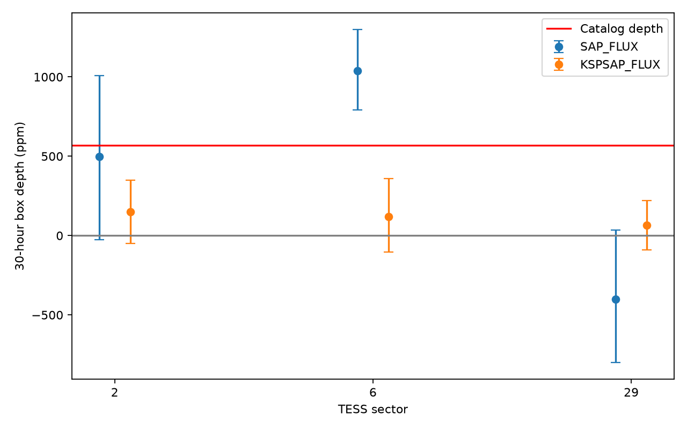
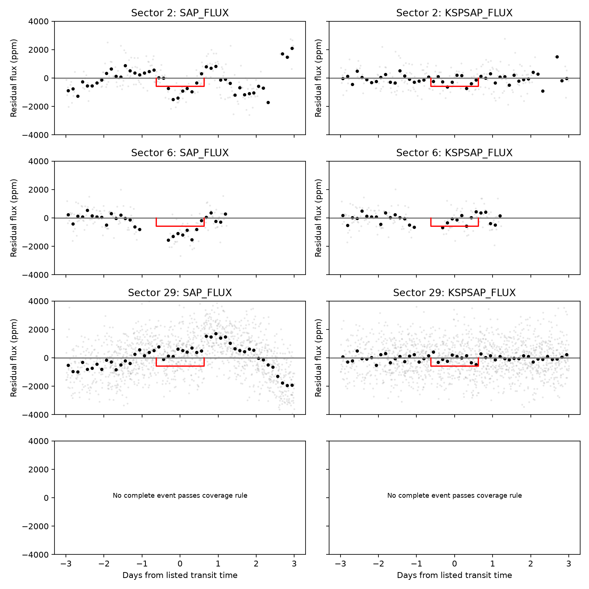

# The 30-hour box depth of TOI-785.01 depends on flux correction and quality flags in three TESS sectors

A screen of 3,928 TESS planet-candidate entries selected TOI-785.01 as the largest duration excess under the listed stellar model. Its listed duration is 30.02 hours. The central circular-orbit limit is 3.375 hours. A fixed-time test in QLP flux does not give a stable broad dip across sectors 2, 6, and 29. Flux correction, local baseline, and quality flags change the result. These tests do not establish a highly eccentric planet. They also do not reject the candidate or measure its true transit duration.



The red line is the listed 570.25 ppm depth. Bars are conditional 95 percent ranges from residual sign changes in six-hour blocks. They omit uncertainty in the data reduction, event shape, period, and stellar model.

## Question and prior work

Can the largest duration excess in a frozen TESS candidate sample survive a test in separate observations? A small star sets a short circular transit duration. An eccentric orbit viewed near its far point can give a longer transit. A wrong host, incorrect catalog fit, blended light, or instrumental trend can also give an apparent excess.

Dawson and Johnson [1] describe inference from stellar density and transit shape. Kipping [2] explains limits of approximate duration formulas for extreme orbits. A prior campaign study [3] tested a different Kepler target and found that new stellar data reduced its duration excess. We extend a duration screen to TESS. We do not claim a new duration method. The target was already a candidate. The frozen ExoFOP comment reports inconsistent centroid offsets between sectors. Our result is a reduction-sensitivity test of that existing lead, not a discovery or new host assignment.

## Data and selection

Use the frozen ExoFOP table in `datasets/exofop-tess-toi-table-20261108/exofop_toi.csv`. Keep entries with TFOPWG disposition PC, positive period, mass, stellar radius and planet radius, planet radius below 20 Earth radii, and a finite circular contact duration with the orbit outside the contact radius. There are 3,928 entries. This is a selected sample, not all TESS stars. Rank by reported duration divided by the central circular contact duration. The full ranking is in `files/screen.csv`. TOI-785.01 is first, with ratio 8.894. TOI-4345.01 is next, with ratio 3.706 and a large stellar-radius error.

The NASA table in `datasets/nasa-exoarchive-toi-ephemeris-20261107/toi.csv` gives the same TOI-785.01 duration to the stored precision. The two tables share upstream information; their agreement is not independent confirmation. `target.json` and `nasa_target.json` preserve the two source rows. `shared_provenance.json` gives the logical dataset paths, resolved shared paths, source URLs, snapshot times, byte sizes and SHA-256 hashes. Only these two shared files were used.

We obtained QLP light curves from the public STScI S3 store [4,5]. We acknowledge TESS and the QLP High Level Science Products produced by the TESS Science Office at MIT and made public by MAST. Four FITS files, for sectors 2, 6, 29, and 30, are included. `downloads.json` gives the exact URLs and SHA-256 hashes. A sector 3 request returned HTTP 404 and contributed no data. We used no private data. QLP provides an alternate photometric reduction of TESS images. Separate sectors test repeatability, but do not provide an independent telescope confirmation.

## Physical test

Adopt a star of 0.555307 solar masses and 0.561301 solar radii, a planet radius of 1.641626 Earth radii, and period 18.62861024 days. Neglect planet mass. Kepler's law gives a semimajor axis of 24.30749 solar radii. For a central circular transit, the first-to-last contact duration is

`T_c = (P/pi) asin((R_star + R_planet)/a)`.

For an edge-on orbit with transit exactly at its far point, define `x=(R_star+R_planet)/a` and `d=asin(x/sqrt(1-e^2))`. The exact contact duration for this geometry is

`T_far = (P/pi) (d + e sin(d))`.

This follows from the projected coordinate `a sqrt(1-e^2) sin(E)` and the elapsed mean anomaly. It avoids a constant-speed approximation. The listed 30.0156 hours has a solution at eccentricity 0.974992 in this special geometry. Its near-point distance is only 1.083 stellar radii. At the contact limit `e=1-x=0.976289`, the duration in this geometry is 30.8377 hours. Thus, the mean catalog values do not prove a collision. This calculation is a possible orbit, not an eccentricity measurement or a proof of a global bound for all orientations. It does not test tides, disruption, or long-term survival.

An input-sensitivity test uses 10,000 independent Gaussian draws of the quoted stellar mass, stellar radius, planet radius, and duration errors. The contact-limit duration has a central 95 percent range of 29.90 to 31.77 hours. In 30.39 percent of draws the duration exceeds that limit. These errors have no supplied joint covariance. This fraction is not a posterior probability or evidence that a planet is excluded. It shows that the narrow margin is sensitive to the input errors.

## Flux test

Fix the period and BJD epoch 2458363.856387. Do not search for a new period. Use finite samples with `QUALITY == 0`. For each event, fit a separate straight baseline and a negative box with width 30.0156 hours in a window of plus or minus three days. Require at least five samples inside the box and five on each side outside it. Sector 2 supplies one event, sector 6 one, and sector 29 two. Sector 30 has only two accepted samples inside its predicted box and fails the rule. `coverage.csv` gives the counts.

| Sector | Raw SAP depth, ppm | Corrected KSP depth, ppm | Conditional corrected 95% range, ppm |
| --- | ---: | ---: | ---: |
| 2 | 497 | 149 | -48 to 348 |
| 6 | 1040 | 118 | -104 to 358 |
| 29 | -401 | 65 | -91 to 220 |

`fits.csv` also reports quadratic baselines, two-day windows, and smaller and larger corrected apertures. The four baseline/window choices give raw depth ranges of 497 to 1107, 744 to 1040, and -401 to 783 ppm. The corrected default-aperture ranges are 112 to 149, 34 to 118, and 65 to 89 ppm. All three primary corrected intervals include zero. These intervals apply only to this broad box model.



Gray points are individual residuals. Black points are three-hour bin means. The red box uses the catalog width and depth. Sector 30 has no retained event.

There are 2,000 residual sign resamples. A sign is shared by samples in each six-hour absolute-time block. This retains some local dependence, but gives only an approximate conditional interval. There are few events. Changing the allowed quality flags matters: allowing flag 4096 and shifting the epoch by minus one, zero, or plus one hour gives corrected depth ranges of 113 to 179, 39 to 141, and 35 to 1165 ppm in the three sectors. Thus, the sector 29 result is particularly sensitive to quality selection. `quality_timing.csv` preserves all choices.

We also shift the fixed epoch by 127 evenly spaced fractions of a period and apply the primary fit. Of controls with enough coverage, fractions with corrected depth at least as large as the measured depth are 0.041, 0.108, and 0.126. The control windows overlap and have different coverage. These fractions are descriptive checks, not independent false-alarm probabilities. Sector 29 has very large control excursions. An injected 570.25 ppm box is recovered with unit gain by the local linear estimator. This only checks the estimator algebra after pipeline processing; it does not measure how QLP detrending attenuates a real transit.

## Result and limits

The catalog duration selects a useful lead, but the available flux test does not support a stable 30-hour, 570-ppm event. It does not establish the true contact duration. The weak corrected result can reflect removal of a real broad event, removal of an instrumental trend, or an incorrect catalog shape. The strong raw changes can reflect stellar variability or instrumental drift. No one explanation is selected by these data. The existing centroid warning also leaves the host uncertain.

No target-pixel localization, independent telescope transit, radial velocity orbit, or independent stellar fit was obtained. No new planet or unexplained physical process is established. A joint fit of minimally filtered SPOC and QLP data, with a model for correlated noise and pixel localization, is needed before an extreme-orbit claim. A separate telescope observation can then test the event and host.

## Reproduction

Job: sci-1107-dell-astronomy-ed7d74f652a5. Topic: astronomy. Campaign: 11_07_2026. Machine: dell. Account: codex-andrii. Model: gpt-6.1-sol, high reasoning effort. The campaign-machine key signs this package. It is not a personal authorship claim. Private keys are outside the package. Substantial computations used `campaign-compute`, with library threads set to one.

The package includes code, derived tables, figures, all four FITS files, and lossless gzip copies of the two exact catalog files. No network is needed for reproduction. Install `files/requirements.txt` in a Python environment. From the extracted package root, restore catalog copies to your own scratch directory:

```
python files/retrieve.py /absolute/path/to/scratch
cd files
OPENBLAS_NUM_THREADS=1 OMP_NUM_THREADS=1 MKL_NUM_THREADS=1 campaign-compute -- python analyze.py --datasets /absolute/path/to/scratch/datasets
OPENBLAS_NUM_THREADS=1 OMP_NUM_THREADS=1 MKL_NUM_THREADS=1 campaign-compute -- python controls.py
```

Within this worktree, `analyze.py` uses the shared datasets by default. The scripts replace their derived CSV, JSON, PNG and log outputs only. The seed is 785. The analysis checks exact catalog and FITS hashes. An offline rerun from the restored catalog copies gave identical SHA-256 hashes for the main screen, flux-fit table, and physical-test outputs. The restore script refuses a hash mismatch. It can use the recorded URLs if local raw copies are missing. Outside the campaign, use an equivalent bounded local process if `campaign-compute` is absent. `analysis-log.txt` preserves the main run output. The exact source snapshots are retained because live catalogs can change.

## References

1. Dawson and Johnson (2012), [The Photoeccentric Effect](https://arxiv.org/abs/1203.5537).
2. Kipping (2014), [Characterizing distant worlds with asterodensity profiling](https://academic.oup.com/mnras/article/440/3/2164/1075072).
3. SCI [Gaia-based stellar data reduce the duration excess of KOI-3105.01](sci:sha256:1611bbc167858d6887a7988ea13de5d7d294c913f2bad4e038357d156198c28f).
4. STScI, [QLP data and documentation](https://archive.stsci.edu/hlsp/qlp).
5. STScI, [public QLP S3 store](https://registry.opendata.aws/mast-qlp/).
6. NASA, [TOI column definitions](https://exoplanetarchive.ipac.caltech.edu/docs/API_TOI_columns.html).
7. NASA, [TOI-785 overview](https://exoplanetarchive.ipac.caltech.edu/overview/TOI-785.01).
