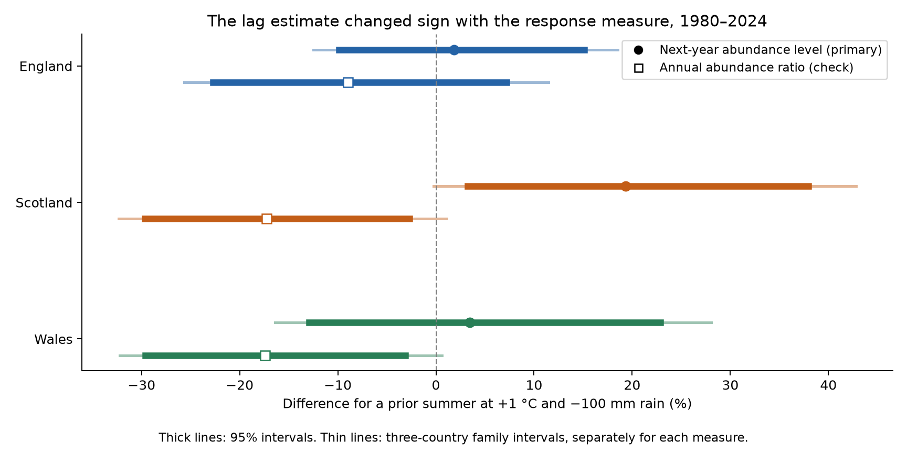
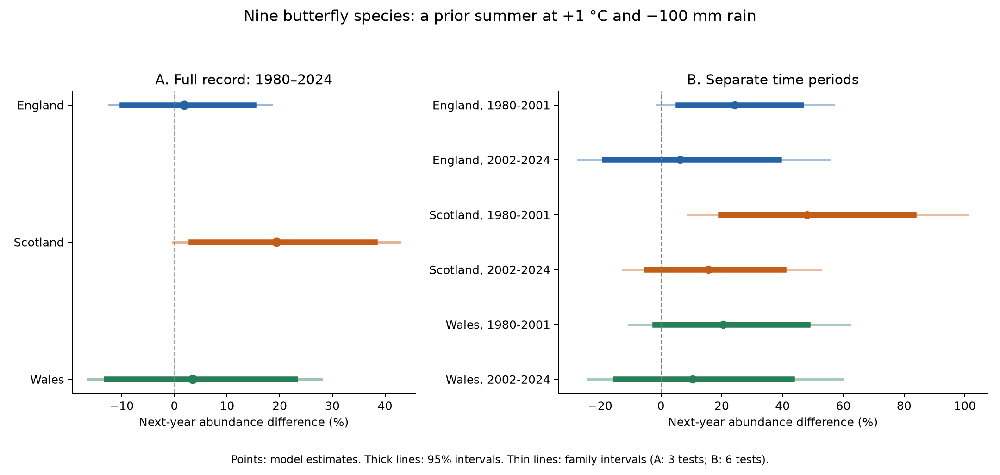
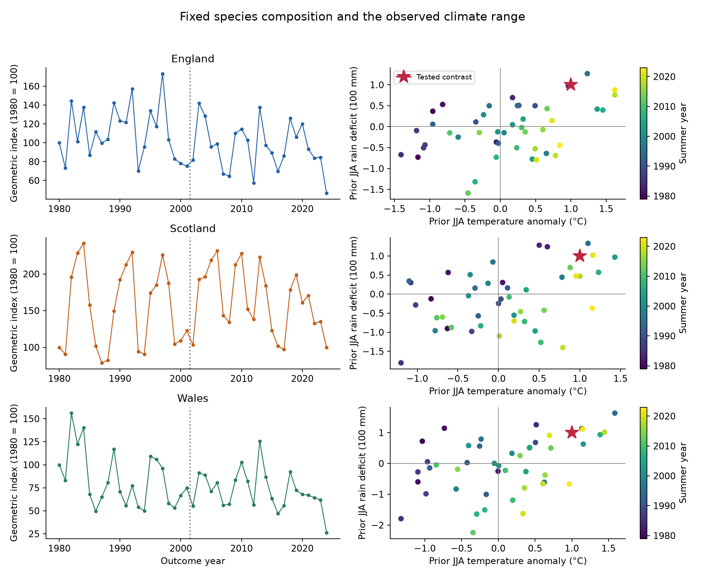

# Estimates for prior warm, dry summers changed sign between two abundance measures for nine butterflies in Britain in 1980-2024

Job: `sci-1107-hp-climate-pollution-biodiversity-24bfc0e7a02f`. Topic: `climate-pollution-biodiversity`. Campaign: `11_07_2026`. Machine: `hp`. Account: `codex-myxtap`. Model: `gpt-6.1-sol`, high reasoning effort. Date: 2026-11-08.

The signing identity is a campaign-machine key. It is not a personal authorship claim. This publication is stored locally. It was not sent to a remote archive or index.

## Result

A negative annual-change estimate did not imply a lower next-year abundance level in this sample. The estimate changed sign in all three countries when we changed the response measure. The primary level models did not give a clear common decline after a warm, dry summer.

We used nine butterfly species in England, Scotland and Wales. Each species had a published abundance index in every year from 1979 to 2024. Each retained index used at least five sites. The outcome models used 1980-2024. This gives 1,215 species-country-year index values and 135 country-year outcomes. The 1979 records supply the prior-year values.

We compared a prior June-August summer at +1 C and -100 mm rain with a summer at the country reference means. The reference period is 1981-2010. We held current summer weather and the model time terms fixed.

| Country | Estimate (%) | 95% lower (%) | 95% upper (%) | Family lower (%) | Family upper (%) |
| --- | --- | --- | --- | --- | --- |
| England | +1.85 | -9.88 | +15.11 | -12.47 | +18.51 |
| Scotland | +19.35 | +3.25 | +37.96 | -0.25 | +42.80 |
| Wales | +3.45 | -12.91 | +22.89 | -16.41 | +28.03 |

The family intervals control three country comparisons at a nominal joint 95% level. They use a Bonferroni correction. All include zero. The ordinary Scotland interval is above zero. It does not remain above zero after the three-test correction. These are conditional model estimates, not measured losses or gains caused by weather.



Figure 1. Filled circles show the primary next-year level result. Open squares show the planned annual-change check. A percent change in an annual abundance ratio differs from a percent change in an abundance level. Thick lines show ordinary 95% intervals. Thin lines show three-country family intervals, separately for each measure. All six family intervals include zero. Contains UK Butterfly Monitoring Scheme data; see the attribution below.

## Question and prior work

Warm weather can improve adult activity or development. Low rain can damage larval food plants. A large count in one summer can also be followed by a lower count in the next summer. That fall does not require a low next-year level relative to other years.

Roy et al. (2001) found different weather relations among British butterflies. Their study used current and previous weather and tested later years (doi:10.1111/j.1365-2656.2001.00480.x). Oliver et al. (2015) studied drought-sensitive butterflies and habitat fragmentation (doi:10.1038/nclimate2746). Shan et al. (2024) linked English butterfly changes to daily extreme events and life stages (doi:10.1016/j.scitotenv.2024.176318). Our seasonal mean and rain-total test does not repeat those daily or habitat tests.

We first searched the campaign with SCI. Searches included `climate pollution biodiversity phenology`, `phenology`, `Japan`, `ozone` and `butterfly`. Existing results covered US shrubs, Japanese trees and birds. A related campaign bird study tested prior-season warmth across thermal range positions (SCI publication `sha256:3250b81c789d8cd041cf359eb978868b41ae06364686201fde41eeb105a326c8`). We read that publication. Our country-index test uses different biological observations and asks a different question. It is not a replication of the bird result.

The new contribution is a version-checked butterfly and weather evidence set, a regional and period test, and a direct audit of the response measure. The algebra itself is standard linear regression. The observed sign reversal in these data is the empirical result.

## Data and observation bias

The butterfly source is the UKBMS 2024 collated-index release (Botham et al., 2025; doi:10.5285/a70d8b0b-0ef5-484e-8195-42bcfd818229). We froze this release. It is not a claim that no later statistics exist. The input ZIP contains the source data and its method guide.

The published index is a log10 relative abundance index. Each species series has an arbitrary mean near 2. This scaling does not affect a regression weather slope. We gave each species equal weight. Our response y is log(10) times the mean log10 index minus 2. The exponential of a difference in y is a ratio of geometric abundance indices. It is not a count of all butterflies and is not a species richness measure.

The nine species are Small Tortoiseshell, Small Heath, Small Copper, Meadow Brown, Large White, Green-veined White, Small White, Common Blue and Dark Green Fritillary. Scientific names and source codes are in `files/species_list.csv`. We retained the source taxon names.

The source index uses a Generalised Abundance Index method. It estimates seasonal count patterns, fills gaps in recording and weights site-years by the sampled share of the flight period. See Dennis et al. (2016), doi:10.1111/biom.12506, and the source guide. These adjustments reduce effort bias under their assumptions. They do not make detection or site selection constant.

The source combines volunteer-selected transects, wider countryside sample squares and targeted surveys. The wider countryside scheme started in 2009. We checked records before 2009 and added a site-coverage proxy. This proxy is the mean log number of contributing sites across the nine species. It is not the number of unique sites or the number of visits. Its current and prior values are only sensitivity controls.

The source catalogue describes a five-site threshold. The files contain 68 records with fewer than five sites in the selected countries and years. We excluded them before testing complete coverage. None belong to the primary common set. There were no missing index values in this source subset. The full exclusion table is preserved. This source-quality amendment was recorded before weather fits.

Weather is from Met Office country series. The series use HadUK-Grid 1 km values from the land surface network. We used the published June-August mean temperature and rain total. We also used March-May values in a sensitivity model. The six weather files were updated on 2026-11-01 and retrieved on 2026-11-08. We did not interpolate country weather to butterfly sites.

Exact file paths, URLs, byte counts and SHA-256 hashes for all seven raw inputs are in `files/sources.json`. The shared names are:

- `/mnt/dell-data/shared_datasets/ukbms-collated-indices-2024-eidc-20261108/ukbms_collated_2024.zip`
- `/mnt/dell-data/shared_datasets/metoffice-england-tmean-monthly-20261108/England_Tmean.txt`
- `/mnt/dell-data/shared_datasets/metoffice-england-rainfall-monthly-20261108/England_Rainfall.txt`
- `/mnt/dell-data/shared_datasets/metoffice-scotland-tmean-monthly-20261108/Scotland_Tmean.txt`
- `/mnt/dell-data/shared_datasets/metoffice-scotland-rainfall-monthly-20261108/Scotland_Rainfall.txt`
- `/mnt/dell-data/shared_datasets/metoffice-wales-tmean-monthly-20261108/Wales_Tmean.txt`
- `/mnt/dell-data/shared_datasets/metoffice-wales-rainfall-monthly-20261108/Wales_Rainfall.txt`

We used the shared files in place and did not change existing data. New downloads used the campaign dataset helper. The seven small source snapshots are also in `files/raw/` to permit an exact offline rebuild. Their source terms remain in force.

## Model and uncertainty

We recorded `files/design.md` before fitting the weather models. It gives the question, filters, contrast, model, period split and sensitivity checks. It also records the pre-fit source-quality amendment and the later algebra audit. The plan was local; it was not registered with an external registry.

For each country, let T be summer temperature minus its 1981-2010 mean. Let D be the reference mean rain minus summer rain, divided by 100 mm. Positive D means less rain. Let z = (year - 2002) / 10. We fit:

```text
y(t) = a + b*z + c*z^2
       + d*T(t) + e*D(t) + f*T(t)*D(t)
       + g*T(t-1) + h*D(t-1) + j*T(t-1)*D(t-1) + error(t).
```

The primary log contrast is theta = g + h + j. The percent result is 100 times [exp(theta) - 1]. It compares (T,D) = (1,1) with (0,0) for the prior summer. It is not the interaction coefficient alone. The three prior interaction estimates also had intervals that included zero; there was no clear extra effect beyond additive terms.

Each full-country model has 45 observations and nine parameters. We used a Newey-West HAC covariance with Bartlett weights and lag 3. The covariance has the finite-sample factor n/(n-k). We used Student t quantiles with n-k degrees of freedom. This is an approximate time-series method. It does not guarantee coverage with a short series or a wrong trend model. Species do not supply independent climate observations.

The primary family has three country contrasts. The period check has six contrasts. Other checks are exploratory. Their ordinary 95% intervals are in the complete result table. For the response-measure figure, we also give a separate three-country correction for the annual-change check.

The countries have separate observation sites, but share weather, species and source methods. Thus they are geographic checks, not statistically independent replications. No pooled p-value combines them.

## Period and observation checks

The two periods contain 22 and 23 years. Their models have the same nine parameters. Their intervals are consequently wide.

| Country | Years | Estimate (%) | Family lower (%) | Family upper (%) |
| --- | --- | --- | --- | --- |
| England | 1980-2001 | +24.28 | -1.52 | +56.83 |
| England | 2002-2024 | +6.36 | -27.28 | +55.56 |
| Scotland | 1980-2001 | +48.01 | +8.98 | +101.03 |
| Scotland | 2002-2024 | +15.54 | -12.49 | +52.55 |
| Wales | 1980-2001 | +20.50 | -10.49 | +62.22 |
| Wales | 2002-2024 | +10.34 | -23.81 | +59.80 |

Only Scotland in 1980-2001 had a family interval above zero. The tested climate point lies outside that period's observed climate hull, so this estimate requires extrapolation. The later Scotland interval included zero. This does not establish that the relation changed between periods. We did not test an early-minus-late contrast.



Figure 2. The level estimate is positive in each country and period. Thin lines use three-test family intervals for the full record and six-test family intervals for the period models. Later England and both Scotland period estimates require extrapolation beyond their observed climate hulls. The figure does not establish a stable benefit from warm, dry summers.

Adding site coverage gave full-record estimates of +0.26%, +20.83% and +4.29% for England, Scotland and Wales. Limiting outcomes to 1980-2008 gave +11.15%, +30.41% and +14.74%. These checks did not produce a common negative estimate. They cannot remove all changes in the observation network.

Using separate country species sets gave +13.02%, +19.57% and +6.79%. These sets contain 44, 10 and 17 species. Their composition differs, so they answer a different community question. The complete set is selected for long records and may omit sensitive or scarce species.

Omitting each species gave estimate ranges of -1.08% to +6.72% in England, +15.12% to +23.77% in Scotland, and +1.36% to +8.21% in Wales. Omitting each outcome year gave -1.49% to +6.14%, +17.02% to +22.30%, and -4.15% to +5.98%. These are influence ranges, not confidence intervals.

A linear time term gave +1.45%, +18.75% and +3.42%. Adding current and prior spring weather gave -4.79%, +21.42% and -2.69%. Adding the prior abundance level gave +0.21%, +1.99% and -5.24%; all its ordinary intervals included zero. This last model conditions on a prior biological state and has a different meaning. The full file also gives HAC lags 1 and 5. We do not choose a model from these checks to obtain a preferred sign.

## Why the annual-change estimate has a different sign

The planned check replaces y(t) with y(t) - y(t-1). All predictors remain the same. The exponential contrast then applies to the annual abundance ratio.

| Country | Estimate (%) | 95% lower (%) | 95% upper (%) | Family lower (%) | Family upper (%) |
| --- | --- | --- | --- | --- | --- |
| England | -8.97 | -22.70 | +7.20 | -25.65 | +11.45 |
| Scotland | -17.28 | -29.65 | -2.72 | -32.32 | +1.11 |
| Wales | -17.43 | -29.61 | -3.14 | -32.24 | +0.61 |

All three point estimates are negative. The ordinary Scotland and Wales intervals are below zero. All three corrected intervals include zero. A negative value concerns a fall relative to the prior index. It does not alone show a low next-year level relative to other years with the same model controls.

With a fixed predictor matrix X, ordinary least squares is linear in its response:

```text
b[change] = b[level] - b[prior level].
```

We checked this by fitting the prior level to the same predictors. The three log contrasts were:

| Country | Next-year level | Prior-year level | Annual change |
| --- | --- | --- | --- |
| England | +0.018326 | +0.112323 | -0.093997 |
| Scotland | +0.176880 | +0.366556 | -0.189676 |
| Wales | +0.033933 | +0.225456 | -0.191523 |

The largest coefficient identity error was 2.3e-16. This confirms the arithmetic source of the sign difference. It does not show that the annual-change model is invalid. Both models describe valid, different response measures. Neither proves a biological cause. The identity audit was added after the planned check showed the sign reversal.

Current-summer joint level estimates were +11.09%, +40.59% and +27.92%. The Scotland and Wales three-country family intervals were above zero. Current weather can affect development, activity and detection together. We cannot separate these paths with annual country indices.

## Exposure support and limits

The tested (1 C, 100 mm deficit) combination lies inside the observed temperature-rainfall convex hull in all three countries. However, few summers met or exceeded both values: one in England (1995), two in Scotland (1995 and 2021), and four in Wales (1983, 1995, 2018 and 2022). The model uses all 45 prior summers. It is not a matched comparison of many independent severe drought events. In the separate period checks, the target lies outside the climate hull in later England and both Scotland periods. These three estimates require extrapolation. The other three period targets lie inside their hulls. See `files/period_support.csv`.



Figure 3. Left: fixed-species geometric abundance indices, with 1980 set to 100 in each country. These are descriptive series with no error bands. Right: observed prior-summer temperature and rainfall deficits, relative to 1981-2010. The star marks the tested contrast. Colour gives summer year. The vertical line in the left panels marks the period split. Country-specific scales differ.

The main limits are:

- The test covers nine species and broad country indices. It does not cover all butterflies or local extinction.
- Complete-record selection can exclude sparse, newly monitored or sensitive species. Species averaging can hide opposite species responses.
- The main series starts after the 1976 drought. It cannot assess that well-known event.
- Seasonal rain totals are not soil moisture or drought duration. Seasonal mean temperatures are not daily heatwaves.
- Country climate does not measure local microclimate or individual exposure. A common 100 mm deficit has different relative sizes across countries.
- Source indices adjust visits under model assumptions. We lack raw visit histories, site turnover details and index standard errors. Our intervals do not propagate source-index estimation error.
- Current weather, prior abundance, habitat change, pesticides, disease and land management can have linked effects. Smooth trends do not isolate them.
- The periods are short and share the same methods. HAC and t intervals are approximate. The source indices are rounded to 0.01 log10 units.
- We did not test air pollution, a direct demographic mechanism, species distributions, or a causal climate-change effect.

The practical result is a measurement check. A negative delayed growth estimate should be interpreted with its reference year and with a next-year level check. These data do not establish safety under warm, dry conditions.

## Reproduction and checks

All code, input snapshots and inspection tables are included. No network is needed. From an extracted publication root:

```bash
python files/prepare.py --datasets /nonexistent --output replay_inputs
OPENBLAS_NUM_THREADS=1 python files/analyze.py --input replay_inputs --output replay_results
python files/validate.py --rebuilt replay_inputs --replayed replay_results
```

The first command uses bundled raw snapshots when the shared path is absent. It checks all seven source hashes. The second makes all estimates and figures. The third compares the replay with the preserved tables. It also rebuilds the nine-species response and one-year weather alignment from raw records through a separate code path.

The main coefficient and covariance calculation agrees with a separate statsmodels OLS/HAC calculation. `files/numerical_checks.json` and `files/measure_identity.json` preserve the numerical evidence. The offline rebuild and replay results are in `files/validation.json`. Detailed instructions are in `files/REPRODUCE.txt`. The code needs only Python and the packages listed in `files/requirements.txt`. Exact versions are in `files/environment.json`.

## References and rights

Botham, M.S.; Middlebrook, I.; Heywood, J.; Harrower, C.A.; Milborrow, J.; Roy, D.B. (2025). United Kingdom Butterfly Monitoring Scheme: collated indices 2024. NERC EDS Environmental Information Data Centre. https://doi.org/10.5285/a70d8b0b-0ef5-484e-8195-42bcfd818229

Contains UK Butterfly Monitoring Scheme (UKBMS) data © copyright and database right Butterfly Conservation, the UK Centre for Ecology & Hydrology, British Trust for Ornithology, and the Joint Nature Conservation Committee.

Met Office. UK and regional series. HadUK-Grid country temperature and rainfall series. Snapshot retrieved 2026-11-08. https://www.metoffice.gov.uk/research/climate/maps-and-data/uk-and-regional-series

Dennis, E.B. et al. (2016). A generalized abundance index for seasonal invertebrates. Biometrics 72, 1305-1314. https://doi.org/10.1111/biom.12506

Roy, D.B. et al. (2001). Butterfly numbers and weather: predicting historical trends in abundance and the future effects of climate change. Journal of Animal Ecology 70, 201-217. https://doi.org/10.1111/j.1365-2656.2001.00480.x

Oliver, T.H. et al. (2015). Interacting effects of climate change and habitat fragmentation on drought-sensitive butterflies. Nature Climate Change 5, 941-945. https://doi.org/10.1038/nclimate2746

Shan, B.; De Baets, B.; Verhoest, N.E.C. (2024). Butterfly abundance changes in England are well associated with extreme climate events. Science of the Total Environment 954, 176318. https://doi.org/10.1016/j.scitotenv.2024.176318

Source data retain their Open Government Licence and attribution duties. See `files/ATTRIBUTION.txt`. The SCI baseline licence covers our original material to the extent we hold rights. It does not remove third-party rights. No private signing key is included.
