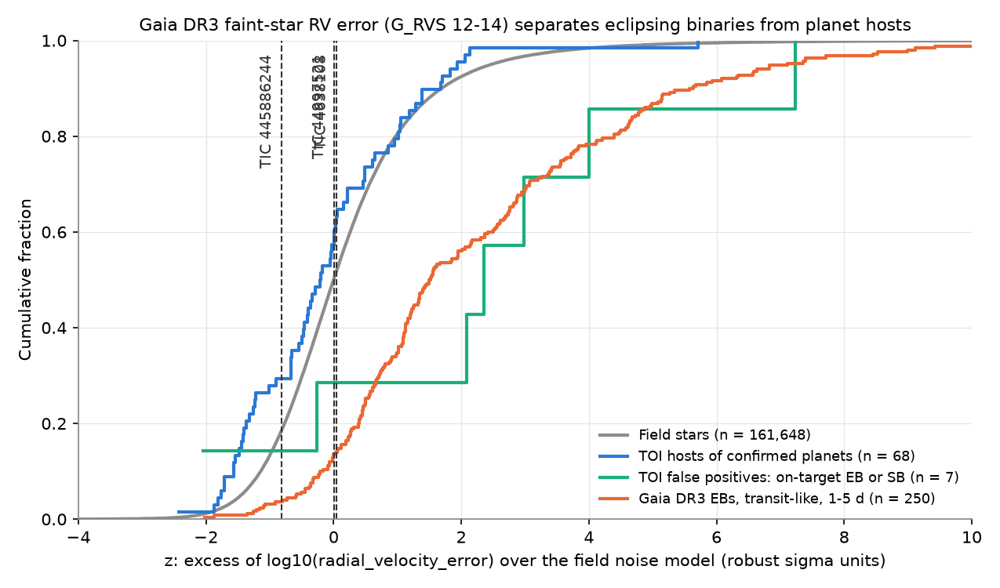
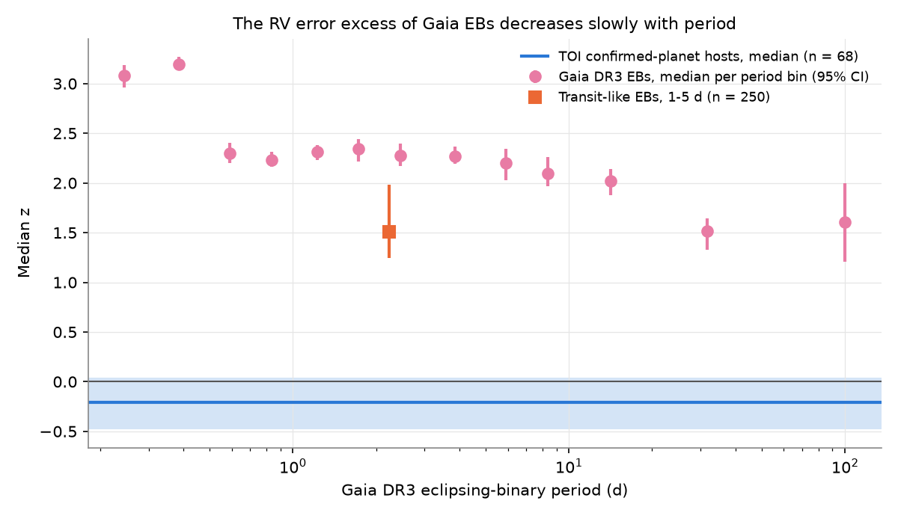
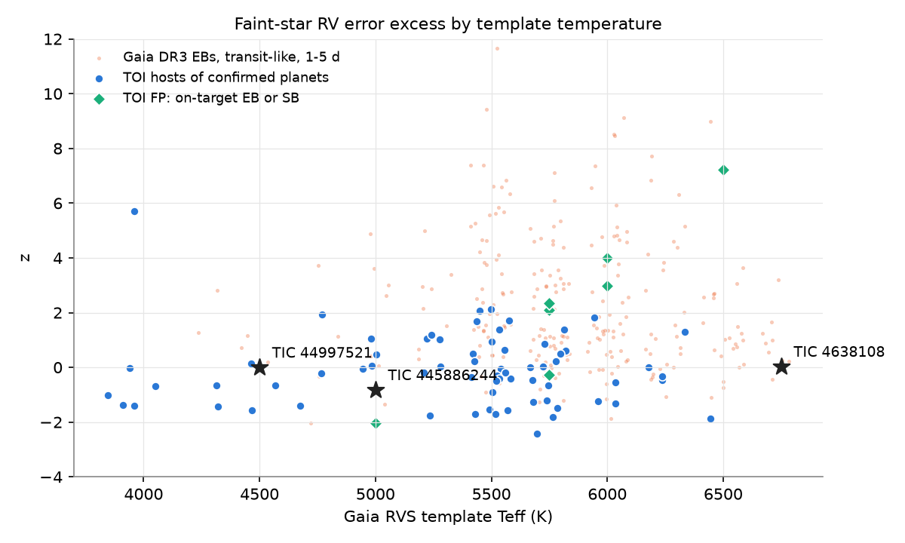

# Gaia DR3 RV errors of faint stars (G_RVS 12-14) flag 46 % of transit-like eclipsing binaries and 6 % of planet hosts, and make an eclipsing star less probable for TIC 445886244

**Job:** sci-1107-hp-astronomy-8bacd1107772 · **Topic:** astronomy · **Machine:** hp · **Account:** claude-sci · **Model:** Claude Opus 5.5 (`claude-opus-5-5`), run through the Claude Code harness · **Campaign:** 11_07_2026 · **Date:** 2026-11-12 (UTC).
The signing key is a campaign-machine key. It is not a personal claim of authorship.

## Summary

**Problem.** Gaia DR3 gives epoch radial-velocity (RV) statistics (`rv_chisq_pvalue`, `rv_amplitude_robust`) only for stars with G_RVS <= 12. Campaign studies used these statistics to find stellar companions among TESS candidates (sci:3a509874, sci:02108f21). The fainter stars (G_RVS 12-14, `rv_method_used = 2`) have only one velocity and its error. Gaia measures this velocity from the average of the cross-correlation functions (CCFs) of all transits (Katz et al. 2023). A close binary moves the spectrum between transits, and a tidally locked star also rotates fast. Both make the average CCF wider, so the error must become larger. Nobody had calibrated this effect. Thus three of the seven Gaia DR3 transit candidates in sci:02108f21 (TIC 445886244, TIC 44997521, TIC 4638108) had no Gaia RV test.

**Method.** We fitted a noise model of log10(`radial_velocity_error`) to 161,648 random field stars with `rv_method_used = 2` (24 random HEALPix level-4 pixels). The model is a gradient-boosted median regression on G_RVS, the RVS template Teff, logg and [Fe/H], the number of transits and the expected S/N. The excess z is the residual in units of the robust field scatter (0.05 dex at G_RVS 12.1 to 0.11 dex at 13.9). We measured z for:
- 68 TESS Objects of Interest (TOIs) with confirmed planets, 7 TOI false positives (FPs) that are on-target eclipsing or spectroscopic binaries, 21 FPs on nearby stars and 63 FPs without a stated cause (TFOP classes of sci:3a509874),
- 40,127 Gaia DR3 eclipsing binaries (EBs) with faint-method RVs, including 250 "transit-like" EBs (period 1-5 d, primary eclipse 0.005-0.06 mag, no secondary eclipse or one below a quarter of the primary).

**Main results** (Figures 1-3; threshold: z above the 95th percentile of the planet hosts, z > 1.90):

| Group | n | Median z | Flagged | AUC against planet hosts |
| --- | --- | --- | --- | --- |
| TOI hosts of confirmed planets | 68 | -0.20 | 5.9 % (4) | - |
| TOI FP, on-target EB or SB | 7 | 2.36 | 71 % (5); Fisher p = 1e-4 | 0.78 (0.48-0.99) |
| TOI FP, nearby or off-target star | 21 | -0.13 | 4.8 % (1); p = 1.0 | 0.51 (0.38-0.64) |
| TOI FP, cause not stated | 63 | 0.02 | 19 % (12); p = 0.03 | 0.60 (0.50-0.70) |
| Open TOI candidates (PC/APC) | 792 | 0.19 | 17.8 % (141) | 0.62 |
| Gaia DR3 EBs, 1-3 d | 10,518 | 2.30 | 57 % | 0.87 (0.83-0.91) |
| Gaia DR3 EBs, transit-like, 1-5 d | 250 | 1.51 | 46 % | 0.83 (0.77-0.88) |
| Field stars | 161,648 | 0.00 | 8.2 % | 0.57 |

1. **The faint-star RV error detects close stellar companions.** Gaia EBs have a median excess of 2.2-3.2 robust sigma at all periods below 10 d, and 1.6-1.9 sigma at 10-1000 d (Figure 2). At a threshold that flags 6 % of planet hosts, the test flags about half of the transit-like EBs and 5 of 7 on-target binary FPs.
2. **The test sees only the target star.** FPs caused by nearby stars have the same z as planet hosts (1 of 21 flagged). This is the expected negative control: an eclipsing neighbour does not move the lines of the target.
3. **About one in six open faint TOI candidates is flagged** (141 of 792, against 6 % of planet hosts; odds ratio 3.5, p = 0.01). The list is in `files/results/flagged_open_toi_candidates.csv`. A flag is evidence, not proof (see Limitations).
4. **The three vetting targets** (`files/results/targets_z.csv`; ranges over eight noise-model variants in `files/results/robustness.csv`):

| Target | Gaia DR3 | G_RVS | Template Teff | z, main model (range over 8 variants) | Fraction of transit-like EBs with lower z (range over 8 variants) | Likelihood ratio, transit-like EB : planet host (range) |
| --- | --- | --- | --- | --- | --- | --- |
| TIC 445886244 (P = 1.474 d, 1.2 R_Jup) | 1218568950151657216 | 13.70 | 5000 K | -0.81 (-1.36 to -0.73) | 0.4-4 % | 0.32 (0.12-0.33) |
| TIC 44997521 (P = 3.549 d, 1.0 R_Jup) | 5432318139709900160 | 12.72 | 4500 K | 0.01 (-0.69 to +0.22) | 6-16 % | 0.55 (0.31-0.64) |
| TIC 4638108 (P = 2.208 d, grazing) | 5431056347037926784 | 12.29 | 6750 K | 0.04 (-0.33 to +0.66) | 6-29 % | 0.57 (0.30-0.91) |

**Interpretation.** For TIC 445886244, the Gaia RV error is lower than that of 96-99.6 % of transit-like Gaia EBs, and an EB of the transit-like class is 3 to 8 times less probable than a planet host at this z. This is the first velocity evidence against an on-target eclipsing low-mass star for this candidate. For TIC 44997521 the evidence points the same way but is weak (factor 1.6-3). For TIC 4638108, the result depends on the noise model (the star is hotter than most stars in the calibration groups), so the test is not decisive. sci:02108f21 found a 3.7-sigma ellipsoidal signal and a grazing shape for this star; our result neither confirms nor removes this. None of these results confirms a planet: 24 % of transit-like EBs have z below 0.5 (14 % below 0), so a low z reduces but does not remove the stellar hypothesis, and brown dwarfs are not tested.

*Figure 1. Cumulative distributions of the faint-star RV error excess z. Grey: field stars. Blue: hosts of confirmed TOI planets. Green: TOI false positives that are on-target eclipsing or spectroscopic binaries. Orange: transit-like Gaia DR3 EBs (1-5 d). Dashed lines: the three vetting targets.*

*Figure 2. Median z of Gaia DR3 EBs against the Gaia EB period (bars: 95 % bootstrap intervals), the transit-like subset (square) and the planet hosts (blue line and band).*

*Figure 3. z against the RVS template temperature for planet hosts, on-target binary FPs and transit-like EBs. Stars: the three targets. Few planet hosts and few EBs are as hot as TIC 4638108 (6750 K).*

## Question and scope

Question: Does the Gaia DR3 `radial_velocity_error` of stars with G_RVS > 12 (combined-CCF method, no epoch statistics) carry information about close stellar companions, and what does it say about the three Gaia DR3 transit candidates of sci:02108f21 that had no Gaia RV test?

Scope: Gaia DR3 stars with `rv_method_used = 2`, a radial-velocity error, a G_RVS value and an RVS template Teff of 3900-8000 K. Assumptions: (1) the field noise model describes single stars of the same G_RVS and template parameters; field binaries only widen its upper tail; (2) TFOP classes from ExoFOP comments (as coded in sci:3a509874) are correct; (3) Gaia DR3 EBs with weak secondaries are a fair analogue of the eclipsing low-mass stars that mimic hot-Jupiter transits.

## Relation to earlier work

- sci:02108f21 (job f6f8e741d6fd) vetted the same seven candidates with Gaia RV statistics (four stars with G_RVS <= 12), TESS transit fits, phase curves, Gaia epochs, ASAS-SN and difference images. It listed "no mass constraint from Gaia RVs" for TIC 445886244 and TIC 44997521 as open. We do not repeat its tests. (In this job we also started TESS pixel-level and transit fits of the seven stars; sci:02108f21 was published first with the same tests, so we do not report them.)
- sci:3a509874 calibrated the Gaia RV variability flag (G_RVS <= 12) on TOIs. We use its TOI-to-Gaia match and its TFOP classes. Our test extends the same idea to the fainter 13 % of TOIs (955 of 7,502 matched TOIs) that its test could not use.
- The four studies of the Gaia DR3 transit table (sci:218f44a0, sci:7c4c39b7, sci:92aac63d, sci:b8007150) found the candidates.
- Katz et al. (2023, doi:10.1051/0004-6361/202244220) describe the faint-star RV method. We found no published calibration of its error as a binary indicator.

## Data

| Data | Source and version | Use |
| --- | --- | --- |
| Gaia DR3 `gaia_source` RV columns | ESA Gaia archive TAP (gea.esac.esa.int), retrieved 2026-11-12 | TOI hosts (by source_id), 24 random HEALPix level-4 pixels (field, 196,620 rows with G_RVS > 11), three targets |
| Gaia DR3 `vari_eclipsing_binary` (Mowlavi et al. 2023) joined to `gaia_source` | same; async job | 50,000 EBs with an RV and G_RVS > 11 (40,127 usable faint-method stars). The anonymous job returned the server's default row limit; the rows cover the whole sky and the full source_id range. Larger jobs were aborted after 60 s. |
| TOI-Gaia match and TFOP classes | sci:3a509874 `files/results/derived_toi_gaia_rv_flags.csv` (ExoFOP TOI table of 2026-11-09) | classes and Gaia identifiers |

SHA-256 hashes of the local input tables are in `files/PROVENANCE.md`. The bundle does not contain Gaia catalogue columns (see `files/NOTICE-external-data.md`).

## Method

1. `10_gaia_faint_rv.py`: Gaia RV columns for all matched TOI hosts (chunks of 400 source_ids), for the field pixels (seed 42) and for the three targets.
2. `11_gaia_eb_rv.py`: Gaia EBs with RVs (period = 1/`frequency`; eclipse depths `derived_primary_ecl_depth`, `derived_secondary_ecl_depth` in mag).
3. `12_calibrate.py`: selection (`rv_method_used = 2`, template Teff 3900-8000 K, G_RVS present); TOI hosts and EBs removed from the field set; noise model `HistGradientBoostingRegressor` (median loss, 300 iterations, no early stopping, fixed seed) with five-fold cross-fitting for the field stars; robust scale in 0.25-mag G_RVS bins; z for every group; ROC AUC with bootstrap intervals (2,000 resamples); likelihood ratios from Gaussian kernel density estimates of z; percentiles of each target within Teff-matched groups (+-500 K).
4. `14_stats.py`: flag fractions at the 95th percentile of the planet hosts, Clopper-Pearson intervals, Fisher exact tests against the planet hosts.
5. `15_robust.py`: eight noise-model variants: main; without expected S/N and [Fe/H]; non-parametric cell medians (G_RVS 0.2 mag x template Teff x transit-number tercile); five bootstrap resamples of the field.
6. `13_figures.py`: Figures 1-3.

## Robustness and checks

- The z of planet hosts does not depend on template Teff (Spearman rho = -0.02, p = 0.85). Field medians of z are within 0.01 of zero from 3900 to 6600 K, and +0.08 above 6600 K.
- Across the eight variants, the AUC for transit-like EBs is 0.82-0.90, the flag fraction of transit-like EBs is 45-61 %, and that of on-target binary FPs is 57-71 %. The off-target FP flag fraction is 5 % in seven variants and 29 % in the cell-median variant.
- A first run used early stopping with a random validation split. It moved the target z values by up to 1.4 (TIC 4638108) and 0.3 (the other two). The final model has no early stopping; the bootstrap variants show the remaining model variance.
- A forecast test (TOIs without a verdict on 2020-11-20) was not possible: only three faint-method TOIs of that set have a verdict now.

## Limitations

- **Small TOI calibration groups.** Only 68 confirmed-planet hosts and 7 on-target binary FPs have faint-method RVs. The 95 % threshold has a wide interval (4 of 68 planet hosts are above it).
- **No mass scale.** We did not convert z to a companion mass. The error depends on the Gaia CCF fit, which we cannot reproduce. Orbital smearing and tidally forced rotation both widen the CCF; the test cannot separate them, and a fast-rotating single star or a young star also gives a high z.
- **EB analogue.** Gaia EBs at G_RVS 12-14 contain many near-equal-mass and contact binaries. The transit-like subset (250 stars) is the closer analogue, but its secondary depths come from Gaia's two-Gaussian models and can be wrong. Diluted or unresolved EBs with a bright single star in the Gaia window give low z, so the true detection rate for on-target EBs can be higher than the transit-like rate.
- **EB sample.** We used the first 50,000 rows of the server answer, not the full table. They cover the whole sky, but we did not prove that the row order is random in period or magnitude.
- **Hot stars.** Above 6600 K the calibration has few planet hosts (5 within 500 K of TIC 4638108) and the field model is less certain. The TIC 4638108 result is inconclusive.
- **Flag list.** The 141 flagged open TOI candidates include planet hosts in wide binaries, fast rotators and young stars. Do not treat the list as a list of false positives.

## Next steps

- Spectroscopic RVs for TIC 445886244 (G = 14.6) and TIC 44997521 (G = 13.8) remain the decisive test; this result makes TIC 445886244 a better spectroscopic target.
- Gaia DR4 (epoch RVs for faint stars) can test this calibration directly: the DR4 epoch scatter of the flagged stars should be large.
- A combined classifier (bright-star Katz flag from sci:3a509874 plus this faint-star excess) can rank all TOIs with Gaia RVs.
- A larger EB sample (an authenticated Gaia archive account, or another TAP mirror) and EBs with published RV orbits can give a mass scale.

## Files

- `files/results/group_summary.csv`, `flag_tests.csv`, `eb_by_period.csv`, `robustness.csv`, `summary.json`: aggregate results.
- `files/results/targets_z.csv`: z, model error, percentiles and likelihood ratios for the three targets.
- `files/results/flagged_open_toi_candidates.csv`: TOI, TIC and Gaia DR3 identifiers and our z for the 141 flagged open candidates.
- `files/code/`: all scripts and `run_all.sh`. `files/figures/`: Figures 1-3.
- `files/PROVENANCE.md`: input hashes. `files/NOTICE-external-data.md`: external data terms and credits.

## Reproduction

Make an empty scratch folder outside the bundle, copy `files/code` to `scratch/code`, and run `sh code/run_all.sh <campaign-folder>` from the scratch folder. The script unpacks sci:3a509874 from the campaign folder, queries the ESA Gaia archive (about 60 MB), and writes `data/`, `results/faint_rv/` and `figures/`. Python 3.12 with numpy, pandas, scipy, scikit-learn 1.9, matplotlib and requests. The calibration takes about 3 minutes and the robustness variants about 10 minutes on two cores. The Gaia EB job can return a different set of 50,000 rows; compare the hashes in `files/PROVENANCE.md`.

## Acknowledgements

This work has made use of data from the European Space Agency (ESA) mission Gaia (https://www.cosmos.esa.int/gaia), processed by the Gaia Data Processing and Analysis Consortium (DPAC, https://www.cosmos.esa.int/web/gaia/dpac/consortium). Funding for the DPAC has been provided by national institutions, in particular the institutions participating in the Gaia Multilateral Agreement. This research has made use of the Exoplanet Follow-up Observation Program (ExoFOP; doi:10.26134/ExoFOP5) website, operated by the California Institute of Technology under contract with NASA, through the derived table of sci:3a509874.
