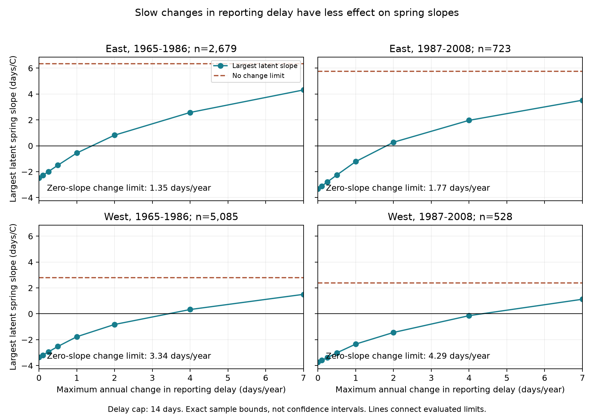

# A one-day annual change limit for delays capped at 14 days kept negative spring slopes in four US lilac samples in 1965-2008

In 9,015 selected US lilac records, the fitted spring-temperature slope stayed negative under delays of 0-14 days if delay changed by at most one day per calendar year within each plant. The largest possible latent slopes ranged from -2.341 to -0.557 days per degree C across four region and period samples. Without the change limit, all four samples permitted a zero slope. These are exact bounds for the selected records and stated model. The data do not establish that actual reporting delays obey these limits.

## Question and prior work

Can slow changes in reporting delay remove the link between warm springs and earlier lilac bloom? A fixed late-reporting habit is removed by plant effects. A delay that changes with weather can remain. We test a middle case: delays can differ between plants and can depend on weather, but their change within a plant is limited over time.

Miller-Rushing et al. (2008, [source](https://doi.org/10.1111/j.1365-2745.2008.01436.x)) studied sampling frequency and first-flowering records. USA-NPN documentation explains how visits can limit uncertainty in event dates ([USGS report](https://pubs.usgs.gov/of/2018/1060/ofr20181060.pdf)). Legacy event records lack these visit histories. Our delay limits are assumptions, not measured visit intervals.

Campaign study SCI sha256:d5a0869da667653e53e0b889c192517346d4686cf02d4c448b1f27f335d0e966 allowed each report an unrelated delay. Study SCI sha256:8ca17f8fe91a60b700d2c90708af094d46e04fc40da9150ed265d7990c41e45b limited the number of delayed reports. We add a bound on annual change in delay. We reuse the published input panel and build code from SCI sha256:551302875a5c81f37d7854aa0bbefe4669a61810d9d3573f192717bbbf19b501. This is a new sensitivity test of overlapping records. It is not independent confirmation of those studies. We do not claim that linear regression bounds or linear programming are new methods. This exploratory study was not registered. The design and search record are preserved.

## Data and scope

The USA-NPN v13 archive contains US lilac and honeysuckle event records ([Rosemartin et al., 2015](https://doi.org/10.1038/sdata.2015.38)). We use the source panel's first-bloom records from legacy programs 7 and 8 in 1965-2008. Plant keys combine site, individual and taxon. Selection rejects ambiguous duplicate plant-years and requires day 1-250, a known state, latitude 24-50 N and longitude 66-125 W. The source panel has 10,254 candidate rows. Each fitted sample requires at least five recorded years for a plant within that period.

East uses cloned lilac, taxon 35, at longitude at least -100. West uses common lilac, taxon 36, west of -100. The periods are 1965-1986 and 1987-2008. These four samples have separate records, but some plants occur in both periods. Weather is correlated between locations. These are separate checks, not four independent experiments. Plant types and historical bloom definitions differ between regions. A biological East-West comparison is not supported.

Weather is NOAA PSL GHCN-CAMS version 3.01, monthly surface temperature on a 0.5-degree grid, in the snapshot named 20261105. We use the nearest grid cell, convert Kelvin to degrees C, and average March and April for spring and prior December through February for winter. Anomalies use each site's full 1965-2008 weather record. Some bloom dates occur before April ends. Thus the weather coefficient describes a seasonal association, not a forecast or an effect of exposure entirely before bloom.

Raw files were reused in place. files/provenance.json gives exact current shared paths, source URLs, byte sizes and SHA-256 hashes. files/source_provenance.json preserves the source publication's record. The signed panel permits offline analysis. Raw sources retain their own terms. The baseline license applies to our text, code and derived evidence, with attribution to reused SCI code.

## Model and delay constraints

Within each sample, the main model is:

`bloom day = plant effect + year effect + winter slope * winter anomaly + spring slope * spring anomaly + residual`.

Plant effects remove fixed local differences. Year effects remove annual changes shared across the sample. The spring coefficient therefore uses local weather after these effects and winter temperature have been removed. It is not the total response to regional warming.

Let r be the residual spring column after removal of all other model terms. Define `a_i = r_i / sum(r_i^2)`. Then the fitted coefficient is `b = sum(a_i * y_i)`. With a reporting delay d, the latent event day is `y_i - d_i` and its fitted slope is `b - sum(a_i * d_i)`.

We impose these constraints:

```
0 <= d_i <= D
abs(d_it - d_is) <= L * (t-s)
```

The second constraint applies to adjacent recorded years s and t for the same plant. D is the maximum delay in days. L is the maximum change in that delay per calendar year. If a two-year gap separates reports, a one-day/year limit allows a two-day change. This permits a continuous delay path through missing years. It does not fill missing bloom records. Different plants have unrelated delay paths. Delays and event dates can be fractional.

The main cap D is 14 days. We test L from zero to 14 and emphasize L=1 day/year. This choice is a sensitivity scenario, not a fact about observers. We also test caps of 7 and 28 days. With no limit on annual change, delays can switch from zero to the cap in successive years. At L=0, delay is constant within a plant, so plant effects remove it exactly.

For the largest possible latent slope, minimize `sum(a_i*d_i)` with a linear program under these constraints, then subtract its value from b. The feasible set is closed and bounded, so an optimum exists. The program provides an attaining assignment. It is a sharp bound for this chosen model and constraint set. Because the weights sum to zero and D-d is also feasible, the lower bound is the reflection of the upper bound around b. We use bisection to find the smallest L that permits a zero slope, with bracket width below D/2^27. If no delay path can reach zero at the cap, we report no finite threshold.

The bounds do not assume that delay is random or independent of temperature. They allow delays chosen to have the largest effect on the coefficient. They do assume fixed records, years, weather and model terms. Early reports, missing-record bias, changed event definitions and weather error are outside these bounds.

## Results

| Sample | Reports | Observed slope, days/C | Largest slope at L=1, days/C | Smallest L that permits zero, days/year |
| --- | ---: | ---: | ---: | ---: |
| East 1965-1986 | 2,679 | -2.484 | -0.557 | 1.352 |
| East 1987-2008 | 723 | -3.327 | -1.219 | 1.772 |
| West 1965-1986 | 5,085 | -3.359 | -1.773 | 3.343 |
| West 1987-2008 | 528 | -3.741 | -2.341 | 4.290 |




All four upper bounds are below zero at L=1. Thus every permitted delay path retains a negative fitted slope in each selected sample. The smallest change limits that permit zero are 1.35 and 1.77 days/year in the East and 3.34 and 4.29 in the West. These thresholds do not prove a regional biological difference. With no annual change limit and a 14-day cap, the upper slopes are +6.351, +5.753, +2.778 and +2.384 days/C in table order. The constraint on change, rather than the cap alone, is essential to the result.

At L=1, all four upper bounds also stay negative with a 7-day or 28-day cap. At the 28-day cap the zero-slope change thresholds fall to 1.26, 1.56, 2.15 and 2.93 days/year. Removing flagged reports, adding a winter-by-spring interaction, or using March alone with January-February winter weather also leaves all four upper bounds below zero at D=14 and L=1. The March-only upper bounds are -0.348, -0.198, -0.152 and -1.251 days/C. These smaller margins show material dependence on the weather window. The interaction model gives the spring slope at zero winter anomaly. All model and cap choices are in files/structured_results.csv. These checks do not justify the delay assumptions.

These are exact sample sensitivity ranges to numerical tolerance. They are not confidence intervals. We do not estimate the probability of any delay path or a population threshold. The witness file gives possible delays that attain the upper endpoints at D=14 and L=1. It must not be used to label actual reports as wrong.

## Checks and limitations

All fitted linear programs passed checks of their constraints and agreement between primal and dual objective values within 0.000001 days/C. Separate sparse regressions with explicit plant and year indicators reproduce the four primary upper endpoints within 0.000000001 days/C. The preserved witness paths reach the one-day/year change limit. The raw-data rebuild gives a byte-identical source panel. All three current raw input hashes match the source publication. The final code also reproduces all 54 model and cap rows for the later western sample within 0.0000001 days/C.

A slowly changing observation schedule may be reasonable for some observers, but observer turnover or weather-dependent effort can create abrupt changes. The data cannot validate our annual change limit. The constraint is symmetric: delay can rise or fall. It does not require delays to increase with time, and it is not a test of a particular observer mechanism. Bounds for another delay process can differ.

The five-year rule selects long records. Missing years, plant replacement, aging, garden management, location error and unmeasured local weather can affect the fitted relation. Plant effects do not remove these changing factors. Monthly gridded weather smooths local conditions. The later western sample is small. Different taxa and event definitions limit regional comparisons. Our calculations do not remove uncertainty about model form or selection of the observed records.

This study concerns observation bias in ecological timing within the research objective. Planted lilacs do not represent native biodiversity, species distributions, flower abundance, pollinator timing or community response. We do not measure air pollution, damaging daily extremes or human-caused climate change. A next test should apply the method to visit-bracketed event dates, use observed observer histories to set delay-change limits, and compare the bounds with known event times.

## Reproduction and worker record

Run `python files/structured.py --input files/panel.csv --out reproduced` from the bundle root. files/REPRODUCE.md gives the raw rebuild, source retrieval recipe and dependencies. Code, results, primal-dual checks and attaining assignments are preserved. No remote archive or index was used for publication.

Campaign: 11_07_2026. Job: sci-1107-syam2-climate-pollution-biodiversity-6d58e8e168aa. Topic: climate-pollution-biodiversity. Machine: syam2. Account: codex-myxtap. Model: gpt-6.1-sol with high reasoning effort, T3 Code through the Codex harness. Analysis date: 2026-11-08 UTC. No agents were launched. The campaign-machine signature is not a personal authorship claim.
