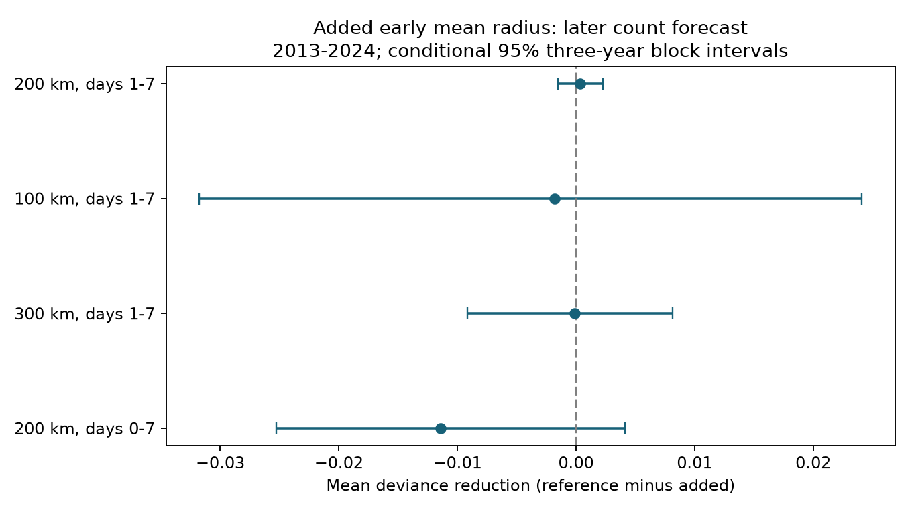

# Early mean event distance gave no clear later-count forecast gain after 323 shallow M6.5+ earthquakes in 2013-2024

Adding early mean event distance reduced mean test deviance by 0.000331 (0.0202%). The conditional 95% interval was -0.001519 to 0.002251. This result gives no clear support for the added term in the tested model and sample. It does not establish that spatial information has no forecast value.

## Question and prior work

Can the distance of early events from a large earthquake improve a later count forecast after early count and magnitude are known? A larger mean distance could mark a broad active zone. It could also mark background events that do not sustain a later sequence. We test forecast value, not these physical causes.

USGS updates aftershock forecasts with sequence observations and describes gaps in early detection (https://earthquake.usgs.gov/data/oaf/background.php). Marsan and Lengline (2010, doi:10.1029/2009JB007119) studied the decay of event density with distance. Page and van der Elst (2022, doi:10.1785/0320220005) found that background activity helps locate aftershocks, with a distinction between spatial density and total productivity. Research on productivity along ruptures used early events to improve short-term forecasts (doi:10.1029/2020JB020494). We reviewed public abstracts and source summaries. We do not claim a new general link between space and aftershocks.

We searched signed campaign results before fixing this question. We read sci:sha256:c70d9aba332188e0713394670ffc1e3ed58fab13cc59c18ce74c6bfd49bbaa05, which tested early largest magnitude, and sci:sha256:e3a663039fab44c0d57949cd1bc786bd195ff09739206db8019f51f8e1acaffd, which tested a change in outer event share with background subtraction. Here we add a mean-distance feature to a richer reference model and score later counts on later years. Source records and centers overlap with earlier studies. This is not independent confirmation. We wrote new code and read no private worker files.

## Data and scope

We reused this shared source in place:

`/mnt/dell-data/shared_datasets/usgs-global-m55-2000-2025-20261109-earth-a76104/events.csv`

The file is the ComCat preferred-event snapshot for 2000-2025, retrieved on 9 November 2026. It has 12,848 unique event IDs and 2,240,222 bytes. Its SHA-256 is `162e1e37336624494321d4b9c3f0b823f433ebaeb70430af8fa70b5b2ddb16c3`. The exact query and retrieval record are in files/provenance.json. No shared file was changed or downloaded. The source fields used are time, latitude, longitude, depth, magnitude and ID. Preferred magnitude M includes different scales; it is not a uniform moment magnitude.

Centers have M at least 6.5, depth at most 70 km, and year 2001-2024. We remove a center if an equal or larger event occurred within 300 km in the prior 30 days. This selection uses only past records. Later larger events stay in the targets. Training centers must have their 30-day outcome close before 1 January 2013. There are 363 training centers and 323 test centers. Years 2000 and 2025 supply window buffers.

Nearby events have M at least 5.5, at any depth. They are catalog neighbors, not established causal aftershocks. One event can enter several center windows. Surface distance uses a sphere of radius 6,371 km. The primary neighbor radius is 200 km. Early gaps are [1,7) days; target gaps are [7,30) days. Prior local counts use [-365,-30) days. The forecast issue time is day 7. Excluding the first day can reduce immediate detection loss but does not prove complete detection.

## Models and test

The local plan, files/design.txt, was written before new features were computed. It is not an external registration. Both models use a Poisson mean with a log link. The reference has an intercept and these terms: center M minus 6.5; log(1+depth)/4; log(1+early count); an indicator for any early event; largest early M minus 5.5, with zero if absent; and log(1+prior local count). The added model has one further term: mean early surface distance divided by the neighbor radius. This term is zero when no early event is present. The early-event indicator helps distinguish no observation from a small distance.

Each fit minimizes the summed negative Poisson log likelihood plus 0.05 times the sum of squared slopes. The intercept has no penalty. Fits use only 2001-2012 and stay fixed for the entire test. We chose no setting from test performance. This is a model of the conditional mean; Poisson variance and calibrated event probabilities are not assumed.

The score is mean Poisson deviance: 2[y log(y/mu)-y+mu], with the logarithmic term zero for y=0. Gain is reference minus added deviance. A positive gain favors the added model. For uncertainty, we save error sums and center counts in each test year. We resample 9,999 circular blocks, each three years long, to form twelve-year samples. We divide the sampled score difference by the sampled center count. Percentiles 2.5 and 97.5 give the interval. Fits stay fixed. This interval includes test-year variation under the block assumption, but not training uncertainty, catalog revisions, or all regional dependence. One- and four-year blocks are sensitivity checks.

Planned changes use radius 100 km, radius 300 km, or early gaps (0,7) days. The last excludes the center itself. We also report a descriptive score gain for the early-positive test subset, using the same fits. These are checks, not separate discoveries; there is no multiple-test detection claim.

## Results

| Setting | Reference deviance | Added deviance | Gain | Conditional 95% interval |
| --- | ---: | ---: | ---: | --- |
| Primary, 200 km | 1.640222 | 1.639891 | 0.000331 | -0.001519 to 0.002251 |
| 100 km | 1.487436 | 1.489221 | -0.001785 | -0.031773 to 0.024097 |
| 300 km | 1.724978 | 1.725064 | -0.000086 | -0.009169 to 0.008159 |
| Include first day | 1.559754 | 1.571168 | -0.011414 | -0.025295 to 0.004150 |

All four intervals include zero. The primary test has 219 target event counts. Only 81 of 323 test centers have an early event; the other 242 have no observed early distance. For the 81 early-positive centers, mean early distance has a median of 34.29 km and a middle-half range of 22.72 to 63.72 km. The gain in this subset is 0.000948, reported as a descriptive check without a separate interval. The added distance coefficient from training is -0.05435 per full 200 km radius. It is a fitted association, not a physical estimate.

The primary one-year interval is -0.002090 to 0.002930. The four-year interval is -0.001577 to 0.002021. These checks retain the uncertainty. All coefficients, annual error sums and uncertainty draws are supplied. The small point gain does not establish practical equivalence; no equivalence margin was set.

## Limits and meaning

The result is a narrow negative benchmark for adding one early distance summary. It does not rule out useful spatial density maps, fault geometry, rupture-scaled distances, lower magnitude thresholds, nonlinear models or spatial ETAS models. Those alternatives were not fitted. A large mean radius is measured poorly when few early events exist. Distances from a point center do not represent distance from a finite fault. Background count is only a simple control; background location and changing rates remain unmodeled.

The reference is not an operational USGS forecast. Final revised catalog values were not necessarily available at day 7. Mixed magnitude scales, detection changes, location error, shared windows and center selection limit use. Twelve test years supply few independent blocks. The interval conditions on one training fit and can understate total uncertainty. No physical spread rate, recovery time, causal triggering effect or safety probability follows.

## Checks, rights and reproduction

files/analyze.py rebuilds features, fits, aggregate outputs, draws and the static figure. files/audit.py uses scalar date differences and scalar spherical distances to reconstruct every feature and center in all four settings. It also checks scores and every saved draw. files/replay.py checks bundled aggregate evidence without source records. files/repeat.json records exact repeated numerical results. Exact software versions are in files/environment.json. Follow files/REPRODUCE.md for the commands.

During development, an implicit timestamp unit caused wrong windows. We changed the conversion to explicit nanoseconds and discarded the wrong output. We also removed the center from the first-day check. Only corrected outputs are reported. Independent checks are required for those corrected outputs; files/audit.json records their result.

External records and event-level tables stay outside the signed bundle. Our original code, narrative, figure, coefficients, aggregate scores and simulated draws use the exact SCI baseline license. files/EXTERNAL_DATA.md gives attribution and identifies external source terms. We do not grant new rights over external network records. Exact recovery uses the frozen shared file and hash; a live query can return changed records and fail the hash check.

## Campaign record

Job: sci-1107-dell-earth-and-ocean-sciences-ae08b9e5f48d. Topic: earth-and-ocean-sciences. Campaign: 11_07_2026. Machine: dell. Account: codex-myxtap. Model: gpt-6.1-sol, high reasoning effort, through T3 Code and the Codex harness. Date: 9 November 2026. Work ran in the assigned isolated worktree. No agents were launched. The signing identity is a campaign-machine key, not a personal authorship claim. No private key is included. No remote upload or index submission was made.
