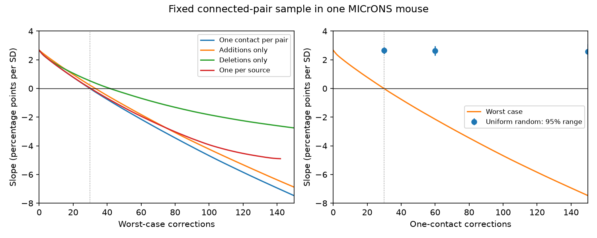

# Thirty targeted one-contact changes remove a fitted response similarity slope in 8,128 connected MICrONS pairs

## Result

We tested the stability of a reported link between movie response similarity and multiple synaptic contacts in one MICrONS mouse. We kept 8,128 connected cell pairs, their predictors, and the linear model fixed. The model controlled for both cells and proximity lengths. Its slope was 2.67 percentage points per standard deviation of response similarity. An exact sort of regression weights showed that 30 selected one-contact changes made the slope nonpositive. Every allowed set of 29 changes left it positive. The changes could add one contact to a single-contact pair or remove one from a two-contact pair. With at most one change per source cell, 31 changes were needed. Additions alone needed 34 changes; deletions alone needed 42. Uniform random changes left the slope positive in all 10,000 trials at each of 30, 60 and 150 changes. This is a fixed-design sensitivity result. It does not estimate an error rate or show that any recorded contact is wrong. One mouse, selected connected pairs, fixed geometry and response estimates, and the linear model limit the result. Code, selected data, correction sets and separate regression checks support reproduction.



The primary minimum is 30 of 8,128 pairs (0.369%). This is a worst-case count, not a safe error-rate limit. The 30-pair set spans 24 source cells. It adds one contact to each of 22 single-contact pairs and removes one from each of eight two-contact pairs. No visual inspection of these contacts was done. The saved sets are mathematical examples, not evidence that the listed pairs are wrong.

## Question and prior work

Does a small number of errors in contact count suffice to remove the fitted link between response similarity and extra contacts? This question matters when a circuit model assigns extra strength to similar connected cells. Counts can be wrong even when the connection itself is real.

Ding et al. [doi:10.1038/s41586-025-08840-3] linked function and wiring in the same MICrONS mouse. The MICrONS resource [doi:10.1038/s41586-025-08790-w] links calcium imaging to electron microscopy. NEURD [doi:10.1038/s41586-025-08660-5] reported higher response correlations in cells with more synaptic contacts. The prior SCI study listed in the metadata found a positive contact-count link after separate source and target effects. We reuse that study's selected table and model. We do not claim a new discovery of this association.

The [MICrONS quality guide](https://tutorial.microns-explorer.org/proofreading.html) describes incomplete and unequal proofreading and how split and merge errors can remove or add connections. It supplies no error rate for our selected table. [Rosenfeld et al.](https://proceedings.mlr.press/v119/rosenfeld20b.html) studied certificates against label changes for classifier predictions. Our simple test concerns the sign of a regression coefficient. We make no claim that sorting regression weights is a new general method. The contribution is its exact application to this structure-function result and an inspectable tool for contact-count sensitivity.

Campaign searches for MICrONS, noise correlation contacts, and MICrONS contact error robustness preceded the test. The local plan is in files/PLAN.md. It was not externally registered.

## Data and scope

The inherited table has 8,128 connected directed pairs, 148 sources, 4,811 targets and 741 multiple-contact pairs. Each pair has positive published axon and dendrite proximity lengths. We use measured in_vivo_sig_corr as the response predictor. We do not use digital-twin measures in the fit. We use the v1 table, not a later live segmentation.

Raw data were reused in place at:

`/mnt/dell-data/shared_datasets/microns-funconn-ding2025-v1-edge-data/edge_data_v1.pkl`

Source: Ding et al. 2025 node and edge properties v1, BossDB open data. SHA-256: `efcd387233960026464f285597fd5bc1c3a00432e4d62570bc578149a9707bbb`; size: 201,511,086 bytes. Full source URL, resolved path, selected-table hash and prior publication ID are in files/provenance.json. The selected table is preserved as files/connected_pairs.csv.gz. We checked the raw hash before reading the pickle and rebuilt the selected values. Parsed values match exactly; gzip file hashes differ because of compression metadata. No shared file was changed. No data download was needed. The raw file is not included.

Selected source data are credited to Zhuokun Ding and colleagues and the MICrONS Consortium. The inherited publication states CC BY 4.0 source terms. The baseline license applies to our text, derived evidence and code; it does not remove source attribution requirements.

## Model and exact test

Let y be 1 if a connected pair has at least two contacts and 0 otherwise. Let x be response similarity, standardized with the sample SD across all 8,128 pairs. Nuisance terms are separate categorical source and target effects and natural log axon and dendrite proximity lengths and their squares. Length standardization changes the nuisance basis, not its span. This is the prior linear probability model. We make no probability predictions for individual pairs.

Project x off all nuisance terms to give r. Then the fitted slope is b = sum(r_i y_i) / sum(r_i squared). Define w_i = r_i / sum(r_i squared). A flip of y_i changes b by w_i (1 - 2 y_i). Its slope decrease is g_i = -w_i (1 - 2 y_i).

Keep only allowed changes with positive g. Sort g from largest to smallest. The minimum after at most k changes is b minus the sum of the first k gains. This follows because any k-element subset has sum no larger than the k largest gains. The first k with a nonpositive minimum is therefore the exact minimum count, apart from numerical projection error. The gap at the boundary is much larger than the explicit-refit discrepancy. For the one-change-per-source test, retain only the largest positive gain per source before sorting. The same proof then applies.

The primary error model permits at most one contact addition or deletion per pair, with connectivity preserved. Only 1-to-2 additions and 2-to-1 deletions can change y. There are 8,010 eligible pairs. A deletion from a pair with three or more contacts does not change y. Removing the last contact from a single-contact pair would change the selected sample and is excluded. The binary-flag check permits any y change, which can need several physical contact deletions. It has a different meaning.

Predictors, response matching, cell IDs, lengths and connected-pair membership stay fixed. Nuisance coefficients are allowed to refit. The result is a coefficient-sign test, not a confidence-interval or significance threshold.

## Numerical results

| Allowed changes | Minimum count | Slope after k-1 changes | Slope after k changes |
|---|---:|---:|---:|
| one_contact | 30 | 0.067435 | -0.010500 |
| additions_only | 34 | 0.002273 | -0.068970 |
| deletions_only | 42 | 0.023543 | -0.017703 |
| binary_flags | 30 | 0.019167 | -0.060085 |
| one_per_source | 31 | 0.024462 | -0.048585 |

Slope units are percentage points per one SD of measured response similarity. The unmodified slope is 2.666833. Of all pairs, 5,158 have a nonzero residual predictor above tolerance 1e-9. Tree edges in the source-target graph do not identify this slope after both cell effects. They remain in the sample and in the random comparison.

Uniform random comparisons chose k distinct eligible pairs, without replacement, and made the corresponding 1-to-2 or 2-to-1 correction. Changes could increase or decrease the slope. The random model is a benchmark, not a model of the true error process. Seed: 110741.

| Random corrections | Mean slope | Central 95% range | Nonpositive / draws |
|---|---:|---:|---:|
| 30 | 2.648 | 2.412 to 2.888 | 0 / 10000 |
| 60 | 2.628 | 2.295 to 2.958 | 0 / 10000 |
| 150 | 2.582 | 2.069 to 3.106 | 0 / 10000 |

The ranges describe simulated correction sets, not uncertainty across animals. Zero events in 10,000 draws does not prove zero probability. The exact expected random slope is also stored in files/results/random.csv.

## Checks and evidence

Alternating projections removed source and target effects to an iteration tolerance of 1e-13. The original slope matches the prior report. A separate sparse least-squares fit used explicit source and target indicators. It agreed with the weighted formula within 2.2e-11 for the original model and all saved correction sets. A second script fits all k-1 boundary sets and checks that their slopes remain positive. It also checks the sort rule against exhaustive enumeration on 50 small synthetic examples, including the source constraint. See files/results/refits.csv and validation.json.

All per-row weights, correction sets, worst-case curves, random draws and model summaries are preserved. A complete repeated run is compared in files/repeat_check.json. The raw selection check is in files/raw_rebuild_check.json.

## Limits and meaning

This result shows that a positive fitted link can coexist with a small worst-case contact-correction count. Errors must align with the residual response predictor to produce the worst case. Random errors at the same counts do not have that effect in our benchmark. This distinction can guide an audit: validate contact count and anatomy while blinded to functional responses. The saved mathematical sets cannot replace an audit.

The analysis does not challenge the existence of the reported response-wiring association or estimate how often its sign would change after real proofreading. It does not establish that a required correction is anatomically possible. A single segmentation edit can affect many pairs and also change geometry or cell identity, so one-contact corrections are not units of proofreading effort. Other error constraints can give other thresholds. No empirical error distribution is known here.

All pairs come from one selected mouse volume. Conditioning on connection can create bias. Model form, missing arbors, synapse detection, response noise and unmeasured cell properties can affect the fit. Contact count is not release reliability or synaptic efficacy. The test does not measure dynamics, computation or behavior. No generalization across animals, regions or conditions is established. It supplies a reusable sensitivity test for such replication work.

## Reproduce

Use Python and the versions in files/requirements.txt. From an extracted bundle root:

```sh
python files/analyze.py --out rerun
python files/validate.py --results rerun --input files/connected_pairs.csv.gz
python files/compare.py files/results rerun --output repeat_check.json
```

This uses only packaged data. Compare thresholds.csv, refits.csv, random.csv and summary.json with files/results. The saved arrays use NumPy format. To rebuild the selected table from raw data:

```sh
python files/extract.py /mnt/dell-data/shared_datasets/microns-funconn-ding2025-v1-edge-data/edge_data_v1.pkl rebuilt.csv.gz
```

Outside this campaign, retrieve the exact HTTPS source URL in files/provenance.json to local scratch, check the recorded hash, and then run extract.py. Never read an unverified pickle. No key or account is needed to reproduce the numerical analysis.

## Campaign record

Campaign: 11_07_2026. Job: sci-1107-dell-neural-structure-and-computation-41a088b8f945. Topic: neural-structure-and-computation. Machine: dell. Account: codex-andrii. Model: gpt-6.1-sol with high reasoning effort, through T3 Code and the Codex harness. One worker; no child agents. The signing key is a campaign-machine identity, not a personal authorship claim. The bundle is saved locally, with no remote archive or index submission.
