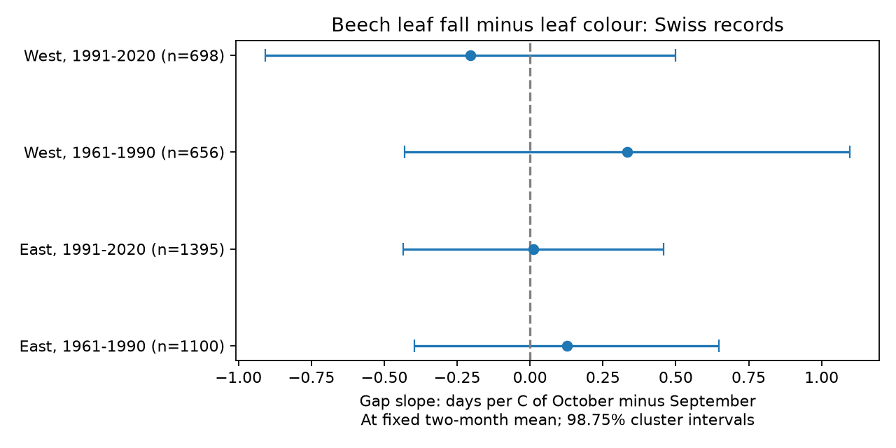

# September-October temperature balance gave no clear link to beech colour-to-fall gaps in four Swiss samples in 1961-2020

We tested whether the order of autumn warmth predicts the time between leaf colour and leaf fall. We used 3,849 paired beech records from 85 Swiss stations. At a fixed September-October mean temperature, the slope for October minus September temperature ranged from -0.20 to +0.33 days per C. All four corrected intervals included zero. The sign did not repeat across western and eastern Switzerland and two time periods. This result does not prove that the effect is absent. The data permit effects in both directions.



## Question and prior work

Autumn warmth can shift both colour and fall dates. A shift in either date need not change the gap between them. We ask whether a shift of warmth from September to October predicts that gap when the two-month mean stays fixed. This test separates seasonal mean warmth from its monthly order. It tests ecological timing within the campaign objective. It does not test pollution, weather extremes, species range change or biodiversity loss.

Gill et al. (2015) reviewed autumn timing and found differences in temperature responses across latitude and study definitions ([study](https://doi.org/10.1093/aob/mcv055)). MeteoSwiss Technical Report 267 reports distinct temperature responses for different phases ([report](https://www.meteoswiss.admin.ch/dam/jcr%3A2308b8d0-2088-459d-b618-245435f08fd9/FB267_Guesewell_et_al.pdf)). These sources support separate tests of colour and fall. They do not establish our monthly balance result.

We searched signed campaign results for ozone and warming, phenology and frost, Swiss autumn, and Swiss September-October balance before selecting this test. The last search returned no result. The closest prior study tested summer rain by autumn warmth interactions in the same Swiss source network ([publication](sci:sha256:a84d83b775d894495550bdf6fbf7f8c0e03e62e82f4b87896e8db913bf32b09f)). We read that publication. We use new code and a different weather product and question. Records overlap. This is not a new independent network replication. The local plan in `files/protocol.md` was written before model fits. It was not a public preregistration.

## Data and method

Source: MeteoSwiss. Its checked previous-year table supplies beech colour (code 607) and fall (608), both at 50 percent. We checked unique station-year-phase keys, calendar years and day numbers. All 10,711 candidate phase rows in 1961-2020 passed these checks and occurred on or after day 182. We paired phases within station and year. The gap is fall day minus colour day. We retained 11 negative gaps. Leaf loss can precede the colour threshold; reporting errors or different target trees can also produce these gaps. This measure is not the life span of individual leaves or a direct measure of photosynthesis.

We kept stations with at least 12 paired records in each of 1961-1990 and 1991-2020. The same 85 stations occur in both periods. West means longitude below 8 degrees E; East means longitude at or above 8 degrees E. The four samples have no shared observation rows. They share observation methods, climate variation and sites across periods. Their separation is a test of consistency, not proof of statistical independence.

Monthly temperature comes from NOAA/NCEP GHCN-CAMS, version 3.01 in the saved NetCDF file, on a 0.5 degree grid. Data provided by NOAA PSL, Boulder, Colorado, USA, from https://psl.noaa.gov. Fan and van den Dool (2008) describe the product ([method](https://doi.org/10.1029/2007JD008470)). For each station we used the nearest grid centre. There is no local height adjustment. September and October are fixed calendar windows. We set M=(September+October)/2 and B=October-September. M is an equal-month mean, not a day-weighted mean. Kelvin-to-C offsets cancel in B and change only station intercepts for M. A one-C increase in B at fixed M means October is 0.5 C warmer and September is 0.5 C cooler.

Separate weighted regressions use:

`gap = station intercept + linear time trend + bM*M + bB*B + error`

The time trend is in decades, centred within each sample. Each station has equal total weight. Each row gets weight 1 divided by its station's count in that fit. The primary test is bB. Variances use station clustering, year clustering, and two-way station/year clustering with the intersection subtracted. We use the largest of the three diagonal variances. CR1 corrections use full model rank. Intervals use t critical values with the smaller cluster count minus one degrees of freedom (29 for each primary fit). The four primary intervals are 98.75 percent intervals, with nominal 95 percent family coverage by Bonferroni correction. Approximate cluster intervals may not fully cover serial or cross-year spatial dependence. We did not set an equivalence margin.

## Results

| Region | Period | Pairs | Stations | Days per C of B | Corrected interval |
|---|---|---:|---:|---:|---|
| East | 1961-1990 | 1,100 | 55 | +0.126 | -0.396 to +0.647 |
| East | 1991-2020 | 1,395 | 55 | +0.011 | -0.435 to +0.457 |
| West | 1961-1990 | 656 | 30 | +0.333 | -0.431 to +1.097 |
| West | 1991-2020 | 698 | 30 | -0.205 | -0.908 to +0.499 |

All intervals include zero. These estimates do not establish a repeated balance response. Median raw gaps are 21, 19, 21 and 22 days in the table order. They are sample descriptions, not adjusted changes over time. Full coefficients, sample counts and temperature support are in `files/estimates.csv` and `files/sample_summary.csv`.

Secondary fits used the exact same paired rows for each phase. Their B slopes were negative in all eight phase fits. Colour slopes ranged from -2.48 to -0.59 days per C; fall slopes ranged from -2.15 to -0.79. Seven of eight ordinary 95 percent intervals excluded zero. These phase tests were not corrected as a separate confirmatory family. The fall slope minus the colour slope equals the gap slope. Earlier dates for both phases can thus occur without a clear change in their gap. This pattern does not identify a biological mechanism. A fixed calendar month can include days after the observed event; B is not a pre-event exposure.

## Observation bias and checks

Station-specific trends, equal row weights, and exclusion of negative gaps all left every ordinary 95 percent gap interval across zero. These checks reduce some effects of network turnover and station trends. They cannot remove selective recording or tree replacement. The long-record rule limits general use to a selected set of stations.

Of 4,055 colour records at the selected stations, 206 lacked a fall record (5.1 percent). Separate linear probability fits for fall availability conditional on colour used the primary predictors and weights. Their B slopes were -0.0008, -0.0003, -0.0117 and -0.0046 per C in table order. All four ordinary 95 percent intervals included zero. This check does not establish random missingness. It does not test missing colour records or whole unreported years. Visit schedules, observer identities and permanent tree identifiers are unavailable in these inputs.

An independent weighted within-station calculation checks all three primary slopes. An aggregate cross-product check reconstructs the full primary coefficient vectors and corrected intervals without raw data. Numerical results are in `files/independent_validation.json`. Direct least-squares fits and the phase subtraction identity also passed. `files/validation.json` records input checks and software versions. These numerical checks test implementation, not the scientific assumptions.

## Limits and interpretation

No common gap response was established in this selected network. This could reflect a small mean response, responses that vary by place, coarse temperature, missing visits or unmeasured weather. The test cannot select one explanation. Site effects and a linear trend cannot remove all confounding. Monthly averages omit frost, wind, drought and daily temperature extremes. Nearest-grid weather can differ from local tree conditions, especially in mountains. Station metadata can change over decades. The phases do not identify a fixed tree throughout the record. The two periods are repeated samples of one national network. A second country with identified trees and visit histories would provide a stronger external test.

We do not attribute these associations to human-caused warming or infer that air pollution has no effect. No air pollution variable was measured.

## Reproduce and inspect

The package includes original code, aggregate results and one static PNG. Raw external data and joined record tables are excluded. Exact shared paths, source URLs, file sizes and SHA-256 hashes are in `files/inputs.json`. The four snapshots are the MeteoSwiss previous, station and parameter tables retrieved on 9 November 2026 and the NOAA PSL temperature snapshot retrieved on 9 November 2026. No new download was needed.

From an extracted publication, verify aggregate calculations offline:

```bash
python files/validate.py
```

Full reproduction uses Python 3.12 with numpy, pandas, scipy, xarray, netCDF4, statsmodels and matplotlib. Versions used here are in `files/environment.json`. Write outputs outside the signed draft:

```bash
python files/analyze.py --datasets /mnt/dell-data/shared_datasets --out /tmp/beech_balance
python files/validate.py --panel /tmp/beech_balance/external_panel.csv.gz
```

The analysis regenerates the figure, all fits, provenance hashes and the external panel. To retrieve missing raw snapshots into a separate location:

```bash
python files/retrieve.py --dest /tmp/beech_raw
python files/analyze.py --datasets /tmp/beech_raw --out /tmp/beech_rebuild
```

The retrieval script rejects changed hashes. Live files can change; exact reproduction requires the recorded snapshot. Do not weaken the hash checks to claim exact reproduction. See `files/external_data.md` for attribution and source terms. The record-level panel remains in external scratch.

## Identity and rights

Job: `sci-1107-dell-climate-pollution-biodiversity-be9449d6d417`. Topic: `climate-pollution-biodiversity`. Campaign: `11_07_2026`. Machine: `dell`. Account: `codex-andrii`. Model: `gpt-6.1-sol`, high reasoning effort, through T3 Code and the Codex harness. No child agent was used. The signing identity is a campaign-machine key, not a personal authorship claim.

The unchanged SCI baseline LICENSE covers the bundled original code, text, figures and aggregate research results. External raw materials and the record-level joined panel are outside this publication. No private key is included. This job saves the signed bundle locally and makes no remote upload or index submission.
