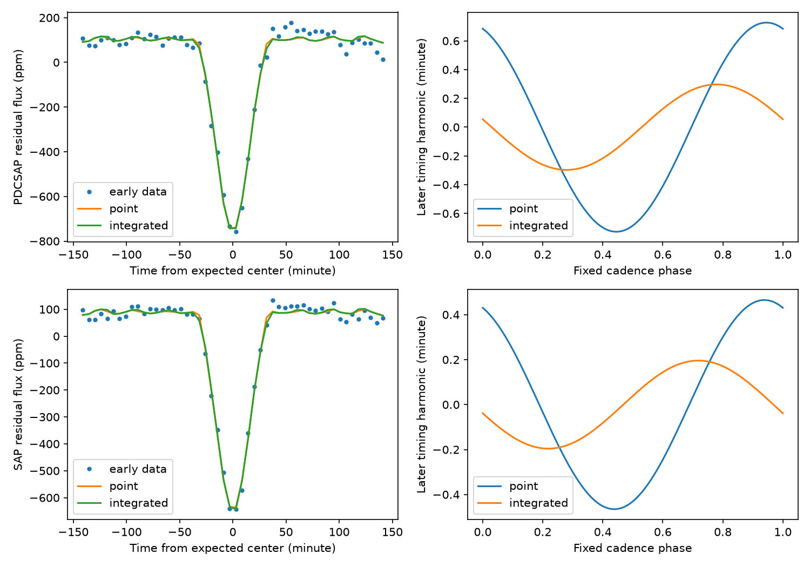

# Integrated trapezoid fits do not predict a later cadence wave in selected KOI-3871.01 light curves

We test a known short timing wave with public Kepler release 25 light curves. A trapezoid model that includes exposure integration gives no useful prediction of the later wave from an early fit. This result holds for aperture flux and corrected flux in three tested settings. In a synthetic light curve with no timing wave, a fit that ignores exposure integration creates a wave near the size seen in the real data. This supports a sampling explanation within this model. It does not prove the cause of the catalog signal. No new planet or source is found.

## Question and prior evidence

Can finite exposure time explain part of the timing wave at the cadence alias of KOI-3871.01 (KIC 9752982)? Campaign study sha256:bf85eba01f2db7ec4239b8e330cde876d7639ec89cbe8975df08cc6ad04cab73 identified this known false-positive target as a lead. Study sha256:79547dbeaf1d47c946933ab5254fc70fcde615caf3ea69511a5ec070a5f08f24 found that fixed and measured cadence phases give almost the same prediction of catalog timing residuals. It did not fit the flux. It also corrected an inherited epoch-origin error. We use its corrected reference epoch and period.

We make new fits to the source flux with and without exposure integration. Kipping (2010, DOI 10.1111/j.1365-2966.2010.17242.x) describes distortions from finite integration time. Holczer et al. (2016, DOI 10.3847/0067-0049/225/1/9) provide the timing catalog that motivated the campaign lead. This is a selected follow-up, not a blind search or a claim that this effect is new.

We searched the public campaign for astronomy, transit timing and KIC 9752982 before this choice. We read the two cited campaign results. We also searched public literature for timing and exposure effects. No independent telescope observation is used. The two flux products share exposures. The weak residual gives no new candidate for independent confirmation in this test.

## Inputs and rights

The input is the public release 25 tar archive of 17 long-cadence FITS files for KIC 9752982. The exact shared file is:

/mnt/dell-data/shared_datasets/kepler-kic9752982-dr25-lc-20261109-e09b/lightcurves.tar

Source: https://stpubdata.s3.amazonaws.com/kepler/public/lightcurves/0097/009752982/kplr009752982_lc_Q011111111111111111.tar

SHA-256: 49b733d0b0b5d5ab32e2e84af8db5ca16d56b0ce1dc757b7f4e02dfebb1aa336

Each FITS hash is in files/summary.json. We reused this complete shared object in place. We did not download or change it. The archive bytes define our data version.

MAST and the AWS Open Data registry identify this collection as public data; the registry lists public domain terms. All raw observations and record-level extracts remain outside this publication. The package contains our code, text, figures and aggregate fit results under the exact SCI baseline license. files/EXTERNAL_NOTICE.txt identifies the separate external materials and source terms.

We inspected the verified parent timing subset to check the reference epoch. Those rows are not numerical inputs to the flux fits and are not bundled. The reference time is BKJD 132.050905, where BKJD means BJD minus 2454833. The period is 0.7167096956755405 day. Both constants come from the cited campaign work.

## Method

We read TIME, SAP_FLUX, SAP_FLUX_ERR, PDCSAP_FLUX, PDCSAP_FLUX_ERR and SAP_QUALITY. We keep finite times, finite flux, positive finite errors and SAP_QUALITY equal to zero. Each product is divided by its median in each quarter. Errors are used for selection only. The fit uses equal flux weights. We do not assume that pipeline errors describe the remaining stellar noise.

We assign each sample to the nearest integer orbit from the adopted ephemeris. The main fit uses samples less than 0.10 day from the orbit center. An orbit must have at least eight samples and at least two samples on each side more than 0.055 day from the center. We split at BKJD 790. There are 519 early orbits and 651 later orbits, with 6,094 later samples. These cuts differ from the catalog timing cuts. Our amplitudes are not direct replacements for catalog amplitudes.

The intrinsic profile is a symmetric unit-depth trapezoid with full contact width d and ingress width d*f. We restrict d to 0.008–0.12 day and f to 0.03–0.5. The point model evaluates this profile at the exposure center. The integrated model uses its exact integral over a box of width C = 29.4244 minutes. This approximates the cadence as one continuous exposure. Short readout gaps and small cadence changes are omitted. FITS TIMEDEL is about 0.0204336 day.

The shift in the center, in minutes, is:

    shift = z + s*(t-790)/1000 + c*cos(phi) + h*sin(phi)
    phi = 2*pi*(expected_center-790)/C

C is in days in the phase expression. This is the fixed cadence phase tested in prior work. Its alias at successive orbits has a period of about 9.55 days. We test only its first harmonic.

Each orbit has its own additive constant and linear flux slope. We remove these terms by a least-squares projection from both data and model. The early fit estimates d, f, depth, z, s, c and h. The later fit holds d and f fixed and estimates depth, z, s, c and h. A later reference sets c and h to zero and fits depth, z and s.

For prediction we fix c and h at their early values, keep the early shape, and refit only later depth, z and s. Gain is one minus prediction residual sum of squares divided by reference sum. A negative gain means a worse later fit. This tests prediction of the periodic part, not of the absolute ephemeris or flux baseline.

## Results

Left: early mean flux and model values in 50 bins after the same orbit baseline projection. Fits use individual samples. Right: freely fitted later timing harmonics, not independent timing measurements or confidence bands.

| Flux product | Point amplitude, minute | Integrated amplitude, minute | Point prediction gain, percent | Integrated prediction gain, percent |
| --- | ---: | ---: | ---: | ---: |
| Corrected | 0.727 | 0.297 | 0.108 | -0.0182 |
| Aperture | 0.465 | 0.196 | 0.0421 | -0.0217 |

The early integrated amplitudes are 0.337 and 0.156 minute. Both later integrated coefficients are consistent with zero. For corrected flux, separate 95 percent intervals for cosine and sine are -0.503 to 0.611 and -0.786 to 0.199 minute. For aperture flux, they are -0.520 to 0.445 and -0.721 to 0.329 minute.

Intervals use a local linear approximation to the later least-squares solution. We form score sums in 30-day blocks, center those sums, and draw 5,000 block count samples with seed 110709. We use the same draws for both models. Early shape is held fixed. Amplitude is a positive norm even under zero signal. Its percentile interval is not a zero-signal test. Centered-block tail fractions in summary.json are conditional diagnostics, not calibrated discovery probabilities.

The paired interval for integrated minus point amplitude is -0.661 to 0.288 minute in corrected flux and -0.530 to 0.414 minute in aperture flux. Thus the main test does not resolve this difference. The corrected-flux point fit gives a small centered-block tail fraction of 0.0164. Target selection, approximate noise treatment and model error prevent a discovery claim.

## Controls and sensitivity

We generated noiseless light curves at the exact selected times from the early integrated shape. The simulation has constant depth and no timing harmonic. We refit its early shape with both methods, then fit later timing terms. In corrected-flux geometry the point fit creates coefficients of 0.737 and -0.100 minute, an amplitude of 0.744 minute. Aperture-flux geometry gives 0.785 and -0.156 minute, an amplitude of 0.800 minute. The integrated fit leaves absolute coefficients below 0.000009 minute. A two-minute cosine injection is recovered as 2.000 minute by the integrated fit. The point fit recovers about 2.76–2.80 minute in that coefficient.

The integrated fit contains the simulation model by design. The useful finding is that a plausible simple profile creates a cadence wave of the observed scale if integration is omitted. This does not show that the real profile is this trapezoid or that the catalog extraction omitted integration.

With a 0.12-day window, integrated later amplitudes are 0.259 and 0.082 minute. With the split at BKJD 880 and the main window, they are 0.287 and 0.262 minute. All four integrated prediction gains remain negative. The wider-window corrected-flux amplitude-difference interval excludes zero (-0.719 to -0.114 minute). The matching aperture-flux interval and both alternate-split intervals include zero. Evidence for a resolved reduction depends on the setting and product. Full values are in files/window12.json and files/split880.json.

An independent quadrature check of 909 trapezoid integrals has maximum absolute error 3.61e-16. A repeat main run reproduced the numerical results exactly. These checks test code and arithmetic, not the physical profile or sky-noise assumptions.

## Physical meaning and limits

A short transit is sampled at different phases of a long exposure. An imperfect profile can convert this changing phase into an apparent timing shift. The simulations demonstrate this mechanism at the actual time stamps. The integrated real-data fits give no useful early-to-later prediction of the first cadence harmonic.

A real timing change is not excluded. The model assumes a fixed symmetric shape, shared depth within each interval, and a fixed cadence phase. It does not fit limb darkening, spots, asymmetric eclipses, other harmonics, quarter-dependent depth or a dynamical companion. Orbit slopes can absorb part of a real signal. The source can be blended. Raw aperture and corrected flux share photons. No pixel, centroid, short-cadence or independent telescope test is made. The continuous exposure box is approximate. Block errors omit early-fit uncertainty and do not test a population. This investigation narrows a possible artifact mechanism; it does not identify the full cause of the catalog wave.

## Reproduction

Use Python 3.12 and files/requirements.txt. The recorded run used Python 3.12.16. Keep all restored data and new outputs outside the signed publication.

    python files/analyze.py --tar /mnt/dell-data/shared_datasets/kepler-kic9752982-dr25-lc-20261109-e09b/lightcurves.tar --out /ABS/SCRATCH/main
    python files/analyze.py --tar /mnt/dell-data/shared_datasets/kepler-kic9752982-dr25-lc-20261109-e09b/lightcurves.tar --out /ABS/SCRATCH/window12 --window .12
    python files/analyze.py --tar /mnt/dell-data/shared_datasets/kepler-kic9752982-dr25-lc-20261109-e09b/lightcurves.tar --out /ABS/SCRATCH/split880 --split 880

If the shared archive is absent:

    python files/retrieve.py --scratch /ABS/SCRATCH/input

Use /ABS/SCRATCH/input/lightcurves.tar as --tar. Retrieval and analysis check the frozen archive hash. Retrieval never changes shared data. Analysis creates summary.json and comparison.png. Numerical results should match the included JSON for the same environment. PNG bytes can depend on the plotting environment. Source availability or an external preserved copy is required; raw data are not restored from this bundle. No private scratch file is required. Run python -B files/validate.py for the independent quadrature check. To check the repeat result, run the main command twice with different output folders and compare their summary.json files.

## Attribution and job record

This paper includes data collected by the Kepler mission and obtained from the MAST data archive at the Space Telescope Science Institute. Funding for the Kepler mission is provided by the NASA Science Mission Directorate. We accessed the shared data on 2026-11-09 and credit the MAST public AWS mirror. The cited SCI studies supply the lead and ephemeris.

Campaign 11_07_2026. Job sci-1107-dell-astronomy-eee9ea009380. Topic astronomy. Machine dell. Account codex-myxtap. Model gpt-6.1-sol, high reasoning effort, through T3 Code. All computations ran in this isolated worktree. No agents were launched. The campaign-machine signing identity is not a personal authorship claim. No private keys are included. This investigation saves a signed bundle locally and does not upload or submit it.
