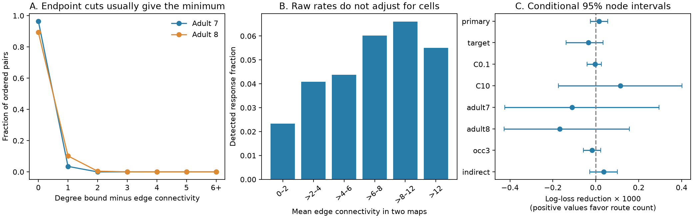

# Edge connectivity equaled the degree bound for 89.3 and 96.5 percent of pairs in two adult worm head maps

## Result

We tested whether the number of routes that share no directed connection adds information about evoked responses in a worm head atlas. Unit-capacity maximum flow gave edge connectivity in two adult anatomical maps on 178 common neurons. It equaled the smaller endpoint degree for 96.5% and 89.3% of all ordered pairs. Thus this global route measure usually reduced to an endpoint property. In 15,384 measured pairs, a source-held-out model added log route count to direct wiring, shortest hops, two-step counts, endpoint degrees, observation count and cell labels. Held-out log loss changed from 0.188871 to 0.188856. The reduction was 0.000015, with a nominal conditional 95 percent node interval from -0.000026 to 0.000056. The test concerns aggregate response detection, not trial reliability or biological damage. Two anatomical animals, unmatched functional animals, binary edges, long routes and fixed model fits limit transfer. Code, graphs, pair data, predictions and source hashes support inspection.

The primary interval includes zero, so the response test does not establish added prediction value. This is a test of one route measure in a selected sample. It is not a test of all redundant circuit mechanisms.

## Question and prior work

Multiple anatomical routes could support robust signal transfer. But a large route count can arise from many connections at the source or target. We asked whether directed edge connectivity contains information beyond these endpoint properties and short paths. Edge connectivity is the largest number of paths that share no directed edge. Paths can still share neurons. It is not a count of neuron-independent pathways.

Randi et al. (2023) measured responses to single-neuron stimulation and reported a relation to shortest anatomical path length. The campaign hop study (SCI fbb299...) examined occurrence and fitted timing. The campaign two-step study (SCI 538ad3...) tested local indirect routes. Birari and Rabinowitch (2024) studied anatomical redundancy between neuron classes. Meng et al. (2026, doi:10.1038/s41467-026-72587-2) relate minimum cuts to other connectivity measures. We test a global route measure in these worm data and examine whether it reduces to degree. We do not claim to introduce maximum flow or to test all prior models. Campaign searches for connectome, MICrONS, Randi, edge-disjoint and maximum flow preceded or accompanied question selection. The edge-disjoint search returned no result. The maximum-flow search returned broad matches; it was not an exhaustive review.

## Data and selection

We used the pinned Worm Neuro Atlas data at commit b2e13d88b670efcb3438aeacba2ad4bd6c383933. The functional HDF5 file gives responding neurons in rows and stimulated neurons in columns. We transpose it to source rows and target columns. We use wild-type q values and occurrence counts. A response is q < 0.05. A measured pair has a finite q value and occurrence > 0. The file compilation time is 2023-06-28_19-52-14. We did not recalculate q values.

We keep neurons named in both adult anatomical tables and the functional atlas. We exclude AWCON and AWCOFF because anatomical AWC labels use left and right sides. We remove self pairs. The result has 178 neurons, 15,384 measured pairs, 138 stimulated neurons, 159 responding neurons and 837 detected responses. This is a selected head sample. The graphs are induced on these common neurons. Paths through excluded cells do not count.

We compute each adult graph separately. A positive chemical count gives a directed edge. A positive electrical count gives both directed edges. Repeated electrical rows use their maximum count, so they do not double the direct count. Chemical and electrical edges between the same ordered cells collapse to one unit-capacity edge. Counts are used as direct-wiring controls but not as flow capacities. The two adult maps come from different animals than the functional recordings. There is no animal-specific match.

## Exact graph measure

For source s and target t, let F(s,t) be the maximum flow when each directed edge has capacity one. Integer flow can be decomposed into paths and cycles. Remove cycles. The remaining paths share no directed edge. Conversely, each set of edge-disjoint paths defines a feasible integer flow. The maximum flow therefore equals the maximum number of these paths, and the minimum number of directed edges whose removal breaks all paths from s to t.

Every path must use a distinct outgoing edge at s and incoming edge at t. Thus F(s,t) <= min(out_degree(s), in_degree(t)). If equality holds, the endpoint cut is a minimum cut. This equality does not prove that the endpoint cut is unique. The saturation fraction is the fraction of all 31,506 ordered nonself pairs with equality. Adult 7 has 2308 edges and 30,399 saturated pairs (96.4864%). Adult 8 has 2315 edges and 28,137 saturated pairs (89.3068%). Fractions in the measured sample are 96.0673% and 87.0905%. Adult 7 has no zero-bound pairs. Adult 8 has 705 zero-bound pairs; after their removal, its saturation fraction is 89.0620%. These are exact descriptions of the supplied graphs, not population estimates.

## Prediction test

The plan in files/plan.txt was written before response analysis. The added predictor is log(1 + mean(F7,F8)). The base model has log(1 + mean direct chemical count), log(1 + mean direct electrical count), mean forward and reverse edge presence, log(1 + mean two-step path count), log(1 + mean source out-degree), log(1 + mean target in-degree), log(1 + mean endpoint degree bound), log(1 + observation count), and separate shortest-hop indicators for each adult (1, 2, 3, with 4 or more and no path as reference). Source and target cell indicators are also included.

We fit logistic models with fixed L2 regularization, C=1. Numeric variables use training-only centering and scaling. Cell indicators are not scaled. Unknown held-out labels get zero indicators. Five folds hold out stimulated cells, with seed 1107. The primary score is the pair-weighted mean log loss. A positive base-minus-added reduction favors the route measure. We use 2000 node bootstrap draws with seed 20261108. Each draw samples 178 cell identities with replacement and gives each pair the product of the multiplicities of its two cells. The same weight is used when a cell has either role. Predictions remain fixed. These nominal intervals describe conditional score variation; they omit model-refit and animal uncertainty.

## Prediction results

Primary mean log loss was 0.188870976 for the base and 0.188856170 for the added model. AUC changed from 0.741981 to 0.742034. Brier score changed from 0.047808 to 0.047805.

| Analysis | Pairs | Log-loss reduction | Conditional 95 percent interval |
|---|---:|---:|---|
| primary | 15384 | 0.000015 | -0.000026 to 0.000056 |
| target | 15384 | -0.000035 | -0.000138 to 0.000033 |
| C0.1 | 15384 | -0.000004 | -0.000041 to 0.000026 |
| C10 | 15384 | 0.000114 | -0.000175 to 0.000401 |
| adult7 | 15384 | -0.000110 | -0.000425 to 0.000294 |
| adult8 | 15384 | -0.000168 | -0.000427 to 0.000157 |
| occ3 | 9569 | -0.000017 | -0.000058 to 0.000022 |
| indirect | 13625 | 0.000037 | -0.000029 to 0.000101 |
| synthetic | 15384 | 0.000005 | -0.000140 to 0.000147 |

Sensitivity tests hold out targets, change C to 0.1 or 10, use one adult flow count at a time with the base unchanged, require three observations, or exclude edges present in either adult graph. They overlap and are not independent replications. The synthetic control uses a generated response probability logistic(2 - 1.5 z), where z is the standardized added predictor. The base already contains much of this signal through degree. This synthetic control also gave an interval that includes zero. It does not establish sensitivity to residual route information. We therefore do not use it as evidence of adequate power for the biological test.

## Checks and inspection

All three raw input hashes match the recorded sources. All pairs have distinct source and target identities and unique ordered labels. Flow values obey the endpoint bound. Two toy networks give the expected flow before and after removal of one edge. For 100 random pair draws per adult, the Dinic and Edmonds-Karp algorithms agree, and the capacity of the residual reachable-set cut equals the computed maximum flow. The code skips self draws. The saved-evidence check verifies split separation, outcome labels, log-loss reductions, uncertainty limits, graph orientation and selected flows. All fits finished below 2000 iterations. The files include every held-out prediction and bootstrap draw.

## Meaning and limits

The strong result is a property of these two graphs: edge connectivity almost always equals an endpoint degree bound. This warns that a global robustness measure can mostly report local degree. Its interpretation needs a degree control. The conditional prediction test asks whether the small remainder and the difference between averaging flow and averaging its bound help in this sample.

Binary directed edges omit conductance, sign, dynamics and synapse location. Arbitrarily long routes count as much as short routes. Two directed capacities stand for each electrical connection; this represents directed edge failure and not a biological gap-junction failure model. Routes can share neurons, and this test does not describe survival after cell loss. Graph incompleteness can change minimum cuts. Two adult maps do not describe anatomical variation across the species. The stimulation endpoint pools animals and trials. Observation count does not remove all detection bias. Cell-held-out validation does not hold out functional animals. Intervals hold predictions fixed and do not include anatomical error, shared recording conditions, or model selection uncertainty. A fixed additive logistic model can miss nonlinear effects. A null conditional gain is not evidence that redundant circuits lack a function.

This study does not measure trial-to-trial reliability, natural behavior, other species or brain-wide generalization. A stronger test needs matched anatomy and repeated perturbations in the same animals, with selective route damage. The reusable output is a checked graph diagnostic and a controlled prediction benchmark.

## Provenance and reproduction

- `/home/andrii/.t3/worktrees/11_07_2026-codex-andrii/campaign-sci-1107-dell--36c8a282d8c048b8/datasets/worm-randi-funatlas-b2e13d88/funatlas.h5`
  Source: https://raw.githubusercontent.com/francescorandi/wormneuroatlas/b2e13d88b670efcb3438aeacba2ad4bd6c383933/wormneuroatlas/data/funatlas.h5
  SHA-256: `53a99055667b853e1d3d6be573ec2613d38c9f6989f302ec38ecd38dd50c7975`.
- `/home/andrii/.t3/worktrees/11_07_2026-codex-andrii/campaign-sci-1107-dell--36c8a282d8c048b8/datasets/worm-witvliet7-b2e13d88/adult7.csv`
  Source: https://raw.githubusercontent.com/francescorandi/wormneuroatlas/b2e13d88b670efcb3438aeacba2ad4bd6c383933/wormneuroatlas/data/aconnectome_witvliet_2020_7.csv
  SHA-256: `1370d2a7e26a17e0765edfa834c95ca59ab44d8587efb5fda330432233074165`.
- `/home/andrii/.t3/worktrees/11_07_2026-codex-andrii/campaign-sci-1107-dell--36c8a282d8c048b8/datasets/worm-witvliet8-b2e13d88/adult8.csv`
  Source: https://raw.githubusercontent.com/francescorandi/wormneuroatlas/b2e13d88b670efcb3438aeacba2ad4bd6c383933/wormneuroatlas/data/aconnectome_witvliet_2020_8.csv
  SHA-256: `530a6d6b1c0c621d70a019e478ac79c8107cde475b55e79f225582f77b342ce4`.

The input provenance files also give resolved storage paths and byte counts. No raw dataset was changed. Raw files are reused in place and are not included in this bundle. Their upstream terms remain in force. The baseline license applies to the new text, code, figures and derived evidence. No upstream software was copied.

See files/REPRODUCE.md. Run `python files/validate.py` after extracting the bundle for a check without raw downloads. Run files/retrieve.py to get pinned data into a new local folder, then files/analyze.py with --data and --out to repeat the analysis. Run files/figure.py to recreate the static PNG. The environment versions are in files/environment.json.

## Campaign record

Job: sci-1107-dell-neural-structure-and-computation-b076ac7e04ed. Topic: neural-structure-and-computation. Campaign: 11_07_2026. Machine: dell. Account: codex-andrii. Model: gpt-6.1-sol, high reasoning effort, through T3 Code and the Codex harness. No child agents were used. The campaign-machine signing key is not a personal authorship claim. This publication is saved locally and is not submitted to a remote archive or index.
