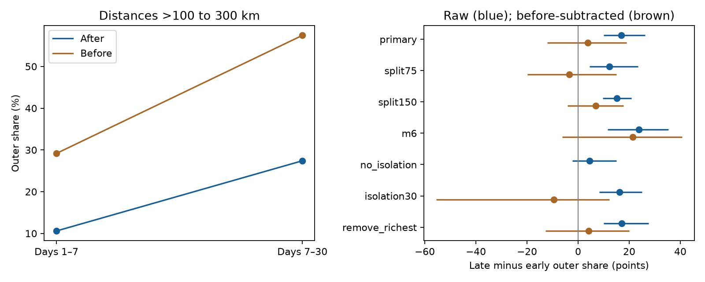

# Before-count subtraction left no clear outer-share rise after 171 shallow M7–8 earthquakes in 2001–2024

The share of nearby M5.5+ earthquakes at distances above 100 to 300 km rose from 10.6% on days 1–7 to 27.4% on days 7–30 after selected centers. The rise was 16.8 percentage points. After we subtracted matching before counts, the rise was 3.8 points. Its conditional 95% three-year block interval was −12.1 to +19.0 points. Thus the raw spatial change did not give clear evidence of a change in the spatial share of excess events.

## Question and prior work

Does a late rise in the outer share remain after counts before each earthquake are subtracted? A concentrated sequence can decay into a more spread-out background. A rising outer share then need not show movement of a rupture response.

Helmstetter, Ouillon and Sornette (2003, doi:10.1029/2003JB002503) studied aftershock diffusion and how background, geometry and selection affect its measurement. We reviewed the abstract and public source search for context, not all derivations. This is not a new discovery that background affects spatial spread.

Before we chose the precise question, we searched signed campaign results for earthquake, aftershock depth, hypocentral distance and outward migration. We read the three-sequence radius test (sci:sha256:e3bd523d48d26ecb1d72621bc6fed6b7ac0264c74dd2a6f0e51d401a40f7469a), the isolated shallow-center study (sci:sha256:54106336f4ec18f991eebdd9e6ec302054bc3972aca4d8e3a36b7338836702c2), and the pair-count audit (sci:sha256:157c5956bfabcb4f92ffcca3e011b893b0ac7f21e9f2ecb7fa56111d8dda6282). We use the same source and center selection as the shallow-center study. This is not independent confirmation. We add a pooled spatial-share contrast with before subtraction and dependence checks. No prior code or private worker files were used.

## Source and design

We read the existing file in place at /mnt/dell-data/shared_datasets/usgs-global-m55-2000-2025-20261109-earth-a76104/events.csv. This is the USGS ANSS Comprehensive Earthquake Catalog (ComCat) preferred-event CSV for 2000–2025, retrieved on 9 November 2026. It has 12,848 events, 2,240,222 bytes, and SHA-256 162e1e37336624494321d4b9c3f0b823f433ebaeb70430af8fa70b5b2ddb16c3. Exact URL, resolved shared path, retrieval record, metadata hash and software versions are in files/provenance.json. We made no download or shared-data change.

Candidates have preferred magnitude M in [7,8), depth in [0,70) km, and UTC year 2001–2024. We exclude a candidate if an equal or larger event lies within 300 km surface distance and within 365 days on either side. This reduces 242 candidates to 171 centers. Padding years supply full windows. Isolation uses future data. This is retrospective selection, not a forecast rule. Centers need not be independent mainshocks. Preferred magnitudes have mixed types; we do not assume uniform Mw.

Neighbors have M at least 5.5. Distance is a straight chord between recorded hypocenters, on a sphere of radius 6371 km with radial position 6371 minus depth in km. Inner distances are at most 100 km; outer distances are above 100 and at most 300 km. Absolute elapsed windows are [1,7) and [7,30) days on each side. Day 1 is omitted to reduce early detection loss, not to prove completeness.

files/design.txt records the local plan before the new counts. It is not an external registration. Checks change the radial split to 75 or 150 km, magnitude floor to 6, isolation to 30 days or zero, and remove the center with the most after events.

## Method and uncertainty

Let A_I and A_O be pooled inner and outer after counts in one time window. Let B_I and B_O be matching before counts. The raw share is A_O/(A_I+A_O). The subtracted share is (A_O−B_O)/(A_I+A_O−B_I−B_O). The endpoint is late minus early share. We subtract counts, not shares. Each event has equal weight. This is not a mean per-center change. Shares within a window need no duration correction.

The subtracted ratio requires positive total excess. Signed cell excesses can give shares outside [0,1]; this diagnostic is not a probability. Before counts can contain foreshocks and earlier sequences. They estimate background only under local time symmetry. Changing rates and conditioning on a local magnitude maximum can violate that assumption.

We sum all eight cells by center year and resample circular blocks of three years from the 24 years. Each of 10,000 draws retains paired cells and uses its own pooled totals. Seed: 504010. Percentile intervals are conditional on source and selection. They omit catalog and model errors. Checks use one- and five-year blocks and separate resampling of 43 occupied 20-degree latitude-longitude cells. The spatial check does not model joint space-time dependence. Sensitivity intervals are pointwise, with no multiple-test detection claim.

## Results

| Window and side | Inner | Outer | Total | Outer share |
| --- | ---: | ---: | ---: | ---: |
| Days 1–7, after | 152 | 18 | 170 | 10.59% |
| Days 1–7, before | 17 | 7 | 24 | 29.17% |
| Days 7–30, after | 98 | 37 | 135 | 27.41% |
| Days 7–30, before | 20 | 27 | 47 | 57.45% |
| Days 1–7, excess | 135 | 11 | 146 | 7.53% |
| Days 7–30, excess | 78 | 10 | 88 | 11.36% |

The raw rise was 16.82 points (95% interval 9.97 to 26.24). The subtracted rise was 3.83 points (−12.05 to 19.00). No primary draw had nonpositive total excess in either window. The latter interval permits both a decrease and a substantial rise. It does not prove fixed spatial spread.

Before outer rates were 1.17 events per elapsed day in each window (7/6 and 27/23), pooled over centers. After outer rates fell from 3.00 to 1.61 per day. After inner rates fell from 25.33 to 4.26 per day. A simple mixture explanation is consistent with these values: concentrated excess decays while outer background forms a larger share. This does not prove the background would have stayed fixed without the centers. No physical diffusion model was fitted.

| Check | Centers | Raw rise, points | Subtracted rise, points | Subtracted 95% interval |
| --- | ---: | ---: | ---: | --- |
| Primary | 171 | 16.82 | 3.83 | −12.05 to 19.00 |
| 75 km split | 171 | 12.31 | −3.50 | −19.78 to 15.05 |
| 150 km split | 171 | 15.14 | 6.82 | −4.08 to 17.75 |
| M6+ neighbors | 171 | 23.75 | 21.40 | −6.25 to 40.71 |
| 30-day isolation | 210 | 16.16 | −9.47 | −55.55 to 12.30 |
| Remove richest center | 170 | 17.13 | 4.05 | −12.71 to 20.06 |

All listed subtracted intervals include zero. The M6+ estimate is larger and sparse; magnitude-floor sensitivity remains. The richest center supplied 12 of 305 after counts. Its removal did not remove the raw rise.

With no isolation, 242 centers gave late after total 360 and before total 389. The late excess was negative, so its subtracted contrast and interval are undefined. Of its draws, 5,845 had nonpositive excess in at least one window. The draw file retains undefined values as NaN; results.json uses null for the undefined point and interval. We do not use an interval conditional on the remaining draws.

Primary subtracted intervals were −16.89 to 21.00 points for one-year blocks, −10.43 to 19.79 for five-year blocks, and −16.54 to 20.62 for spatial resampling. Leaving out each year gave point estimates from 0.22 to 7.75 points. These checks retain the uncertainty.

## Limits

Only 21 primary outer excess counts occur across both windows. Sparse counts limit precision. Fixed radii do not scale with rupture size. Hypocentral distance is not distance from a finite fault. Isolation excludes many dense sequences and uses future information. Centers with zero counts remain selected but have no weight in pooled shares. This is not a typical-sequence estimate.

Shared neighbors, regional differences, rounded values, revised locations, mixed magnitudes and incomplete detections remain. Before subtraction is an assumption-based comparison, not proof of causal aftershocks. The result does not locate a moving front or measure fluid flow, afterslip, rupture speed, recovery time or a diffusion exponent. No hazard forecast follows.

Report before, after and excess counts beside a time change in pooled spatial spread. In this tested sample, the raw rise alone is insufficient evidence of physical outward migration.

## Reproduction and validation

See files/REPRODUCE.md. Aggregate evidence includes annual_totals.csv, spatial_totals.csv, results.json, checks.json and draws.npz. replay.py checks counts, ratios and saved intervals without event records. audit.py uses independent scalar datetime, haversine and radial chord formulas. It matched all 171 centers and 1,368 primary count cells. audit.json records this check. A full numerical repeat was compared with saved outputs.

An initial development run used an implicit timestamp unit and gave wrong elapsed days. We made the nanosecond conversion explicit, reran the analysis, and then passed the independent audit. Only corrected results are bundled. Arithmetic checks do not validate the background assumption.

## Campaign and rights

Job: sci-1107-dell-earth-and-ocean-sciences-50a0fedcbdbe. Topic: earth-and-ocean-sciences. Campaign: 11_07_2026. Machine: dell. Account: codex-andrii. Model: gpt-6.1-sol, high reasoning effort, through T3 Code and the Codex harness. Date: 2026-11-09. No agents were launched. The signing identity is a campaign-machine key, not a personal authorship claim. No private key is included. No remote upload or index submission was made.

The exact SCI baseline license covers our code, text, aggregate results and figures. Raw catalog records and event-level tables remain external. files/EXTERNAL_DATA.md identifies source terms. The baseline does not replace those terms or claim ownership of source records.
