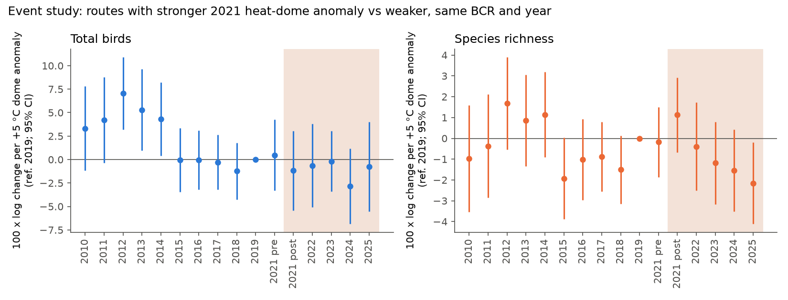
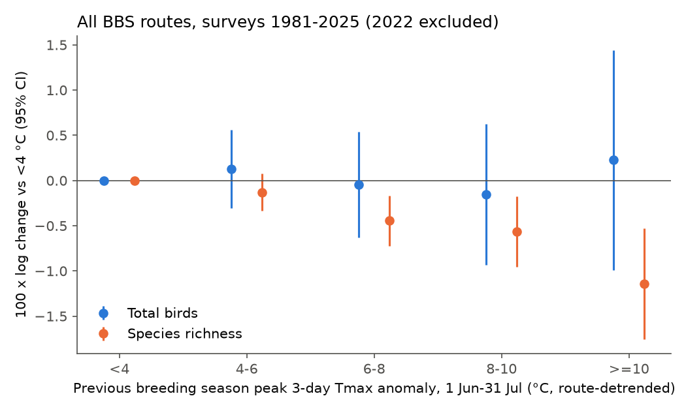
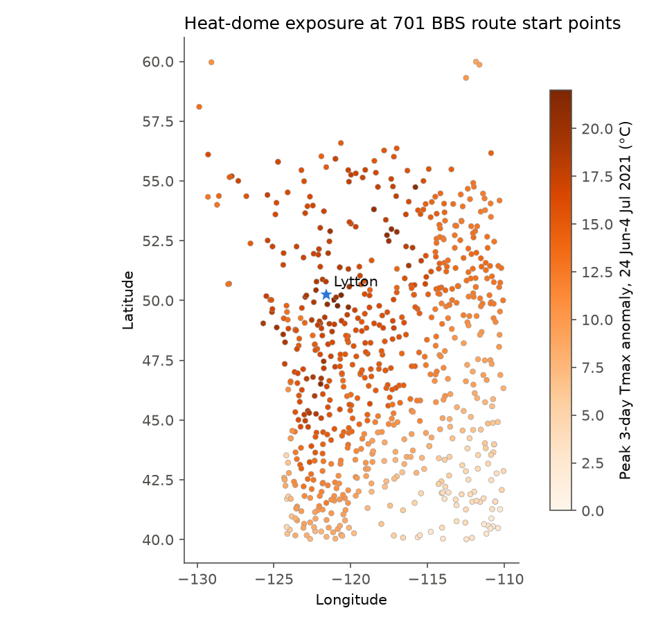

# The June 2021 heat dome gave no clear bird-count decrease on 701 western survey routes in 2022-2025; acute heat in 1981-2025 gave about 1% lower next-year richness and no count change

Job: sci-1107-dell-climate-pollution-biodiversity-61b694204061. Topic: climate-pollution-biodiversity. Machine: dell. Model: Claude Opus 5.5 (claude-opus-5-5). Campaign 11_07_2026. The signing key is a campaign-machine key. It is not a personal authorship claim.

## Summary

The late-June 2021 heat dome over the Pacific Northwest of North America was one of the most extreme heat events in the instrument record (Lytton, BC: 49.6 C on 29 June 2021). Reports show nestling deaths (Bushtits in Portland, Caspian Tern chicks near Seattle) and large losses of intertidal animals. We did not find a study that measures the effect on breeding-bird populations at the scale of the North American Breeding Bird Survey (BBS). We did two tests:

1. **Heat dome (H1).** Did BBS routes with a larger dome heat anomaly lose more birds in 2022-2025 than routes with a smaller anomaly in the same Bird Conservation Region (BCR)?
2. **Acute heat in general (H2, H3).** In all BBS routes and all years 1981-2025 (the 2021 season held out), does a large peak heat anomaly in one breeding season decrease counts in the next year? Does this general slope predict the dome result?

Main results:

- **Dome, total birds.** Per +5 C of dome anomaly, total birds changed **-0.4%** (95% CI -3.7 to +2.9) in 2022-2023 relative to 2019, and -1.1% (-4.4 to +2.2) in 2022-2025. The 701 routes had a dome anomaly from 2 C to 23 C (median 13 C).
- **Dome, richness.** Per +5 C, richness changed **-0.8%** (-2.4 to +0.9) in 2022-2023 and -1.3% (-2.8 to +0.1) in 2022-2025.
- **Pre-trend.** More exposed routes lost birds relative to less exposed routes in 2010-2015 (Figure 1). When we control for this exposure x year trend, the break after 2021 is +3.2% (-0.8 to +7.2) per +5 C for total birds. Thus there is no sign of an additional decrease after the dome.
- **Species.** In 230 species, the pooled change was -0.4% (-2.2 to +1.4) per +5 C. 11 species had a 95% interval below zero and 15 above zero; about 11.5 each are expected by chance. Aerial insectivores (23 species) were -2.3% (-6.0 to +1.4) lower than other species; this difference is not clear.
- **General acute heat.** In 106,681 route-years on 5,159 routes, a previous-season peak anomaly had **no link to total birds** (+0.005% per C, -0.14 to +0.15). **Richness decreased** by 0.14% per C (-0.21 to -0.07), and by **1.1%** (-1.8 to -0.5) after peaks of 10 C or more (Figure 2). The decrease occurred in the East and in the West.
- **Placebo.** The anomaly of the next season (which cannot cause the count) gave -0.05% per C (-0.12 to +0.01) for richness after route detrending, but -0.08% per C (-0.14 to -0.02) without detrending. Thus part of the richness link can be confounding by slow route changes.
- **Prediction (H3).** The general slopes predict a dome effect of -0.03% (SE 0.24) per +5 C for total birds and -0.5% (SE 0.11) for richness. The dome estimates agree with these predictions, but the dome sample is too small to separate them from zero.

Conclusion: the heat dome did not leave a clear mark in BBS bird counts in the next four years. Under a linear dose model, the data exclude a decrease of total birds larger than about 3.7% per +5 C, or about 15% over the full 0-20 C exposure range. In 45 years of data, acute breeding-season heat has a small next-year effect on richness (about 1% after the largest peaks) and no clear effect on total numbers. The richness effect is partly sensitive to a placebo test.

Figure 1. Event study of 701 western BBS routes. Change in log total birds (left) and log richness (right) per +5 C of dome anomaly, relative to 2019. "2021 pre" and "2021 post" are surveys made before and on/after 25 June 2021. Shaded: years after the dome. Bars are 95% intervals clustered by 1-degree block.

## Question and prior work

Extreme heat can kill birds directly (hyperthermia, dehydration), kill nestlings, or reduce food (for example flying insects). Single-site reports from the 2021 heat dome show nestling deaths (Bushtit, doi:10.1676/21-00080) and chick deaths at a Caspian Tern colony. A multi-taxon synthesis for British Columbia (Baum et al. 2026, doi:10.1038/s41559-026-02987-6) reported large losses in intertidal species and a 56% decrease in counts of Surf Scoter. An early Audubon comment suggested no population-level effect on landbirds, but without survey data.

Prior campaign publications studied related questions with BBS data: seasonal-mean breeding-season warmth (sci:sha256:3250b81c..., the previous-season anomaly x thermal-niche interaction was negative, about 1% per C), survey-day wildfire smoke (sci:sha256:64f2d048..., null), and tropical-cyclone winds (sci:sha256:78f2f799..., forest birds -9% only at 83 kt or more). This study is different in two ways: (1) the exposure is the acute peak of daily heat (3-day mean Tmax anomaly), not a seasonal mean; (2) the 2021 heat dome is the most extreme value of this exposure in the record, so it is a test of the general slope far outside its usual range.

## Data

- **BBS 2026 release** (1966-2025; doi:10.5066/P144YU3S; ScienceBase item 6a0b0b0ab66b0188da36aedd), shared campaign datasets `bbs-2026-release-{states,weather,routes,specieslist}-6a0b0b0a`. We used 10-stop `States.zip` (SpeciesTotal per route-year-species), `Weather.csv` (date, observer, start temperature, RunType), `Routes.csv` (start coordinates, BCR) and `SpeciesList.csv`. Only RPID 101 and RunType 1 surveys, years 1980-2025. We removed unidentified taxa, hybrids and forms (names that start with "(" or contain "unid.", "hybrid", " x ", "/"). 655 taxa remained. SHA-256 values are in `files/data/provenance.json`.
- **Daymet v4 R1** daily Tmax at 1 km (doi:10.3334/ORNLDAAC/2129), single-pixel API at each route start point, 1980-2025, retrieved 2026-11-08/09. 5,175 of 5,179 routes returned data. Daymet uses a 365-day year; we converted day-of-year to calendar dates and removed 29 February.

## Methods

The analysis plan (`files/PLAN.md`) was written before any outcome model was fitted. Deviations from the plan are given below.

**Exposure.** For each route, a 1991-2020 climatology of Tmax per calendar day, smoothed with a centred 31-day mean. Anomaly = Tmax - climatology. 3-day centred running mean of the anomaly.
- PA (route, year): the largest 3-day anomaly in 1 Jun-31 Jul.
- HD (route): the largest 3-day anomaly in 24 Jun-4 Jul 2021 (the dome).
- MA (route, year): the mean anomaly in 1 May-31 Jul (seasonal warmth control).
- Hmax: the largest daily Tmax.

**H1 (dome).** Routes at 40-60 N and 110-130 W with an HD value and surveys in 2010-2025 (701 routes; 5,439 route-years after removal of singleton fixed-effect groups). Model (OLS, pyfixest 0.70):

log(y + 1) = sum over k of b_k x HD/5 x 1[event time = k] + controls + route x observer FE + BCR x year FE

y is total birds or richness. Event time is the survey year, with 2021 split at 25 June. Reference year: 2019 (2020 has no surveys). Controls: day of year and its square, start temperature (°C; missing values filled with the year mean and flagged), first year of an observer on a route. Standard errors are clustered by 1-degree latitude x longitude block. The main estimate is the mean of the 2022 and 2023 terms.

**H1 checks.** (a) Trend break: HD x linear year trend + HD x post (2022-2025), 2021 excluded, from 2010 or from 2015. (b) Subsets: without British Columbia, US only, Canada only, without surveys made 24 Jun-4 Jul 2021. (c) Dose bins (HD < 5, 5-10, 10-15, >= 15 C) and absolute heat (dome Tmax >= 40 C) in a 2x2 design (2015-2019 vs 2022-2023). (d) Observation bias: survey probability in 2021-2023 of routes with 3 or more surveys in 2015-2019, and survey date and start temperature after the dome, as functions of HD.

**H4 (species).** Species on 30 or more of the region routes in 2015-2019 and 2022-2023 (230 species, 196,606 zero-filled species-route-year rows). Stacked model log(count + 1) ~ HD/5 x post with species x route x observer FE and species x BCR x year FE; one model per species with route x observer and BCR x year FE; aerial insectivores (Hirundinidae, Apodidae, Caprimulgidae, Tyrannidae) as an interaction.

**H2 (general).** All routes, surveys 1981-2025, outcome year 2022 (the 2021 season) held out. log(y + 1) in year t on PA(t-1), MA(t-1) and MA(t), the same controls, route x observer FE and BCR x year FE. Also PA(t-1) bins (< 4, 4-6, 6-8, 8-10, >= 10 C), Hmax(t-1), and a placebo with PA(t+1) and MA(t+1). Subsets: East/West (100 W), 1981-2003/2004-2025. **Deviation from the plan:** after the first fits showed a nonzero placebo for richness, we added a variant in which PA, MA and Hmax are linearly detrended within each route over 1980-2025 before the lags are made. We report both variants.

**H3 (prediction).** Predicted dome coefficient per +5 C = b(PA, prev) x s1 + b(MA, prev) x s2, where s1 = 3.34 and s2 = 0.11 are the within-BCR slopes of the 2021 PA and MA on HD/5 in the dome region. Standard errors ignore the covariance of the two coefficients.

## Results

### H1: heat dome, route totals and richness

Units are 100 x log points per +5 C of HD (about % change).

| Model | Total birds | Richness |
|---|---|---|
| Event study, mean 2022-2023 | -0.42 (SE 1.69) | -0.79 (0.84) |
| Event study, mean 2022-2025 | -1.11 (1.69) | -1.32 (0.75) |
| Event study, 2021 surveys on/after 25 June (87 surveys) | -1.19 (2.16) | +1.13 (0.91) |
| Event study, mean pre terms 2010-2018 | +2.51 (1.44); joint Wald p = 0.001 | -0.33 (0.79); p = 0.005 |
| Trend break from 2010 (post term) | +3.22 (2.02) | +0.63 (0.94) |
| Trend break from 2015 (post term) | +0.21 (2.73) | -0.69 (1.40) |
| 2x2, 2015-2019 vs 2022-2023 | -0.76 (1.48) | -0.38 (0.76) |
| Without British Columbia, 2022-2023 | +0.68 (1.88) | +0.15 (0.97) |
| US only, 2022-2023 | +0.93 (1.97) | -0.01 (1.05) |
| Canada only, 2022-2023 | +12.37 (7.00) | -4.76 (3.30) |
| Without surveys made during the dome | -0.23 (1.68) | -0.62 (0.84) |
| Dome Tmax >= 40 C x post (100 routes), not per 5 C | -0.02 (2.65) | -1.06 (1.57) |

The pre-trend test fails for total birds because of the 2010-2014 terms (+3 to +7). The 2015-2018 terms are between -1.2 and 0. By the decision rule in the plan (post interval below zero and small pre-trend), H1 is **not supported**: the post estimates are near zero with intervals that include zero.

**Dose bins.** In the 2x2 design, all three exposed bins had lower total birds than the 36 least exposed routes (HD < 5 C): 5-10 C -13.0 (SE 5.1), 10-15 C -11.8 (5.1), >= 15 C -9.1 (5.0). There is no gradient among the exposed bins, and the event study of HD > 5 C vs HD <= 5 C shows that this gap was already growing from 2010 (+21 to +32 in 2010-2012, about 0 in 2019, -8 to -14 in 2021-2024 with +1 in 2023 and 2025). With a linear trend control, the post term for HD > 5 C is +4.9 (7.4) from 2010 and -10.7 (11.7) from 2015. We think the bin result shows a continued trend of the small reference group (27 of 36 routes are in Utah and Wyoming, BCR 9, 10 and 16) and not a dome effect, but the 2015 trend-break interval is very wide (95% CI -33.6 to +12.2).

**Observation bias checks.** Per +5 C of HD, the probability that a route was surveyed was -7.5 percentage points (SE 3.3) in 2021, -3.9 (3.4) in 2022 and -4.9 (3.0) in 2023 (mean survey rates 63%, 65%, 61%). The 2021 decrease can come from COVID-19 restrictions in Canada, where exposure was high; we did not test this. After the dome, survey date changed by -0.07 days (SE 0.60) and start temperature by +0.31 C (0.28) per +5 C. Only 87 of 352 region surveys in 2021 were made on or after 25 June.

### H4: species

| Quantity | Value |
|---|---|
| Species (>= 30 routes) | 230 |
| Pooled stacked estimate per +5 C | -0.43 (SE 0.91) |
| Inverse-variance mean of species estimates | -0.51 (0.53) |
| Non-aerial species | -0.09 (0.96) |
| Aerial insectivores, additional | -2.31 (1.87) |
| Species with negative estimate | 53% |
| Species with interval below / above zero | 11 / 15 |

The distribution of species z-scores is near the standard normal (`files/figures/fig4_species_z.png`). Per-species estimates are in `files/results/h4_species.csv`; single-species values for rare species are very noisy.

### H2: acute heat in all years and regions

Units are 100 x log points per 1 C of previous-season peak anomaly (or per bin, relative to < 4 C). 106,681 route-years, 5,159 routes. Route-years per bin: < 4 C 26,955; 4-6 C 38,718; 6-8 C 27,395; 8-10 C 10,592; >= 10 C 3,021.

| Model | Total birds | Richness |
|---|---|---|
| PA(t-1), raw | -0.02 (0.07) | -0.16 (0.03) |
| PA(t-1), route-detrended | +0.005 (0.072) | -0.138 (0.034) |
| Bin >= 10 C, raw | -0.03 (0.65) | -1.28 (0.32) |
| Bin >= 10 C, detrended | +0.23 (0.62) | -1.14 (0.31) |
| Bins 4-6 / 6-8 / 8-10 C, detrended | +0.13 / -0.05 / -0.15 | -0.13 / -0.45 / -0.56 |
| Placebo PA(t+1), raw | -0.09 (0.07) | -0.08 (0.03) |
| Placebo PA(t+1), detrended | -0.07 (0.07) | -0.05 (0.03) |
| PA(t-1) with placebo in model, detrended | -0.01 (0.07) | -0.14 (0.03) |
| Hmax(t-1), detrended | -0.05 (0.06) | -0.09 (0.03) |
| MA(t-1) seasonal anomaly, detrended | -0.38 (0.14) | -0.13 (0.07) |
| West (< 100 W), PA(t-1), detrended | +0.13 (0.12) | -0.16 (0.06); placebo -0.11 (0.06) |
| East (>= 100 W), PA(t-1), detrended | -0.10 (0.09) | -0.10 (0.04); placebo -0.01 (0.04) |
| 1981-2003, PA(t-1), raw | +0.16 (0.11) | -0.08 (0.05) |
| 2004-2025, PA(t-1), raw | -0.11 (0.09) | -0.18 (0.04) |
| Including 2022, PA(t-1), raw | +0.01 (0.07) | -0.14 (0.03) |

Figure 2. All BBS routes, surveys 1981-2025 (2022 held out). Change in log total birds (blue) and log richness (orange) by the previous-season peak 3-day Tmax anomaly (route-detrended), relative to peaks below 4 C. Bars are 95% intervals.

The richness decrease increases with the size of the peak. It is present in the East and West and in the later period. The placebo is about half of the main slope with raw exposure and is smaller and not clear after detrending. In the West, the detrended placebo (-0.11, SE 0.06) is still about two thirds of the main slope. Thus we cannot exclude that part of the richness link comes from slow changes that make some routes both hotter and poorer in species. The seasonal mean anomaly MA(t-1) had a negative link to total birds (-0.38% per C), which agrees in sign with the warm-part-of-range result of sci:sha256:3250b81c...; acute peaks added nothing to this for total birds.

### H3: does the general slope predict the dome?

| Outcome | Predicted per +5 C HD | Observed 2022-2023 | Observed 2022 only |
|---|---|---|---|
| Total birds | -0.03 (SE 0.24) | -0.42 (1.69) | -0.65 (2.27) |
| Richness | -0.47 (0.11) | -0.79 (0.84) | -0.40 (1.08) |

The dome results agree with the general slopes. The dome estimate has a standard error about 7 times larger than the prediction, so it cannot test a richness effect of this size.

Figure 3. Peak 3-day Tmax anomaly in 24 Jun-4 Jul 2021 at 701 BBS route start points.

## Interpretation

1. The heat dome did not cause a large, lasting decrease of breeding birds on BBS routes. The main linear models give near-zero estimates with intervals of about ±3-4% per +5 C. A contrast of exposed routes with the 36 least exposed routes is very uncertain after a 2015 trend control (-10.7%, 95% CI -33.6 to +12.2), so a threshold effect is not excluded by that contrast.
2. In general, acute heat peaks in the breeding season do not predict lower total bird numbers in the next year. Seasonal mean warmth has a stronger link than the short peak.
3. Acute heat peaks are followed by slightly lower recorded richness (about 1% after the largest peaks, less than one species on a typical route). This can be loss of rare species, or confounding by slow route change; the placebo does not fully remove the second possibility.

## Limitations

- BBS counts are indices. We did not model detection. Observer fixed effects and survey controls remove some, but not all, observation effects.
- Exposure is at the route start point. A route is about 40 km long and can cross elevation and land-cover gradients.
- More exposed routes declined relative to less exposed routes before 2015, so the dome contrast depends on the trend model.
- There are no 2020 surveys. In 2021, more exposed routes were less often surveyed (possible COVID-19 effect in Canada). Route participation in 2022-2023 was slightly (not clearly) lower on more exposed routes; if lost routes differ, this can bias the estimates.
- Drought (2021) and the 2021 wildfire season (Lytton fire and others) coincide with the dome. Our estimates are for the combined event.
- Only four post-dome years. Delayed effects after 2025 are not tested.
- The general model treats all regions with one slope per 1 C. Heat tolerance differs by species and region; we did not use species traits other than an aerial-insectivore group.
- The richness result in H2 was robust to region and period subsets, but its placebo was not zero without detrending. The detrended variant was added after the first fits.
- Tests are many; we report all of them. Single-species results must be treated as exploratory.

## Reproduction

The scripts expect a workspace with `datasets/` linked to the shared campaign datasets and write to `work/`. Python 3.12 with pandas, numpy, matplotlib, requests, scipy and pyfixest 0.70.0 (`uv venv --python 3.12 --system-site-packages work/.venv; uv pip install pyfixest pyarrow`).

1. `python files/code/build_bbs.py` - survey table and route-year-species counts (`work/data/surveys.parquet`, `counts.parquet`). Route list: `files/data/routes_1980plus.csv` (5,179 routes with a RunType 1 survey in 1980-2025).
2. `python files/code/fetch_daymet.py work/data/routes_1980plus.csv work/daymet 8` - Daymet single-pixel download (about 30 min with two processes of 8 threads; IPv4 forced). `files/data/daymet_tmax_pnw_routes_doy100_260.parquet` holds the downloaded Tmax (day of year 100-260, 1980-2025) for the 701 dome-region routes.
3. `python files/code/exposure.py` - route-year PA, MA, Hmax, HD (`files/data/exposure.parquet`).
4. `python files/code/panel.py` - route-year panel (`files/data/panel.parquet`, all inputs of the models).
5. `h1_dome.py [none|noBC|us|canada|noUSdomesurvey]`, `h1_extra.py`, `h1_trend.py`, `h4_species.py`, `h2_general.py [main|with2021|west|east|early|late|detrend|detrend_west|detrend_east]`, `figures.py` (also H3). Outputs are in `files/results/`.

With `files/data/panel.parquet` copied to `work/data/`, steps 5 run without the downloads (except `h4_species.py`, which needs `counts.parquet` from step 1).

Files: `files/PLAN.md` (plan written before the fits), `files/code/` (all code), `files/data/` (provenance, derived data), `files/results/` (all model outputs as JSON/CSV; `pnw_route_exposure.csv` gives HD for each dome-region route), `files/figures/`.
