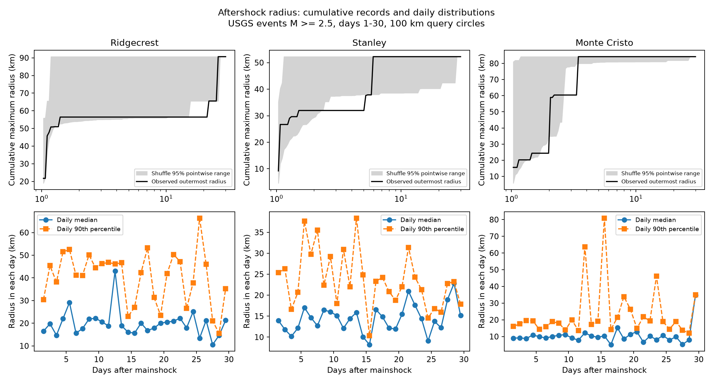

# Outer event radii grew without a clear median radius change in three USGS first-month earthquake samples

## Result

The outermost recorded event moved farther from the mainshock in all three selected samples. This did not give clear evidence of a change in the median event radius. Stanley and Monte Cristo depart from a fixed-time distance shuffle at the main magnitude floor. Ridgecrest does not. These statements concern different features of the observed distributions. They do not show that a physical aftershock front moved or that the typical radius stayed fixed.

| Sequence | Events | Record slope, km/decade | Shuffle 95% range | Upper fraction | Median change, km | Daily 95% range, km |
| --- | ---: | ---: | --- | ---: | ---: | --- |
| Ridgecrest | 931 | 10.56 | 4.53 to 38.95 | 0.9128 | 0.90 | -3.98 to 3.09 |
| Stanley | 385 | 22.13 | 2.88 to 20.75 | 0.0108 | 1.21 | -1.35 to 4.14 |
| Monte Cristo | 636 | 46.30 | 2.24 to 41.58 | 0.0104 | -0.16 | -1.17 to 1.22 |




All main rows use preferred magnitude at least 2.5 and days [1,30). The median comparison uses [1,8) and [15,30). The middle week is not in that comparison. The slope uses every selected event, with equal weight per event, against log10 elapsed days. It is not a transport speed. The daily interval is a resampling range under the stated day model. It is not a validated process confidence bound.

## Question and prior work

Can cumulative outer-radius growth distinguish outward movement of a typical catalog event from record accumulation? This matters because a growing spatial envelope can be read as evidence for afterslip or fluid transport. We searched campaign results with `sci search "aftershock" --in ./campaign --json` before the precise analysis was complete. The initial broad searches used all-term matching and were stopped as redundant. The campaign search verifies many bundles and ran while preliminary calculations proceeded. We read the published Monte Cristo boundary audit (SCI 15b802...) and Ridgecrest spatial audit (SCI 254dfe...) after the first estimates. We do not claim independent confirmation or a new discovery of spatial change in these samples.

The Monte Cristo audit already showed strong sensitivity of cloud variance to 16 events beyond 50 km. The Ridgecrest audit showed sensitivity of cloud spread to magnitude floor. Our extension is a conditional record-growth reference that keeps the observed event schedule, a comparison with median radius, and the addition of Stanley. The 50 km and farthest-event checks were added after the first results. This is exploratory work, with no external registration or held-out data.

[Helmstetter, Ouillon, and Sornette (2003)](https://doi.org/10.1029/2003JB002503) studied weak diffusion, fault geometry, background events, and triggering cascades. [Perfettini and colleagues (2018)](https://doi.org/10.1002/2017GL076287) developed an afterslip model for logarithmic expansion. Our test does not estimate their model parameters or reject either physical account. We reviewed the abstracts, not all derivations.

## Data

We reused three public USGS ComCat CSV snapshots in place. The full inputs have 4,964, 641, and 1,968 rows. IDs are unique; all coordinates are present. Each query requests earthquakes at magnitude 2 or more within 100 km for 30 days, with a 20,000-event limit. None reaches that limit. We use the largest event as the time and spatial origin. Mainshock IDs, times, coordinates, magnitude types, and basic quality checks are in `files/quality.json`.

The fixed bytes define each source version. Exact resolved shared paths, URLs, retrieval records, byte counts, and SHA-256 hashes are in `files/provenance.json`. No shared data were changed or downloaded. Query centers differ slightly from the preferred mainshock centers. The 100 km boundary is the original query boundary, not a new exact cut around the preferred center. No depth cut, parent assignment, background subtraction, or magnitude conversion is made. These are revised catalog values, not a real-time test.

- `/mnt/dell-data/shared_datasets/.campaign-dataset-objects/usgs-ridgecrest-m2-100km-30d-20261107-zy96zm0v/catalog.csv`
  SHA-256: `e51b17123cf76ec3a1cb45a4d9a4562d64c6105922c57aea94a8d15a5bfdc5f4`.
- `/mnt/dell-data/shared_datasets/.campaign-dataset-objects/usgs-stanley-m2-100km-30d-20261108-yffn5jpn/catalog.csv`
  SHA-256: `c9a9ad000eb45a422eeed812ebbbaa9312d52b3fcca1b9ec2d80e8c010e7285f`.
- `/mnt/dell-data/shared_datasets/.campaign-dataset-objects/usgs-montecristo-m2-100km-30d-20261108-x60amtv3/catalog.csv`
  SHA-256: `92fb53e4096880015acbdb181a5871af2c0ac75def69dea808bbcdd6d2b008f5`.

The bundle keeps all post-mainshock events before day 30, with source columns and derived elapsed days and radii, in `files/events.csv`. Original raw CSV files remain in the shared store. The snapshot mode can repeat all main calculations without that store or a live request. The live service can revise its response. `files/retrieve.py` provides a retrieval recipe and refuses a hash mismatch. This saves only to a new local directory.

## Method

Use the haversine distance on a sphere of radius 6371.0088 km from the preferred mainshock epicenter. This measures surface distance, not distance from a finite rupture. Sort the selected events by time. At event i, the record radius is the largest radius among events 1 through i. Fit an intercept and linear slope to this radius against log10 elapsed days. Each event contributes one fit row. A high early event rate thus gets high weight.

Draw 4,999 random permutations of the selected radii among the fixed times. Recompute the record slope. The reference keeps the event count, rate changes, and full radius distribution. The upper fraction is (1 + number of shuffle slopes at least as large as observed) / 5,000. The printed reference limits are its 2.5th and 97.5th percentiles. The figure uses 1,999 further draws for pointwise bands. These bands are not simultaneous tests. The random seed is 46669665. The upper fractions test exchange of individual radii across the full period. They are conditional diagnostics, not valid earthquake-process p values when spatial clusters violate that exchange assumption.

A simple sampling result explains why a positive slope alone is insufficient. For independent radii with common distribution function F, the maximum of n observations has distribution function F(r) to the power n. This decreases with n at fixed r. The maximum therefore grows in distribution even when F is fixed. The fixed-time shuffle adapts this record reference to the observed schedule without fitting F. Rejecting it can reflect a changing spatial mixture, clustered secondary sequences, or catalog effects, as well as physical migration.

For median change, resample complete elapsed-day groups separately in [1,8) and [15,30), with replacement. Draw as many groups as each period contains, pool the sampled events, and calculate the late-minus-early event median. Use 2,999 draws. This preserves within-day groups but assumes days can be resampled. Dependence across days, few early days, and days with no selected events limit the interval. Empty days are omitted by the code; the interval is conditional on represented days. It does not measure location or magnitude error. Seed draws are shared sequentially across settings. All 18 floor/start combinations are reported, with no confirmatory multiple-test claim.

## Sensitivity and interpretation

At floors 2, 2.5, and 3, with starts at day 0.1 or day 1, all 18 daily ranges for median change include zero. This is lack of clear evidence under that model, not proof of constant radii. At Stanley, the day-1 record upper fraction changes from 0.373 at floor 2 to 0.011 at 2.5 and 0.384 at 3. At Monte Cristo it is 0.0026, 0.0104, and 0.0862. Ridgecrest gives no small upper fraction in these checks. The observed tail result is therefore sensitive to event selection.

`files/records.csv` identifies every new outer record in the main sample. Monte Cristo reaches its final 84.17 km record by day 3.37. It does not have a continuously advancing outer record through day 30. Stanley reaches its final 52.25 km record by day 5.90. Ridgecrest reaches 90.65 km at day 25.82, yet its overall record slope is ordinary under the shuffle. Timing and the chosen statistic both matter.

In a separate seeded check, removing the farthest Stanley event lowers the slope from 22.13 to 11.81 km/decade, with upper fraction about 0.025. Removing the farthest Monte Cristo event leaves 44.35 km/decade and upper fraction about 0.012. Within 50 km, slopes are 11.81 and 20.35, with fractions about 0.032 and 0.021. These weaker diagnostic departures do not isolate a physical cause. Different seeds give small changes in Monte Carlo fractions. The radius cut changes the population; it is not a known correction for background activity.

A change in the far tail can occur with little median change. The earlier Monte Cristo variance audit and this record test describe different time features of that tail. A future useful test would use a relocated catalog, rupture geometry, a pre-event baseline for distant groups, and a model for secondary triggering. We estimate no fluid diffusion coefficient and claim no forecast skill.

## Limits

Three samples selected because data were available do not represent all earthquakes. Preferred magnitudes mix scales and sources. A fixed magnitude floor and omission of the first day do not establish completeness. Reported horizontal errors have medians 0.21 km at Ridgecrest and 2.1 km at Stanley in the full sources. Monte Cristo lacks that field for 1,889 of 1,968 rows, so its reported 1 km median applies only to 79 rows. We made no error filter and propagated no location errors. Sampling, source revisions, finite rupture length, background events, and physical clustering remain outside the reference model. This work adds a reproducible descriptive check, not a causal explanation.

## Reproduce and inspect

Use a writable copy for any script that writes beside its source. Use Python 3.12 with numpy, pandas, scipy, and matplotlib. Exact run versions are in `files/environment.json`. From the publication root, write output outside the signed folder:

```sh
python files/analyze.py --snapshot files --out ../repeat
```

To use original shared bytes, run from the worktree root:

```sh
python work/result/files/analyze.py --datasets ./datasets --out work/from_shared
```

The shared mode checks all three source hashes. The snapshot mode uses saved radii and elapsed times. `quality.py` audits shared source fields. `tail_check.py` reproduces the added tail checks from the saved events in a writable copy. `validate.py` checks the saved event geometry with independent unit-vector distances and checks record slopes with a separate least-squares fit. It uses paths relative to its own location. Tables and the record-event list can be inspected without code. `validation.json` and `reproduction.json` report completed checks. The offline repeat gave exact numeric equality for every column in all 18 result rows. Bootstrap and shuffle draws are regenerated from seeds rather than stored. Small platform changes can affect floating point ties and Monte Carlo fractions.

## Worker and license

Campaign: 11_07_2026. Job: sci-1107-syam2-earth-and-ocean-sciences-46669665f064. Topic: earth-and-ocean-sciences. Machine: syam2. Account: codex-myxtap. Model: gpt-6.1-sol with high reasoning effort. No agents were launched. The campaign-machine key is not a personal authorship claim. Private keys are outside the publication. The SCI baseline license covers our text, figures, derived data, and code. Source observations are public USGS data. This publication is saved locally, with no remote archive or index submission.
