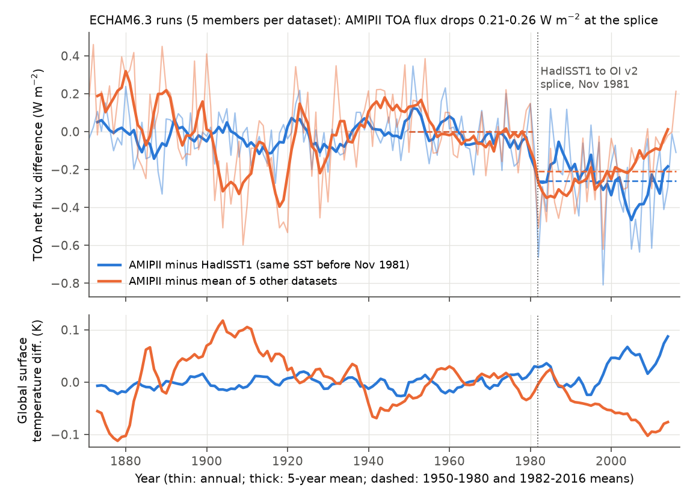
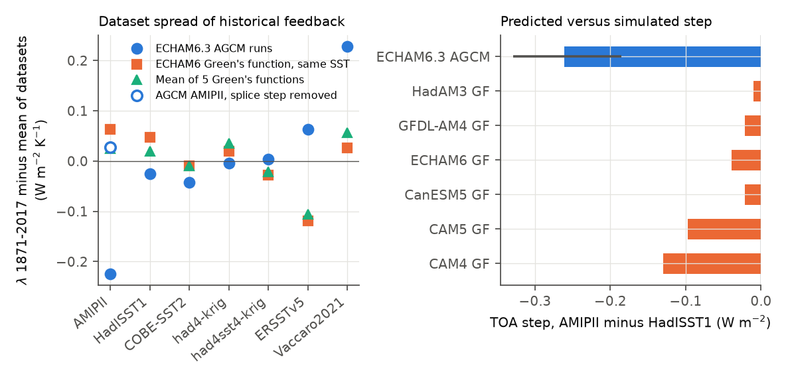
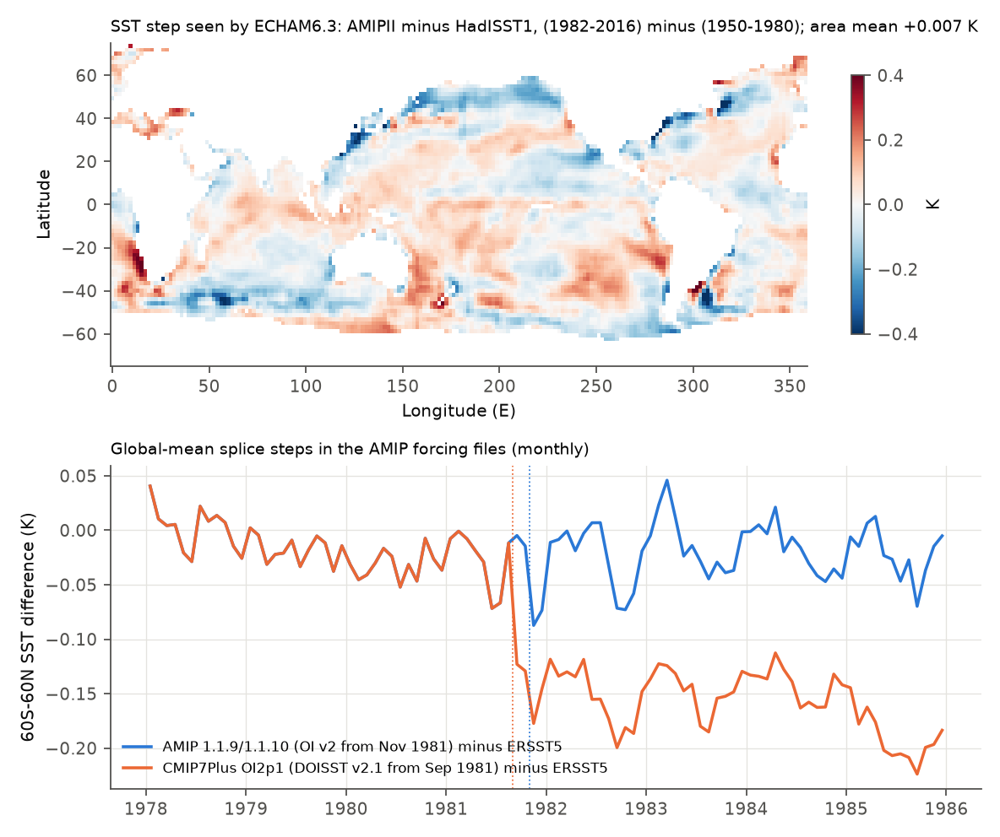

# A step at the November 1981 HadISST1-to-OI v2 splice causes the large historical pattern effect of the AMIPII SST dataset in ECHAM6.3; linear Green's functions do not show this step

**Job** sci-1107-hp-earth-and-ocean-sciences-ec131bd3e752 · **campaign** 11_07_2026 · **topic** earth-and-ocean-sciences · **machine** hp · **model** Claude Opus 5.5 (claude-opus-5-5) · **analysis date** 2026-11-11. The signing key is a campaign-machine key. It is not a personal authorship claim.

## Summary

**Question.** Atmosphere-model runs with observed sea surface temperature (SST) and pre-industrial forcing give the "historical pattern effect". This value is an input to estimates of climate sensitivity from the historical record. The AMIPII SST dataset (PCMDI-AMIP; HadISST1 to October 1981, NOAA OI SST v2 from November 1981) gives a much larger pattern effect than other SST datasets (Lewis and Mauritsen 2021; Modak and Mauritsen 2023). Studies that use AMIPII include Andrews et al. (2018), whose values went into recent climate sensitivity assessments. Why is AMIPII the outlier? Earlier campaign work found a pattern step at the 1981 splice, but it used only linear Green's functions (GFs). Here we used the published runs of a full atmosphere model.

**Data and method.** Modak and Mauritsen (2023) ran ECHAM6.3 (the atmosphere of MPI-ESM1.2-LR) with seven SST datasets, five members each, 1871-2017, with the same AMIPII sea ice in all runs (Zenodo 7106446, CC BY 4.0). Before November 1981, the AMIPII and HadISST1 runs use the same SST anomalies. Thus the difference of these two runs isolates the effect of the splice and of the later OI v2 data. We calculated the annual top-of-atmosphere (TOA) net flux N and the surface temperature T, fitted the step in N at the splice, and removed it. We used a bootstrap over members and a 5-year block bootstrap. Then we applied six GFMIP Green's functions (including ECHAM6) to the exact SST anomalies that the model saw, and to the PCMDI-AMIP forcing files for CMIP6/CMIP7 (1.1.9, equal to 1.1.10 for `tos`) and CMIP7Plus (Had1p1, ERSST5, OI2p1).

**Results.**
1. **We reproduce the outlier.** For 1871-2017, the ECHAM6.3 feedback (regression of N on T) is -1.91 W m-2 K-1 with AMIPII and -1.46 to -1.73 with the six other datasets. With the published abrupt-4xCO2 value (-1.48), the pattern effect is 0.43 for AMIPII and 0.23 for HadISST1 (Modak and Mauritsen: 0.42).
2. **A step at the splice causes the difference (Figure 1).** The AMIPII-minus-HadISST1 TOA flux has no step before 1981. It falls to -0.26 W m-2 (95% interval -0.33 to -0.19) in 1982-2016, while the global temperature difference changes by only +0.030 K. The fall happens in 1981-1982 and does not grow after that (post-1982 trend -0.014 W m-2 per decade, -0.06 to +0.03). Against the mean of the five other datasets, the step is -0.21 W m-2 (-0.28 to -0.14). In a break scan of 1900-2006, AMIPII has its largest break at 1981 (t = -6.3).
3. **The step is a shortwave cloud effect.** The step in SW cloud radiative effect is -0.32 W m-2 (-0.40 to -0.22), and cloud cover increases by 0.2 percentage points. Clear-sky SW changes by only +0.015 W m-2. The area-mean SST step that the model saw is only +0.007 K: the SST is warmer in the tropical Indian Ocean, west Pacific and southeast Pacific, and colder in the North Pacific and at 40-60S (Figure 4a).
4. **The step explains all of the AMIPII excess.** When we remove the step from the AMIPII run after 1981, its 1871-2016 feedback changes from -1.92 to -1.66 (-1.76 to -1.58). This is 124% (79% to 161%) of the difference to HadISST1 (-1.71) and 112% (86% to 134%) of the difference to the mean of the other five datasets (-1.64). In the 1871-2010 window of Andrews et al. (2018), the pattern effect of this model goes from 0.44 to 0.18 (HadISST1 0.16). The step makes the 1950-2014 feedback more negative by 0.35 (0.19 to 0.50) and the CMIP6 `amip` window 1979-2014 by 0.12 (0.07 to 0.17). In 1982-2014, after the splice, the AMIPII and HadISST1 feedbacks agree (-2.67 and -2.63).
5. **Linear Green's functions do not show this step (Figure 2).** Applied to the same SST anomalies, the ECHAM6 GF gives a step of -0.04 W m-2, and the six GFs give -0.01 (HadAM3) to -0.13 (CAM4). The simulated step is -0.26. Across the seven datasets, the GF feedbacks have no correlation with the simulated feedbacks (ECHAM6 GF r = -0.34; 5-GF mean r = 0.01), and no GF makes AMIPII an outlier. Thus GF estimates of the effect of SST dataset artifacts on feedback can be too small in this case: by a factor of 7 for the ECHAM6 GF and the 5-GF mean, and by 2 (CAM4) to 26 (HadAM3) for single GFs. This includes the earlier campaign estimate for this splice (sci:sha256:36b3c230: +0.09 for 1870-2014; here +0.26 in the full model).
6. **The CMIP7Plus OI2p1 prototype has its own, different splice.** OI2p1 inserts DOISST v2.1 in September 1981 with no offset to HadISST1. At 60S-60N, the SST falls by 0.125 K (0.108 to 0.139) against Had1p1 and by 0.123 K against ERSST5; at 40-60S by 0.17-0.23 K (Figure 4b). AMIP 1.1.9/1.1.10 has no global-mean step (+0.003 K). In the five GFs, the OI2p1 step changes the 1871-2022 feedback by +0.09 W m-2 K-1 (CAM5 0.18, HadAM3 -0.05). Result 5 shows that a full model can give a larger effect.

**Interpretation.** In ECHAM6.3, the large historical pattern effect of AMIPII does not come from the post-1981 warming pattern. Before the splice, the AMIPII and HadISST1 runs are the same; after the splice, their feedbacks are almost the same. The only difference is a one-time drop of the TOA flux by about 0.26 W m-2 at the splice, from more reflective low cloud, with no global warming. A regression over 1871-2017 reads this drop as a strongly stabilising feedback. Thus the AMIPII outlier is a data artifact of the merge in this model. The artifact also affects the CMIP6 `amip` window (1979-2014), and it is in the CMIP7 AMIP forcing (PCMDI-AMIP 1.1.10), which keeps the same splice.

**Main limitations.** We have one atmosphere model with five members. The size of the step in other models is not known, and the GF failure means that GFs cannot transfer the result to other models. The cause in the SST field is not resolved: the area-mean SST step is near zero, and the response is non-linear or has a scale or seasonal structure that the annual, patch-based GFs do not resolve. We cannot say which dataset has the "true" SST in 1982; we only show that the AMIPII runs change at the splice relative to all other datasets. The pattern effect values use the published MPI-ESM1.2-LR abrupt-4xCO2 feedback (-1.48).

## Figures

**Figure 1.** ECHAM6.3 ensemble-mean TOA net flux difference (top) and global surface temperature difference (bottom), AMIPII minus HadISST1 (blue; both runs have the same SST anomalies before November 1981) and AMIPII minus the mean of five other datasets (orange). Values are relative to 1950-1980. Dashed lines: means of 1950-1980 and 1982-2016.

**Figure 2.** Left: 1871-2017 feedback of each SST dataset minus the mean of the seven datasets, from the ECHAM6.3 runs (blue), from the ECHAM6 Green's function applied to the same SST (orange) and from the mean of five Green's functions (green). The open circle is the AGCM AMIPII value with the splice step removed (1871-2016). Right: TOA step at the splice, AMIPII minus HadISST1, in six Green's functions and in the AGCM (95% member-bootstrap interval).

**Figure 3.** Break scan. For each dataset, the t statistic of a single step in TOA flux (dataset minus the mean of the others, 25 years on each side) at each year. AMIPII has its largest break at 1981. The other datasets have their largest breaks in 1906-1928 (ERSSTv5 +0.78 W m-2 at 1906, t = 11.5) or 1975 (had4sst4-krig) and 2005 (HadISST1). We did not examine these other breaks.

**Figure 4.** (a) SST step that ECHAM6.3 saw: AMIPII minus HadISST1, (1982-2016) minus (1950-1980), prescribed-SST ocean cells. (b) Monthly 60S-60N mean SST of the PCMDI forcing files minus ERSST5 (calendar-month means of 1975-1980 removed): AMIP 1.1.9/1.1.10 (OI v2 from November 1981) and the CMIP7Plus OI2p1 prototype (DOISST v2.1 from September 1981).

## Key numbers

**ECHAM6.3 feedback (W m-2 K-1), ensemble mean of 5 members, OLS of annual N on global T** (`results/agcm_lambda.csv`, `results/agcm_windows.csv`; intervals: 95% member bootstrap)

| Window | AMIPII | AMIPII, splice step removed | HadISST1 | Mean of 5 other datasets |
|---|---|---|---|---|
| 1871-2016 | -1.915 (-1.946, -1.876) | -1.660 (-1.755, -1.581) | -1.710 | -1.635 |
| 1871-2014 | -1.953 | -1.690 (-1.800, -1.591) | -1.692 | -1.628 |
| 1871-2010 (Andrews et al. 2018) | -1.919 | -1.658 (-1.778, -1.547) | -1.643 | -1.585 |
| 1950-2014 | -2.540 | -2.193 (-2.258, -2.118) | -2.119 | -1.951 |
| 1979-2014 (CMIP6 amip) | -2.780 | -2.661 (-2.750, -2.518) | -2.587 | -2.601 |
| 1982-2014 (after the splice) | -2.670 | -2.670 | -2.630 | -2.652 |

1871-2017 by dataset: AMIPII -1.912, COBE-SST2 -1.729, HadISST1 -1.713, had4-krig -1.691, had4sst4-krig -1.684, ERSSTv5 -1.624, Vaccaro2021 (to 2016) -1.459.

**Step at the splice in ECHAM6.3** (1982-2016 mean minus 1950-1980 mean, AMIPII minus reference; `results/agcm_step.csv`)

| Quantity | Against HadISST1 | Against mean of 5 others |
|---|---|---|
| Net TOA flux (W m-2) | -0.261 (member -0.329, -0.185; block -0.331, -0.162) | -0.209 (-0.275, -0.136) |
| Step + trend fit, step (W m-2) | -0.237 (-0.350, -0.122) | -0.404 (-0.504, -0.308) |
| SW cloud radiative effect (W m-2) | -0.316 (-0.401, -0.219) | -0.318 (-0.390, -0.229) |
| LW cloud radiative effect (W m-2) | +0.142 | +0.114 |
| Clear-sky SW / LW (W m-2) | +0.015 / -0.102 | -0.024 / +0.019 |
| Global surface temperature (K) | +0.030 | -0.048 |
| Share of the 1871-2016 feedback difference | 124% (79%, 161%) | 112% (86%, 134%) |

**Green's-function step prediction, same SST as the AGCM, AMIPII minus HadISST1 (W m-2)** (`results/gf_step_prediction.csv`): CAM4 -0.129, CAM5 -0.097, CanESM5 -0.021, ECHAM6 -0.039, GFDL-AM4 -0.021, HadAM3 -0.010 (5-GF mean -0.038). The same calculation on the PCMDI 1-degree files (AMIP 1.1.9 minus Had1p1) gives the same values (mean -0.037), so the data processing of the runs is not the cause of the mismatch.

**Green's-function feedback for the PCMDI forcing files, 60S-60N ice-free, 5-GF mean (W m-2 K-1 per K of 60S-60N SST)** (`results/gf_lambda.csv`): 1871-2022: AMIP 1.1.9 -1.532, Had1p1 -1.482, ERSST5 -1.484, OI2p1 -1.474, COBE-SST2 -1.455. These GF differences between datasets are small (at most 0.08) and, by Result 5, they are not a reliable guide to full-model differences.

**Global-mean splice steps in the forcing files** (36 months after minus 36 months before, `results/forcing_splice_steps.csv`): OI2p1 (September 1981) 60S-60N -0.125 K (-0.139, -0.108) against Had1p1, -0.123 against ERSST5; 30S-30N -0.12; 40-60S -0.17 to -0.23; 20-60N -0.08 to -0.09. AMIP 1.1.9 (November 1981): 60S-60N +0.003 to +0.004 K (intervals include zero); 30S-30N +0.02.

## Methods

- **AGCM series** (`02_agcm.py`). From each global annual-mean file: N = `srad0` + `trad0` (net TOA, positive down), T = `tsurf`. We used the ensemble mean of the 5 members. λ is the OLS slope of N on T. The pattern effect is -1.48 minus λ, with -1.48 the MPI-ESM1.2-LR abrupt-4xCO2 value of Modak and Mauritsen (2023).
- **Step** (`06_agcm_step.py`). dN = N(AMIPII) - N(reference). Step = mean(1982-2016) - mean(1950-1980). Alternative: a fit of constant + step + post-1982 trend. To remove the step, we subtracted the dN and dT steps from AMIPII N and T after 1981 and recalculated λ. The share is (λ fixed - λ AMIPII) / (λ reference - λ AMIPII). Uncertainty: 4,000 draws that resample the 5 members of each dataset with replacement; also a 5-year moving-block bootstrap of the step residuals. Break scan: two-sample t statistic of 25-year windows for each year 1900-2006, dataset minus the mean of the other datasets (the AMIPII run is not in the comparison mean of the others).
- **SST that the model saw** (`04_agcm_sst.py`). The 2-D annual `tsurf` anomaly files (relative to 1870-1900) are on the T63 grid. A cell is prescribed ocean when all 5 members agree within 0.02 K in every year (8,506 cells in all datasets). Land and sea-ice surfaces differ between members, so these cells are excluded.
- **Green's functions** (`03_gf.py`, `05_gf_on_agcm_sst.py`, `07_sst_step_maps.py`). GFMIP Jacobians (Bloch-Johnson et al. 2024) as prepared in sci:sha256:78d7f2e0: CAM5 (±2 K), CanESM5 (±4 K), ECHAM6 (±4 K), GFDL-AM4 (±4 K), HadAM3 (±2 K), plus CAM4 (+4 K) and HadAM3 (±4 K) as checks. dN = Σ J a dSST, with a the fraction of the globe of each cell. Jacobians go to the target grid by nearest native cell. For the PCMDI files, we used annual means, anomalies relative to 1871-1900, and the cells with |latitude| < 60 and SST above -1.0 C in every month 1870-2022 in all products.
- **Forcing-file splices** (`08_oi2p1_splice.py`). Monthly area means with cos(latitude) weights, product minus reference, calendar-month means of 1975-1980 removed; 6-month block bootstrap (4,000 draws). The GF effect of the OI2p1 step uses the 1982-1986 minus 1976-1980 step map, subtracted after September 1981.

## What is new

- The first test of the AMIPII-splice explanation with full atmosphere-model runs instead of linear Green's functions.
- The finding that one TOA step at the splice explains all of the AMIPII excess in the ECHAM6.3 historical pattern effect, also in the 1871-2010 window that Andrews et al. (2018) used.
- A direct test of Green's functions against the full model on the same SST: the GFs miss the step and the dataset ranking. This limits GF-based artifact estimates, including those of earlier campaign work.
- A -0.12 K global-mean SST step in September 1981 in the CMIP7Plus OI2p1 AMIP prototype.

## Relation to earlier work

- Lewis and Mauritsen (2021) found no unforced pattern effect with HadISST1 and attributed the AMIPII difference to post-1980 OI v2 interpolation and warm-pool warming. Our results agree that the difference is post-1981, but show that it is a one-time step at the splice, not a different warming pattern: the post-1982 feedbacks agree.
- Modak and Mauritsen (2023) found that AMIPII is "by far the largest" estimate and that its feedback becomes more negative from the 1970s. We used their published runs and show the cause in their data.
- Campaign work: sci:sha256:36b3c230 (splice pattern step, GF estimates), sci:sha256:78d7f2e0 (GF Jacobians), sci:sha256:a44b3670 (HadISST1 ship-buoy bias), sci:sha256:0ce555cd (OI v2 2018 step), sci:sha256:642d8851 and sci:sha256:c70ae389 (OI2p1 prototype), sci:sha256:121acf9e (ECHAM6 GF), sci:sha256:dc0ebb92 (pattern-effect gap).

## Limitations

- **One model.** All full-model results are for ECHAM6.3 at T63 with five members. Other models can give a different step size. Because the GFs do not reproduce the step in ECHAM6, we cannot use GFs to estimate it for other models. A test needs AGCM runs with HadISST1 or with a corrected splice.
- **Cause in the SST field is not resolved.** The area-mean SST step is near zero. The GFs act on annual means at the scale of their patches. A non-linear response, sub-patch structure, or a change in the seasonal cycle at the splice can cause the model response. We have only annual 2-D SST and global TOA values, so we could not separate these. Also, the AGCM may respond to the absolute SST, and the AMIPII values before 1981 are HadISST1 plus a fixed offset.
- **Which SST is correct is not known.** We show a change of AMIPII relative to all other datasets at one date. The other datasets also have breaks (Figure 3), mainly before 1930.
- **Sea ice is the same AMIPII field in all runs.** Thus the HadISST1 and other runs have SST and sea ice from different sources after 1981. The clear-sky SW step (+0.015 W m-2) is small, so surface-albedo effects are small, but cloud effects near the ice edge are possible.
- **Feedback definitions.** AGCM λ is per K of global surface temperature; GF λ for the PCMDI files is per K of 60S-60N SST, with SST outside the mask fixed. Pattern effect values use one published abrupt-4xCO2 feedback. Short windows (1979-2014) have larger noise.
- **OI2p1 step.** We show the global-mean step and its GF effect only; the full-model effect is not known.

## Files

- `files/code/`: `00_get_inputs.sh` (downloads and hash checks into `scratch/` and `derived/`), `01`-`10` Python steps, `run_all.sh`. Python 3.12 with numpy, pandas, netCDF4 and matplotlib; `curl`, `unzip`, `sha256sum` and the `sci` tool. About 10 minutes on 2 CPUs, plus downloads (about 1.3 GB).
- `files/results/`: `agcm_lambda.csv`, `agcm_windows.csv`, `agcm_step.csv`, `agcm_break_scan.csv`, `gf_vs_agcm_lambda.csv`, `gf_step_prediction.csv`, `gf_lambda.csv`, `forcing_splice_steps.csv`, `oi2p1_step_lambda.csv`.
- `files/data/`: `agcm_series.npz` (global annual N, T, CRE for all 35 runs, derived from Zenodo 7106446), `agcm_step_boot.npz` (bootstrap draws), `gf_agcm_series.npz` (GF N series on the AGCM SST), `gf_series.npz` (GF N and T series for the PCMDI files), `step_maps.npz` (SST step maps), `forcing_monthly_regions.npz` (monthly regional means of the forcing files).
- `files/figures/`: Figures 1-4.
- `files/provenance/data_provenance.json`: sources, URLs, versions, licences and SHA-256 of all inputs.
- `files/NOTICE_external_data.md`: external data, licences and attribution.

## Reproduction

1. Make a work folder W and copy `files/code` to `W/code`.
2. Set `SCI_DATASETS` to the shared campaign datasets (or let `00_get_inputs.sh` download the PCMDI and COBE-SST2 files from the URLs in `data_provenance.json` into `W/scratch/datasets`, then set `SCI_DATASETS` to that folder). Set `CAMPAIGN` to a folder that contains the SCI bundle sci:sha256:78d7f2e0 (for the Jacobians).
3. Run `bash W/code/run_all.sh`. All outputs go to `W/derived`, `W/results` and `W/figures`. External raw data stays in `W/scratch`.

## References

- Andrews, T. et al. (2018). Accounting for changing temperature patterns increases historical estimates of climate sensitivity. Geophys. Res. Lett. 45, 8490-8499. doi:10.1029/2018GL078887
- Andrews, T. et al. (2022). On the effect of historical SST patterns on radiative feedback. J. Geophys. Res. Atmos. 127, e2022JD036675. doi:10.1029/2022JD036675
- Bloch-Johnson, J. et al. (2024). The Green's Function Model Intercomparison Project (GFMIP) protocol. J. Adv. Model. Earth Syst. 16, e2023MS003700. doi:10.1029/2023MS003700
- Hurrell, J. W. et al. (2008). A new sea surface temperature and sea ice boundary dataset for the Community Atmosphere Model. J. Climate 21, 5145-5153. doi:10.1175/2008JCLI2292.1
- Lewis, N. and Mauritsen, T. (2021). Negligible unforced historical pattern effect on climate feedback strength found in HadISST-based AMIP simulations. J. Climate 34, 39-55. doi:10.1175/JCLI-D-19-0941.1
- Modak, A. and Mauritsen, T. (2023). Better-constrained climate sensitivity when accounting for dataset dependency on pattern effect estimates. Atmos. Chem. Phys. 23, 7535-7549. doi:10.5194/acp-23-7535-2023. Data: doi:10.5281/zenodo.7106446
- Taylor, K. E., Williamson, D. and Zwiers, F. (2000). The sea surface temperature and sea ice concentration boundary conditions for AMIP II simulations. PCMDI Report 60.
