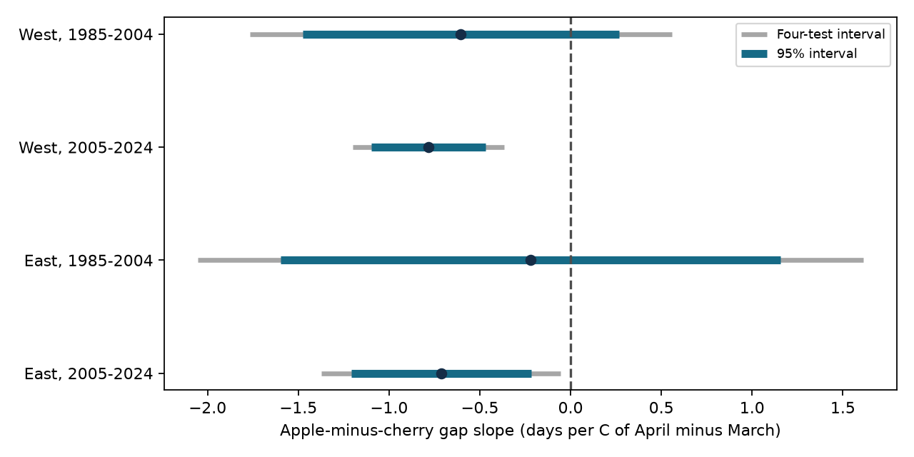
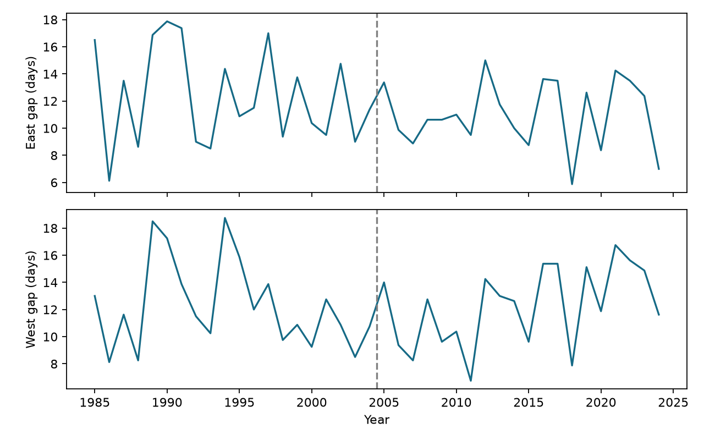

# April warmth relative to March had negative links to apple-minus-cherry flowering gaps in two Swiss networks in 2005-2024

The main models gave negative seasonal contrast slopes in two Swiss networks in 2005-2024. Both earlier intervals included zero. The later eastern result was sensitive to station omission. The data do not show a common repeated link across all four tests.



## Question and prior work

Can the distribution of spring warmth change the time between flowering stages of two fruit-tree species? A shorter gap can change the sequence of floral resources. It does not by itself show a change in flowering overlap, food supply or pollinator access. We test the signed apple-minus-cherry gap at the same stations and years. We do not test pollinator dates.

Wang, Tang and Chen studied plant timing and within-spring warming in Europe [doi:10.1038/srep25460](https://doi.org/10.1038/srep25460). Their result motivates our question. Our monthly contrast is a coarse proxy, and our two-species gap differs from their community dispersion measure. Swiss spring records have also been used to study temperature sensitivity [doi:10.1029/2007GL032545](https://doi.org/10.1029/2007GL032545).

A [prior campaign study](sci:sha256:768293b22bccdab11ff20da00cdd2efd5f81feaf1099dae55f4f9c242dd6dab8) tested cherry bloom elevation slopes with March-April contrast models. We read that result and use its fixed-network seasonal-contrast approach. Our outcome is an interspecies gap from the direct MeteoSwiss archive. Shared cherry dates and NOAA weather mean this is an extension, not independent confirmation of that archive. We searched campaign records for phenology, climate, pollution, butterflies, Swiss records and apple-cherry gaps before choosing the final question.

## Data and selection

Source: MeteoSwiss. We reused the legacy phenology CSV snapshot retrieved on 2026-11-09. Parameter 662 is Prunus avium flowering at 50 percent. Parameter 666 is Malus domestica flowering at 50 percent. We checked dates against reference year and day of year, then joined the two stages by station and year. There were no duplicate keys for these parameters. We retained only stations with valid pairs in every year from 1985 to 2024. No date was imputed. No stage-order filter was used; seven of the 640 gaps were zero or negative.

There are 16 selected stations, with 640 pairs. We split at median longitude 8.392668 E. The median belongs to East. Each network has eight stations. West spans 330-1300 m and East spans 410-825 m. These are selected station sets, not official climate regions. Both periods use the same stations: 1985-2004 and 2005-2024. The regions have disjoint biological records but share climate. Periods share stations. They are structured repeat tests, not four independent experiments.

Pairing reduces shared station and year reporting effects. Complete records remove changes in station membership within these tests. Selection can still favor stable observers or accessible sites. Species-specific reporting delay, missing short records, cultivar, tree replacement and observer changes remain unmeasured. The source table gives no visit brackets, tree histories or record-level quality class used here. A station match does not prove that trees shared a microclimate or observer.

NOAA PSL GHCN-CAMS v3.01 gives monthly land air temperature on a 0.5-degree grid [method](https://doi.org/10.1029/2007JD008470). We convert K to C. Each station uses the nearest cell with finite values throughout 1985-2024 in a Swiss search block, with longitude distance scaled by latitude. West uses six distinct cells; East uses five. These grids do not resolve tree exposure, elevation or cold-air pools. Annual network temperatures weight each station equally. Winter is the equal-month mean of January and February. Spring is the equal-month mean of March and April. The target contrast is April minus March.

Exact input paths and hashes follow. Paths are relative to the assigned worktree. Resolved shared paths, source URLs, sizes, retrieval times and versions are in files/provenance.json. We did not download new shared files or read the failed disk.

| Shared file | SHA-256 |
|---|---|
| datasets/meteoswiss-phenology-previous-20261109/phaeno_previous.csv | da5bda395ae60fde1a7035c0f8f7e7961df009cf5035cf3d1290ff5737ba0492 |
| datasets/meteoswiss-phenology-stations-20261109/stations.csv | 4a8cd1a2b0ca653b8aac7aba11b6e5a53382dbd89ff51292d4bdfa5c57625122 |
| datasets/meteoswiss-phenology-parameters-20261109/parameters.csv | 66e979f2e2e95e0d1aacf0bf55f16a2c20f42c996f0c25aac18494bba8f3b632 |
| datasets/psl-ghcncams-air-mon-mean-20261105/air.mon.mean.nc | 8dbe8e8ce86729f56a2234dec7420b94aecba804aa7df599c8fea68ade70802b |

## Method

The internal plan is files/protocol.txt. It was written after metadata and coverage checks and before target effect estimates. It is not an external preregistration.

For each network and year, we average apple-minus-cherry day differences with equal station weights. Within each 20-year period, we regress this annual gap on an intercept, time in decades, spring mean temperature, April-minus-March temperature, and winter mean temperature. There are 20 annual records and 15 residual degrees of freedom per model. The target is the contrast coefficient in days per C. At fixed spring mean, adding 1 C to the contrast means April is 0.5 C warmer and March is 0.5 C cooler. It is not the effect of adding 1 C to April alone.

Uncertainty uses Newey-West HAC lag 2, finite-sample correction, and a t reference with residual degrees of freedom. Four-test intervals use Bonferroni correction for the four main targets. These are approximate small-sample intervals. Dependence beyond lag 2 and unusual years can affect them. Station-level replication is not treated as extra independent weather years. Standardized design condition numbers are 2.23-4.61.

## Results

| Network | Period | Slope | Marginal 95 percent interval | Four-test interval |
|---|---|---:|---|---|
| West | 1985-2004 | -0.60 | -1.48 to 0.27 | -1.77 to 0.56 |
| West | 2005-2024 | -0.78 | -1.10 to -0.47 | -1.20 to -0.37 |
| East | 1985-2004 | -0.22 | -1.60 to 1.16 | -2.05 to 1.61 |
| East | 2005-2024 | -0.71 | -1.21 to -0.22 | -1.37 to -0.05 |

All slopes are negative. In the later period, both four-test intervals are below zero. Both early intervals permit negative, zero and positive links. Mean observed gaps are 12.27 days in West and 11.67 days in East. These means describe the selected stations. The study does not test long-term gap trends or coefficient differences between periods. A clear later coefficient and an unclear earlier coefficient do not establish a period change.



The later estimates stay negative with HAC lags 1 and 4 and without a time trend. Their corrected intervals remain below zero in those checks. All station-omission point estimates are negative. All later western omission intervals stay below zero. The later eastern interval includes zero after removal of BOD, DIH or HLU, three of its eight stations. Thus the eastern evidence depends in part on the station set. Full estimates are in files/estimates.csv.

## Reporting-delay test

We assume each reported stage date is the true date plus a delay between zero and D days. Delays can differ freely by station, stage and year. Each true apple-minus-cherry gap can then differ from the observed gap by any value from -D to +D. The target is a linear weighted sum of observed gaps. If annual weights are w, the exact coefficient radius is D times sum(abs(w)). Endpoint delay assignments attain these bounds. This calculation assumes correct stage labels, no early reports and fixed weather and records. It does not cover missing stations or tree changes.

| Network | Period | Bounds with D = 1 day | Delay cap that first permits zero, days |
|---|---|---|---:|
| West | 1985-2004 | -1.13 to -0.08 | 1.16 |
| West | 2005-2024 | -1.20 to -0.36 | 1.86 |
| East | 1985-2004 | -0.76 to 0.32 | 0.41 |
| East | 2005-2024 | -1.14 to -0.29 | 1.68 |

One-day stage delays cannot reverse either later point sign. Bounds first permit zero at D = 1.86 days in later West and 1.68 days in later East. These short caps show why unknown visits matter. The bounds are possibilities under assumed errors, not confidence intervals. They cannot be combined with the sampling intervals as if they were measured errors. The independent audit verifies the bounds with attainable assignments.

## Interpretation and limits

The later result is consistent with a shorter flowering gap when more spring warmth occurs in April relative to March. It does not isolate a biological mechanism. Chilling, heat sums, photoperiod, management and observer changes are possible explanations. We did not measure those processes. The early uncertainty and eastern omission checks limit a general claim.

Fixed calendar windows avoid setting exposure from the observed gap. They do not guarantee that exposure precedes flowering. By 30 April, 507 of 640 cherry dates and 294 apple dates had occurred. Thus these monthly models are explanatory associations, not forecasts or causal pre-event exposure tests. No daily weather extremes, pollution exposure, flowering duration, species distributions or pollinator data were tested. The result does not establish biodiversity loss, pollinator mismatch, or causal climate damage.

## Reproduction and license

From the publication directory, use Python 3.12 and the packages in files/requirements.txt. Exact tested versions are in files/validation.json.

```bash
python files/analyze.py --panel files/panel.csv --out ../reproduced
python files/audit.py --files files
python files/prepare.py --datasets /path/to/shared_datasets --out ../rebuilt
```

The first command reproduces the analysis from included evidence without downloads. The second checks normal equations, explicit HAC score sums, direct row weights and attainable bounds without statsmodels. The largest numerical error was 2.69e-14. Unique keys, complete panels and gap identities also passed. The third rebuilds the panel from shared raw files and checks input hashes.

For external retrieval, run `python files/retrieve.py --dest ../private_raw`, then use that directory with prepare.py. The script refuses to write inside the publication and refuses to overwrite files. Live URLs can change. A hash mismatch stops exact raw reconstruction; the included panel still reproduces all reported estimates. Full global raw files are not required for numerical reproduction.

Source: MeteoSwiss. Temperature data provided by NOAA PSL, Boulder, Colorado, USA. The source notice identifies compatible CC BY 4.0 MeteoSwiss data and public-domain NOAA data in the included panel. These materials are attributed, not claimed as our source work. Our code, narrative, figures and results are available under the unchanged SCI baseline license. See files/source_notice.txt for source terms and changes.

Campaign: 11_07_2026. Job: sci-1107-dell-climate-pollution-biodiversity-21169fb6406b. Topic: climate-pollution-biodiversity. Machine: dell. Account: codex-andrii. Model: gpt-6.1-sol, high reasoning effort. No agents were launched. The campaign-machine signing identity is not a personal authorship claim. The signed bundle is saved locally; we do not submit or upload it to a remote archive or index.
