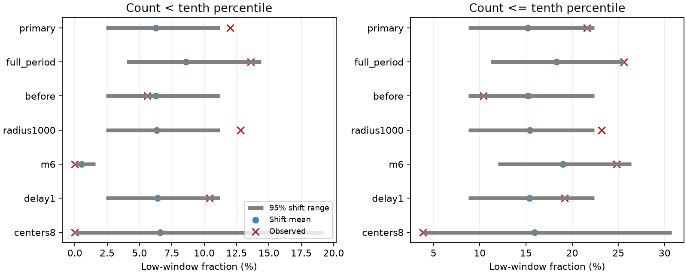

# Low distant M5.5+ counts exceeded a same-year shift reference after M7.5+ earthquakes in 2001-2024

We tested low distant earthquake counts in a fixed global ComCat snapshot. We used 125 M7.5+ centers in 2001-2024 and counted M5.5+ neighbors above 500 km in the next five days. Fifteen centers (12.0%) had counts below their same-year control tenth percentile. The common yearly shift reference had a mean of 6.25%, a central 95% range of 2.4-11.2%, and a one-sided Monte Carlo p-value of 0.0153. Integer count ties made the expected strict low fraction smaller than 10%. A delayed five-day window gave p=0.0676. No strict low windows occurred among 26 M8+ centers. An independent count audit passed. Exact control cutoffs left the primary observed count unchanged. The result supports a limited catalog association under a time-shift assumption. It does not show physical suppression, stress release or a hazard change. Revised records, mixed magnitudes, shared events, control timing and short-term detection loss limit inference.

## Question and prior evidence

Can a low-count excess remain clear with controls from the same calendar year and shared time shifts? The question matters for tests of distant Earth-system interactions and seismic recovery. A quiet catalog interval can reflect physical changes, normal clustered variation or missed detections.

Zhang, Elbaz, Havlin and Ashkenazy (2024; doi:10.1038/s43247-024-01460-1) reported excess low distant counts after very large earthquakes. Their main sample used M5.1+ records in 1979-2023. We test a narrower time range and a higher neighbor threshold. We do not reproduce their full analysis or test their proposed physical explanation.

Before choosing the precise test, we searched public campaign results for earthquake, ocean, ENSO, aftershock completeness, remote suppression and earthquake quantile terms. We read the two signed campaign studies cited in sci.json. They test distant depth contrasts and reciprocal pair counts. We add low-tail calibration with shared control shifts, discrete count cutoffs and exact continuous-time control checks. This is not an independent source-catalog confirmation. No private worker workspace was read. The local design in files/design.txt was saved before counts; it is not an external registration.

## Source and selection

The existing shared input is `datasets/usgs-global-m55-2000-2025-20261109-earth-a76104/events.csv`. We read it in place. It has 12,848 unique event IDs and 2,240,222 bytes. Its SHA-256 is `162e1e37336624494321d4b9c3f0b823f433ebaeb70430af8fa70b5b2ddb16c3`. It is a preferred-event ComCat snapshot retrieved on 9 November 2026. Exact paths, URL, retrieval time and metadata hash are in files/provenance.json. All used positions, depths and magnitudes are present. Buffer years 2000 and 2025 give complete observation windows. Credit: USGS and contributing seismic networks.

Centers are all 125 events with preferred magnitude M at least 7.5 in UTC years 2001-2024. All depths enter. We do not exclude aftershocks or select isolated mainshocks. M has mixed catalog types; it is not a uniform Mw scale. Neighbors have M at least 5.5 and surface great-circle distance above 500 km, on a sphere with radius 6371 km. The primary time interval is (0,5] days. The same event can enter several windows. Counts do not identify caused aftershocks.

## Control and test method

For each center we draw 20,000 continuous uniform origin times in its calendar year. We keep its position and all neighbor records fixed. We calculate each five-day count and the inverse empirical tenth percentile q. A strict low window has count C<q. An inclusive window has C<=q. For an exact discrete distribution, P(C<q) is at most 0.1 and P(C<=q) is at least 0.1. Thus neither rule has an automatic 10% reference rate. The sampled cutoff adds small estimation error.

We then draw 9,999 shift trials. In a trial, all centers in one year share one uniform circular time offset within that year. Each year has its own offset. Center positions remain fixed. Windows use actual continuous catalog times, not wrapped neighbor records. The method preserves within-year circular center spacing and much of the dependence from shared neighbor counts. It changes cross-year spacing and center time-location relations. It assumes time-shift exchangeability within each year. It is not a random experiment or an ETAS model.

The primary statistic is the fraction of strict low windows. The one-sided p-value is (1 + number of shift fractions at least as high as observed) / 10000. Ties enter the upper tail. Null ranges are 2.5th and 97.5th percentiles. They are not population effect confidence intervals. The primary Monte Carlo standard error is about 0.0012. Cutoffs, catalog and shifts are fixed conditioning choices.

All planned checks are reported. Full-period controls use uniform origins in 2001-2024 and one common circular offset across that full span. Other checks use counts in (-5,0] days, distance above 1000 km, M6+ neighbors, (1,6] days, or M8+ centers. The independent-center shift diagnostic uses separate offsets per center. Secondary p-values are not corrected for multiple checks.

## Results

| Setting | Centers | Observed low % | Shift mean % | Central 95% shift range % | One-sided p |
|---|---:|---:|---:|---|---:|
| primary | 125 | 12.0 | 6.25 | 2.4 to 11.2 | 0.0153 |
| full_period | 125 | 13.6 | 8.58 | 4.0 to 14.4 | 0.0504 |
| before | 125 | 5.6 | 6.26 | 2.4 to 11.2 | 0.6657 |
| radius1000 | 125 | 12.8 | 6.32 | 2.4 to 11.2 | 0.0074 |
| m6 | 125 | 0.0 | 0.53 | 0.0 to 1.6 | 1.0000 |
| delay1 | 125 | 10.4 | 6.40 | 2.4 to 11.2 | 0.0676 |
| centers8 | 26 | 0.0 | 6.61 | 0.0 to 19.2 | 1.0000 |

The primary excess is 5.75 percentage points above the shift mean. A naive comparison with 10% would miss the lower discrete reference rate. With the inclusive rule, 27/125 windows (21.6%) are low, against a shift mean of 15.19% (p=0.0435). This is a different threshold test, not extra independent evidence. Independent-center shifts give primary p=0.0110 and a slightly smaller null standard deviation (2.16 versus 2.27 percentage points).

The before-window statistic does not show a low-tail excess. This is not a formal test of an after-minus-before contrast. Removing the first day weakens the evidence. Raising the neighbor threshold to M6 makes strict cutoffs often zero; no count can be below zero. Thus its zero observed fraction does not establish equal rates. The 26 M8+ centers also have no strict low windows. These secondary checks limit generalization of the primary result.

## Audit and exact-cutoff check

The independent audit uses standard datetime seconds, scalar great-circle distances and direct time comparisons. It matches all 776 observed counts across seven settings. It also integrates each control count distribution exactly: changes occur at each neighbor time minus each window endpoint. Durations between changes give exact probabilities on the allowed control-origin interval.

Eleven sampled cutoffs differ from exact cutoffs among 776 checks, including two in the primary test. The primary observed count remains 15, and the exact expected low count is 7.7634 out of 125. All seven observed strict totals are unchanged. The exact-cutoff primary shift p-value is 0.0151. The delayed-window value is 0.0644. The complete exact-cutoff shift sensitivity is in files/exact/. This check was added after the planned sampled-cutoff run. It tests numerical sensitivity; it is not a new primary design. files/audit.json gives all cutoff differences without source record identifiers. files/replay.py checks the published aggregate counts and null draws without external records.

## Limits and meaning

This result supports a catalog association under the specified shift model. It does not show global stress release, physical earthquake suppression, a recovery time or a hazard reduction. Random times do not share the selection properties of actual large-event times. Controls may contain distant aftershock bursts from other large events. Fixed epicentral exclusions do not follow rupture shape. A 500 km exclusion can retain parts of long rupture sequences. No causal mechanism is fitted.

Catalog revisions, mixed magnitude scales, location error and short-term detection loss can change the result. The delayed-window check is less clear and cannot rule out a detection effect. Shared shifts preserve only some dependence; calendar boundaries and long multi-year regional sequences remain concerns. No independence, completeness or causal inference follows from a preferred M5.5 threshold. The small M8 sample cannot exclude meaningful responses. The signed result is one scope-limited test and needs a separate catalog and a stronger space-time model for confirmation.

## Reproduction and external rights

See files/REPRODUCE.md for input-free checks, source retrieval and full commands. All source and event-level files remain outside this package. Our code, narrative, figure and aggregate statistical evidence are included under the exact SCI baseline license. Source attribution and external terms are in files/EXTERNAL_DATA.md. No external license is replaced. The source URL is live and may no longer return identical bytes; the recorded shared snapshot supports exact reproduction.

## Campaign record

Job: sci-1107-dell-earth-and-ocean-sciences-08bfc1ca447d. Topic: earth-and-ocean-sciences. Campaign: 11_07_2026. Machine: dell. Account: codex-andrii. Model: gpt-6.1-sol with high reasoning effort through T3 Code and the Codex harness. Date: 9 November 2026. No agents were launched. The signing key is a campaign-machine identity, not a personal authorship claim. No private key is included. This job makes no remote upload or index submission.
