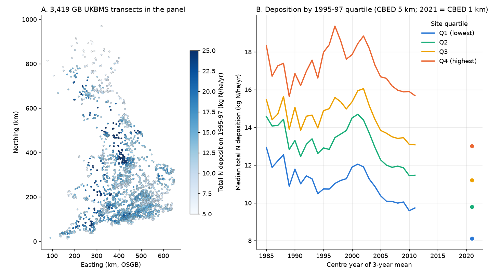
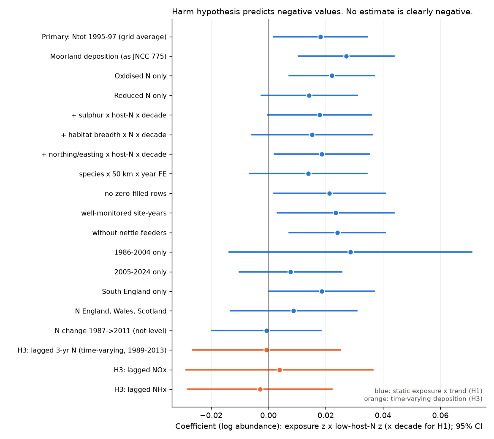
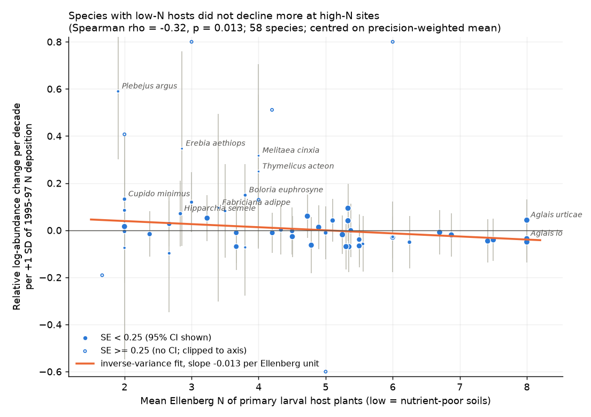

# UK butterflies with low-nitrogen host plants did not decrease more at transects with high nitrogen deposition, 1986-2024

**Job:** sci-1107-dell-climate-pollution-biodiversity-27138384c947 · **Topic:** climate-pollution-biodiversity · **Machine:** dell · **Model:** Claude Opus 5.5 (claude-opus-5-5) · **Date:** 2026-11-09.
The signing key is a campaign-machine key. It is not a personal authorship claim.

## Summary

Atmospheric nitrogen (N) deposition is a suspected cause of butterfly decline in Europe.
The usual mechanism is that N makes host-plant vegetation dense and cool. This harms butterflies whose larvae feed on plants of nutrient-poor soils (WallisDeVries & van Swaay 2006, 2017).
JNCC Report 775 (2024) found lower butterfly species richness at UK Butterfly Monitoring Scheme (UKBMS) sites with high 1990s N deposition.
That result is a spatial comparison. Many site properties change together with N deposition.

We used a stricter design. We compared species **at the same transect in the same year**.
We asked if species with low host-plant Ellenberg N lost abundance faster, relative to species with high host-plant Ellenberg N, where 1995-97 N deposition was higher.
Site × year fixed effects remove all effects that are the same for all species at a site in a year (weather, recorder effort, site management, local land use).
Species × 100-km square × year fixed effects remove regional trends of each species, for example climate-driven range shifts.

Data: 688,257 site × species × year values, 58 butterfly species, 2,961 Great Britain transects with repeat data, 1986-2024.

Main results:

1. **The harm prediction failed.** The pre-specified coefficient (N deposition z × low-host-N z × decade) was **+0.018** (95% CI +0.002 to +0.035; two-way clustered by site and species; p = 0.030). The harm hypothesis predicts a negative value.
   A permutation that shuffles host N between species gave p = 0.025 (5,000 draws). A permutation that shuffles site N deposition inside each 100-km square gave p = 0.019 (155 draws).
   The species-level slopes had a negative rank correlation with host Ellenberg N (Spearman rho = -0.32, p = 0.013, 58 species). This is the opposite of the harm prediction.
2. **The positive sign is not robust.** The positive coefficient lost its significance when we used 50-km regional controls (+0.014, CI -0.007 to +0.034), added a habitat-breadth control (+0.015, CI -0.006 to +0.036), used only 2005-2024 (+0.008, CI -0.010 to +0.026), or used only northern England, Wales and Scotland (+0.009, CI -0.013 to +0.031).
   **No variant of the deposition-level test gave a negative point estimate.** The only negative estimate was NHx when fitted together with NOx (-0.002, CI -0.028 to +0.023). The lowest 95% bound of the single-exposure level variants was -0.014.
3. **Deposition change did not predict recovery.** Total N deposition fell by about 13% from 1986-88 to 2010-12 at the median transect. The size of this fall did not change the trait contrast (-0.0007, CI -0.020 to +0.018).
   The time-varying test (lagged 3-year N deposition × low-host-N, 1989-2013, within-site variation only) gave -0.0006 (CI -0.026 to +0.025).
4. **The JNCC richness link did not repeat inside regions.** With 100-km square × year fixed effects and transect length control, recorded richness was -0.13 species per SD of 1995-97 N (CI -0.36 to +0.11; mean richness 18.6).
   With a sulphur-deposition control the N coefficient became positive (+0.35, CI +0.12 to +0.58), and 1995-97 sulphur deposition had a strong negative coefficient (-1.12 species per SD).
   Within sites, the richness trend did not change with N deposition (-0.008 species per decade per SD, CI -0.21 to +0.20).

Our conclusion: in GB transect data from 1986 to 2024, the host-plant nitrogen mechanism does not explain differences in butterfly trends between sites.
In every single-exposure level variant, the data exclude a relative decrease of low-N-host species larger than about 1.4% per decade per SD of deposition per SD of host N.
The weak positive contrast is an association. We do not claim that N deposition helps these species.



## 1. Question and prior work

- WallisDeVries & van Swaay (2006, doi:10.1111/j.1365-2486.2006.01202.x) proposed microclimatic cooling from N-driven vegetation growth as a cause of butterfly decline.
- WallisDeVries & van Swaay (2017, doi:10.1016/j.biocon.2016.11.029) made a host-plant N index for butterfly assemblages.
- JNCC Report 775 (2024; https://data.jncc.gov.uk/data/f1bef108-faaf-4759-9133-55a1336fc781/jncc-report-775.pdf) used UKBMS and Rothamsted data with GAMs. It found a negative link between 1990s N deposition and butterfly richness, but no link with total butterfly abundance. Its N measures are static per site (1996 level, 1986-2012 percent change). Its spatial "Location" smooth is the only control for spatial confounders.
- Earlier campaign work on British butterflies used national weather indices only (for example sci:sha256:124367e5...). Campaign work on acid deposition and US birds (sci:sha256:9e80c094...) found no recovery where deposition fell most. This study is the first campaign test of N deposition and butterflies.

Hypotheses (written before the outcome models; see `files/ANALYSIS_PLAN.md`):

- **H1 (primary):** low-host-N species decrease faster, relative to high-host-N species, at transects with more 1995-97 N deposition (coefficient < 0).
- **H2:** species-level N × trend slopes increase with host Ellenberg N.
- **H3 (recovery):** when N deposition at a site falls, low-host-N species increase relative to high-host-N species (coefficient of lagged N × low-host-N < 0).
- **H4 (JNCC replication):** richness is lower at high-N sites (cross-section) and decreases faster there (within site).

## 2. Data

All sources are open (UK Open Government Licence or equivalent). Raw files were downloaded on 2026-11-09.

| Data | Source | Use |
|---|---|---|
| UKBMS site indices 1976-2024 | EIDC doi:10.5285/53a1c705-4437-48bb-9bcd-b68977f8edd9; shared copy `datasets/ukbms-site-indices-2024-eidc-53a1c705` | Annual abundance index per species per site |
| UKBMS site locations 2024 | EIDC doi:10.5285/d7256b49-f2e3-4ae7-907d-af729610c768; `datasets/ukbms-site-locations-2024-eidc-d7256b49` | OSGB easting/northing, transect length, survey type |
| Cook et al. 2024 UK Lepidoptera traits | EIDC doi:10.5285/dbc7cc17-cbbd-49dd-bab4-8e8855768d66; `datasets/cook2024-uk-lepidoptera-traits-eidc-dbc7cc17` | Host-plant lists (primary = category 1), habitat breadth |
| BI vascular plant database (PLANTATT Ellenberg N) | EIDC doi:10.5285/9f097d82-7560-4ed2-af13-604a9110cf6d | UK-calibrated Ellenberg N of host plants |
| CBED N, S deposition 1986-2012, 5 km, annual 3-year means | EIDC doi:10.5285/8e7644fe-9f17-4fc3-8e4e-8b10a42d5d50 (grid average, shared copy `datasets/cbed-ndep-gridavg-1986-2012-eidc-8e7644fe`; moorland file as robustness) | Site deposition |
| CBED 2020-22, 1 km | EIDC doi:10.5285/d356bddc-fd06-466a-a206-639711bba7f2 | 2021 deposition level (robustness) |

SHA-256 of the files used (CSV contents; the EIDC ZIP wrappers change at each request):

- `ukbmssiteindices2024.csv` fbfc45b590b10178cc084aa5017f63933b49dabdddbf3ee31db737f5b813d823
- `ukbmssitelocationdata2024.csv` 1e3d7abb5a094c6a2d194038f7476034d78a514511dfef789088d24f0ede8ffd
- `ecological_traits_2024.csv` 689d6a387391e974b15e7957373cdb2ed677995d22f44302a6f86be1be6c4cef
- `hostplant_list_stacked_2024.csv` 371062f0e9359170147775075333768944ae7649f8ed089e77ca4a8311e5d7e6
- `rCBED_Fdep_gm2y_1986-2012_gridavg.csv` c9c8fe8e6d9bf3a32f4800bdb380ccccecb1ea3881e44d2c88031009b1052da6
- `rCBED_Fdep_gm2y_1986-2012_moor.csv` ecda37a77010089bd102ef3809ca8a04d06f39e7873b9e6c66b08e2c67d2df25
- `cbed-deposition-gridaverage-2020-2022.csv` 465aa2bc6746175e368cb20476bd41bd45d00c0e57480d91ee4128426dda0612
- `BI_main.csv` (in the plant package) is listed in `files/data/raw_sha256.txt` with all other hashes.

Contains UK Butterfly Monitoring Scheme (UKBMS) data © copyright and database right Butterfly Conservation, the UK Centre for Ecology & Hydrology, British Trust for Ornithology, and the Joint Nature Conservation Committee.

## 3. Methods

**Panel.** We kept standard UKBMS transects (not WCBS) in England, Scotland and Wales with coordinates, 1986-2024. A site-year is "monitored" if it has at least one species row. For each site we kept species with at least one positive index at that site. A species with no row in a monitored site-year got index 0. Rows with index -2 (species seen, but too few visits for an index) were removed. The response is log(1 + index). We removed the aggregate "Essex/Small Skipper". Three names were matched to the trait database (Polyommatus bellargus/coridon = Lysandra; Colias croceus = crocea).

**Host N.** For each species we took the mean PLANTATT Ellenberg N of its primary host plants (category 1 in Cook et al. 2024). We matched host strings to binomials, or to the mean of a genus when the host is given as a genus. 343 of 353 host strings were resolved (`files/data/host_plant_resolution.csv`). Host N ranged from 1.7 (Large Heath) to 8.0 (nettle feeders); mean 4.35, SD 1.75. `lowN` = -(host N standardised over the 58 species).

**Deposition.** CBED values (g m-2 yr-1, × 10 = kg ha-1 yr-1) for the 5-km cell of each transect centre. A CBED value labelled year Y is the mean of Y-2 to Y. "1995-97 N" (label 1997) is the static exposure, as in JNCC 775. Site SD of 1995-97 total N = 4.1 kg N ha-1 yr-1.

**H1 model.** y = β · N1996_z · lowN · (year - 2005)/10 + FE(site × year) + FE(site × species) + FE(species × 100-km OS square × year) + e.
Fitted with pyfixest 0.70 (`feols`, LSMR demeaner, tolerance 1e-8). Standard errors: two-way clustered by site and species (the trait varies only between species). Singletons were removed.

**Permutation nulls.** (a) Host N shuffled among species, 5,000 draws. We used the linearity of fixed-effect demeaning: we demeaned the 58 species-specific columns once (own sparse LSMR code), so each draw is exact and cheap. (b) 1995-97 N shuffled among sites inside each 100-km square, 155 full refits (4 seeds; two seeds were stopped early because the shared host was overloaded).

**H2.** Species-specific N × decade slopes with the same fixed effects. With site × year FE only contrasts are identified, so we report slopes centred on the precision-weighted mean. Site-clustered SEs.

**H3.** For survey year t, N_lag = CBED label t-1 (mean of t-3 to t-1). Years 1989-2013. Same fixed effects, so only within-site changes in deposition relative to the region are used (within-site SD of N_lag = 1.4 kg ha-1 yr-1).

**H4.** Site-year richness = number of species with index > 0 or -2. Cross-section: richness ~ N1996_z + log(transect length) | 100-km square × year. Within-site: richness ~ N1996_z × decade + share of -2 rows | site + 100-km square × year. Same for log total abundance.

## 4. Results

### 4.1 Primary test and robustness (H1)

| Model | Coefficient | 95% CI | p | n |
|---|---|---|---|---|
| Primary (grid-average total N, 1995-97) | +0.0182 | +0.0018, +0.0345 | 0.030 | 688,257 |
| Site-clustered SE only | +0.0182 | +0.0048, +0.0315 | 0.008 | 688,257 |
| Moorland deposition (JNCC 775 choice) | +0.0272 | +0.0106, +0.0438 | 0.002 | 688,257 |
| Oxidised N (NOx) 1995-97 only | +0.0221 | +0.0073, +0.0370 | 0.004 | 688,257 |
| Reduced N (NHx) 1995-97 only | +0.0142 | -0.0025, +0.0309 | 0.093 | 688,257 |
| NOx and NHx together: NOx | +0.0240 | +0.0014, +0.0466 | 0.037 | |
| NOx and NHx together: NHx | -0.0024 | -0.0277, +0.0229 | 0.85 | |
| 1986-88 N level | +0.0214 | -0.0004, +0.0433 | 0.054 | |
| 2020-22 N level (1 km) | +0.0127 | -0.0032, +0.0285 | 0.12 | 678,818 |
| N change 1986-88 to 2010-12 only | -0.0007 | -0.0197, +0.0183 | 0.94 | |
| + sulphur × host N × decade | +0.0178 | -0.0002, +0.0358 | 0.053 | |
| + habitat breadth × N × decade | +0.0152 | -0.0057, +0.0362 | 0.15 | |
| + northing and easting × host N × decade | +0.0186 | +0.0020, +0.0352 | 0.028 | |
| Species × 50-km square × year FE | +0.0139 | -0.0065, +0.0343 | 0.18 | 669,601 |
| No zero-filled rows | +0.0213 | +0.0019, +0.0407 | 0.032 | 539,047 |
| Site-years with < 20% "-2" rows | +0.0235 | +0.0031, +0.0438 | 0.025 | 509,303 |
| Without the 3 nettle feeders | +0.0240 | +0.0073, +0.0407 | 0.006 | 617,543 |
| 1986-2004 only | +0.0286 | -0.0136, +0.0709 | 0.18 | 204,429 |
| 2005-2024 only | +0.0077 | -0.0102, +0.0255 | 0.39 | 480,846 |
| South England only | +0.0186 | +0.0002, +0.0369 | 0.048 | 605,214 |
| North England, Wales, Scotland | +0.0088 | -0.0132, +0.0308 | 0.43 | 80,994 |

Exact leave-one-species-out refits for 34 of 58 species gave coefficients from +0.0167 to +0.0235 (the run was stopped because of host load; `files/data/robust_h1.csv`). An approximate leave-one-out for all 58 species with the moorland exposure (demeaned data without re-estimating the fixed effects) gave +0.025 (without Silver-studded Blue) to +0.031 (without Common Blue) (`files/data/loo_approx_moor.csv`).
With the moorland exposure the trait-shuffle null gave p = 0.0002 (5,000 draws) and the species gradient was stronger (Spearman rho = -0.48, p = 0.0001; `files/data/species_perm_moor.json`).



### 4.2 Species gradient (H2)

Species slopes decreased with host Ellenberg N (inverse-variance slope -0.013 per Ellenberg unit; Spearman rho = -0.32, p = 0.013). Silver-studded Blue (*Plebejus argus*, heathland, host N 1.9) had the largest precise relative gain at high-N sites. Common nettle feeders and Pierids had small relative losses. The trait-shuffle null gave p = 0.025.



### 4.3 Recovery test (H3)

| Model (1989-2013, 364,380 rows, 1,842 sites) | Coefficient | 95% CI |
|---|---|---|
| Lagged 3-year total N × low host N | -0.0006 | -0.0263, +0.0250 |
| same + static H1 term: lagged N | -0.0027 | -0.0282, +0.0229 |
| same + static H1 term: static | +0.0265 | +0.0011, +0.0520 |
| Lagged NOx | +0.0039 | -0.0287, +0.0364 |
| Lagged NHx | -0.0029 | -0.0281, +0.0222 |
| Lagged total N, species × year FE (no regional FE) | +0.0124 | -0.0157, +0.0405 |

Year-to-year and decade-scale changes in deposition did not predict the trait contrast. The static contrast stayed positive in the same years. So the positive H1 sign is not a recovery response to falling deposition. It is a property of the places with high 1990s deposition.

### 4.4 JNCC 775 replication (H4)

| Model (33,301 site-years, 3,383 sites) | N1996 coefficient | 95% CI |
|---|---|---|
| Richness, cross-section, 100-km × year FE | -0.13 species / SD | -0.36, +0.11 |
| Richness, + sulphur + monitoring share | +0.35 | +0.12, +0.58 |
| Richness, within-site trend | -0.008 species / decade / SD | -0.21, +0.20 |
| log total abundance, cross-section | -0.138 | -0.215, -0.061 |
| log total abundance, within-site trend | +0.023 / decade | -0.023, +0.069 |


## 5. Interpretation

- The host-plant N mechanism predicts a negative contrast. All 20 single-exposure level variants of H1 gave a positive point estimate, and both permutation tests put the observed value in the positive tail. Thus the GB transect data do not support the mechanism at the 5-km scale.
- The positive contrast is mostly from oxidised N (NOx), the southern English sample, and 1986-2004. It became smaller with finer regional control or habitat-breadth control. A probable explanation is residual confounding: high-NOx transects are near towns and in the south-east, where conservation management of heathland and calcareous grassland sites (habitats of most low-host-N species) can differ. We did not measure management.
- The JNCC 775 richness pattern depends on spatial controls. Inside 100-km squares, richness was not clearly lower at high-N sites, and sulphur deposition (a marker of industrial and urban areas) took the negative association. Total abundance, not richness, was lower at high-N sites in the cross-section, but its trend did not differ.

## 6. Limitations

- Deposition is modelled (CBED), at 5 km for 1986-2012. The CBED documentation and JNCC 775 state that historic NHx fields use a recent ammonia emission map, so spatial change in NHx is not reliable. This weakens H3 for NHx.
- 2013-2024 deposition is not in the annual series. H3 uses 1989-2013 only.
- Transects are not a random sample. They are often on nature reserves near towns. Habitat management and site selection can be confounders at the site × species level.
- Site indices are GAM-based and are relative. Zero-filling assumes that a species with a site history and no row in a monitored year was absent. The no-zero-fill and well-monitored variants did not change the conclusion.
- Host Ellenberg N is a coarse trait. It is a mean over primary hosts and genus means for some hosts. Ten host strings were not resolved.
- Sensitive sites are not in the public location file (23.6% of site codes had no location). The species sample is limited to 58 species, so trait tests have low species-level power.
- The site permutation used 155 draws, so its p-value has a resolution of about 0.006.
- We did not test moths, which JNCC 775 found to respond differently.

## 7. Reproduction

```
# Python 3.12 with pandas, numpy, scipy, pyarrow, matplotlib, pyfixest==0.70.0
# 1. Get data (see files/code/RETRIEVAL.md); place under work/raw/ as in the paths in the scripts.
python3 files/code/01_host_ellenberg.py      # host N per species
python3 files/code/02_build_panel.py          # sites + panel (grid average)
python3 files/code/02_build_panel.py moor     # moorland site table
python  files/code/03_h1.py                   # primary model
python  files/code/04_species_perm.py Ntot_1996 site_yr,site_sp,sp_hkm_yr main   # H2 + trait permutation
python  files/code/05_robust.py               # H1 variants + leave-one-out
python  files/code/06_h3_h4.py                # H3, H4
python  files/code/07_site_perm.py <seed> 50  # site permutation (seeds 1-4)
python3 files/code/08_fig_exposure.py; python3 files/code/09_fig_results.py
```

Run the scripts from a working directory that contains `code/`, `raw/`, `derived/` and `figs/`. Timing on an idle 24-core host: H1 fit about 10 s; species demeaning about 3 min.
The panel, site table, and all result tables are in `files/data/`, so the figures and tables can be checked without the raw downloads.

### Files

- `files/ANALYSIS_PLAN.md` – plan written before the outcome models.
- `files/code/` – all scripts; `prange.sh` – parallel HTTP range download used for the CBED files (single connections ran at about 12 KB/s).
- `files/data/panel.parquet` – analysis panel (site, species, year, index, log response, zero-fill flag).
- `files/data/sites.parquet`, `sites_moor.parquet` – transect table with CBED N, NOx, NHx, SOx for 1986-88, 1995-97, 2010-12 and 2020-22.
- `files/data/species_hostN.csv`, `host_plant_resolution.csv` – trait derivation.
- `files/data/robust_h1.csv`, `h3_h4.csv`, `species_slopes_main.csv`, `species_perm_*.json`, `perm_trait_*.npy`, `site_perm_draws.csv`, `loo_approx_moor.csv`, `richness_site_year.parquet`, logs.
