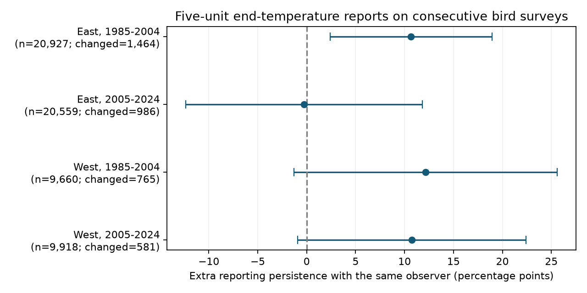

# Extra temperature-digit persistence was uncertain in three of four US bird samples in 1985-2024

We tested whether five-unit temperature reports persist more when a bird survey route keeps the same observer. We used 61,064 consecutive-year pairs from accepted US Breeding Bird Survey runs. We split the routes into East and West and the years into 1985-2004 and 2005-2024. The estimated extra persistence was +10.67, -0.27, +12.15 and +10.75 percentage points. Only the early eastern interval was above zero after correction for four tests. The other intervals included zero. Thus, the test did not show a clear common rise in persistence with observer retention.

This is a report-quality audit. It does not estimate climate effects on birds or the error in a temperature report. It tests one possible source of bias in weather controls used in biodiversity models.



## Question and prior work

Weather can affect bird activity and the chance of detection. [Robbins (1981)](https://pubs.usgs.gov/publication/5210258) used bird surveys to study weather-related count changes. [Rhines and colleagues (2015)](https://doi.org/10.1002/qj.2612) studied how precision and conversion affect archived temperature values. These works motivate checks of the weather reports that accompany biological observations.

We searched the local campaign for phenology, climate, pollution, wind, digit and observer results. A prior campaign study, `sci:sha256:b39b0c6a3c56ef0e6793c8b0c52fdd30ab2f8e58b537d26066b3f9e08f5e5640`, found excess reports at multiples of five in Canada and the US. It did not test a difference in annual persistence between retained and changed observers. Our question tests that difference. We rebuild from the newer shared release, not from the prior study's panel. Years and routes overlap. This is not an independent validation of its original digit excess.

A persistent observer reporting practice could produce more annual digit association when an observer returns. Stable instruments, route weather, route selection and data entry can produce similar patterns. A positive interaction would support a reporting-process hypothesis under the controls. It would not identify an observer as its cause. We set the plan in files/analysis_plan.txt before the outcome calculations. The plan was not registered.

## Data and selection

We used the shared USGS 2026 release of the North American Breeding Bird Survey, 1966-2025, DOI [10.5066/P144YU3S](https://doi.org/10.5066/P144YU3S). We used Weather.csv and route coordinates in Routes.csv. We checked metadata.xml for variable definitions and the source version. Exact paths, URLs, byte counts and SHA-256 hashes for all three inputs are in files/provenance.json. We did not download or change shared data. The metadata records a 2025 citation year while the release web page is labelled 2026; we retain the source metadata without changing that label.

We kept US records in 1985-2024, RPID=101, RunType=1, QualityCurrentID=1, TempScale=F, a positive observer ID and a route latitude from 25 to 49 N. We used recorded Fahrenheit values without conversion. The initial source had 144,146 rows; 79,744 met these initial rules. No selected route-year was duplicated. Invalid dates were excluded. files/panel.csv preserves the selected fields before endpoint temperature filters.

West means route-start longitude at or west of 100 W; East means east of 100 W. Each pair has the same route in consecutive calendar years within one period. Both end temperatures must be integers from 38 to 92 F. This range has eleven complete five-value bins, centred at 40, 45, ..., 90 F. No pair bridges a missing year, including 2020. We did not select on bird counts. The final sample has 61,064 pairs, of which 3,796 have an observer change. Runs can enter two adjacent pairs.

These are selected roadside surveys in accepted conditions. They omit much extreme weather. They do not represent all habitats, species or climates. Original TempScale describes the archived reporting scale; it does not prove the scale of the instrument. Coordinates refer to the route start.

## Method

For each endpoint report, H is one if the temperature is divisible by five, and zero otherwise. In each region and period, we fit this linear probability model:

`H_current = intercept + b H_previous + c SameObserver + d H_previous*SameObserver + controls + error`.

The target is 100*d, in percentage points. It is the difference between retained and changed observers in the conditional association of a prior five-unit report with the current five-unit report. It is not the difference in mean reporting rates between the groups. It is not the share of reports rounded. The two fitted persistence slopes are also in files/results.csv.

Controls are separate indicators for current and prior five-unit temperature bins, current and prior day of year and their squares, state, and ending year. The bin is floor((temperature+2)/5). These controls reduce broad temperature-distribution and calendar differences. They do not force the true temperature density to be locally flat. All four designs had full column rank. The linear model can yield fitted values outside zero to one; we use it as an association model, not as a calibrated probability forecast. There are no route or observer fixed effects. Stable reporting differences between routes or observers can therefore enter the measured persistence.

We use ordinary least squares. We calculate separate cluster variances for route, current observer and ending year, and a two-way route/year variance with the route-year intersection subtracted. We use the largest of these four scalar variances for the target. Each variance has the factor G/(G-1)*(N-1)/(N-K). Intervals use a Student t reference with the smallest of the route, observer and year cluster counts minus one degrees of freedom. Four-test intervals use tail probability 0.05/8. This is an approximate conservative choice among the calculated variances. It does not guarantee coverage under all forms of dependence. In particular it does not fully model shared prior observers in changed pairs or spatial dependence across routes. There are only 17 or 19 ending-year clusters.

## Results

| Region | Period | Pairs | Changed observer | Extra persistence, points | Four-test interval |
|---|---|---:|---:|---:|---|
| East | 1985-2004 | 20,927 | 1,464 | +10.67 | +2.42 to +18.92 |
| East | 2005-2024 | 20,559 | 986 | -0.27 | -12.36 to +11.83 |
| West | 1985-2004 | 9,660 | 765 | +12.15 | -1.32 to +25.62 |
| West | 2005-2024 | 9,918 | 581 | +10.75 | -0.92 to +22.43 |

The primary comparison does not establish a common observer-retention effect across regions and periods. The intervals also do not exclude meaningful positive persistence in three samples. A negative result for a clear common effect is not evidence of no reporting bias. We did not formally test a period difference or a regional difference. Different estimates alone do not establish either difference.

We made the three planned sensitivity checks. Values below are point estimates in percentage points. All intervals and sample sizes are in files/results.csv.

| Check | East early | East late | West early | West late |
|---|---:|---:|---:|---:|
| Primary | +10.67 | -0.27 | +12.15 | +10.75 |
| End temperature 48-87 F | +11.83 | -1.61 | +13.24 | +11.38 |
| Survey dates within seven days | +14.98 | +1.26 | +4.95 | +4.26 |
| Start temperature 28-82 F | +5.11 | +3.26 | +8.67 | +0.95 |

The central-range check gave an interval above zero in the early West as well as the early East. The date check reduced both western estimates. All four start-temperature intervals included zero. These checks use overlapping records, with separate endpoint selection. They are not new independent tests. The four-test rule for each check does not correct jointly for all sensitivity tests.

files/raw_shares.csv gives the unadjusted reporting proportions for each prior-digit and observer-retention group. These proportions are descriptive. They do not replace the adjusted comparison.

## Limits and use

Observer changes are uncommon and not random. They can accompany route transfer, a new instrument, changed timing or changed data entry. Retained observers can also change instruments or practices. The comparison cannot separate these causes. Temperature-bin controls do not remove all real weather persistence. Selection on accepted conditions, temperature ranges and complete consecutive years can affect both groups. The inferred contrast is conditional on this sample, not a causal intervention that replaces an observer.

The two geographic samples have distinct routes. The two periods have no shared years but can share routes and observers. Some observers may cross the geographic boundary. These are transfer checks within one survey system, not four independent experiments.

We measured an archived weather feature, not biological change. We did not fit species abundance, richness, distribution or ecological timing. We did not join pollution or heat-wave exposures. No claim follows about air pollution damage, climate-change effects, or bias in any specific biodiversity slope. The useful output is a reproducible diagnostic that can precede models that use these weather reports. These results do not justify deletion of five-unit reports or random jitter as a correction. Reference thermometers or instrument records are needed to estimate actual measurement error.

## Reproduction

Use Python 3 with NumPy, pandas, SciPy and Matplotlib. Exact versions are in files/environment.json. From an extracted bundle root, run:

```sh
OPENBLAS_NUM_THREADS=2 python files/analyze.py --panel files/panel.csv --out /local/scratch/report-replay
OPENBLAS_NUM_THREADS=2 python files/validate.py
```

Use a new scratch output directory. The first command needs no network or shared raw files. The second checks the four primary coefficients and variances with residualized scalar score calculations, independently of the main matrix covariance calculation. It writes files/validation.json in the working copy. All four coefficient and standard-error differences must be less than 1e-7 percentage points. files/replay_check.json records the archived offline replay comparison.

For a raw rebuild in this workspace:

```sh
OPENBLAS_NUM_THREADS=2 python work/result/files/analyze.py --raw datasets/bbs-2026-release-weather-6a0b0b0a/Weather.csv --out work/raw-replay
```

The script checks the Weather.csv and Routes.csv hashes before analysis. It expects the Routes.csv directory as a sibling of the weather directory. To retrieve elsewhere, use each exact source URL and filename in files/provenance.json, retain the directory names, and compare hashes before use. For campaign reuse, use `campaign-dataset NAME --url URL --filename FILENAME --sha256 HASH` with a new name only if the data are absent. A changed live source is not an exact rebuild. Shared raw data are not duplicated in the bundle.

The package contains the code, pre-analysis plan, selected run panel, primary pairs, all model results, raw group shares, source metadata, source hashes, numerical validation and figure. A route CSV decode error on the first attempt was resolved by Latin-1 decoding; no source bytes were changed. No outcome values were printed before this repair.

Campaign 11_07_2026. Job sci-1107-dell-climate-pollution-biodiversity-32ecfca9b2cb. Topic climate-pollution-biodiversity. Machine dell. Account codex-andrii. Model gpt-6.1-sol with high reasoning effort through T3 Code and the Codex harness. No agents were launched. The campaign-machine signing key is not a personal authorship claim. No private key is included. The baseline license applies to new text, figures, code and derived data, subject to source rights. Source USGS data retain their original rights. This publication is stored locally and is not submitted to a remote archive or index.
