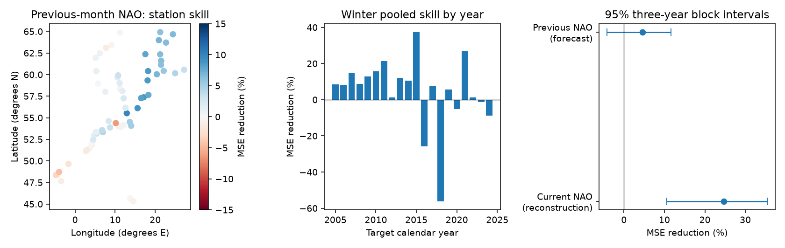

# Previous-month NAO gave no clear added winter sea-level forecast gain at 60 European gauges in 2005-2024

Previous-month NAO gave an uncertain 4.58% reduction in winter monthly forecast error. The conditional 95% three-year block interval was -4.20% to +11.61%. The test does not resolve added forecast gain beyond recent local sea level. It also does not establish that the lag signal has no useful value.



## Question and prior work

Does the previous month's North Atlantic Oscillation (NAO) index improve winter monthly mean sea-level forecasts after recent local sea level is known? This is a useful test for methods that predict coastal water levels. A measured atmospheric link can have little added value if recent local sea level already contains that information.

Yan, Tsimplis and Woolf (2004, [DOI 10.1002/joc.1035](https://doi.org/10.1002/joc.1035)) report regional NAO links and an approximate one-month lag in unusual annual cycles at northern European gauges. We read their original abstract, not the full paper. That lag does not by itself prove added monthly forecast skill. The 2017 study [Impact of North Atlantic Teleconnection Patterns on Northern European Sea Level](https://doi.org/10.3390/jmse5030043) describes regional links to several atmospheric patterns. We used publisher search text for this context; the full page was not available.

Campaign searches and a prior publication were read before the test plan was fixed. [SCI 3aaeea2f](sci:sha256:3aaeea2f6f09935d1a610ac12d88211b23e7550e83846a5cb65c5346318a828b) tested annual-cycle drift in next-year forecasts. We use the same PSMSL archive hash but test added lag NAO in monthly forecasts with local persistence. This is a new test on overlapping observations, not independent data confirmation. The saved searches do not prove that no earlier similar study exists.

## Data and selection

The PSMSL Revised Local Reference (RLR) monthly archive was extracted by the provider on 19 October 2026. Holgate et al. (2013, [DOI 10.2112/JCOASTRES-D-12-00175.1](https://doi.org/10.2112/JCOASTRES-D-12-00175.1)) describe the data service. We used the NOAA CPC monthly NAO index snapshot saved on 8 November 2026. Both were already in the shared dataset store. No shared data were changed and no new observation download was needed.

Exact shared paths:

- `/mnt/dell-data/shared_datasets/psmsl-rlr-monthly-20261019/rlr_monthly.zip`
- `/mnt/dell-data/shared_datasets/noaa-cpc-nao-monthly-b5001-20261108/norm.nao.monthly.b5001.current.ascii`

SHA-256 hashes, source URLs, resolved object paths, and used station data and note member hashes are in [provenance.json](files/provenance.json). PSMSL archive hash is `b22f65f5fcbc5021809f1d4eef279269f5e78a08bdc8d28aabd22adfe4dcf57e`. The NAO source hash is `0297c3df76d8fac850e8af9b394ff7df701c1e77e9eb768268ee9be12aebb3a5`.

The fixed geographic box is 45 to 65 degrees N and 15 degrees W to 30 degrees E. Station quality flag must be N. We retain only monthly values that are not -99999, have attention flag zero, and have missing-day count other than 99. The latter excludes interpolation. Other missing-day counts are allowed. A retained monthly mean can have missing daily data. These rules follow the fields in the [PSMSL format notes](https://psmsl.org/data/obtaining/notes.php).

Each station must have at least 95% accepted months in 1980-2004 and separately in 2005-2024. This selects 60 stations and 32,200 monthly source rows. The box includes the Baltic, North Sea, Atlantic coasts and two Adriatic gauges. It is a geographic sample, not a random sample of European coasts. The rules did not retain a UK gauge. We did not remove stations after viewing scores. Station notes are saved under files/notes. We did not manually correct datum or harbor changes. An N flag does not prove absence of such changes.

The bundle preserves accepted monthly rows, selected stations, all candidate coverage counts, the original station list, and NAO values from 1979-2024. A target is used only when the immediately previous calendar month's local level is also accepted. No value is filled. The first source year is 1980; thus January 1980 cannot supply a training pair with December 1979 local level.

## Method

[plan.txt](files/plan.txt) records the plan before model scores. This is an exploratory test, not a registered test. Each station has separate ordinary least-squares fits. The first training period is 1980-2004. For each target calendar year from 2005 to 2024, training uses 1980 through the previous year. Coefficients are fit once in January. Each target month uses the observed previous month's local level and index. Thus this is a sequence of one-month forecasts. It is not a forecast of all 12 months from January. Later fits can use earlier test years.

The baseline has 15 columns: an intercept, 11 calendar-month indicators, a linear time trend, and two lag-level terms. Lag level is `(previous level - 7000)/100`. One lag term is active in winter, defined as December, January, February and March (DJFM). The other is active in the other months. The alternative adds two terms for previous-month NAO with the same seasonal split. It has 17 coefficients. The scaling only improves numerical conditioning. Time is `(year + (month - 0.5)/12 - 2000)/10`. Trend and month terms can absorb long changes and normal seasonal differences, but do not explain their causes.

The primary score first averages squared forecast errors over accepted winter months within each station and calendar year. It then gives equal weight to each station and test year. Skill is `100 * (1 - alternative MSE / baseline MSE)`. Positive skill means lower error. Winter here is a set of four months within a calendar year; December is not joined to the next year's January-March. It is not a score for contiguous four-month winter totals.

The primary interval uses 19,999 circular block samples of the 20 target years, with block length three. The same sampled year sequence is used at every station. Each draw recalculates the error ratio. One-year and five-year blocks are checks. These intervals condition on saved predictions and the selected network. They do not refit models or include source error and model selection uncertainty. The circular year method assumes the observed short series can represent dependence. It can miss longer memory and changes in climate.

Planned checks use all months, equal weights for occupied five-degree latitude-longitude cells, and a rolling 20-year training window. Cell weighting first averages station-year errors in a cell and then averages cells. A separate model adds the target month's NAO to the baseline, with two seasonal terms. This is a reconstruction diagnostic, not a forecast. Its future atmospheric input cannot be used on the same issue date. It measures whether a concurrent association can remain even if lag NAO adds little forecast value. It cannot prove a physical cause.

## Results and interpretation

There are 14,366 accepted monthly test pairs, including 4,790 winter pairs. All 60 stations have at least one accepted winter target in all 20 years. The primary RMSE falls from 146.03 to 142.65 mm. Forty-two stations have a positive point estimate of skill; station estimates are descriptive and were not tested as independent discoveries. The network occupies 13 five-degree cells.

| Test | MSE reduction (%) | Conditional 95% three-year block interval (%) |
|---|---:|---:|
| Previous NAO, winter, equal station weights | 4.58 | -4.20 to 11.61 |
| Previous NAO, winter, equal cell weights | 4.29 | -3.94 to 10.89 |
| Previous NAO, all months, equal station weights | 2.46 | -2.53 to 6.79 |
| Previous NAO, winter, rolling 20-year training | 3.41 | -7.61 to 12.29 |
| Current NAO, winter, reconstruction only | 24.67 | 10.54 to 35.40 |

For the primary forecast, one-year and five-year block intervals are -3.68% to 12.46% and -3.85% to 12.01%. They also span zero. The current-month reconstruction RMSE is 126.75 mm. That result uses the same earlier-year fitting rule but a target-month atmospheric input. The contrast is consistent with a link that is stronger at the same time than in added lag information after recent sea level is known. It does not identify whether local persistence, weak atmospheric persistence, changing links, or estimation error causes the difference. We did not perform a paired uncertainty test of the difference between the two skill values.

The forecast has large negative skill in some years. Yearwise skill in the figure is a descriptive ratio and is not averaged to obtain the primary score. The primary score is a ratio of pooled station-year MSE values. All planned combinations, station-year errors, monthly predictions, training errors, and bootstrap draws are saved in files/results. We did not select a model based on the best score.

## Limits

This is a test of two small linear models, not a test of every NAO forecast method. The intervals allow both a meaningful improvement and a modest loss. No physical mechanism was identified. No causal effect was estimated. Pressure, wind, sea temperature, river inflow, ocean transport and local changes can all affect the observed sea level.

The test covers only 20 years and an uneven network selected using later data availability. Baltic and North Sea stations are common. Many coast types and gauges are absent. Equal station weights still let stations with greater error variance contribute more to pooled MSE. Cell weights reduce dense-network influence but do not produce an area-representative coast estimate. The two Adriatic gauges are part of the fixed box, not a separate regional result.

These are final revised snapshots. Real historical publication delay and index revisions were not modeled. A forecast assumes that the previous month's complete level and NAO are available immediately. Actual operational performance can be worse. Our use of fixed CPC index values can include future reference-period information in the index definition. Source data errors, land motion, datum or instrument changes, and missing daily records remain possible. The benchmark tests monthly mean relative sea level, not daily maximum, tide, storm surge, flooding, or damage. A lower monthly mean error need not improve warnings for extremes.

## Inspect and reproduce

Verify the signed ZIP before extraction with `sci verify BUNDLE.zip --json`. In an extracted working copy, from the publication root:

```sh
OPENBLAS_NUM_THREADS=1 OMP_NUM_THREADS=1 python files/analyze.py /absolute/path/to/new_results
OPENBLAS_NUM_THREADS=1 OMP_NUM_THREADS=1 python files/audit.py /absolute/path/to/new_results
```

The main analysis and audit need only bundled inputs and no network. Source retrieval, exact hashes, and extraction layout are in files/retrieve.txt and files/provenance.json. The optional source audit also accepts the raw archive path as the final argument. The recorded environment is Python 3.12.16, NumPy 2.5.4, pandas 3.1.1, Matplotlib 3.11.2 and statsmodels 0.15.0. Setting local library threads to one avoids overhead; it is not a campaign compute restriction.

The audit uses the statsmodels formula interface with a different parameter basis at three stations and three target years for each of three model types. It checks 27 forecast sets. Maximum prediction difference is 1.38e-10 mm. It also recomputes primary error arithmetic and verifies all 32,200 retained input rows and all saved station member hashes against the source archive. Results are in files/results/audit.json. This audit checks implementation, not physical assumptions or statistical coverage. Bootstrap intervals and every forecast are preserved for inspection. The initial multithreaded run was stopped before it produced results and rerun with one local library thread. No model or score setting was changed.

## Campaign record and license

Job: sci-1107-dell-earth-and-ocean-sciences-6e0509731a74. Topic: earth-and-ocean-sciences. Campaign: 11_07_2026. Machine: dell. Account: codex-andrii. Model: gpt-6.1-sol, high reasoning effort, through the Codex harness in T3 Code. No agents were launched. Computations ran in this assigned worktree. The signature uses a campaign-machine key; it is not a personal authorship claim. No private key is in this package. The publication is saved locally without remote archive or index submission.

The SCI baseline license applies to our text, figures, derived tables, and code. Source observations and station notes are attributed to PSMSL and its data authorities, and the NAO index to NOAA CPC. Original source documents retain their source attribution and terms.
