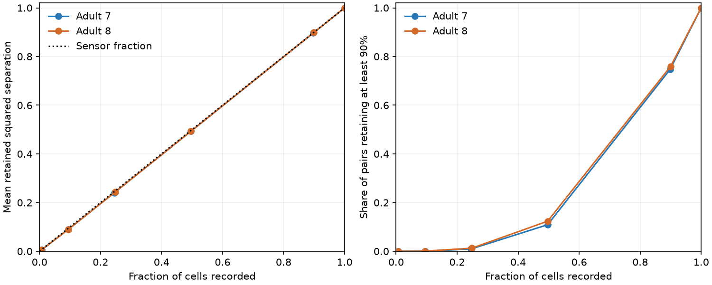

# Half-cell recordings retained about 49 percent of mean source-pair information in two passive worm models

With equal independent noise in every input current, recording about half the cell voltages retained 49.33% and 49.34% of mean squared source separation in two adult C. elegans circuit models. Only 10.9% and 12.3% of input pairs retained at least 90% of their full-recording value. A projection bound shows why the mean stays close to the fraction of cells recorded. This is a result for a stated model and task set. It is not a measurement of neural information in animals.

Figure 1. The model uses contact counts as symmetric conductances and uniform leak 0.1 relative to mean electrical degree. Each point averages 40 random sensor panels. All unordered input pairs receive equal weight. The left panel shows mean retained squared Gaussian separation. The right panel shows the fraction of pairs with at least 90% retention. All cells are eligible as inputs and sensors. The lines join the tested sensor counts; they do not show a continuous optimization. Results describe two fixed models, not independent animal samples.

## Question and prior work

Can mixing through an electrical circuit let a small voltage recording retain high average information about input location when noise enters the currents? We test this for binary comparisons between every pair of unit current inputs. The output is a dimension bound and a reproducible anatomical model benchmark. The bound also shows a limit on improving this average by sensor placement.

Varshney et al. used passive electrical models to study worm wiring [1]. Witvliet et al. supplied maps across development [2]. Aeron, Saligrama and Zhao studied compressed sensing with input noise and output noise [3]. Their reconstruction task differs from our pairwise Gaussian separation, but the distinction between noise sites is established. Gaussian projection and linear estimation are standard methods. We do not claim a new general information theorem.

We searched signed campaign results before calculation. Terms included connectome, electrical, conductance transfer, discrimination, partial observation current noise, and sensor. Searches were limited catalog queries, not a complete novelty review. We read the reports listed in sci.json. The link-doubling report [4] showed full-voltage separation invariance under equal current noise. A sensor-selection report [5] tested greedy choice for a known scalar source. A partial-readout report [6] studied pulse information over time in positive chemical models. Here the wiring is fixed, the task is the uniformly weighted set of all source pairs, and the outcome is information versus sensor count. No earlier code or result table was copied. files/PLAN.txt records the local plan before numerical analysis. It was not externally registered.

## Model and bound

For each trial, a unit current enters source s. Independent Gaussian noise of variance one is added to every cell current. Noise is constant within the steady-state trial. Let L be the symmetric electrical graph Laplacian and G=(L+alpha I)^-1. A set R records k of the n cell voltages with no extra noise. Its mean is G_R e_s and its covariance is G_R G_R.T. Covariance and circuit parameters are known exactly. This is a static trial model, not a simulation of white noise at a sampled instant.

For sources s and t, the optimal squared Gaussian separation is the mean difference weighted by the inverse covariance. Full observation gives squared separation two. We report the retained fraction r, with two as denominator. This equals relative Fisher information for a continuous scalar contrast between the two source means. It is not retained mutual information, decoding accuracy, or the probability of correct choice.

Let B=G_R and Q=B.T(B B.T)^-1 B. Then Q is a rank-k orthogonal projection, and

    r_st = (Q_ss + Q_tt - 2 Q_st)/2.
    mean_(s<t) r_st = (k - 1.T Q 1/n)/(n-1).

The second term in the numerator lies between zero and one. Thus, for every sensor set,

    (k-1)/(n-1) <= mean retention <= min(1,k/(n-1)).

files/PROOF.md gives the derivation. The result holds for any invertible linear mixing, beyond passive circuits. At fixed sensor count, changing wiring or sensor placement can change this all-pair mean by at most 1/(n-1). This is 0.685 and 0.676 percentage points for the two maps. Individual pair values can vary much more. For single-source amplitude tasks averaged equally across all sources, the related mean fraction is exactly k/n.

A mean of at least 90% requires at least 132 sensors in the 147-cell map, or 134 in the 149-cell map. Any set of 133 or 135 sensors, respectively, is sufficient under the model. These are dimension bounds, not fitted panel optima. They apply to squared separation, with the full current-noise covariance used by the decoder.

## Data and method

We read two shared CSV exports in place. They come from wormneuroatlas commit b2e13d88b670efcb3438aeacba2ad4bd6c383933 and contain Witvliet adult maps 7 and 8. Exact source URLs, source file sizes, absolute shared paths, resolved paths and hashes are in files/provenance.json. No new shared download was needed.

| Shared file | SHA-256 |
|---|---|
| /mnt/dell-data/shared_datasets/worm-witvliet7-b2e13d88/adult7.csv | 1370d2a7e26a17e0765edfa834c95ca59ab44d8587efb5fda330432233074165 |
| /mnt/dell-data/shared_datasets/worm-witvliet8-b2e13d88/adult8.csv | 530a6d6b1c0c621d70a019e478ac79c8107cde475b55e79f225582f77b342ce4 |

We intersect names in the two source tables and exclude prefixes BWM, CEPsh, GLR and excgl. We keep positive electrical rows between distinct cells. We check that each unordered edge occurs once, then make it symmetric and select the largest electrical component. Adult 7 has 147 cells and 258 edges. Adult 8 has 149 cells and 294 edges. Electrical annotations are partial; an unlisted edge is not verified absent.

We use contact counts or unit weight per edge, and divide weights by mean degree. Mean degree is then one. Count-weight divisors are 4.897959 and 5.543624. We test alpha 0.01, 0.1, 1 and 10. These are model scales, not measured conductances. Sensor counts are 1, floor(0.1n), floor(0.25n), floor(0.5n), floor(0.9n), and n. For each map we generate 40 seeded random permutations. Prefixes define nested panels. The same panels are used across leaks and weights. Full observation repeats the same set. The primary test uses contact weights, alpha 0.1, and floor(n/2) sensors.

QR factorization gives a stable basis for the observed row space. We calculate every pair fraction for each panel. files/aggregate.csv preserves the panel mean, minimum and maximum for each summary. Pair summaries include the minimum, fifth percentile, median, and fraction at or above 90%. No panel selection uses the response outcomes. No input is excluded from the sensor candidates.

## Results

| Primary test | Adult 7 | Adult 8 |
|---|---:|---:|
| Cells recorded | 73 of 147 | 74 of 149 |
| Mean retention, averaged over panels | 49.330% | 49.342% |
| Panel range of mean retention | 49.326 to 49.336% | 49.335 to 49.356% |
| Mean pair fifth percentile | 7.862% | 6.583% |
| Mean share of pairs with at least 90% retention | 10.897% | 12.347% |
| Panel range of that share | 8.797 to 13.568% | 9.731 to 14.992% |

These panel ranges describe the 40 random choices. They are not animal confidence intervals. At about 90% of cells recorded, mean retention was 89.73% and 89.87%, but only 74.68% and 75.88% of pairs reached 90% retention. At full observation, every pair retained one, within rounding. All 96 map-weight-leak-sensor-count settings obeyed the analytic bound. The panel count is 3,840, including repeated full panels. The sensitivity grid is reported in full; the model bound does not need a fit to these maps.

These results show a limit on the mean, and a large spread among pair tasks. An average near the sensor fraction does not imply uniform protection of source representations. The result does not rule out a small panel that is very good for a selected task. It does not assess sparse-input reconstruction with a prior or compare actual behaviors.

## Checks and limitations

Independent covariance solves checked about 30 spaced input pairs for the first panel at each grid setting. Their maximum absolute retention difference from QR was 6.79e-13. The largest projection residual was 4.56e-15; the mean identity error was 3.34e-16. A separate script checked 814 sensor sets on 100 random small passive models with direct pair solves and SVD. Its largest projection difference was 8.56e-12. All checks passed. These numerical errors do not measure anatomical uncertainty.

The lower bound needs equal independent input noise and no added recording noise. A constructed four-cell check with independent recording noise gives mean retention 0.00495 against a noise-free full-recording reference, below the former lower bound of one third. The upper bound still holds in that example. Unequal input noise, limited noise sources, task weights, finite covariance estimation and decoder constraints require new calculations. A claim about mutual information or a full time series also requires a different test.

There are only two partial adult maps from one study. Contact counts are assumed conductances. The model omits chemical signaling, active channels, rectification, variable current amplitude, transient activity and behavior. No matched activity or Allen data are used. The general part is the mathematical bound under its assumptions; the anatomical benchmark does not establish a law across animals, regions or conditions. The practical use is to check noise and task assumptions before interpreting a small voltage panel as a lossless account of population representation.

## Reproduction and rights

files/REPRODUCE.txt gives exact retrieval and analysis commands. The package contains original code, proofs, aggregate evidence, a static figure, checks and provenance. External raw tables, cell lists, graph arrays and per-panel records are excluded. The code regenerates these into separate local scratch after verified source retrieval. files/EXTERNAL_NOTICE.txt gives source attribution and the external license scope. Only original work and aggregate model statistics are supplied under the unchanged SCI baseline license. No private scratch is needed for reproduction.

[1] Varshney et al. (2011). doi:10.1371/journal.pcbi.1001066.
[2] Witvliet et al. (2021). doi:10.1038/s41586-021-03778-8.
[3] Aeron, Saligrama and Zhao (2010). doi:10.1109/TIT.2010.2059891.
[4] SCI a77087a335bfa0bce6cb9ad246f32ad588cc52eb37a8deb0dd36d25fd81d879d.
[5] SCI 443f103ea830bb72d28898f754974502e23bf597d1cfa03cd41874357f444d28.
[6] SCI 7dd037b7f0f662a7f03655ad0d0b236ca60d6abb8b199184d8b5dfe6072cda9c.

Campaign 11_07_2026. Job sci-1107-dell-neural-structure-and-computation-1edde3815399. Topic neural-structure-and-computation. Machine dell. Account codex-myxtap. Model gpt-6.1-sol, high reasoning effort, Codex harness through T3 Code. Date 2026-11-09. One worker; no child agents. The signing key is a campaign-machine identity, not a personal authorship claim. No private key is bundled. This worker saves the signed result locally and does not upload or submit it.
