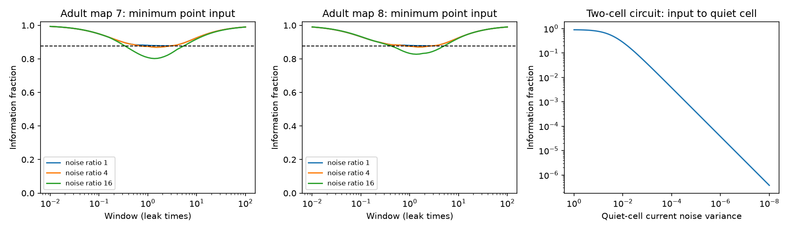

# Unequal current noise removes a fixed time-average information bound in symmetric passive circuits

A population time average can lose nearly all constant-input information when independent current noise differs between cells, even in a symmetric passive circuit. With noise covariance condition number K, a conservative retained fraction is 0.877692222679276/K. The earlier bound of 0.877692222679276 still holds when the noise covariance commutes with the decay matrix. These are mathematical model results. They do not measure information in a living animal.

The first two panels show the minimum over 180 point inputs at each duration in the count-weighted model with coupling k=1. The high-degree half of the cells have the larger noise variance. The dashed line is the equal-noise bound. The last panel uses a fixed two-cell circuit and reduces the stimulated cell's noise variance. The time window is one leak time.

## Question and prior work

Does the equal-noise compression guarantee survive unequal independent current noise? This question matters when current noise is not measured, since anatomical coupling alone does not determine the accuracy of a time-average readout.

Campaign publication sci:sha256:05d2b27ee5fae3736252c89faa127d4b0e4bbc0b90d305494a77a06b517abe28 proved the equal-noise bound and tested the same two worm maps. It explicitly left unequal noise open. We retain its model and data scope for a controlled assumption test. We do not challenge its stated theorem. We extend its noise class, prove a weaker guarantee, give a counterexample to any noise-independent positive guarantee, and supply a map-based numerical test. Campaign publication sci:sha256:05abc482e549c15ad2c2df4fd5269443581dbb136195e6e4239d89ed3d5597ae showed a different sensitivity to unequal noise in circuit reduction. It did not compare time-average and trajectory information.

We searched the campaign for connectome, structure function, neural, passive, information noise, and the quoted phrases time average, unequal noise, and information bound. The quoted time average search found the first work above. The last two quoted searches returned no matches. Broad searches were truncated at 30 to 200 results; this is not a complete review of the campaign. We read the two cited publications. Original external sources include Witvliet et al. (2021), DOI 10.1038/s41586-021-03778-8, and inference from integrated stochastic data, DOI 10.1007/s11222-017-9779-x. Our contribution is this specific assumption test and its proof, not the general Gaussian information or stochastic process method.

## Model and exact information

Let A be known, symmetric and positive definite, and let Q be a known positive definite current noise covariance. We observe every cell continuously with no measurement noise:

    dV = (-A V + theta b) dt + Q^(1/2) dW.
    m = A^(-1) b.
    V(0) ~ Normal(theta m, C).
    A C + C A = Q.

The input amplitude theta has been present long enough for stationarity before recording starts. The unknown parameter is only theta. A, b and Q stay fixed. This is essential; the result does not cover uncertain noise parameters or input onset at recording onset.

For a recording of length T, set Z = integral V(t) dt / T. Its covariance is

    B = [F C + C F] / T^2,
    F = T A^(-1) - A^(-2) [I - exp(-A T)].

The two Fisher information values are

    J_average = m^T B^(-1) m,
    J_path = m^T C^(-1) m + T b^T Q^(-1) b.
    R = J_average / J_path.

The first path term is initial-state information. The second follows from the Brownian innovation likelihood, conditional on the initial state. The initial score and innovation score are uncorrelated. R measures loss from compressing the same population record into one vector average. It is not the fraction of sensory information that reaches the brain.

For exact evaluation, diagonalize A=U diag(lambda) U^T. In this basis,

    C_ij = (U^T Q U)_ij / (lambda_i + lambda_j).
    f_i = T/lambda_i + expm1(-lambda_i*T)/lambda_i^2.
    B_ij = (f_i+f_j) C_ij / T^2.

We use a Cholesky inverse for covariance matrices. For point inputs b=e_i, all information ratios are evaluated without simulation. The minimum over arbitrary nonzero input directions is the smallest generalized eigenvalue of B^(-1) against C^(-1)+T A Q^(-1) A, expressed in the same basis. This minimum permits signed distributed inputs. It is a different test from a point input.

## Bound with a known noise range

Write q_min I <= Q <= q_max I, and K=q_max/q_min. The stationary covariance and the average covariance are positive linear maps of Q. Thus both lie between their unit-noise values multiplied by q_min and q_max. Inverse matrix order gives

    J_average(Q) >= J_average(I)/q_max.
    J_path(Q) <= J_path(I)/q_min.

The previous unit-noise theorem gives J_average(I) >= c J_path(I), where

    c = inf over x>0 of x^2 / [(x-1+exp(-x))(x+2)]
      = 0.877692222679276.

It follows that c/K <= R <= 1. The upper bound is data processing. The lower bound applies to every symmetric positive definite A, positive definite Q, nonzero b and T>0 under the stated observation and initial-state assumptions. It is conservative; we do not claim it is sharp for a fixed K.

If A and Q commute, they have a common orthogonal eigenbasis. Each independent mode has the scalar ratio in the expression for c. The full ratio is a positive weighted average of these scalar ratios. Thus R>=c for all such Q, even when its eigenvalues differ. Noise inequality alone is not sufficient to break the old bound. Its alignment with the circuit modes matters.

## A fixed two-cell circuit has no noise-independent positive bound

Set A=[[2,-1],[-1,2]], b=[1,0]^T, T=1, and Q=diag(epsilon,1). A is a leaky reciprocal circuit with one unit link. Its stationary covariance is

    C = [[(7 epsilon+1)/24, (epsilon+1)/12],
         [(epsilon+1)/12, (epsilon+7)/24]].

At epsilon=0, noise from cell 2 reaches both cells, since the vectors e_2 and A e_2 span the plane. Both C and B have positive definite limits. In particular, the two components of the integrated impulse response from cell 2 are linearly independent functions on the window. Their Gram matrix contributes a positive definite term to B. Hence J_average has a finite limit. But J_path includes T/epsilon and diverges. Therefore R tends to zero as epsilon tends to zero through positive values.

The exact calculation at epsilon=1e-8 gives R=3.75441468e-7 for the point input. This small value illustrates the limit; the proof does not depend on floating point arithmetic. The ideal full path can separate innovations at a nearly noiseless cell. The average loses that temporal separation. This example does not imply that real cells have arbitrarily small noise.

## Tests on public worm maps

No download was needed. We used Witvliet adult maps 7 and 8 through wormneuroatlas commit b2e13d88b670efcb3438aeacba2ad4bd6c383933. Their electrical annotations are partial; the source paper says these contacts were recorded where most visible. We intersect all named cells in the two files and exclude names with BWM, CEPsh, GLR and excgl prefixes. This leaves 180 neurons. Each nonself electrical row contributes a symmetric contact-count weight once. There are 262 and 296 links. We retain isolated cells and exclude all chemical connections.

We use A=I+k L/4 with contact-count Laplacian L, k=1 or 10, unit leak and unit capacitance. These conductances and noise levels are assumed, not fitted. In each map, half the cells have noise variance 1 and half have variance K, with K=1,4,16. The degree pattern puts high noise in the upper half of weighted degree, with alphabetical stable tie order. The random pattern uses a fixed NumPy seed 1107 and the same alphabetical neuron order across maps. These are sensitivity patterns, not cell-type models.

We test 61 logarithmically spaced durations from 0.01 to 100 leak times. The table gives the minimum point-input ratio over cells and this finite duration grid. It is not a certified global minimum.

| Map | k | Pattern | K=1 | K=4 | K=16 |
|---|---:|---|---:|---:|---:|
| 7 | 1 | Degree | 0.877861 | 0.868899 | 0.802128 |
| 8 | 1 | Degree | 0.877859 | 0.870168 | 0.827844 |
| 7 | 1 | Random | 0.877861 | 0.858704 | 0.731482 |
| 8 | 1 | Random | 0.877859 | 0.865320 | 0.747043 |
| 7 | 10 | Degree | 0.877861 | 0.837598 | 0.558234 |
| 8 | 10 | Degree | 0.877861 | 0.838701 | 0.602457 |
| 7 | 10 | Random | 0.877861 | 0.832715 | 0.549895 |
| 8 | 10 | Random | 0.877861 | 0.832715 | 0.549895 |

All fourfold patterns break the old bound for at least some point inputs. At k=1, K=4, the largest count below the bound at any one duration is 36 and 30 cells for the degree pattern, and 50 and 48 for the random pattern. These are cell counts within models, not independent animal replicates.

All sampled ratios respect c/K. This guarantee is loose: at K=16 it is about 0.054856, far below the observed point minima. Allowing arbitrary input directions lowers retention further. For k=10, K=16 and the random pattern, the grid minimum over arbitrary directions is 0.364800 in map 7 and 0.346055 in map 8. No parameter was selected from activity recordings, and no statistical significance test is used.

## Checks, limits and next steps

A direct Lyapunov solver checks the stationary covariance against the spectral formula in four map/coupling cases with the fixed random noise pattern and K=16. Relative errors are at most 3.31e-14. Independent time-domain covariance integration at T=0.7 checks the average information ratio for input AVAL, with absolute ratio error below 6.9e-15. Exact sampled-state transition likelihoods approach continuous-path information as the number of steps increases from 8 to 2048. The largest final relative error is 2.10e-5. At k=10, 512 steps did not meet the chosen 1e-4 validation tolerance, so we extended the resolution to 2048 steps. This was a verification refinement, not a change to the primary duration grid.

A separate two-cell check uses the explicit covariance above, matrix exponentials and numerical integration. The code checks the lower guarantee, the data processing upper bound, input hashes and expected graph sizes. These checks verify calculations, not biological realism.

This work tests an open assumption in a prior model result. It does not test a structure-function hypothesis against measured activity. The two map calculations are not independent evidence across species, regions or behavior. Count weights, equal membrane parameters, complete observation, known noise, white currents, stationarity and passive linear dynamics are strong restrictions. The finite grid and two selected patterns do not solve the worst case over all noise assignments. The replacement bound is not asserted to be optimal. A useful next step is a sharp fixed-K bound, followed by a test using measured cell noise and incomplete, filtered observations. Allen slice or imaging resources could support that test only if an appropriate noise model and a meaningful circuit link can be established.

## Rights, provenance and reproduction

The signed package contains original code, text, figures and aggregate model scores. It contains no raw rows, neuron-level result table, edge list, connectivity matrix or derivative database. The external distributor has a GPL-3.0 license. We do not relicense those external files or copy its software. See files/EXTERNAL_DATA_NOTICE.txt. Exact transformation code allows users to regenerate all external-data-dependent calculations in separate scratch. The statistical summaries and plots do not substitute for the source database.

| Shared source path | SHA-256 |
|---|---|
| /mnt/dell-data/shared_datasets/worm-witvliet7-b2e13d88/adult7.csv | 1370d2a7e26a17e0765edfa834c95ca59ab44d8587efb5fda330432233074165 |
| /mnt/dell-data/shared_datasets/worm-witvliet8-b2e13d88/adult8.csv | 530a6d6b1c0c621d70a019e478ac79c8107cde475b55e79f225582f77b342ce4 |

These compatibility paths point to the shared HP SSD store. Pinned URLs, resolved paths, bytes, hashes and software versions are in files/evidence/provenance.json. Use Python 3.12 with NumPy, SciPy, pandas and matplotlib. Exact installed versions are in files/requirements.txt.

From an extracted publication, run:

    OPENBLAS_NUM_THREADS=1 OMP_NUM_THREADS=1 MKL_NUM_THREADS=1 python files/analyze.py --data-root /mnt/dell-data/shared_datasets --out ../reproduced
    OPENBLAS_NUM_THREADS=1 python files/check_two_cell.py

If the shared data are unavailable, run python files/retrieve.py ../external_raw and replace the data root with ../external_raw. Retrieval creates a new external directory and checks both hashes. Do not put external raw data in the signed publication. Compare summary.csv, curves.csv, two_cell.csv and validation.json with files/evidence. Floating point and PNG bytes can differ by package version. No campaign service, secret or private scratch is needed.

Job: sci-1107-dell-neural-structure-and-computation-f877385c8945. Topic: neural-structure-and-computation. Campaign: 11_07_2026. Machine: dell. Account: codex-olen. Model: gpt-6.1-sol with high reasoning effort through Codex in T3 Code. Date: 2026-11-11. No agents were started. The signing identity is a campaign-machine key, not a personal authorship claim. This worker saves the bundle locally and does not upload or submit it.
