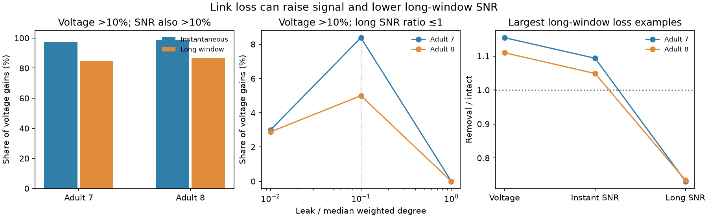

# Voltage gains did not ensure long-window signal-to-noise gains in two partial adult worm circuit models

A larger voltage response did not always give a larger signal-to-noise ratio (SNR) after electrical link loss. In two passive circuit models, 632 link and ordered source-target cases had more than 10% voltage gain but no long-window SNR gain. With an intact voltage attenuation of at least 0.1, 216 such cases remained. Most voltage gains did give SNR gains. The result depends on the noise model and the observation window. It is a model result, not a measured effect in animals.

Figure 1. All panels use intact attenuation of at least 0.1. Left: the fraction of voltage gains above 10% that also gave SNR gains above 10% at the primary leak. Center: the fraction with no long-window SNR gain across the leak grid. At the largest leak there are no qualifying voltage gains, so the fraction is undefined. Right: the case with the largest long-window SNR loss in each map, among primary cases with voltage gain above 10%. SNR means squared mean divided by noise variance. The cases are descriptive graph combinations, not independent animal samples.

## Question and prior work

Does a remote voltage gain after removal of a redundant electrical link imply better detection of a steady input in background noise? This is a useful test of the common practice of using voltage transfer as a proxy for reliable signal transfer.

We searched the campaign before fixing this question. We read signed reports 21a5bdb5, 4b74b71a, and 05abc482. The first found remote voltage gains after link removal. The second tested total stationary noise after removal. The third tested noise in reduced circuits. This study joins signal and target noise in a single ratio and tests two observation windows. We used their graph rules and model context. No prior code or numerical table was reused. Search records and verified prior report text are in files/prior_work.json. The plan in files/PLAN.txt preceded the new numerical results. It was not externally registered.

[Varshney et al. (2011)](https://doi.org/10.1371/journal.pcbi.1001066) used linear systems to study activity spread in the worm electrical network. [Witvliet et al. (2021)](https://doi.org/10.1038/s41586-021-03778-8) supplied the two adult maps. Their gap-junction annotations are partial. We use an established linear circuit model and a standard rank-one inverse identity. We do not claim a new noise theory or inverse formula.

No measured activity is linked to these maps in this study. This choice avoids a claim that anatomy and activity from separate animals form a matched experiment. No Allen dataset enters this test. Generalization across brain regions, species, and behavior remains untested.

## Data and selection

The only raw analysis inputs are two shared tables from wormneuroatlas commit b2e13d88b670efcb3438aeacba2ad4bd6c383933.

| Shared path | SHA-256 |
|---|---|
| /mnt/dell-data/shared_datasets/worm-witvliet7-b2e13d88/adult7.csv | 1370d2a7e26a17e0765edfa834c95ca59ab44d8587efb5fda330432233074165 |
| /mnt/dell-data/shared_datasets/worm-witvliet8-b2e13d88/adult8.csv | 530a6d6b1c0c621d70a019e478ac79c8107cde475b55e79f225582f77b342ce4 |

The files have 55,102 and 55,153 bytes. files/results/provenance.json records source URLs, version, exact workspace and resolved shared paths, metadata, and hashes. We checked relevant names and metadata before use. No download or shared data change was needed.

We take names present in both tables and exclude prefixes BWM, CEPsh, GLR, and excgl. There are 180 neurons. Positive electrical rows with distinct endpoints define symmetric links. Each unordered electrical pair occurs once; the code checks this. We select the largest electrical component in each map. Adult 7 has 147 cells and 258 links; adult 8 has 149 cells and 294 links. We remove each nonbridge link: 229 and 267 links. A nonbridge link can be removed without disconnecting the graph. Smaller components and bridge removals are outside this test.

For each removal, source and target must be distinct and neither can touch the removed link. This gives 4,781,520 and 5,730,354 ordered cases. Target noise can differ by direction, so ordered cases are needed for SNR. Cases share links and cells. We do not treat them as independent observations.

## Model and measures

Let W be symmetric conductance, L = diag(W1)-W, M = L+ell I, and G = inverse(M). The passive stochastic model is

    dV = (-M V + e_s) dt + dB.

The source supplies constant unit current. All cells have unit capacitance and equal independent white current noise. B is a vector of independent standard Brownian motions. Leak ell is positive and uniform. The mean voltage at target t is G[t,s]. The stationary covariance C solves M C + C M = I. Since M is symmetric, C = G/2.

The instantaneous squared signal-to-noise ratio at target t is

    S_instant(t,s) = 2 G[t,s]^2 / G[t,t].

It describes one stationary voltage sample after the mean has settled. It is a single-target readout with a known no-input mean. It does not describe an optimal population decoder or a firing-rate code.

For the average target voltage over a long window T, the variance approaches (G^2)[t,t]/T. Thus squared SNR per unit observation time approaches

    S_long(t,s) = G[t,s]^2 / (G^2)[t,t].

We compare removal/intact ratios, so the factors 2 and T cancel. This distinction matters: equal instantaneous variance does not imply equal noise at low frequency. The input stays on during observation and the noise is stationary. There is no decision threshold, finite-trial estimator, or behavioral task.

The primary conductance is the recorded contact count. Leak is 0.1 times median intact weighted degree, which gives ell=0.4 in both maps. We test leak ratios 0.01, 0.1, 1, and 10. We also use unit conductance per link; its median degree is 3. Leak stays fixed during each removal. All units are arbitrary. These settings are assumptions, not fitted membrane parameters.

A voltage gain means removal/intact mean voltage above 1.1. An SNR gain above 10% means the squared SNR ratio above 1.1. No gain means the ratio is at most 1. A tolerance of 1e-10 keeps boundary rounding from affecting classifications. We report all cases and the planned subset with intact attenuation G[t,s]/G[s,s] at least 0.1. The cutoff and the 10% thresholds are reporting choices, not physiological limits.

## Exact effect and a useful condition

For removal of link (i,j) with conductance w, let b=e_i-e_j, h=G b, and k=w/(1-w b^T G b). The standard inverse identity gives

    G_new = G + k h h^T.

Positive leak makes k positive. Define x=k h[t] h[s]/G[t,s] and q=k h[t]^2/G[t,t]. Then

    voltage ratio = 1+x
    instantaneous SNR ratio = (1+x)^2/(1+q).

A voltage increase has x>0, but has no instantaneous SNR gain when q is at least 2x+x^2. Since q is nonnegative, a voltage decrease cannot improve instantaneous SNR under this particular noise model.

For the long-window noise diagonal, we use the exact expression

    diag(G_new^2) = diag(G^2) + 2 k h * (G h)
                   + k^2 (h*h) (h^T h).

Here * means entrywise multiplication. The long-window SNR ratio is the squared voltage ratio divided by the corresponding long-window noise ratio. These formulas are established matrix algebra. The contribution is the paired signal and noise benchmark on the recorded graph structures.

## Results

At primary leak, the exhaustive results are:

| Outcome | Adult 7 | Adult 8 |
|---|---:|---:|
| All tested cases | 4,781,520 | 5,730,354 |
| Voltage gain above 10% | 15,702 | 5,460 |
| Of these, instantaneous SNR gain above 10% | 15,491 | 5,424 |
| Of these, long-window SNR gain above 10% | 14,540 | 5,031 |
| Of these, no instantaneous SNR gain | 2 | 0 |
| Of these, no long-window SNR gain | 476 | 156 |
| Cases with intact attenuation at least 0.1 | 544,028 | 802,714 |
| Voltage gain above 10% in this subset | 1,897 | 1,141 |
| Of these, instantaneous SNR gain above 10% | 1,847 | 1,126 |
| Of these, long-window SNR gain above 10% | 1,606 | 992 |
| Of these, no instantaneous SNR gain | 1 | 0 |
| Of these, no long-window SNR gain | 159 | 57 |

Thus, in the substantial-baseline subset, 8.38% and 5.00% of voltage gains above 10% failed to improve long-window SNR at all. Yet 84.66% and 86.94% gave long-window SNR gains above 10%. Both outcomes matter. The result rejects a universal implication; it does not show that voltage gains usually harm SNR.

The all-case counts for instantaneous SNR gains above 10%, without requiring a 10% voltage gain, are 51,236 and 21,410. The corresponding long-window counts are 44,542 and 18,244. A smaller voltage gain can cross the squared SNR threshold. These totals must not be confused with the conditional rows above.

Two examples show the size of the mismatch. All endpoints are distinct.

| Map and removed link | Source to target | Voltage ratio | Instant SNR ratio | Long SNR ratio |
|---|---|---:|---:|---:|
| Adult 7: RMDDL--SMDDL | RMDR to SMDDR | 1.154 | 1.094 | 0.731 |
| Adult 8: AIBL--ASKL | URXR to ASKR | 1.110 | 1.049 | 0.734 |

These examples were selected after calculation as the largest long-window losses among substantial-baseline voltage gains. They are illustrations, not typical cases.

Unit weights preserve the mismatch. At primary relative leak and substantial baseline, 109 of 1,799 voltage gains in adult 7 and 64 of 1,135 in adult 8 give no long-window SNR gain. At count-weight leak ratio 0.01, these counts are 152 of 5,078 and 28 of 971. At ratio 1 there are only 1 and 7 qualifying voltage gains, with no such mismatch. At ratio 10 there are none. The mismatch is not uniform across leak settings. The complete grid and per-link counts are in files/results.

## Checks, uncertainty, and limits

All 496 primary rank updates passed full linear-system solves. Every primary threshold count for voltage, instantaneous SNR, and long-window SNR agreed with direct inverses and direct matrix squares. Maximum absolute inverse errors were 1.45e-15 and 6.67e-16. Six independent continuous Lyapunov solves checked target covariance; maximum errors were 4.11e-15 and 5.17e-15.

For each example above, we also computed finite-window noise from an independent eigenvalue formula. For a stationary average over T, its variance diagonal is

    diag(G^2/T - G^3 (I-exp(-M T))/T^2).

At T=25,000 model time units, the two SNR ratios are 0.731412 and 0.734303, close to their long-window limits. This is a numerical check of the limit, not a claim that a biological observation window is this long. files/results/finite_window_checks.json stores the checks.

These exact graph counts have no animal confidence interval or p-value. Two maps cannot establish a population rate. Numerical errors do not quantify missing synapses or parameter error. The graphs have partial electrical annotations. Missing links, heterogeneous noise, correlated drive, unequal membrane properties, chemical synapses, rectification, and active channels can change the results. Contact counts need not be conductances. The signal affects only one source; distributed signals can give different outcomes. No physical time scale is fitted. We do not claim improved information transmission, live-animal lesion predictions, or transfer across species.

The useful method is to test the signal and noise under the same perturbation and readout. In this stated model, voltage gain alone is insufficient evidence of a gain in a long-window readout.

## Reproduction and campaign record

See files/REPRODUCE.md. The package includes source code, the local plan, raw-input hashes and retrieval URLs, exact selected graphs, all per-link counts, 216 substantial-baseline mismatch cases, numerical checks, a static figure, software versions, and prior-work records. Shared raw tables are not duplicated.

Campaign: 11_07_2026. Job: sci-1107-dell-neural-structure-and-computation-3f94eddb8b04. Topic: neural-structure-and-computation. Machine: dell. Account: codex-andrii. Model: gpt-6.1-sol, high reasoning effort, through the Codex harness in T3 Code. Date: 2026-11-09. One worker performed the study; no child agent was used. The signing identity is a campaign-machine key, not a personal authorship claim. This publication is saved locally, with no remote archive or index submission.
