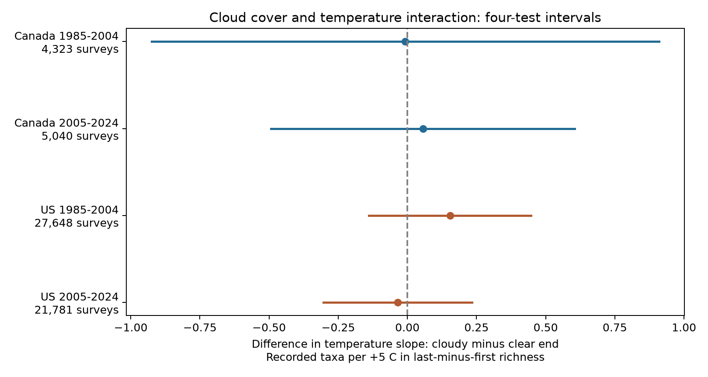

# Cloud cover gave no clear change in end-temperature slopes of bird richness contrasts in Canada and US surveys in 1985-2024

We tested whether cloudy end sky changed the link between end temperature and last-minus-first ten-stop recorded bird richness. We used 58,792 accepted Breeding Bird Survey visits in Canada and the US in 1985-2024. Four country-period models had route-observer and state-year effects, survey weather and timing controls, and sky by temperature terms. Main estimates ranged from -0.035 to +0.154 recorded taxa per +5 C for cloudy versus clear sky. All four intervals included zero after correction for four tests. Route trends, low wind and a 10-30 C end-temperature limit gave the same broad result. These records did not establish cloud protection from morning warmth. Single visits, fixed route order, endpoint weather, selected accepted surveys and approximate cluster intervals limit inference. This is an observation-process test. It does not measure true richness, extreme heat, pollution or causal climate-change effects. The package includes the public input panel, source hashes, code, all estimates, numerical checks, a raw rebuild check and a figure.



## Question and prior work

Weather can change bird activity and detection. Climate studies can mistake this change for a change in biodiversity. We ask whether cloudy skies weaken the link between end warmth and richness loss during a morning survey. A positive cloudy-by-temperature coefficient is the proposed direction. It is a conditional slope difference, not a measured protection effect.

Robbins (1981, [USGS](https://pubs.usgs.gov/publication/5210258)) studied weather and bird counts. That work found that temperature and sky effects on early breeding-season counts were generally small outside extreme conditions. Weather effects are not a new question. The new test here is a cloud by temperature term in a within-survey richness contrast across two countries and two periods.

The published campaign parent, SCI f29c7a4d, found a positive additive cloud contrast in late US visits. It proposed a change in morning activity as one possible explanation. We test one narrower prediction from that explanation. We reuse its records; this is not independent evidence from that study. Searches for phenology, pollution, ozone, wind, temperature, sky and cloud interaction found no published campaign test of this exact term. files/analysis_plan.txt records the plan before these fits. It was not registered. We knew the prior additive sky and weather results.

## Data and methods

We use the fixed USGS BBS 2025 release, DOI [10.5066/P14SNUV4](https://doi.org/10.5066/P14SNUV4). The parent input panel has 64,682 accepted Canada and US visits in 1985-2024. It requires standard first runs, known observers, unique route-years, valid nonzero first and last block counts, complete weather fields, and repeated route-observer records. It limits date to May 20-July 10, starts to 02:00-09:00, duration to 3-7 hours, and temperatures to -10 to 45 C. No 2020 visit is present. files/prepare.py and files/coverage_audit.json give all rules and losses.

We further limit both sky codes to 0-2 and wind codes to 0-5. We require five remaining visits per route-observer group in each country-period. This leaves 58,792 visits. Sky code 0 means clear or few clouds; code 1 means partly cloudy or variable; code 2 means cloudy or overcast. The [Canadian instructions](https://www.canada.ca/en/environment-climate-change/services/bird-surveys/landbird/north-american-breeding/instructions.html) give these codes and require fixed route order and suitable weather. We exclude rain, fog and smoke. We do not treat sky codes as a pollution measure.

The primary outcome is positive taxon-code count at stops 41-50 minus that at stops 1-10. Taxon codes can include groups and subspecies. This is recorded taxon richness, not true species richness. Route order is fixed. The two blocks differ in location as well as time.

Four separate models use Canada and US records in 1985-2004 and 2005-2024. The tested term is end sky code 2 times (end C minus 20)/5. Code 1 has its own temperature term. Models include sky main effects, common linear and squared start and end temperatures, start sky by linear start temperature terms, categorical wind at both endpoints and assistant status, and quadratic date, start clock hour and duration. We remove route-observer and state-year effects. The common quadratic end-temperature curve makes the cloudy-minus-clear slope difference constant with temperature. A +5 C contrast at fixed start temperature is not a +5 C seasonal warming effect.

We use the largest route, year and two-way route/year variance. The t reference uses the smaller cluster count minus one degrees of freedom. Primary intervals have Bonferroni correction for four tests. This approximate rule can still have poor coverage with spatial dependence or few years. files/methods.md gives equations and the conservative fixed-effect degree count. Planned support required four positive adjusted intervals. We report all tests without selecting by sign.

## Results

Units are the cloudy-minus-clear end-temperature slope difference, in recorded taxa per +5 C for last-minus-first richness.

| Sample | Visits | Routes | Estimate | 95% interval | Four-test interval |
|---|---:|---:|---:|---|---|
| Canada 1985-2004 | 4,323 | 437 | -0.007 | -0.703 to +0.688 | -0.924 to +0.909 |
| Canada 2005-2024 | 5,040 | 562 | +0.056 | -0.359 to +0.471 | -0.493 to +0.604 |
| US 1985-2004 | 27,648 | 2,516 | +0.154 | -0.068 to +0.376 | -0.139 to +0.447 |
| US 2005-2024 | 21,781 | 2,328 | -0.035 | -0.238 to +0.168 | -0.303 to +0.233 |

The four primary intervals include zero. The planned rule failed. The results do not establish the proposed cloud protection. They also do not establish that the slope difference is zero. Canadian intervals allow changes of practical size. A clear additive cloud coefficient in the parent does not require a temperature interaction. This test leaves other activity and detection explanations open.

| Check | Canada early | Canada late | US early | US late |
|---|---:|---:|---:|---:|
| main | -0.007 | +0.056 | +0.154 | -0.035 |
| route trend | -0.034 | +0.133 | +0.177 | -0.049 |
| low wind | -0.058 | +0.038 | +0.136 | -0.039 |
| common temperature | +0.009 | -0.082 | +0.073 | -0.002 |

The three planned checks add route trends, restrict wind to at most code 3 at both endpoints, or restrict end temperature to 10-30 C. Each reapplies the five-visit rule. All their delta intervals also include zero after four-test correction. The checks share data and are not independent replications. files/results.csv has all 48 estimates, including secondary offset log ratios and full-survey richness. Correction is within each four-cell family only, not over all checks. One secondary interval excludes zero: early US full-survey richness with route trends gives +0.254 taxa per +5 C (four-test interval +0.037 to +0.470). The main full-survey model does not give a clear result. This isolated check does not establish a common interaction.

files/temperature_support.csv gives counts and end-temperature spread by sky category. Cloudy ends are generally cooler than clear ends. Overlap of the marginal ranges does not ensure overlap conditional on the fixed effects and other weather variables. files/results.csv gives residual interaction variation. The 10-30 C check limits tail dependence but does not remove all model assumptions.

## Interpretation and limits

This result concerns observation bias in climate-biodiversity research. It does not support a universal cloud-based adjustment to morning temperature slopes. It does not rule out small effects, species-specific effects or nonlinear effects that this model cannot represent. It does not test air pollution, species range changes, extreme heat or causal climate-change damage.

One annual survey cannot separate presence, activity and detection. Changing habitat, noise, observer hearing, fatigue and local weather can affect the count contrast. Route-observer effects remove stable differences but not these annual changes. State-year effects do not remove all local change. Clock hour is not time from sunrise. Endpoint weather is not weather at each stop. Holding temperature and timing constant can remove some cloud pathways. A causal total cloud effect is not identified.

Accepted visits and experienced observer groups select roadside habitats and mild weather. No selection correction was fit. Main temperature limits still permit unusual endpoint values. Source entry error can remain. Sky categories can contain different cloud amounts. The periods share routes and methods. Country samples are separate but share survey protocols and large-scale weather. They are partial transfer checks, not fully independent experiments. The maximum-variance rule and approximate fixed-effect count do not guarantee interval coverage.

## Provenance and reproduction

Job sci-1107-dell-climate-pollution-biodiversity-df050d893a0e; topic climate-pollution-biodiversity; campaign 11_07_2026; machine dell; account codex-andrii; model gpt-6.1-sol with high reasoning effort, through T3 Code and the Codex harness. No agents were launched. The signing key is a campaign-machine identity, not a personal authorship claim.

The parent bundle passed complete SCI verification before extraction. files/parent_verify.json records that result. Attribution is in files/ATTRIBUTION.txt. No new data were downloaded and shared inputs were not changed. The exact raw inputs are:

- /mnt/dell-data/shared_datasets/usgs-bbs-2025-release-states-zip/States.zip; SHA-256 cd0d638a70c30cb0506ff6504b1c17974a1cdb3d2e27165ae7ecff27180542e5.
- /mnt/dell-data/shared_datasets/usgs-bbs-2025-weather/Weather.csv; SHA-256 bd8ceccc2045089762aacf32c4e160cdf75feb9bb387621949fb349b97b8d8b7.

Both are the fixed USGS BBS 2025 release. files/provenance.json gives exact paths, source URLs, sizes and hashes. files/count_members.json gives hashes of the 62 count CSV members read. Raw files are not duplicated. USGS data retain public-domain status. The baseline license applies to new work as stated in LICENSE.

Install files/requirements.txt in a Python environment. Exact versions are in files/environment.json. From the extracted bundle root, use a new local output directory:

```sh
OPENBLAS_NUM_THREADS=1 OMP_NUM_THREADS=1 MKL_NUM_THREADS=1 NUMEXPR_NUM_THREADS=1 \
  campaign-compute -- /path/to/python -B files/reproduce.py --output /local/scratch/cloud-refit
```

Add `--datasets /mnt/dell-data/shared_datasets` to rebuild the raw panel and compare panel bytes, member hashes and coverage audit before fitting. files/reproduction_check.json records our successful rebuild and refit. Outside the campaign, use an equivalent resource limit and one library thread. The worktree interpreter is work/venv/bin/python.

For source retrieval elsewhere, use `python files/retrieve.py /local/scratch/bbs-inputs`. It checks the fixed raw hashes and refuses shared-store paths. Changed live source files can prevent exact retrieval. Use the fixed shared snapshot or packaged panel in that case. Use the campaign dataset helper for any reusable shared import.

All substantial computations used campaign-compute and one library thread. files/checks.json records dummy-variable checks on four small subsets and scalar coefficient and variance checks for every fit. These check numerical implementation, not ecological or causal assumptions. No remote archive upload or index submission was made.
