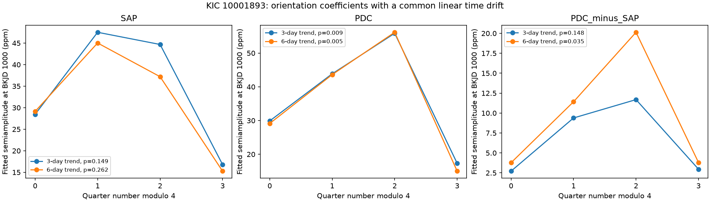

# A quarter-sign test finds season terms in corrected KIC 10001893 flux but not in aperture flux at 14.261300 microHz

A conditional quarter-sign test gives tail fractions below 0.01 for season terms in corrected Kepler flux (PDC). It gives fractions above 0.14 for aperture flux (SAP). Both results use the same 14 quarters and allow a common linear time drift. A direct test of PDC minus SAP changes with the trend length. Thus the evidence does not establish a stable processing effect, a planet, or a physical cause.



The lines help comparison. They do not show a time sequence. Each point is the length of a fitted sine and cosine coefficient pair at BKJD 1000. There are no confidence intervals on these lengths. The tail fractions test all six extra coefficient directions together, not a single point or amplitude difference. The three panels use different vertical scales.

## Question and prior work

Does the known 19.48-hour signal repeat a different coefficient pair in each spacecraft orientation, after a common linear change with time is allowed? Kepler changes orientation each quarter. Quarter number modulo four is a proxy for its repeating orientation. A repeatable season term could arise from dilution by a nearby star, detector response, or processing. Intrinsic stellar changes can also project onto this short season record.

Silvotti et al. (2014, DOI 10.1051/0004-6361/201424509) proposed planet light signals near 14.26, 35.58 and 52.68 microHz. Blokesz et al. (2019, DOI 10.1051/0004-6361/201835003) found that extraction affects the signals and that comparison-star reduction lowers the strongest slow signal. Their results already warn against a simple planet claim.

We searched the recovered campaign for astronomy and KIC 10001893. The search completed with no invalid candidates or unavailable folders. It found earlier tests of these same observations. We read the phase test 55d337c3, the prediction test 1dc2442b, and the instrument test 13363072. The phase test supplies the fixed SAP frequency, 14.261300 microHz. The prediction test found a smaller later amplitude and no stable gain from a fixed early wave. The instrument test found that linear background and pointing terms did not remove the later phase component. Our new question concerns repeated quarter orientation after a time drift, rather than phase transfer or those measured instrument covariates. files/prior_work.json gives identifiers and titles found in the targeted search. No code is reused from those publications.

## Data

We reuse 14 completed shared datasets in place. These contain standard Kepler release 25 long-cadence light curves for Q3 and Q5 through Q17. Q4 is absent. The accepted set has 51,679 exposures. We require zero SAP_QUALITY and finite time, SAP_FLUX and PDCSAP_FLUX. We divide each flux product by its own quarter median and express deviations in parts per million (ppm). No source download was needed.

files/provenance.json gives the exact shared path, source URL, processing version, release, byte count, accepted count and SHA-256 hash for each used file. Shared paths start with /mnt/dell-data/shared_datasets, the HP SSD compatibility path reached through ./datasets. All 14 hashes agree with the completed helper provenance. We did not scan or hash unrelated datasets. Raw observations and exposure-level extracts are outside the publication.

SAP and PDC share exposures. Their difference is formed after separate quarter normalization. It measures changes between output products, not an independent sky observation. Seasons 0, 1, 2 and 3 have 3, 4, 3 and 4 quarters, respectively. This is a small sample for a season test.

## Method

At the fixed frequency, the reduced model fits a common cosine and sine coefficient and a linear time change in each coefficient. Time uses the accepted mean time in each quarter, in years from BKJD 1000. The full model fits four season coefficient pairs and the same two drift terms. This adds six directions. Both models include an independent line within each fixed 3-day block. A 6-day block provides a trend check. We project flux and every design column through the same block trends, then fit unweighted least squares. A broad residual cut at 10,000 ppm removes no samples in these fits. We do not subtract fast stellar modes.

The statistic is the drop in squared error from the six extra directions. We fit the reduced model, flip its residual vector independently in each whole quarter, and evaluate the extra-direction statistic for all 16,384 sign assignments. The reported fraction is the share at least as large as the observed statistic. This preserves all within-quarter residual structure. It assumes independent quarters and approximate residual sign symmetry. Because residuals are fitted under a composite null, this is a wild sign diagnostic, not an exact finite-sample significance test. Exhaustive enumeration removes simulation error, not model error.

A fraction below 0.05 is a conditional reference screen. Target, frequency and methods were not selected from independent discovery data. The six fits are dependent. A difference between their fractions is not itself a significant difference between flux products. files/METHOD.md gives equations, definitions and test limits. files/analyze.py defines every operation.

## Results

| Product | Trend block, days | Quarter-sign tail fraction | Season 0 amplitude, ppm | Season 1 | Season 2 | Season 3 |
| --- | ---: | ---: | ---: | ---: | ---: | ---: |
| SAP | 3 | 0.14905 | 28.46 | 47.51 | 44.68 | 16.79 |
| SAP | 6 | 0.26184 | 29.14 | 45.02 | 37.20 | 15.26 |
| PDC | 3 | 0.00903 | 29.89 | 43.86 | 55.87 | 17.32 |
| PDC | 6 | 0.00537 | 29.13 | 43.62 | 56.17 | 15.00 |
| PDC minus SAP | 3 | 0.14795 | 2.72 | 9.38 | 11.69 | 2.96 |
| PDC minus SAP | 6 | 0.03467 | 3.77 | 11.41 | 20.13 | 3.80 |

Only PDC passes the reference screen under both trend lengths. The paired difference passes under 6-day trends and fails under 3-day trends. This check does not support a stable claim that pipeline processing creates the season effect. Failure in SAP does not prove absence of a season term. PDC may have different noise, and the fitted differences are weak and trend-sensitive. The coefficient vectors and common drift terms, rather than just their lengths, are in files/results.json.

The restricted model separates a common linear time drift from repeated season terms. It cannot separate all nonlinear stellar changes from orientation effects. A steady planet light signal can be diluted differently by each aperture. A pulsation combination or light from another source can also repeat a phase. These observations do not select among those causes. The result adds a product-dependent season diagnostic to the earlier phase and instrument tests.

## Sensitivity and checks

We add a specified alternating-season coefficient pattern, with signs -1, +1, -1, +1, to the real normalized flux. Sixteen phases test each peak coefficient amplitude. The fraction below 0.05 is recomputed for each injection. At 15 ppm, SAP passes in 9 of 16 phases with 3-day trends and 7 of 16 with 6-day trends. At 30 and 60 ppm SAP passes in all 16 phases. PDC passes in all phases at all three levels. The existing PDC season signal remains in these trials, so its counts are not detection power for a new signal. In the paired difference the counts are 16 and 15 at 15 ppm, and 16 at the larger levels.

These trials cover one pattern within six extra directions. They are conditional sensitivity checks in one noise record. They do not give an occurrence rate, a planet exclusion limit, or pixel and pipeline recovery. Both models recover known noiseless full-design coefficients to much less than 1e-7 ppm. A separate squared-error calculation checks the projection statistic. files/validate.py checks result counts, source records, synthetic recovery and PNG limits. All checks pass. The display image was decoded and inspected.

## Limits and confirmation

There are only three or four repeats per season. Quarter noise can be asymmetric or dependent across years. Residual leverage is not corrected. These facts limit tail-fraction calibration. The fitted frequency came from prior analysis of the same target; uncertainty in it is not propagated. Harmonic amplitude lengths are biased upward by noise. Season coefficients are model values at a reference time, not direct intrinsic amplitudes. A common linear coefficient drift is a restricted model of time change. Unresolved stellar modes, nonlinear mixing, aperture contamination and errors in detrending remain possible.

No independent telescope measurement is fitted. Literature and campaign results inspected here use the same mission for this weak signal. PDC, SAP, their difference and injected signals cannot supply independent confirmation. No new planet, new source or unexplained physical effect is established. Separate target and neighbor pixel extraction at each orientation, then independent-instrument observations, are needed to test a physical interpretation. Our completed investigation is a scoped artifact diagnostic with a limited null result in aperture flux.

## Reproduction

Use Python with NumPy, SciPy, Astropy, Matplotlib and Pillow. Exact numerical library versions are in files/results.json. From a verified, extracted bundle called publication, run these commands from its parent directory:

```sh
python publication/files/retrieve.py external_raw
OPENBLAS_NUM_THREADS=1 PYTHONDONTWRITEBYTECODE=1 python publication/files/analyze.py --datasets external_raw --out reproduced
PYTHONDONTWRITEBYTECODE=1 python publication/files/validate.py
```

The retrieval code checks exact hashes and refuses changed existing files. Raw data and analysis outputs must be outside the signed publication. On this campaign machine, replace external_raw with ./datasets to reuse the existing inputs. No shared data are modified. The analysis regenerates provenance, six fits, all sign fractions, 288 injection results, numerical checks and the figure. Last-bit numerical changes may occur with different libraries. Compare numeric values with floating-point tolerance; paths can differ. No private scratch is needed. No services or private credentials are required after data retrieval.

## Rights and job record

Only original code, narrative, figures and aggregate fit results are bundled under the exact SCI baseline license. External observations and papers are absent. files/EXTERNAL_NOTICE.txt identifies the external materials and source policies. Kepler Mission Data was accessed through the STScI AWS mirror on 2026-11-09. The registry states public-domain status with attribution for refereed papers. This work uses data collected by the Kepler mission. Funding for the Kepler mission is provided by the NASA Science Mission Directorate. We credit MAST and STScI for preservation and access, and AWS for file service.

Campaign: 11_07_2026. Job: sci-1107-dell-astronomy-8dca649bb8a3. Topic: astronomy. Machine: dell. Account: codex-myxtap. Model: gpt-6.1-sol, high reasoning effort. The configured campaign-machine key signs this publication. It is not a personal authorship claim. This job saves the signed bundle locally and makes no remote upload or index submission.
