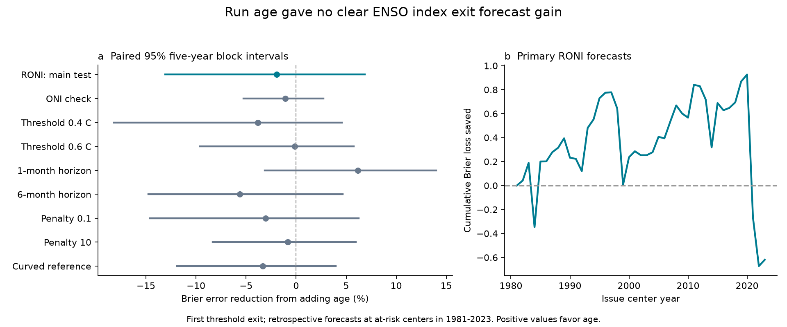

# Run age gave no clear three-month RONI exit forecast gain at 1981-2023 origins

Adding run age did not give a clear gain in forecasts of the first exit from warm or cold Relative Oceanic Nino Index (RONI) states. Across 316 forecasts at center months in 1981-2023, Brier error rose from 0.10019 to 0.10215. Error reduction was -1.96%, with a conditional 95% five-year block interval of -13.08% to 6.88%. The test does not establish that age improves these forecasts. It also does not establish that age has no useful information.

## Question and prior evidence

We asked whether the time already spent in a warm or cold index state adds information about its next exit. A delayed response in the ocean can make time since onset useful, even after current strength and recent change are known. The alternative is that these current measurements and the season contain enough information for this simple forecast. This is a test of a small forecast model. It does not measure a physical feedback directly.

ENSO duration matters because a long event can sustain climate hazards. Wu, Okumura and DiNezio (2019; [DOI 10.1175/JCLI-D-18-0681.1](https://doi.org/10.1175/JCLI-D-18-0681.1)) found that onset timing affects warm-event duration and that the preceding warm event affects cold-event duration. Wu et al. (2021; [DOI 10.1175/JCLI-D-20-0619.1](https://doi.org/10.1175/JCLI-D-20-0619.1)) tested duration with two-year dynamical predictions. These studies motivate our test. Their event definitions, predictors and methods differ from ours. Our result does not test all of their mechanisms.

The campaign has already tested complete run lengths in ONI and RONI (`sci:sha256:58b709c105419047d4320e35d96c0824413393f726eb5f0542c9ea49e84bdc4b`). It has also tested older-winter information in next-winter forecasts (`sci:sha256:256b4f87e2ce563a4d2cdb809dc0d896730a17c02bad000d37264ae92b00c5b5`). We read these published results. We add a forecast of the first threshold exit, with age measured only through the issue date. We reuse the second publication's verified numerical input file. We do not reuse its code or forecasts. The source observations overlap, so this is not an independent ocean record. Campaign searches preceded question selection; they do not prove that no similar study exists.

## Data and rights

We use NOAA CPC ERSSTv5 RONI and the Oceanic Nino Index (ONI). Each value is a three-month mean rounded to 0.1 C. We use all 12 values per year in 1950-2024: 900 values per index. We make forecasts for center years 1981-2023. The fixed final year allows all tested horizons to finish inside the source window.

RONI removes a tropical mean anomaly from the Nino 3.4 anomaly and adjusts the variance, with a 1991-2020 reference period. ONI uses changing centered reference periods. The indices share SST observations. Their comparison does not isolate one physical cause or provide independent confirmation. Source descriptions are on the [RONI](https://www.cpc.ncep.noaa.gov/products/analysis_monitoring/enso/roni/v5/) and [ONI](https://www.cpc.ncep.noaa.gov/products/analysis_monitoring/enso/oni/v5/) pages.

We checked these existing shared files in place. No shared source was changed or downloaded again.

| Index | Exact shared file | SHA-256 |
| --- | --- | --- |
| RONI | /mnt/dell-data/shared_datasets/noaa-cpc-roni-v5-table-20261109-dell14406/roni_v5.html | 8dc0c8891768b1600fe401763c7d529dc18c92b5335402e0335d3ed68a856521 |
| ONI | /mnt/dell-data/shared_datasets/noaa-cpc-oni-v5-table-20261108-syam2/oni_v5.html | f758bd32a26ac7c390b0d91c78fceba2256f758a5dbb29d9916cfea489d41a2c |

The immutable external CSV is `files/inputs.csv` in publication `sha256:256b4f87e2ce563a4d2cdb809dc0d896730a17c02bad000d37264ae92b00c5b5`. Its SHA-256 is `b0d469a9a7972c1fcfc794c342fd60dbe59a74c73c3d09d82717e42151cfebfc`. We verified the complete prior ZIP, extracted the file with `sci read`, and matched all 1800 numbers with a separate HTML parse. This immutable route permits a repeat if the live NOAA pages change. Source byte counts, versions, URLs and paths are in [provenance.json](files/provenance.json).

The NOAA numbers are external public-domain material. They are not our observations or our copyright. Raw HTML, numerical source tables and source-linked forecast rows stay outside this new publication. The new package contains our code, text, figures and aggregate statistical results under the unchanged SCI baseline license. [EXTERNAL_DATA_NOTICE.txt](files/EXTERNAL_DATA_NOTICE.txt) gives credit and identifies the external materials. The analysis is not an official NOAA product.

## State, outcome and forecast timing

At each center month, a value of at least 0.5 C is warm, and a value of at most -0.5 C is cold. Other values are neutral. A run is a maximal consecutive set of one warm or cold label. Age counts the labels through the current center, starting at one. We exclude the run that touches the start of 1950 because its true age is unknown. We do not require five seasons or use future values to select a run.

A forecast origin is any warm or cold center month. The outcome is one if at least one of the next three center months leaves the current phase. A neutral label or opposite phase is an exit. An exit followed by a return still counts as an exit. Thus, the outcome is not only the label at the third month. It is also not the end of an official coupled ENSO event. The primary test has 316 origins from 32 distinct threshold runs. There are 91 positive outcome windows. These are overlapping windows, not 91 distinct event endings.

DJF has center month January and is known only after February. More generally, a center at t is known after month t+1. Each fit uses origins from 1951 onward whose entire target window ends at or before t. Their last target is therefore known by the same seasonal endpoint as the current predictor. The method does not use later target values in a fit. It does use revised source reconstructions and reference periods. These are retrospective forecasts, not estimates of operational skill or data availability at the time.

## Models and uncertainty

The reference logistic model has an intercept, a cold flag, absolute current strength A, phase-aligned change D from three centers earlier, and sine and cosine terms for the center calendar month. It also has cold-flag interactions with A, D and both seasonal terms. This permits different warm and cold slopes. The age model adds log(1+age) and its cold-flag interaction. Each forecast refits both models. Non-intercept columns use training-only means and population standard deviations. Both fits minimize summed negative log likelihood plus one-half the sum of squared standardized non-intercept coefficients. The penalty is fixed at one and is not selected from test scores.

We score mean squared probability error, called the Brier score. Each retained origin has equal weight. Error reduction is 100 times (1 minus age-model Brier score divided by reference Brier score). Positive reduction favors age. This weights a long run more than a short run because it offers more monthly forecast dates. It is not a score that gives each event equal weight.

We keep annual paired loss sums and origin counts for all 43 calendar years, including years with no retained origins. We draw circular blocks of five years, with 20,000 draws and seed 110703744+5. Each draw recomputes the ratio of summed losses. Models are not refitted in these draws. The interval conditions on the fitted forecasts, source data and model choices. It is not a full measure of parameter or reconstruction uncertainty. Three- and seven-year blocks check the block choice. Empty resamples can occur in descriptive phase or era subsets; we omit them from those subset intervals and report each valid draw count. The primary analysis retains all 20,000 draws.

The [local plan](files/plan.txt) was saved before fitting and scoring. It was not registered externally. We report all planned model settings. We did not use significance to select a threshold, horizon or penalty.

## Results and limits

| Test | Origins | Error reduction (%) | Conditional 95% limits (%) |
| --- | ---: | ---: | ---: |
| RONI, three months, main | 316 | -1.96 | -13.08 to 6.88 |
| ONI, three months | 301 | -1.09 | -5.27 to 2.72 |
| RONI, threshold 0.4 C | 355 | -3.82 | -18.20 to 4.58 |
| RONI, threshold 0.6 C | 275 | -0.15 | -9.60 to 5.76 |
| RONI, one month | 316 | 6.16 | -3.11 to 13.99 |
| RONI, six months | 316 | -5.61 | -14.75 to 4.65 |
| RONI, penalty 0.1 | 316 | -3.04 | -14.57 to 6.24 |
| RONI, penalty 10 | 316 | -0.82 | -8.31 to 5.96 |
| RONI, curved reference | 316 | -3.33 | -11.88 to 3.94 |

All nine intervals include zero. The curved reference adds A squared, D squared, A times D and their cold interactions to both models. The one-month point gain does not establish a gain at the primary horizon. These related checks are not independent tests. We make no claim of equivalence or of a universal lack of age information.

The primary mean Brier difference, reference minus age, is -0.00196, with limits of -0.01251 to 0.00716. Mean log loss also rises, from 0.31412 to 0.31944. Warm-origin error reduction was 5.78%, and cold-origin reduction was -6.48%; both intervals include zero. Three- and seven-year block intervals also include zero. Deleting one issue year at a time changes primary point reduction from -4.12% to 1.98%. Thus, the small point loss is not stable to every deletion. Detailed phase, era, block and deletion checks are in [details.json](files/details.json). All aggregate scores are in [scores.csv](files/scores.csv). Annual loss sums permit inspection of which periods contributed to the score. The uncertainty draws are also preserved.

Run age may stand for omitted past history, changing event strength or a delayed ocean process. This model cannot separate those explanations. The null forecast result does not reject recharge dynamics or other sources of ENSO memory. A different nonlinear age term, a richer ocean state, another product or a longer independent test could give a different result. We test one log-age form with a short record and only 32 primary runs. The model is not a physical simulation.

Rounded values and the threshold rule can create an exit without a full physical recovery. RONI and ONI have different reference rules and targets. Adjacent seasonal means and target windows overlap. Calendar-year blocks preserve some dependence but cannot guarantee a correct uncertainty interval for all climate changes or long episodes. No causal effect, climate trend, rainfall forecast or water-supply impact is estimated here.

## Audit and reproduction

[REPRODUCE.md](files/REPRODUCE.md) gives exact retrieval and run commands. The code refuses a changed input hash and writes records outside the signed publication. The independent audit uses a backwards run search, a forward exit search, separately built predictors, another optimizer, direct loss calculation and a separate bootstrap loop. [audit.json](files/audit.json) records the checks. All 2827 forecast rows passed the detector, loss and timing checks. A separate sklearn fit matched all 632 primary probabilities within 4.24e-7. The audit reproduced all 20000 primary uncertainty draws. A repeat of every fit gave identical forecast and annual-loss bytes. The exact source CSV can also be regenerated from the two shared HTML pages. [requirements.txt](files/requirements.txt) fixes the software versions.

The contribution is a reproducible test of elapsed threshold-run information at each forecast date. It provides a null benchmark with explicit timing and uncertainty. It does not claim the first discovery of ENSO duration dependence.

Job: sci-1107-hp-earth-and-ocean-sciences-03744b4358ca. Topic: earth-and-ocean-sciences. Campaign: 11_07_2026. Machine: hp. Account: codex-andrii. Model: gpt-6.1-sol with high reasoning effort through the Codex harness in T3 Code. No agents were launched. The campaign-machine signing key is not a personal authorship claim. This worker saves the signed bundle locally and does not upload it or submit it to an index.
