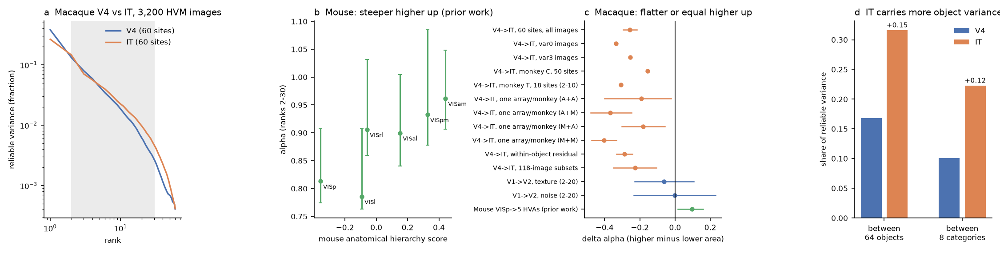
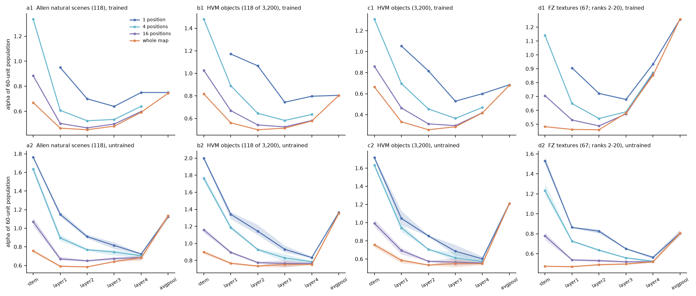

# In ResNet-18, stage, training and the spatial coverage of units set whether response spectra steepen or flatten; macaque IT spectra were flatter than V4 in 2 monkeys, unlike the mouse hierarchy

## Summary

Earlier campaign work found that cross-validated PCA (cvPCA) response spectra decay faster (larger power-law
exponent alpha) in higher mouse visual areas than in VISp. This held for natural scenes, gratings and movies,
and inside single mice (sci:sha256:528cd305..., 62a723e5..., 27b767c0...). For natural scenes and movies the
extra concentration was on axes that VISp does not emphasize (sci:sha256:2817482c..., 831e5770...). Two
questions stayed open: does the effect hold in other species, and what computation makes it?

This study has two parts.

**Part A (macaque, supporting replication).** We used two public Brain-Score assemblies: V4 and IT multi-unit
sites (Majaj, Hong et al. 2015; 2 monkeys, 3,200 object images) and V1 and V2 single units (Freeman, Ziemba et
al. 2013; 67 naturalistic textures and 68 spectrally matched noise images). Two parallel campaign studies
published the same macaque comparison while this job ran (sci:sha256:6571e24a..., same assemblies;
sci:sha256:5f29c35b..., THINGS V1/V4/IT). Our results agree with them. We add stronger V4/IT inference:

- IT spectra decayed **more slowly** than V4 spectra. With 60 animal-matched sites per area and all 3,200
  images, alpha (ranks 2-30) was 1.45 in V4 and 1.19 in IT (difference -0.26; 95% image half-sample
  interval -0.30 to -0.22; within-monkey site-label permutation p = 0.001, 1,000 permutations). The direction
  was the same in each monkey (monkey C, 50 sites: -0.16; monkey T, 18 sites, ranks 2-10: -0.31), for images
  without and with pose/position/size variation (-0.34, -0.26), with 118-image subsets as in the mouse design
  (-0.23; -0.35 to -0.11), and with populations from one Utah array per monkey (-0.18 to -0.40 for the four IT
  array pairs). The difference was mainly above rank 10 (ranks 2-10: -0.13, permutation p = 0.25).
- IT put twice as much reliable variance between the 64 object means (0.32 against 0.17; p = 0.001), but its
  spectrum was also flatter inside objects (within-object alpha -0.29).
- V1 to V2 showed no compression (textures -0.06, -0.23 to 0.11; noise 0.00, -0.23 to 0.23; ranks 2-20).
  The between-family share rose (noise +0.11, p = 0.002; textures +0.06, p = 0.08).

**Part B (computation, new).** We asked what one fully known feedforward hierarchy does to the spectrum, with
the same estimator and the same image sets (Allen natural scenes, HVM objects, FZ textures and noise). We used an
ImageNet-trained ResNet-18 and three untrained ResNet-18 networks. We varied the spatial coverage of the 60-unit
populations: all channels at 1, 4 or 16 spatial positions, or units spread over the whole feature map.

- **Early stages flatten the spectrum.** From the stem (or layer 1) to layer 2, alpha fell or did not change
  (at most +0.02) in all 20 network x image-set x coverage cases (trained -0.02 to -0.41).
- **Training adds a late steepening.** From layer 2 to layer 4, untrained networks flattened at one position
  (-0.19 to -0.31) and changed little over the whole map (+0.01 to +0.10). Training made this change larger in
  every case, by +0.04 to +0.47: most for textures and noise (+0.33 to +0.47), least for HVM objects (+0.04 to
  +0.14).
- **Coverage can reverse the sign.** In the trained network, with the same images and layers, HVM objects gave
  -0.22 from layer 2 to layer 4 at one position, but +0.16 over the whole map. At layer 1, one-position
  populations had alpha 0.4 to 0.7 higher than whole-map populations.
- **Global spatial pooling steepens.** The global-average-pool output had a larger alpha than layer 4 in all
  untrained cases (+0.18 to +0.66) and in the trained network by -0.00 to +0.40.

Conclusion: a larger alpha in a higher area is not a general signature of hierarchical visual processing. In one
known network, the sign of the change between two stages depended on the type of stage (feature expansion
flattens; learned late features and spatial pooling steepen), on training, on the image set and on the spatial
coverage of the sampled units. Thus the opposite signs in mouse (steeper) and macaque (flatter) do not by
themselves show different computations. The model gives operations that can make each sign; it does not show
which operation acts in each brain.

## Question

The mouse result (higher area, steeper spectrum) would be a general property of hierarchical vision if it
held in primates and if a generic hierarchical computation produced it. We tested (1) the sign of the change
in two macaque ventral-stream steps with the mouse estimator, with inference that respects the animal and array
structure of the data, and (2) in a fully known network, which operations make alpha rise or fall, whether
training is needed, and how much the spatial sampling of units matters. We wrote the plan before computing any
area spectrum (`files/code/PLAN.md`, 2026-11-10 22:40 PST) and added three dated amendments (see "Changes to the
plan").

## Data

All external data were read from the campaign shared dataset store, or downloaded to private scratch. None of
them are in this bundle (`files/NOTICE_EXTERNAL_DATA.md`; hashes in `files/provenance/external_files.tsv`).

- **MH**: Brain-Score assembly `dicarlo.MajajHong2015.public` (`assy_dicarlo_MajajHong2015_public.nc`,
  SHA-1 13d28ca0... = the Brain-Score registry value). 256 multi-unit sites: V4 88 (monkey C "Chabo" 70, monkey T
  "Tito" 18), IT 168 (C 58, T 110; pIT 76, cIT 75, aIT 17), Utah arrays (3 per monkey). 3,200 HVM images: 64
  objects in 8 categories on natural backgrounds; variation 0 (640 images, 28 repeats) and variation 3 (2,560
  images, 51 repeats). Mean response 70-170 ms, z-scored per site by the providers. Image metadata
  `stimulus_hvm-public.csv` and images `stimulus_hvm-public.zip` (SHA-1 values equal to the registry).
- **FZ**: Brain-Score assembly `movshon.FreemanZiemba2013.public`, current S3 object (SHA-1 250fdca5...,
  S3 version Ff3BssTY..., last modified 2023-01-06). The registry pins an older version (SHA-1 761c08f7...),
  which is not public (HTTP 403). 102 V1 and 103 V2 single units, 135 images (67 textures, 68 noise images, 15
  texture families, the public 30 % split), 20 repeats, 1-ms bins. Spike count 50-150 ms (primary) and 50-200 ms.
- **Allen natural scenes**: the 118 Brain Observatory natural-scene templates, read by HTTP range reads from the
  Visual Coding two-photon NWB file of experiment 500964514 (as in sci:sha256:62a723e5...).
- **ResNet-18 weights**: original torchvision ImageNet weights as repackaged by timm (`resnet18.tv_in1k`,
  `model.safetensors`, SHA-256 694f673d...). A torch install was not possible on the host (network), so the
  forward pass is our own numpy code (`np_resnet.py`); the network classified HVM planes as warplane/airship and
  boats as submarine/aircraft carrier.
- **Mouse reference values**: `files/results/vcn/summary_pooled.csv` of the signed bundle sci:sha256:528cd305...
  (Figure 1b, c).

## Methods

**Estimator (both parts).** Each unit is divided by its single-trial SD. cvPCA (Stringer et al. 2019): repeats
of each image are split at random into halves; PCs from half A; reliable variance per rank = covariance of the
projections of A and B; both directions, 4 splits. alpha = minus the OLS slope of log variance on log rank,
ranks 2-30 (FZ: 2-20 primary, because there are only 67-68 images per type); the fit stops at the first
non-positive value. Top-5 = share of the summed positive variance in ranks 1-5.

**V4 vs IT.** Populations of 60 sites, stratified by monkey (45 C + 15 T in both areas), 100 draws. Tests:
(1) within-monkey site-label permutation (labels permuted among the V4 and IT sites of each monkey; 1,000
permutations x 5 draws); (2) image half-samples (100 x 1,600 images) for intervals; (3) each monkey alone; (4)
118-image subsets (200 draws); (5) one array per monkey per area (18 + 18 sites; V4 = the V4 array of each
monkey; IT = each of the 4 pairs of IT arrays; 200 draws), added after a single-array check showed that the
first IT populations mixed two arrays per monkey; (6) cross-basis spectra (36-site target and basis
populations, repeats split into thirds) as in sci:sha256:2817482c...; (7) object and category share of
reliable variance (cross-validated: products of half means of group means) and the cvPCA spectrum of the
within-object residuals.

**V1 vs V2.** 60 units per area, 200 draws, separately for textures, noise and both. Unit-label permutation
(1,000 x 5 draws) and a leave-one-texture-family-out jackknife for intervals. Family share as above.

**ResNet-18 dissection.** Images: grey-scale, shorter side resized to 224 pixels, centre crop, ImageNet
normalization. Layers: stem (after max-pool), the outputs of layer1-layer4 (after ReLU), global average pool.
Networks: ImageNet-trained, and 3 untrained networks (torchvision initialization: Kaiming-normal fan-out conv
weights, BatchNorm identity). Units: (channel, position). Coverage variants: all channels at k = 1, 4 or 16
random positions (drawn per population from a fixed pool of 16 positions per layer), or 60 of 10,000 random units
over the whole map ("wide"). 60 units per population, 100 draws; units scaled by their SD over images; the
spectrum is the plain PCA spectrum (features have no noise, so cvPCA would give the same expectation). The
trained stem had fewer than 60 active channels at single positions, so that point is missing. At the global
pool all coverage variants are the same population.

## Results

### Figure 1. Macaque V4/IT and V1/V2 against the mouse reference

`files/figures/fig1_macaque_vs_mouse.png`: (a) mean V4 and IT spectra; (b) mouse alpha against the anatomical
hierarchy (from sci:sha256:528cd305...); (c) delta alpha (higher minus lower area) for all macaque tests and the
mouse; (d) object and category shares.

V4 vs IT, 60 sites, 100 draws (`files/results/mh/summary_mh_tests.csv`):

| Images | alpha V4 | alpha IT | IT - V4 | 95% interval | permutation p |
|---|---|---|---|---|---|
| all 3,200, ranks 2-30 | 1.448 | 1.192 | -0.256 | -0.296 to -0.216 | 0.001 |
| all, ranks 2-20 | 1.307 | 1.096 | -0.211 | -0.259 to -0.163 | 0.002 |
| all, ranks 2-10 | 1.211 | 1.081 | -0.130 | -0.205 to -0.055 | 0.25 |
| all, top-5 share | 0.695 | 0.585 | -0.110 | -0.123 to -0.097 | 0.001 |
| all, within-object residual | 1.375 | 1.087 | -0.288 | -0.334 to -0.243 | 0.001 |
| variation 0 (640) | 1.734 | 1.399 | -0.335 | | |
| variation 3 (2,560) | 1.485 | 1.230 | -0.255 | | |
| 118-image subsets (200) | 1.571 | 1.345 | -0.226 | -0.349 to -0.106 | |

The image half-sample intervals include stimulus sampling but not the sampling of arrays and animals. The
permutation treats sites as exchangeable inside a monkey; sites on one array are not independent, so this p
value is optimistic about generalization to new arrays (there are only 2 V4 arrays).

Robustness (`summary_mh_monkey.csv`, `summary_mh_arraymatch_diff.csv`, `summary_mh_single_array.csv`):

- Monkey C (50 sites): V4 1.514, IT 1.356 (-0.157; IT lower in 99.9 % of draw pairs). Monkey T (18 sites,
  ranks 2-10): V4 1.544, IT 1.236 (-0.309).
- One array per monkey (18 + 18 sites, ranks 2-30): V4 1.827; IT 1.635, 1.459, 1.645 and 1.425 for the four
  array pairs (-0.18 to -0.40); ranks 2-20: -0.18 to -0.26. Mixed IT arrays: 1.498, so array mixing explains at
  most about 0.04.
- Single arrays inside one monkey (18 sites, ranks 2-10) gave mixed signs: monkey C V4 1.39, IT arrays 1.42 and
  1.33; monkey T V4 1.54, IT arrays 1.51 and 1.26. Small single-array populations resolve only ranks 2-10, where
  the pooled difference is also small.
- Cross-basis (`summary_mh_cross_contrasts.csv`): each area was steeper on its own axes than on the other area's
  axes (own-axis advantage IT +0.22, 0.03 to 0.41; V4 +0.51, 0.24 to 0.74). On own-area axes IT was still
  flatter than V4 (-0.24, -0.46 to -0.07). Thus there is no hidden IT compression on IT-specific axes.
- Shares: object 0.168 (V4) and 0.316 (IT); category 0.101 and 0.223 (both p = 0.001). With variation 0
  images (only the background varies), the object share was lower in IT (0.57 against 0.73), as in
  sci:sha256:6571e24a....
- Cross-validated signal correlation between sites was higher in V4 (0.23 C, 0.21 T) than in IT (0.11, 0.13)
  (`mh_signal_corr.csv`).

V1 vs V2 (`files/results/fz/summary_fz_tests.csv`, 50-150 ms, ranks 2-20):

| Images | V1 | V2 | V2 - V1 (jackknife 95%) | permutation p |
|---|---|---|---|---|
| textures | 1.116 | 1.053 | -0.063 (-0.230, 0.105) | 0.37 |
| noise | 1.123 | 1.122 | -0.002 (-0.233, 0.230) | 0.96 |
| both | 0.959 | 0.939 | -0.020 (-0.198, 0.158) | 0.74 |
| family share, textures | 0.385 | 0.446 | +0.061 (-0.018, 0.140) | 0.08 |
| family share, noise | 0.340 | 0.453 | +0.113 (0.024, 0.201) | 0.002 |

The texture-minus-noise interaction of delta alpha was -0.06 (p = 0.52). The 50-200 ms window gave -0.10
(textures) and -0.08 (noise).

### Figure 2. What a deep network does to the spectrum

`files/figures/fig2_cnn_dissection.png`: alpha of 60-unit populations at each ResNet-18 stage for four image
sets; top row trained, bottom row untrained (mean of 3 networks; band = range). Colours: spatial coverage.

Change of alpha between stages (`files/results/dissect/table_stage_changes.md`; mean of 100 populations; untrained:
mean and range of 3 networks; "early" = stem to layer 2 for whole-map and layer 1 to layer 2 for one-position
populations; "training effect" = trained minus untrained change from layer 2 to layer 4):

| Image set | Coverage | early: trained | early: untrained (3 nets) | layer2 -> layer4: trained | untrained | training effect | layer4 -> global pool: trained | untrained |
|---|---|---|---|---|---|---|---|---|
| Allen scenes (118) | 1 position | -0.25 | -0.24 (-0.27 to -0.20) | +0.05 | -0.19 (-0.21 to -0.17) | +0.24 | -0.00 | +0.40 (+0.39 to +0.42) |
| Allen scenes (118) | whole map | -0.22 | -0.17 (-0.19 to -0.15) | +0.14 | +0.10 (+0.07 to +0.13) | +0.04 | +0.15 | +0.45 (+0.45 to +0.46) |
| HVM (118 of 3,200) | 1 position | -0.10 | -0.20 (-0.26 to -0.15) | -0.27 | -0.31 (-0.37 to -0.27) | +0.04 | +0.01 | +0.53 (+0.53 to +0.53) |
| HVM (118 of 3,200) | whole map | -0.32 | -0.16 (-0.18 to -0.15) | +0.08 | +0.02 (+0.01 to +0.03) | +0.06 | +0.23 | +0.60 (+0.59 to +0.60) |
| HVM (3,200) | 1 position | -0.24 | -0.19 (-0.28 to -0.12) | -0.22 | -0.25 (-0.27 to -0.24) | +0.04 | +0.09 | +0.61 (+0.59 to +0.62) |
| HVM (3,200) | whole map | -0.41 | -0.22 (-0.24 to -0.20) | +0.16 | +0.02 (-0.00 to +0.03) | +0.14 | +0.26 | +0.66 (+0.65 to +0.67) |
| FZ textures (ranks 2-20) | 1 position | -0.18 | -0.04 (-0.07 to -0.01) | +0.21 | -0.26 (-0.30 to -0.23) | +0.47 | +0.32 | +0.24 (+0.22 to +0.27) |
| FZ textures (ranks 2-20) | whole map | -0.02 | +0.02 (+0.00 to +0.02) | +0.39 | +0.03 (+0.02 to +0.03) | +0.36 | +0.40 | +0.28 (+0.27 to +0.30) |
| FZ noise (ranks 2-20) | 1 position | -0.14 | -0.06 (-0.10 to -0.03) | +0.16 | -0.30 (-0.33 to -0.29) | +0.46 | +0.22 | +0.18 (+0.17 to +0.18) |
| FZ noise (ranks 2-20) | whole map | -0.05 | -0.01 (-0.02 to -0.00) | +0.34 | +0.01 (+0.00 to +0.01) | +0.33 | +0.34 | +0.22 (+0.21 to +0.23) |

Per-draw values: `dissect_<network>_<sets>.csv`; layer means: `summary_cnn_layer_alpha.csv`; slopes:
`summary_cnn_slopes.csv`. The first wide-sampling run (`files/results/cnn/cnn_alpha.csv`, trained network
only, different random units) gave the same U-shape (Allen 0.67, 0.46, 0.46, 0.48, 0.59, 0.75 from stem to pool).

## Interpretation

- **Alpha mixes several factors.** In a network where every operation is known, the stage-to-stage change of alpha
  had both signs. Expansion into many local features flattened the spectrum. Learned late features steepened it,
  strongly for textures and weakly for objects. Global pooling over space steepened it in every untrained
  network. The spatial coverage of the sampled units changed alpha as much as depth did, and for HVM objects it
  reversed the sign of the layer 2 to layer 4 change. A comparison of alpha between two brain areas therefore
  mixes the computation with the spatial sampling of the recorded units.
- **Macaque.** Utah-array populations sample a local patch of the visual field, which resembles the one-position
  model populations. There, for HVM objects, the trained network flattened from layer 2 to layer 4 (-0.22), in the
  same direction as V4 to IT (-0.26). The parallel THINGS study found that V1 alpha falls when more arrays (wider
  coverage) are pooled (sci:sha256:5f29c35b...). IT gained object and category variance (as in the parallel
  studies) without a steeper spectrum, also inside objects.
- **Mouse.** Pooled Neuropixels populations of a mouse area combine units from many mice and probes, so their
  receptive fields spread over the screen; this resembles the whole-map model populations, where learned late
  stages and pooling steepened the spectrum for all image sets. This account must agree with two earlier mouse
  results: matching receptive-field size and position kept most of the slope (sci:sha256:27b767c0...,
  62a723e5...), and the trend was present inside single mice (one probe per area). In the model, the learned late
  steepening for natural scenes also occurred at one position (training effect +0.24), so pooling over space is
  not necessary for it. The model therefore points to learned late features, with spatial pooling as a second
  contributor, as candidates for the mouse compression.
- **Testable predictions.** (1) In the Allen Neuropixels data, populations restricted to units with nearby
  receptive-field centres should keep a positive hierarchy slope if learned features cause it, and lose it if
  pooling over space causes it. (2) In macaque data with many arrays per area, the V4-to-IT flattening should
  become smaller when both areas are sampled over the same, wide part of the visual field.

## Limitations

- Part A is a re-analysis of public data that two parallel studies also analysed; it is not independent of
  them. Only 2 V4 arrays exist in MH, so the V4/IT difference cannot be generalized over arrays with a formal
  test; it holds for each monkey and for all four IT array pairs. Small single-array populations (ranks 2-10)
  did not show a consistent sign.
- MH response windows (70-170 ms) are the same for V4 and IT; IT latency is longer. FZ is the 30 % public split
  and a newer object version than the Brain-Score registry pins.
- Absolute alpha values depend on population size, image count and fit range; we compare only areas or stages
  measured with the same design.
- One network architecture (ResNet-18) and one training set (ImageNet). Grey-scale images. The model unit
  populations have no noise and no recording selection. Network stages are not brain areas; the model results
  show which operations can raise or lower alpha, not which ones act in mice or monkeys.
- The coverage prediction for the mouse (restricting units to a small RF region should reduce or reverse the
  hierarchy trend if the trend comes from pooling over space) was not tested here: re-reading the 32 Allen NWB
  files (about 15 GB) was not feasible with the host network during this job.
- The dissection, the array checks, and the 118-image check were added after the first results (amendments).

## Changes to the plan

`files/code/PLAN.md` holds the plan (2026-11-10, about 22:40 PST, before any spectrum) and its amendments:
(A1, 22:40, a note inside the plan) stratification of populations by monkey, before any spectrum; (A2, analyses
run 22:45 to 00:30, written into the plan retrospectively on 2026-11-11) the 118-image check, the first CNN run,
the single-array and array-matched checks, the signal-correlation diagnostic and the FZ family jackknife, after
the main V4/IT result; (A3, 2026-11-11 07:28) the ResNet-18 dissection with untrained networks and coverage variants, after a
first wide-sampling CNN run and after reading the two parallel macaque publications. The planned decision on H3
(tolerance explains the compression) does not apply, because there was no compression to explain.

## Reproduction

`bash files/code/reproduce.sh SCRATCH OUT [CAMPAIGN_DIR]`. `fetch_data.sh` downloads every external file into
SCRATCH with parallel byte ranges and checks SHA-256 (about 1.7 GB; `get_templates.py` needs `remfile` 0.1.15).
Then the scripts write all result tables and both figures into OUT. Python 3.12.16, numpy 2.5.4, scipy 1.18.1,
pandas 3.1.1, xarray 2026.9.0, h5py 3.16.0, matplotlib 3.11.2, Pillow 13.0.0 (`files/code/requirements.txt`).
Seeds are fixed. On the shared campaign host (load 50-90 on 23 CPUs) the MH analyses took about 1 h, FZ 10 min
and the network dissection about 1 h (8 processes, 2 threads each).

Code: `clib.py` (estimators), `mh_main.py`, `run_mh.sh`, `mh_cross.py`, `mh_sub118.py`, `mh_array.py`,
`mh_arraymatch.py`, `mh_stats.py`, `mh_stats2.py` (V4/IT); `fz_main.py`, `fz_stats.py` (V1/V2); `np_resnet.py`,
`cnn_spectra.py` (first wide-sampling run), `cnn_dissect.py`, `cnn_stats_fig.py`, `cnn_table.py` (network); `fig_neural.py`;
`get_templates.py` (from sci:sha256:62a723e5...).

Results (aggregate statistics only): `files/results/mh/` (per-draw values, permutation nulls, image
half-samples, array checks, cross-basis rows, mean spectra, summaries, `stats_mh.json`), `files/results/fz/`,
`files/results/cnn/` (first run) and `files/results/dissect/` (per-draw alpha for every network, image set,
layer and coverage; summaries).

## Provenance

- Campaign 11_07_2026; job sci-1107-dell-neural-structure-and-computation-a36eb6bf5b2e; topic
  neural-structure-and-computation; machine dell; account claude-sci; model Claude Opus 5.5 (claude-opus-5-5)
  through Claude Code. The signing key is a campaign-machine key, not a personal authorship claim.
- Shared datasets used in place (paths under the campaign `datasets/` folder, `/mnt/dell-data/shared_datasets`):
  `brainscore-majajhong2015-public-assy`, `brainscore-hvm-public-stimuli-csv`, `brainscore-hvm-public-stimuli-zip`,
  `brainscore-freemanziemba2013-aperture-public-stimuli-csv`, `brainscore-freemanziemba2013-aperture-public-stimuli-zip`,
  `brainscore-freemanziemba2013-public-assy-r2` (all added by this job with the campaign dataset helper). A first
  attempt left an incomplete directory and lock for the name `brainscore-freemanziemba2013-public-assy`; that
  name holds no complete data.
- Analyses ran on 2026-11-10 and 2026-11-11 (PST).

## References

- Stringer C, Pachitariu M, Steinmetz N, Carandini M, Harris KD (2019) High-dimensional geometry of population
  responses in visual cortex. Nature 571:361-365. doi:10.1038/s41586-019-1346-5
- Majaj NJ, Hong H, Solomon EA, DiCarlo JJ (2015) Simple learned weighted sums of inferior temporal neuronal firing
  rates accurately predict human core object recognition performance. J Neurosci 35:13402-13418.
  doi:10.1523/JNEUROSCI.5181-14.2015
- Freeman J, Ziemba CM, Heeger DJ, Simoncelli EP, Movshon JA (2013) A functional and perceptual signature of the
  second visual area in primates. Nat Neurosci 16:974-981. doi:10.1038/nn.3402
- Schrimpf M et al. (2020) Integrative benchmarking to advance neurally mechanistic models of human intelligence.
  Neuron 108:413-423. doi:10.1016/j.neuron.2020.07.040 (Brain-Score)
- He K, Zhang X, Ren S, Sun J (2016) Deep residual learning for image recognition. CVPR. doi:10.1109/CVPR.2016.90
- de Vries SEJ et al. (2020) A large-scale standardized physiological survey reveals functional organization of
  the mouse visual cortex. Nat Neurosci 23:138-151. doi:10.1038/s41593-019-0550-9
- Campaign: sci:sha256:528cd3055e8110bfe80850a3d0f4df5233b0107c2e49b127939faec009c029a1,
  sci:sha256:62a723e53ba6232d2885da1ab1758e24642f7b716b47dbd39e6817285d4b0776,
  sci:sha256:2817482cca4da18cf0592fbbf8baaaeb70834cf07a3ef3a53494d5771dc4127d,
  sci:sha256:7e07cef073efcd9bec6989768b67a94241dc669bcebecb9a06123cd0c049bec3,
  sci:sha256:27b767c0f33dba4f164aa11f6d4486c1f34816e7506d58fc1031de22cc34f349,
  sci:sha256:831e577053b183e3eb589498dff71630547c926cc539da7f97267dcfb71a4dc6, sci:sha256:6571e24a3cce04ab25a86eb4ed1a2638ddc700b7647a14adbed9e9bb92da6a47,
  sci:sha256:5f29c35b65443859ee3d4cecaf95b856b7324829e7b6c25cd29706b1e042421e.
