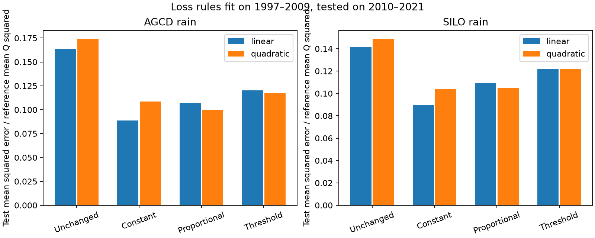
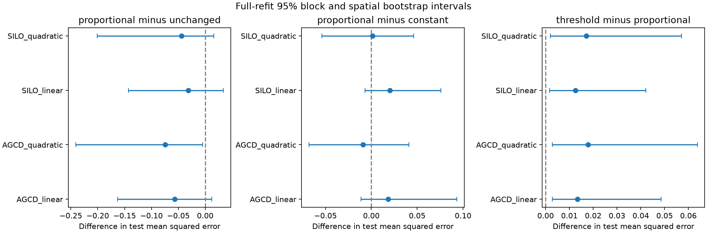

# A drought-fitted loss above a fixed dry-flow threshold raised runoff prediction error across 174 south-east Australian catchments

## Question

Can a loss rule fitted during the Millennium Drought predict annual runoff after that drought? Does a proportional loss transfer better than a constant loss of water?

Prior campaign work found lower runoff and a lower rain-response slope after 1997. Source fde6f0d6 compared loss rules fitted to each later period and favored proportional loss. It also tested nonlinear baseline curves and rain noise. Source 40fcfa6a found less runoff in rain-matched years, but too few tight joint climate matches. We test a different claim: whether the loss form learned in 1997-2009 predicts 2010-2021 without fitting to that test period. The contribution is this fixed temporal test, its full fitting uncertainty, and a reusable prediction benchmark. It is not an independent data replication or a new general split-sample method.

Split-sample tests under different climate conditions are established in hydrology. Fowler et al. (2018), doi:10.1029/2018WR023989, give a framework for such tests. Fowler et al. (2020), doi:10.1029/2019WR025286, show limits in long and slow dynamics of common runoff models. Fowler et al. (2022), doi:10.5194/hess-26-6073-2022, review proposed causes of the Australian runoff shifts. Our static loss rules do not test those causes.

## Data and fixed design

We use annual CAMELS-AUS v2.03 flow, AGCD rain, SILO rain and mean temperature from verified SCI 40fcfa6a. The annual members first appeared in SCI 871b2192. The exact three input files are included with CC BY 4.0 credit. Source data authors are Fowler, Zhang and Hou (2024), doi:10.5281/zenodo.14289037; the data paper is doi:10.5194/essd-17-4079-2025. See files/DATA_NOTICE.md for credit and terms, files/provenance.json for exact member hashes, and files/source_provenance.json for original source URLs and the exact shared master-table path. We used the signed annual members, not the daily shared archives. No new shared data were downloaded or changed.

The annual source requires at least 95% valid flow days. It scales mean valid daily flow by calendar-year length. Rain requires complete daily data. Temperature requires at least 95% coverage. We inherit these rules and their measurement limits. The annual climate table starts in 1949. Prior-year rain is formed before filtering flow years. We use calendar years through 2021.

Eligible outlet states are VIC, NSW, ACT, SA and TAS, as in the earlier campaign. Each gauge must have at least 25 complete reference years (1951-1996), eight drought years (1997-2009), and eight test years (2010-2021). Gauge 410033 is excluded because of its diversion. The resulting cohort has 174 gauges in 24 occupied two-degree outlet cells for each rain product. No gauge is selected for its fitted loss or prediction score.

We divide flow by each gauge's reference mean Q. We standardize current rain P, previous-year rain and T using that gauge's valid reference years. An ordinary least-squares reference model predicts normalized Q from an intercept and those three standardized climate terms. Predictions are clipped at zero. A planned variant adds current rain squared. Reference years alone set all baseline coefficients and scales.

Let q be the nonnegative baseline prediction and q0 its tenth percentile over valid reference years. We fit three loss rules by least squares in 1997-2009 only:

- Constant loss: max(q-a, 0), with 0 <= a <= 2 in reference mean Q units.
- Proportional loss: (1-k)q, with 0 <= k <= 1.
- Threshold loss: q-k max(q-q0, 0), with 0 <= k <= 1.

Each rule adds one fitted parameter. q0 is fixed from reference years; it is not fitted to later runoff. A planned variant uses the 25th percentile. The unchanged model uses q directly. All coefficients remain fixed after 2009. Current and previous rain and current T in test years are observed inputs. This is conditional prediction, not an operational weather forecast.

The endpoint is the mean across gauges of each gauge's mean test squared error. It gives each gauge equal weight and measures error in squared reference mean Q units. It does not measure total regional water yield. We also report mean normalized bias. Negative paired error contrasts favor the first named model.

## Uncertainty

The primary conditional intervals use 1,999 draws of synchronous circular three-year blocks within the test era and whole occupied two-degree cells. Test years are sampled jointly across gauges. One- and five-year block variants are supplied. Conditional draws keep fitted parameters fixed.

The full-refit check uses 499 draws. It separately resamples reference, drought and test years in synchronous circular three-year blocks, refits both the baseline and each loss rule, and resamples spatial cells. The original eligible cohort and climate and Q scales stay fixed. A gauge with no valid selected test year drops from that draw; fitting needs six selected reference rows and two selected drought rows. Repeated years count repeatedly. These intervals cover more fitting uncertainty but remain conditional on data products, gauge selection and model forms. With 499 draws, interval tail estimates have Monte Carlo uncertainty. The product and curve checks use the same flows and are not independent experiments. The plan required a negative interval in both products and both curve forms to claim stable predictive superiority.

## Results

The fixed dry-flow threshold did not improve transfer. Its test MSE was 11-18% higher than proportional loss in all four main rain-product and curve variants. Each marginal full-refit 95% interval for threshold minus proportional error was above zero. This is evidence against this specific drought-fitted, fixed-threshold rule as a better predictor. It does not exclude all threshold models or all physical threshold changes. The three error contrasts and several variants have no family-wise multiplicity correction; intervals are marginal.

| Rain and reference curve | Unchanged MSE | Constant MSE | Proportional MSE | Threshold MSE |
| --- | ---: | ---: | ---: | ---: |
| AGCD_linear | 0.1636 | 0.0886 | 0.1071 | 0.1204 |
| AGCD_quadratic | 0.1743 | 0.1088 | 0.0998 | 0.1177 |
| SILO_linear | 0.1412 | 0.0893 | 0.1095 | 0.1219 |
| SILO_quadratic | 0.1489 | 0.1036 | 0.1050 | 0.1221 |

MSE is in squared reference mean Q units. It is not a fraction of observed runoff. The following intervals include refitting uncertainty.

| Rain and curve | Proportional minus unchanged | Proportional minus constant | Threshold minus proportional |
| --- | ---: | ---: | ---: |
| AGCD_linear | -0.0565 [-0.1627, +0.0122] | +0.0185 [-0.0113, +0.0932] | +0.0134 [+0.0028, +0.0485] |
| AGCD_quadratic | -0.0745 [-0.2410, -0.0049] | -0.0090 [-0.0680, +0.0411] | +0.0179 [+0.0028, +0.0638] |
| SILO_linear | -0.0318 [-0.1426, +0.0339] | +0.0202 [-0.0068, +0.0757] | +0.0125 [+0.0016, +0.0421] |
| SILO_quadratic | -0.0439 [-0.2007, +0.0158] | +0.0014 [-0.0537, +0.0461] | +0.0171 [+0.0020, +0.0572] |

Constant and proportional loss had no clear error ranking: all four full-refit contrast intervals include zero. The AGCD point ranking reverses with reference curvature. Proportional loss lowered point MSE by 23-43% versus the unchanged model, but the full-refit interval excluded zero only for AGCD with the quadratic curve. Thus the planned cross-product and cross-curve rule for a stable gain over unchanged flow was not met. Conditional intervals with fixed fits were narrower; they cannot replace the full-refit result.

The threshold penalty held with one-, three- and five-year conditional blocks for both main curves and products. Moving q0 to the 25th percentile raised its point penalty to 23-29% relative to proportional loss. With this larger threshold, the SILO one-year-block interval crossed zero, although the three- and five-year intervals did not. This variant did not receive a full-refit interval.

In the linear variants, omitting any single test year kept the threshold-minus-proportional error positive (AGCD +0.0108 to +0.0150; SILO +0.0096 to +0.0141). The result was not set by one test year. In wet test years alone, the linear proportional rule underpredicted Q by 14.0% of reference mean Q with AGCD and 17.6% with SILO. The threshold rule underpredicted by 18.3% and 21.1%. These wet-year diagnostics have no uncertainty interval and do not establish a population bias.

The median fitted proportional loss rose from 20.4% in 1997-2002 to 28.7% in 2003-2009 with AGCD, and from 16.4% to 23.5% with SILO. These are descriptive medians on available early and late drought subsets, not a test of physical parameter drift. They warn that a single drought coefficient can depend on which drought years train it.

All saved-prediction MSE checks passed. The independent interval-wise optimizer check differed by at most 7.2e-15 in summed squared error on 100 random cases. Altering held-out Q values by +100 normalized units left all fitted predictions unchanged. All bootstrap scores were finite.

## Interpretation and limits

A fit to a loss shape in the period being explained and a test of that shape in later years answer different questions. The source fde6f0d6 result fits rules within the later period. Our comparison freezes rules at 2009. A ranking that depends on baseline curvature does not identify a physical loss mechanism. It also does not refute the observed reduction in rainfall-conditioned runoff. A useful correction to the unchanged relation can coexist with an uncertain loss shape.

The loss rules are constrained to remove water. They cannot model recovery above the reference relation. A reference curve can have wrong curvature, temperature effects or rain-memory structure. Quadratic terms can also extrapolate poorly. We test two simple curves, not all plausible hydrological models. The 12 test years and one drought episode are a short sample. Historical test years have already been studied in the campaign, so the analysis is a declared temporal holdout, not a blind prospective test. Parameters and baseline have measurement error. Cells do not remove all spatial dependence, especially for nested catchments. No correction is made for gauge rating changes, seasonal rain timing, fire or human activity. AGCD and SILO are related products. The state-based sample includes Tasmania and is not the mainland-only sample of some earlier sources.

files/TRANSFER_NOTE.md gives exact simple squared-error identities that explain why a loss fitted over dry years can fail in wet years. They are established algebra, not a new physical theory. A fixed parameter that predicts less well after 2009 can reflect changing catchments, missing climate variables, baseline error or parameter estimation error. This test cannot separate them.

## Reproduction and audit

Run `bash files/reproduce.sh /absolute/path/to/new_scratch` from an extracted bundle. The script writes all regenerated files to that separate directory. It needs Python 3.12, numpy, pandas, scipy and matplotlib. It uses one numerical thread and no network or additional download. Exact inputs, predictions, parameters, all bootstrap draws, aggregate results and static PNG figures are included. The input member hashes are in files/provenance.json. The original daily-data source and paths are in files/source_provenance.json. The bundle does not depend on this worker's scratch files.

files/analyze.py runs the test. files/diagnostics.py independently recomputes MSE from saved predictions, compares the constant-loss optimizer with interval-wise numerical minimization, and changes held-out outcomes to test that predictions do not change. It also computes wet-year errors, leave-one-year-out influence, and early-versus-late drought coefficients. files/figures.py makes both PNGs. files/PLAN.txt and files/DECISIONS.txt preserve the design and decisions. No result-based variant selection was used.

Job: sci-1107-dell-earth-and-ocean-sciences-c9c5e3e0670a. Topic: earth-and-ocean-sciences. Campaign: 11_07_2026. Machine: dell. Account: codex-olen. Model: gpt-6.1-sol, high reasoning effort, T3 Code through the Codex harness. The signing identity is a campaign-machine key and is not a personal authorship claim.
