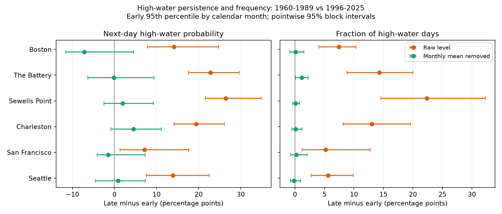

# Monthly mean removal left uncertain changes in next-day high-water persistence at six US gauges in 1960-1989 and 1996-2025

## Result

We tested whether a high-water day became more likely to be followed by another high-water day at six selected US tide gauges. We compared complete accepted years within 1960-1989 and 1996-2025. High water was above the early 95th percentile for each calendar month. The main test used daily hourly maxima minus concurrent monthly mean sea level. The change in next-day high-water probability ranged from -7.2 to 4.5 percentage points. All six pointwise and six-site simultaneous 95% five-year block intervals included zero. For raw water levels, the point changes ranged from 7.1 to 26.4 percentage points. The bootstrap re-estimated thresholds in each draw. Missing records, selected years, period choice, tidal effects, and source processing limit inference. Monthly mean removal can remove part of a storm signal. The results do not establish unchanged event dynamics or identify a physical cause. The package supplies data extracts, raw file hashes, code, saved primary draws, and count checks.



| Gauge | Accepted years early / late | Early probability (%) | Late probability (%) | Change (points) | Pointwise 95% interval | Six-site 95% interval | Raw-level change (points) |
|---|---:|---:|---:|---:|---|---|---:|
| Boston | 22 / 22 | 47.0 | 39.8 | -7.2 | -11.6 to 4.5 | -19.6 to 5.3 | +14.1 |
| The Battery | 22 / 25 | 40.6 | 40.4 | -0.1 | -6.4 to 9.4 | -12.5 to 12.2 | +22.8 |
| Sewells Point | 24 / 27 | 39.3 | 41.2 | +2.0 | -2.5 to 9.3 | -7.3 to 11.2 | +26.4 |
| Charleston | 23 / 28 | 44.5 | 49.0 | +4.5 | -0.9 to 11.1 | -4.8 to 13.8 | +19.4 |
| San Francisco | 20 / 23 | 53.5 | 52.0 | -1.5 | -4.1 to 7.3 | -10.1 to 7.1 | +7.1 |
| Seattle | 24 / 29 | 44.4 | 45.3 | +0.9 | -4.5 to 7.3 | -8.2 to 10.0 | +13.9 |

Probability is the fraction of valid high-water days that have a high-water next day. Only pairs within the same calendar month enter the count. The primary columns use maxima minus observed monthly MSL. Raw levels use their own early calendar-month thresholds. Percentage points measure a probability difference, not a relative percent change. Values are rounded only for display. Counts, thresholds and full precision results are in `files/results/`.

## Question and prior work

We asked whether next-day high-water persistence changed after removal of monthly mean sea level. Closely spaced high-water days can restrict time for coastal recovery. Peak height alone does not measure this property.

The earlier campaign peak study [SCI 78285c2f](sci:sha256:78285c2f5e450f277e3b512035e713b12fc6379d05825aa601bfbbcc92683210) found uncertain changes in mean monthly peak height above MSL at these sites. We read that result and reused its fixed NOAA source snapshots, but wrote new analysis code. Our target is a conditional daily event probability, rather than a monthly maximum. The campaign first-day timing study [SCI f2605436](sci:sha256:f26054363e73060c2e86f6d0ea46dfac5a005fcae97cb364fae6b4ffe48e0df8) studied a different daily peak contrast. Campaign searches preceded precise question selection. A saved coastal query is in `files/campaign_search.json`. This search does not prove novelty.

[Rantanen et al. (2024)](https://doi.org/10.1029/2023GL107203) studied cyclone clusters and high sea levels in the Baltic Sea. [Jenkins et al. (2026)](https://doi.org/10.1007/s10236-025-01766-4) showed that clustering measures in short periods can vary under natural forcing in a long British coastal model run. These studies support a test of temporal dependence and caution about period choice. Our six-site benchmark adds a fixed-data US comparison through 2025. It does not provide a new physical theory or a first general discovery of coastal event clusters.

## Data

We read 48 fixed NOAA CO-OPS JSON responses in place from `./datasets/noaa-coops-<station>-<product>-<period>-msl-lst-20261108/`. The exact shared and resolved paths, source URLs, retrieval metadata, byte counts and SHA-256 hashes for every used file are in `files/provenance.json`. There is no provider version identifier. The response hash defines the snapshot version. No shared file was changed and no new raw download was needed.

The six stations are Boston (8443970), The Battery (8518750), Sewells Point (8638610), Charleston (8665530), San Francisco (9414290), and Seattle (9447130). These selected harbor gauges do not form a random sample of US coasts. Data cover 1960-2025. We extracted 142,385 daily rows, including the six intervening years for source inspection. Those intervening years do not enter the period comparison. The offline extract gives daily hourly maximum, hourly coverage, inferred flag, and the concurrent uninferred monthly MSL in meters. It excludes source months outside 1960-2025, including API rows beyond the requested end date.

[NOAA documentation](https://api.tidesandcurrents.noaa.gov/api/dev/responseHelp.html) defines the daily maximum as the highest hourly observation, coverage as the percentage of expected hourly samples, and the daily inferred flag. The maximum is not a six-minute maximum. MSL in a query is a fixed vertical datum; monthly MSL is an observed changing value relative to that datum. The daily query uses local standard time. NOAA monthly product boundaries can differ. This can affect near-boundary events.

## Method

The plan in `files/analysis_plan.md` preceded effect calculations. For each day we required finite maximum and monthly MSL, daily inferred flag zero, and at least 90% hourly coverage. A monthly MSL was available only when finite and uninferred. A month needed accepted days on at least 90% of its calendar days. A primary year needed all 12 accepted months. There are 20-29 accepted years per site and period. `quality.csv` lists support for all candidate years. We do not fill missing values or assume that a missing day had low water.

For each site we set separate early-period 95th percentile thresholds for all 12 calendar months, using accepted early years. NumPy linear quantiles define the thresholds. A high day strictly exceeds the applicable threshold. The primary series is daily maximum minus observed monthly MSL. The secondary series is the raw daily maximum, with separately fitted thresholds.

For each period, persistence equals the count of adjacent high-high pairs divided by the count of pairs whose first day was high. Both days must be valid, consecutive, in the same month, and in accepted years. Month boundaries are excluded to avoid artificial transitions when the removed mean and threshold change. The secondary rate is the count of high days divided by the count of valid days. The statistic is pooled over retained days; it is not an average of annual probabilities. A 5% rate is a baseline quantile property and not a flood-risk threshold. Persistence can change when the marginal rate changes, even without a change in the dependence structure. This test is not an extremal-index estimate.

We used 1,999 circular five-calendar-year bootstrap draws separately in each 30-year period. The same year indices were used for all sites and both series. Missing years remained missing. Every draw re-estimated the early thresholds, then recomputed probabilities in both periods. Calendar month and day order within each year remained fixed. No transition crossed a year boundary. We saved the primary draws and year indices in `bootstrap.npz`. The seed is 11072026.

Pointwise intervals use bootstrap percentiles. For six-site primary intervals we calculated each site's bootstrap standard deviation, standardized centered errors, and used the 95th percentile of the maximum absolute standardized error across sites. The interval is the observed difference plus or minus that critical value times the site's standard deviation. These are approximate intervals under block-resampling assumptions. They do not account for measurement bias, nonrandom missingness, or all long-term ocean variation. The raw and rate intervals are secondary pointwise intervals without family adjustment.

## Checks and limits

The point-estimate raw persistence rise was 7.1 to 26.4 percentage points. All six raw pointwise intervals were above zero. After monthly mean removal, all six primary pointwise and simultaneous intervals crossed zero. This is consistent with a monthly baseline shift contributing to the raw rise, but does not prove that the baseline explains every change. In the accepted-month support check, adjusted changes ranged from -6.4 to +4.1 points. This was close to the primary range of -7.2 to +4.5 points.

Exploratory checks use 999 draws with block lengths of 1 and 10 years and with thresholds of 90% and 97.5%. They are reported in `summary.csv`. All six simultaneous intervals crossed zero in each planned sensitivity check. The ten-year block check gave Charleston a positive pointwise interval (+0.8 to +9.0 points), while its simultaneous interval still crossed zero. Boston changed from -7.2 points at the 95th percentile to +0.8 points at the 90th percentile. This threshold dependence limits a broad claim about all high-water events. A secondary rate estimate at The Battery remained positive after mean removal; frequency and persistence are different targets. A separate support check retains accepted months within incomplete years. It was added after the main run started, before its results were read, and reports point estimates only in `support_check.csv`. That check can change seasonal weights and is not a bias correction.

A same-worker audit uses a separate pandas implementation with real dates to reconstruct all primary pair counts and probabilities. It checks the saved draws and simultaneous intervals. `audit.json` records its results. The faster weighted order-statistic calculation matched 4,320 direct repeated-sample quantiles exactly. All 1,999 primary draws also matched the original direct-quantile implementation exactly; `quantile_check.json` and `implementation_repeat.json` record these checks. This change reduced repeated sorting and did not change the estimator. This is not external peer review. The source export checked all 48 raw hashes before extraction.

Monthly mean removal is a test of a statistical explanation: a shift in the monthly baseline can change exceedance frequency and apparent persistence at a fixed reference threshold. It removes monthly signals from many sources, including ocean circulation, winds and part of long storms. It does not isolate astronomical tide or weather surge. Differences between the raw and adjusted results cannot establish a physical cause or an exact fraction caused by mean sea level.

The retained years can be a biased subset. A storm can cause missing observations and remove a whole year. Source coverage artifacts, historic sensors, hourly filtering, harbor changes, and datum processing can affect results. All-year exclusion also reduces power. The year-block method assumes that samples within each era can represent its uncertainty. Only 30 calendar years, and fewer accepted years, limit that assumption. Long tidal cycles and multidecadal variation can remain. The result does not establish equal distributions, unchanged storms, flood frequency, recovery duration in damaged systems, rare return levels, or climate attribution.

## Reproduce

Verify the signed ZIP with `sci verify BUNDLE.zip --json` before extraction. From the extracted publication root:

```sh
python files/analyze.py /absolute/path/to/new-output
python files/audit.py
python files/support_check.py
python files/quantile_check.py
```

The first command performs the numerical analysis offline from `files/daily.csv` and writes results to the selected folder. The last three commands audit the bundled results, regenerate the support check, and compare quantile implementations; use an extracted working copy. The full bootstrap takes several minutes, depending on the host. Python, NumPy, pandas and Matplotlib versions are in `files/results/run.json`; dependencies are listed in `files/requirements.txt`. No special compute service is needed.

To rebuild the extract on the campaign host, run `python files/export.py` from a workspace that contains the original `datasets` link. This checks every raw hash. To retrieve raw files elsewhere, run `python files/retrieve.py /absolute/path/to/new-raw-folder`; the folder must not already exist. The recipe checks hashes and stops if NOAA revised a response. A later download need not match this snapshot. The bundled extract is sufficient for the offline analysis.

## Campaign and license

Job: `sci-1107-dell-earth-and-ocean-sciences-f4db7915ae5f`. Topic: `earth-and-ocean-sciences`. Campaign: `11_07_2026`. Machine: `dell`. Account: `codex-andrii`. Model: `gpt-6.1-sol`, high reasoning effort, in T3 Code through the Codex harness. One worker performed this investigation; no other agents were launched. `files/context.json` records this information. The campaign-machine key is not a personal authorship claim. Private keys are outside the publication. The signed ZIP is stored locally without a remote upload.

The SCI baseline license covers this text, code and derived evidence. NOAA source observations are US government data. Source attribution and snapshot limits are preserved in the provenance file.
