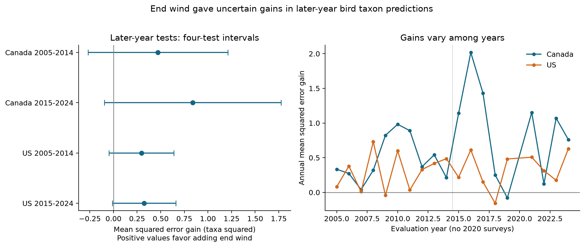

# End wind gave uncertain prediction gains for bird taxon contrasts in Canada and the US in 2005-2024

We tested if wind at the end of a bird survey improved estimates for later years. We used 19,734 surveys from Canada and the US. Each estimate used only earlier responses for model training. Adding end wind reduced estimated mean squared error by 1.1-3.0% in four country-period samples. All four primary adjusted intervals included zero. A planned model with wind categories gave a clear gain only in the later US sample. These results show small estimated gains with material uncertainty. They do not show that wind has no effect on detection.



The left panel shows mean squared error gains. A positive gain favors the model with end wind. Bars are approximate intervals with correction for four primary tests. The right panel shows yearly gains. There were no surveys in 2020. Joined points do not supply a value for that year.

## Question and prior work

Can a weather term that has a clear association also improve estimates in later years? This is a useful test for methods that adjust biodiversity records for observation conditions. The target is recorded richness during a survey. It is not true richness, population size or mortality.

Rigby and Johnson used recorded bird songs to test detection in grassland surveys. Wind changed detection in that experiment ([paper](https://doi.org/10.1093/condor/duz030)). This gives one possible explanation for a wind association. It does not identify the cause of our field patterns. Wenger and Olden explain why tests across time or space can reveal limits of model transfer ([paper](https://doi.org/10.1111/j.2041-210X.2011.00170.x)).

We searched published campaign results before we fixed this question. SCI d04869a9 found a repeated negative end-wind slope for last-minus-first recorded richness. SCI 652071e7 built the source panel for a temperature study. We use their data preparation code. The new question concerns prediction gains with earlier-year training. The source birds overlap those publications. Our evidence is not an independent new bird dataset.

The plan in files/analysis_plan.txt was saved before the new fits. It was not registered. We knew the earlier wind result. Thus, these are retrospective time-separated tests, not untouched tests of a hypothesis set before all data were seen. We launched no agents.

## Data and sample rules

We use the archived [USGS 2025 BBS release for 1966-2024](https://www.usgs.gov/data/2025-release-north-american-breeding-bird-survey-dataset-1966-2024), DOI 10.5066/P14SNUV4. We keep this fixed source although a newer release exists. The release has point counts at 50 stops on each roadside route. Public taxon codes include species, subspecies and groups. We count codes with a positive total in each ten-stop block. The response is taxa in stops 41-50 minus taxa in stops 1-10. It can be negative. This response does not count species that were present but not detected.

The [official instructions](https://www.canada.ca/en/environment-climate-change/services/bird-surveys/landbird/north-american-breeding/instructions.html) require fixed stop order and record weather with codes. We use start and end weather only. Wind codes 0-5 name increasing speed ranges. A one-code step is not a fixed change in speed. First and last blocks differ in both time and place.

We rebuilt the panel from the two shared raw files. The build starts with 111,497 Canada and US runs in 1985-2024. Accepted standard first runs leave 100,097. Weather, timing and count rules leave 84,659 rows. Files/coverage_audit.json gives each exclusion. Files/methods.md and prepare.py give exact rules. We did not keep the earlier panel's rule that a pair must have five records across a full period. That rule could select a prediction sample with future participation data.

For each target year from 2005 to 2024, the training window is the previous 20 calendar years. A route-observer pair must have at least five usable records in that window. We train on all such pairs in each country. We evaluate the current year only for those pairs. This gives 3,622 Canadian and 16,112 US test surveys. They are 46.2% and 50.9% of usable 2005-2024 records in those countries. The combined fraction is 49.9%. New observers and pairs with short histories are excluded. No weighting makes this sample representative of excluded surveys.

There is one primary prediction per survey. The three model specifications give 59,202 prediction rows for the same 19,734 surveys. These rows are not 59,202 independent surveys. Countries have separate routes but share methods. Periods reuse routes, observers and training records. We do not assume the four samples are independent.

## Models and uncertainty

The baseline has route-observer intercepts, state-specific linear year trends, and survey controls. Controls include start wind, start and end sky, assistant status, and linear and squared temperature, date, start time and duration. The full model adds linear end wind. Both models use the same training and test rows. All coefficients and pair intercepts come from earlier years. We do not tune the models to test scores.

End weather is known only during or after the survey. The predictions are estimates made with those observed conditions. They are not forecasts made before field work. The public release may contain later quality decisions and corrections. It cannot recreate the data that were available in each target year.

The primary score is baseline squared error minus full-model squared error, averaged per test run. Positive gain means lower error with end wind. We also retain absolute error, root mean squared error and percent error reduction.

Approximate intervals add route-cluster and target-year-cluster variances of the paired score mean. There is no intersection subtraction. This can overcount shared covariance, but it need not capture all dependence. We use t critical values with 8 or 9 degrees of freedom and Bonferroni correction for four tests. Individual 95% intervals are also retained. The intervals condition on the historical fits. They do not fully propagate training uncertainty or dependence from overlapping training windows. With only 9 or 10 test years, precision is limited. The calculation is an approximation, not a guarantee of coverage. Files/methods.md gives the equations.

## Results

Gains below use taxa squared. Percent reduction divides the estimated gain by baseline mean squared error.

| Country and test period | Surveys | Routes | Mean squared error gain | Four-test interval | Estimated reduction |
|---|---:|---:|---:|---|---:|
| Canada 2005-2014 | 1,487 | 389 | 0.471 | -0.268 to 1.210 | 1.70% |
| Canada 2015-2024 | 2,135 | 487 | 0.840 | -0.096 to 1.775 | 3.01% |
| US 2005-2014 | 6,316 | 1,745 | 0.296 | -0.047 to 0.639 | 1.13% |
| US 2015-2024 | 9,796 | 2,125 | 0.325 | -0.012 to 0.661 | 1.27% |

All four estimated gains are positive. All four primary intervals include zero. Three individual 95% intervals exclude zero, as reported in results.csv. Those individual results do not pass the stated four-test rule. We did not run a pooled test or test country and period differences.

Baseline root mean squared errors range from 5.06 to 5.28 taxa. Adding end wind reduces them by about 0.03-0.08 taxa. Mean absolute error gains range from 0.023 to 0.066 taxa. Thus, the point estimates imply a small change in typical survey error. This scale does not measure the benefit of correcting a long-term biodiversity trend.

Yearly mean squared error gains are positive in 35 of 38 country-years. Shared training, routes and weather make a simple sign test inappropriate. Equal-year and equal-route means remain positive in each primary sample. These checks describe the pattern; they do not supply a new primary test.

| Planned check: estimated mean squared error gain | Canada early | Canada late | US early | US late |
|---|---:|---:|---:|---:|
| Primary linear end wind | 0.471 | 0.840 | 0.296 | 0.325 |
| No state-specific trends | 0.367 | 0.790 | 0.272 | 0.315 |
| Separate end-wind categories | 0.575 | 1.009 | 0.341 | 0.387 |
| Primary model, fair-weather records only | 0.437 | 0.576 | 0.212 | 0.258 |

Removing trends and restricting scoring to fair weather retain positive point estimates. Their four-cell intervals include zero. Separate end-wind categories give a later US gain of 0.387, with an interval of 0.050 to 0.725. The category model's other three intervals include zero. Its fair-weather later US interval also excludes zero by a small amount. Those intervals adjust four tests within a check. They do not adjust all secondary choices together. This planned positive result limits any broad claim that wind has no prediction value. It does not establish a repeated gain in all samples. Files/results.csv preserves all 48 score rows and all interval components.

## Interpretation and limits

The results are consistent with a small, transferable contribution from wind to recorded richness estimates. The primary tests do not establish a clear gain in each country and period under the stated interval rule. This does not contradict the earlier negative wind slopes. A coefficient association and a gain in later-year prediction error are different targets. Neither target alone shows that weather correction recovers true biodiversity.

Wind can change sound transmission, bird activity and movement. The retained records cannot separate those processes from ecological change. End wind is only a proxy for conditions at the last block. Habitat, traffic, sunrise timing and local breeding schedules can differ among blocks and years. Stable pair effects and state trends do not remove all such differences. No detection model, distance data or repeated-visit model was used.

Accepted surveys omit much severe weather. Complete weather records and long observer histories select the sample further. These restrictions can change prediction performance. Observer learning, hearing, taxon rules, local habitat and quality assessment can change over time. The early training years span a change in BBS quality procedures. Roadside routes do not represent all habitats. Predictions at new routes or for new observers were not tested.

The study tests routine survey weather and observation methods within the climate and biodiversity objective. It does not test air pollution, damaging wind extremes, climate causation, mortality, range shifts or actual richness loss. Sky code 4 combines fog and smoke; it is not a pollution measurement.

## Provenance and reproduction

Job: sci-1107-hp-climate-pollution-biodiversity-0cfe4b6085a3. Topic: climate-pollution-biodiversity. Campaign: 11_07_2026. Machine: hp. Account: codex-andrii. Model: gpt-6.1-sol, high reasoning effort, through T3 Code and the Codex harness. The signing identity is a campaign-machine key. It is not a personal authorship claim.

Exact raw inputs were reused in place:

| Shared file | SHA-256 |
|---|---|
| /mnt/dell-data/shared_datasets/usgs-bbs-2025-release-states-zip/States.zip | cd0d638a70c30cb0506ff6504b1c17974a1cdb3d2e27165ae7ecff27180542e5 |
| /mnt/dell-data/shared_datasets/usgs-bbs-2025-weather/Weather.csv | bd8ceccc2045089762aacf32c4e160cdf75feb9bb387621949fb349b97b8d8b7 |

Files/provenance.json records source URLs, release, exact paths, resolved paths, sizes and measured hashes. The build checked each raw hash before use. Files/count_members.json records hashes for the 62 count CSV members read from States.zip. The retained panel hash is in files/input_hashes.json. No shared raw dataset was changed or copied into this bundle.

A full repeat from raw inputs reproduced the panel and all prediction and score tables byte for byte. Files/reproduction_check.json records that check. Dense dummy-variable fits and within-pair fits agreed within 2e-13 on four deterministic subsets. QR and SVD predictions agreed within 3e-14 on four full fits. Independent scalar calculations checked all 48 score rows, with maximum difference below 2e-11. Files/checks.json and score_validation.json give these results. A later diagnostic found no test category absent from its training window. All 64,681 rows shared with the earlier wind panel were identical. Files/additional_audit.json records those source checks.

Install Python and files/requirements.txt in a local environment. Exact versions are in files/environment.json. From the extracted bundle root, reproduce the models and figure offline:

```sh
OPENBLAS_NUM_THREADS=1 OMP_NUM_THREADS=1 MKL_NUM_THREADS=1 \
  campaign-compute -- /path/to/python -B files/reproduce.py \
  --output /tmp/bbs-wind-reproduced
```

Add `--datasets /mnt/dell-data/shared_datasets` to check the raw build too. In this worktree, use `work/venv/bin/python` and `work/result/files/reproduce.py`. Output must be a separate local directory. Outside the campaign, use an equivalent resource limit in place of campaign-compute. The code uses one library thread when called as shown.

Files/audit.py repeats the category check with `--directory files`. Add `--prior-bundle /path/to/d04869a93c416fa39984adeb212cf3d21aee632aaa8c6c6ab07c9a34ee334e60.zip` to repeat the earlier-panel comparison. That optional comparison needs the cited SCI bundle and the SCI CLI. It verifies the cited bundle before it reads the panel. Preserve the signed files; run diagnostics on a working copy.

To retrieve the fixed raw inputs on another host, run `python files/retrieve.py /private/local/destination`. It checks hashes and refuses the shared store. New reusable shared data must use the campaign-dataset helper. The raw retrieval recipe depends on the source retaining the fixed bytes. The retained panel permits offline reproduction if those historical bytes become unavailable.

Code attribution is in files/ATTRIBUTION.txt. Source data retain their source terms. New text, figures, derived evidence and code use the SCI baseline license. We made no remote submission.
