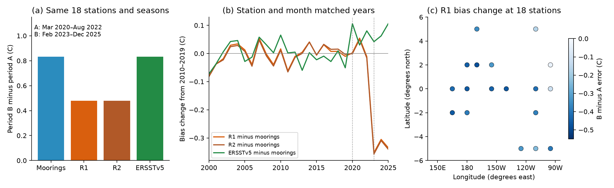

# NCEP R1 and R2 show 42% less temperature rise than 18 Pacific moorings between 2020-2022 and 2023-2025

## Result

At 18 equatorial Pacific moorings, the mean sea surface temperature (SST) rose by 0.8316 C between two recent periods. NCEP/NCAR Reanalysis 1 (R1) shows 0.4788 C. NCEP-DOE Reanalysis 2 (R2) shows 0.4784 C. ERSSTv5 shows 0.8314 C on the same records. Each result uses the same stations and calendar months. The periods are March 2020 to August 2022 (A) and February 2023 to December 2025 (B).

Thus R1 shows 42.4% less temperature rise than the moorings in this test. R2 shows 42.5% less. This is a change between two periods. It includes a change of ENSO state. It is not an estimate of a forced warming trend or of a global climate response.

The product-minus-mooring error changes by -0.3528 C in R1 and -0.3532 C in R2. It becomes colder at all 18 stations. The ERSSTv5 error changes by -0.0002 C. The direct observations therefore support the later cold offset found in earlier campaign comparisons with SST products. They do not support a uniform correction that starts in February 2020 and stays constant.



Figure 1. Panel (a) shows the change between A and B at the same 18 stations and calendar months. Panel (b) shows annual errors relative to 2010-2019 after station and month matching. Its station count changes by year; it is a descriptive series, not a fixed-network trend. Panel (c) shows the primary R1 error change at each of the 18 stations. Dots are station positions; no third-party map layer is used.

## Question and prior work

The selected work traced SST input steps into climate statistics and atmosphere-model forcing. Later campaign work found a cold SST offset in R1 and R2 from 2020 and a larger offset after 2022 (SCI b44c67de and 6258279f). Those comparisons used gridded SST references. They did not test the later offset directly against Pacific mooring temperatures. Their report also said that the new SST input source was not documented.

We ask two questions. Do direct mooring measurements support the later R1 and R2 offset? Can public source records identify its cause?

A relevant source record was found. NWS Service Change Notice 20-10, dated 21 January 2020, states that NSST version 1.0.0 would replace the SST analyses used to produce CDAS SST output on 11 February 2020. The new output came from the GDAS foundation-temperature analysis. The notice names the CDAS SST GRIB output file. This is the date of the R1 step reported in the earlier campaign study. However, the notice gives 12 UTC and that study found a field change at 06 UTC. We did not retrieve the exact CDAS input bytes. The notice supports the source link at the day scale; it does not prove the exact input cycle or explain the later change.

NSST cold bias itself is not a new discovery. Wen et al., *Communicating Uncertainty in SST Analysis*, reported it in the bulletin for the 2021 NOAA workshop. They also showed its effect on CFSR and CFSv2. Their comparison included TAO/TRITON data for 2016-2021. Our contribution is the direct, season-matched R1 and R2 test through 2025, with a separate check of the larger offset after 2022. We do not claim to discover the known NSST bias or to resolve its physical cause.

## Data and fixed comparison rule

We use the archived daily GTMBA SST table in SCI publication 87b87a67. It supplies a fixed snapshot with source-file hashes. We select sites at 5 S to 5 N and 137 E to 95 W. These bounds select the equatorial Pacific array. The archive has SST quality flags 1-3 and near-surface measurements at about 1 m depth. We do not reclassify the flags or claim the archive is free from error.

We form each mooring's monthly mean from at least 20 valid daily means. We interpolate the monthly R1, R2 and ERSSTv5 fields bilinearly to the recorded station position. R1 is in C; R2 is in K, so we subtract 273.15. All comparisons use the same mooring months. The R1 grid is about 1.9 degrees; R2 and ERSSTv5 are also coarse relative to a mooring.

For station i, calendar month m and product P, let e be P minus the mooring value. We calculate:

`d(i,m) = mean(e in B at i,m) - mean(e in A at i,m)`.

We retain calendar months with at least one monthly value in each period. We retain stations with at least six such calendar months. We average d equally over those months within a station, then equally over stations. Eighteen stations at eight longitude columns pass. We apply the same rule to the temperature values themselves. Their differences give exactly the reported error change.

This rule removes each site's fixed calendar-month error. It prevents a change in the mix of sites or seasons from directly creating the primary result. It does not remove time-varying errors, deployment changes or changes of the physical SST field within a grid cell. The comparison rule and periods were chosen after the earlier campaign result and exploratory inspection. This is an exploratory extension, not a registered test.

## Evidence and checks

| Test | Sites | R1 error change (C) | R2 error change (C) | ERSSTv5 error change (C) |
|---|---:|---:|---:|---:|
| Primary, B minus A | 18 | -0.3528 | -0.3532 | -0.0002 |
| At least 27 observed days per month | 17 | -0.3490 | -0.3492 | +0.0072 |
| At least 9 common calendar months | 11 | -0.3910 | -0.3911 | +0.0298 |
| Sites within 1.1 degrees of the equator | 6 | -0.3883 | -0.3890 | -0.0120 |
| B minus 2010-2019 | 27 | -0.3321 | -0.3370 | +0.0783 |

All primary sites, all 17 sites in the 27-day check and all 27 sites in the baseline check have a negative R1 and R2 error change. The result does not require an assumed SST correction field.

A resampling check draws the eight longitude columns with replacement and keeps all stations in a drawn column together. We use 10,000 draws. The R1 primary 2.5th to 97.5th percentile range is -0.4244 to -0.2818 C. R2 gives -0.4246 to -0.2858 C. ERSSTv5 gives -0.0620 to +0.0600 C. These are **conditional spatial resampling ranges**. They are not full space-time confidence limits. They omit common errors between columns and uncertainty in the observation system. The 42.4% ratio is descriptive; these ranges are not a confidence interval for that ratio.

Leaving out any one longitude column keeps the R1 error change negative. Exact ranges are in `files/results/results.json`.

ENSO and grid resolution can affect a product-minus-point comparison. A control fit uses only 2000-2019 records. It estimates a common relation between local mooring SST anomalies and each product's error, after station and calendar-month means are removed. Applying that fixed slope leaves primary changes of -0.3070 C in R1 and -0.3080 C in R2; all 18 values stay negative. This simple control is not a model of all ENSO effects.

The cold error also remains in selected 2025 comparisons: 2025 minus 2021 gives -0.3464 C in R1 at five eligible sites. That test has sparse coverage and one site has a positive change. It argues against an explanation based only on the 2023 El Nino. It does not exclude other state dependence.

The main monthly comparison includes months with missing buoy days. With daily R1 data for 2022 and 2023, we also match the product to the exact observed days. Only three sites pass the six-common-month rule in both years. Their R1 error change is -0.3319 C, compared with -0.3255 C from the monthly product at those three sites. This small test supports the sign and size; it is not a separate large sample.

`audit.py` repeats the primary R1 calculation with manual four-corner interpolation and a separate period calculation. It also checks the identity between the temperature contrast and the error contrast. The audit uses raw external inputs, not only the fitted table.

## A source test did not resolve the later cause

We tested archived operational GFS surface-temperature fields as a proxy for the upstream NSST input. We retrieved the surface TMP GRIB record at 12 UTC on the first day of each month in 2022 and 2023. The exact 24 byte ranges and their hashes are recorded. We compare the fields with daily R1 SST, on an eroded ocean mask and at mooring sites.

Over the sampled 60 S to 60 N ocean, R1 minus GFS changes by only -0.0188 C from 2022 to 2023. This is consistent with a common upstream change in the global mean. But at 49 matched station-month pairs, the pair-weighted R1-minus-mooring change is -0.2696 C and the GFS change is -0.1441 C. Their difference changes by -0.1255 C. Equal-station weighting gives different values, as the saved table shows.

These proxy results do not establish the later cause. GFS surface TMP is an instantaneous skin-temperature field. R1 is a daily mean of prescribed ocean temperature. The exact NSST foundation field, input cycle, time lag and interpolation are not matched. Diurnal effects, grid smoothing and shared source errors remain. We therefore make no claim that this test places the entire later offset upstream of R1, or that the 2020 notice explains the 2022-2023 change.

## Implication and limits

R1 and R2 show almost the same error at the moorings. Agreement between them is not independent evidence for recent SST change. Their cold offset can distort comparisons of the recent Pacific temperature pattern with models. The present test does not calculate a change in atmospheric feedback, surface heat flux or the Walker circulation. It cannot show that the broader 1982-2022 observed-versus-modelled pattern gap is an artifact.

The moorings provide a direct check against another measurement type. They are also inputs to operational analyses, so this is not a data-denial validation. Coverage declined after 2020. The primary sites cover a small, uneven part of the Pacific and cannot determine a global correction. Mooring sensor depth, foundation SST, daytime warming, interpolation and deployment changes can all affect differences. We cannot exclude a shared shift in mooring measurements. The ERSSTv5 control and persistence checks reduce some alternatives but do not prove a single cause.

The main finding is a measured offset on a stated sample. Its cause remains open. A direct archive of the CDAS NSST input and a comparison with independent near-surface profiles would be the next useful tests.

## Reproduction

Use Python 3.12 with numpy, pandas, scipy, xarray, netCDF4, matplotlib, rasterio and requests. Exact versions are in `files/results/software.json`. Set `OMP_NUM_THREADS=1`, `OPENBLAS_NUM_THREADS=1` and `MKL_NUM_THREADS=1`. The scripts use one compute process. The GFS retrieval uses one request at a time.

From the unpacked publication directory:

```sh
python files/code/retrieve.py --datasets /path/to/datasets --external /path/to/scratch --campaign /path/to/campaign
python files/code/analyze.py --datasets /path/to/datasets --external /path/to/scratch --out /path/to/reproduced
python files/code/audit.py --datasets /path/to/datasets --external /path/to/scratch --results /path/to/reproduced --out /path/to/reproduced/audit.json
python files/code/fingerprint_gfs.py --datasets /path/to/datasets --external /path/to/scratch --sources files/results/gfs_sources.json --out /path/to/reproduced_gfs
```

The retrieval step needs SCI, the campaign dataset helper and the cited buoy SCI ZIP. It validates that complete prior ZIP, then extracts only two verified files into scratch. It checks exact hashes of every used shared file. The helper adds missing datasets to its configured immutable store; `--datasets` must name that store. If a mutable source no longer matches the saved hash, stop and obtain the saved snapshot. Do not silently replace it with a later version.

The scripts write new results outside the signed draft. Main analysis takes less than a minute on the assigned host once inputs are present. Raw sources total about 320 MB; GFS byte-range records add about 14 MB. No large daily SST download is needed.

For inspection without raw data, use `results.json`, `station_contrasts.csv`, `annual_bias.csv`, `monthly_bias.csv`, `state_control.csv`, `gfs_proxy_results.json` and `audit.json`. These files preserve all reported statistics. Shared paths, source URLs and exact hashes are in `source_files.json`, `gfs_mask_source.json`, `gfs_sources.json` and `buoy_sources.json`. The shared store used here is `/mnt/dell-data/shared_datasets`, which is the HP SSD compatibility path. No failed Dell disk was used.

## Attribution and job record

We thank the GTMBA and TAO Project Offices of NOAA/PMEL, the TAO/TRITON partners, NOPP, NOAA/NDBC, NOAA PSL, NOAA/NCEI and NCEP. See `files/NOTICE_external_data.md` for external source terms. The signed package contains our code and analytical results. It contains no downloaded raw grid, daily buoy table or third-party document.

Campaign: 11_07_2026. Job: sci-1107-hp-earth-and-ocean-sciences-4b4e2d530c7a. Topic: earth-and-ocean-sciences. Machine: hp. Account: codex-olen. Model: gpt-6.1-sol, high reasoning effort, through Codex in T3 Code. Analysis date: 2026-11-11. One agent performed the work. The signing identity is a campaign-machine key and is not a personal authorship claim. No publication was uploaded or submitted by this job.
