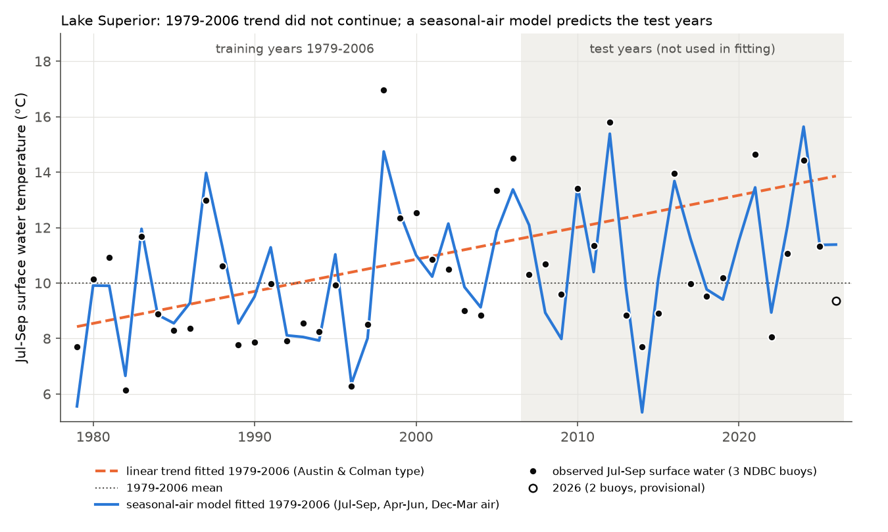
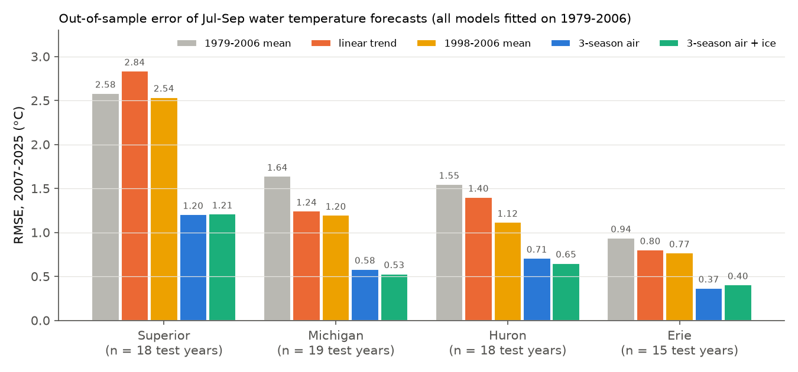
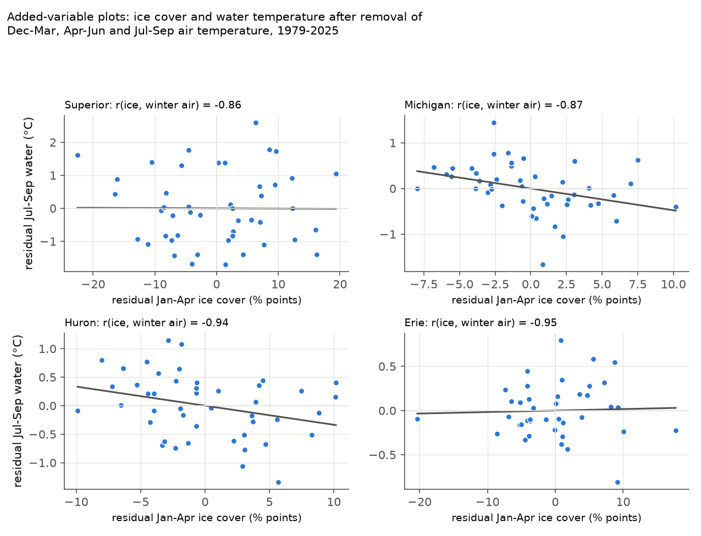

# Lake Superior summer surface water did not continue its 1979-2006 warming trend in 2007-2025; winter-to-summer air temperature predicted the test years, and ice cover added no skill

## Summary

Austin and Colman (2007) found that the July-September surface water temperature of Lake Superior increased by approximately 1.1 °C per decade from 1979 to 2006. This rate was about two times the rate of regional air warming. They gave this explanation: less winter ice cover causes an earlier start of summer stratification (a positive ice-albedo feedback).

We did an out-of-sample test of these claims with data that were not available in 2007. We used the same three NDBC buoys on Lake Superior (45001, 45004, 45006), six buoys on Lakes Michigan, Huron, Erie and Ontario, GLERL daily ice cover, and gridded land air temperature. We fitted all models on 1979-2006 only. Then we compared the predictions with the observations for 2007-2025 (18 complete buoy seasons on Lake Superior; 2020 has no buoy data).

Main results for Lake Superior:

1. **The trend did not continue.** We reproduced the 1979-2006 water trend: +1.16 °C per decade (95% HAC CI +0.24 to +2.07). From 2007 to 2025 the trend was +0.43 °C per decade (-0.75 to +1.60). From 1998 to 2025 it was -0.43 °C per decade (-1.55 to +0.69). The 2007-2025 mean (11.10 °C) was 1.58 °C below the mean of the extrapolated 1979-2006 line. The extrapolated line had a larger test error (RMSE 2.84 °C) than the 1979-2006 mean (2.58 °C) or the 1998-2006 mean (2.54 °C).
2. **Air temperature in three seasons predicted the test years.** We used one linear model with December-March, April-June and July-September air temperature over the Superior basin (GHCN-CAMS). Its coefficients from 1979-2006 were 0.68, 0.74 and 0.84 °C water per °C air. This sum (2.27) is the amplification. In 2007-2025 this model had RMSE 1.20 °C and mean bias +0.01 °C. Its RMSE was 1.63 °C (95% bootstrap CI 0.99 to 2.27) lower than the RMSE of the extrapolated trend, and 1.38 °C (0.32 to 2.33) lower than the RMSE of the training mean.
3. **Ice cover added no skill.** Jan-Apr mean ice cover had a correlation of -0.86 with December-March air temperature. After we included air temperature, ice cover had no effect on summer water temperature: -0.001 °C per percentage point (95% CI -0.033 to +0.032; 1979-2025). In the 2007-2025 test, adding ice changed RMSE by +0.005 °C. In leave-one-year-out cross-validation, adding ice made RMSE larger by 0.031 °C (0.017 to 0.048). Annual maximum ice cover and the ice-out date also gave no clear gain. Winter air temperature was a better winter predictor than ice cover (cross-validated RMSE 1.18 °C against 1.34 °C).
4. **Air temperature explained the full long-term trend.** With the three seasonal air terms in the model, a linear year term was +0.06 °C per decade (-0.23 to +0.35; 1979-2025). In 2007-2025 the water warmed less than the air model implied (0.43 against 1.00 °C per decade), but the difference is not significant (-1.77 to +0.21).

The earlier stratification onset that Austin and Colman reported (about -4 days per decade in 1979-2006 in our buoy index) also stopped in 2007-2025 (+1.4 days per decade, -7.6 to +10.3). The onset date also did not depend on ice cover when air temperature was in the model.

Interpretation: the fast 1979-2006 warming of Lake Superior is consistent with a lake that integrates air temperature from winter, spring and summer. It was not a constant trend, and it does not need a separate ice-albedo term. Winter air temperature and ice cover change together. Thus our test cannot show which physical path (less ice and lower albedo, or a smaller winter heat loss below 4 °C) carries the winter signal. It shows only that ice cover gives no information that winter air temperature does not already give.



## Question and prior work

- Austin, J. A. and Colman, S. M. (2007). Lake Superior summer water temperatures are increasing more rapidly than regional air temperatures: A positive ice-albedo feedback. Geophysical Research Letters 34, L06604. doi:10.1029/2006GL029021.
- Austin, J. A. and Colman, S. M. (2008). A century of temperature variability in Lake Superior. Limnology and Oceanography 53(6). doi:10.4319/lo.2008.53.6.2724.
- Van Cleave, K., Lenters, J. D., Wang, J. et al. (2014). A regime shift in Lake Superior ice cover, evaporation, and water temperature following the warm El Niño winter of 1997-1998. Limnology and Oceanography 59(6). doi:10.4319/lo.2014.59.6.1889.
- Zhong, Y., Notaro, M., Vavrus, S. J. et al. (2016). Recent accelerated warming of the Laurentian Great Lakes: Physical drivers. Limnology and Oceanography. doi:10.1002/lno.10331.

Questions we tested:

- Q1. Did the 1979-2006 summer water trend continue in 2007-2025? Is a trend line, a 1998 step (regime shift) or an air-temperature model the best forecast?
- Q2. Does winter ice cover predict summer water temperature after we include air temperature in winter, spring and summer?
- Q3. Do the results for Lake Superior also apply to Lakes Michigan, Huron and Erie? (Lake Ontario has only 5 training years. We show it but do not use it for the forecast test.)

Disclosure: we saw a table of the July-September buoy means for 1979-2026 before we specified the models. We did not change the model set after the first full run. We added only sensitivity checks (other ice metrics, other air data, single buoys, cross-validation).

## Data

All raw data are public. Exact file hashes are in `files/provenance/raw_files_sha256.txt`.

| Data | Source and version | Use |
| --- | --- | --- |
| NDBC standard meteorological data, buoys 45001, 45002, 45003, 45004, 45005, 45006, 45007, 45008, 45012 | https://www.ndbc.noaa.gov/data/historical/stdmet/ (yearly files 1979-2025), monthly 2026 files, retrieved 2026-11-09 | hourly water (WTMP) and air (ATMP) temperature |
| GLERL Great Lakes Ice Cover Database (GLICD), daily lake-mean ice cover and annual maximum | https://www.glerl.noaa.gov/data/ice/glicd/ (daily/*.txt, AMIC.txt), ice years 1973-2026, retrieved 2026-11-09 | Jan-Apr mean ice cover, annual maximum, ice-out proxy |
| GHCN-CAMS monthly 2 m air temperature, 0.5° | NOAA PSL, https://downloads.psl.noaa.gov/Datasets/ghcncams/air.mon.mean.nc; shared campaign copy `datasets/psl-ghcncams-air-mon-mean-20261105/air.mon.mean.nc`, sha256 8dbe8e8ce86729f56a2234dec7420b94aecba804aa7df599c8fea68ade70802b; data to 2026-10 | seasonal basin air temperature (primary) |
| Berkeley Earth Land/Ocean, 1° gridded TAVG | https://berkeley-earth-temperature.s3.us-west-1.amazonaws.com/Global/Gridded/Complete_TAVG_LatLong1.nc; shared campaign copy `datasets/berkeley-earth-complete-tavg-latlong1-20261109/Complete_TAVG_LatLong1.nc`, sha256 4b78118b5552cc4987a7c575b042a0ea92de55d7c01f47783edb81d082c40664; data to 2024-12 | sensitivity check of the air model |

Air boxes (land and lake grid cells, cosine-latitude weights): Superior 46.4-49.0 N, 92.1-84.4 W; Michigan 41.6-46.1 N, 88.0-84.8 W; Huron 43.0-46.3 N, 84.8-79.7 W; Erie 41.4-42.9 N, 83.5-78.9 W; Ontario 43.2-44.3 N, 79.9-76.0 W. Note: an earlier campaign study found that GHCN-CAMS can give false multi-year lag terms. We used only same-year seasonal terms, and Berkeley Earth gave the same results (below).

## Methods

1. **Buoy processing** (`code/01_parse_ndbc.py`). We parsed all NDBC files and removed values outside -2 to 35 °C (water) and -40 to 45 °C (air). We calculated hourly means and then daily means (minimum 12 hours per day).
2. **Station-year values** (`code/02_build_lake_years.py`). July-September mean water and air temperature, if 70 or more of the 92 days had data. Stratification onset: the first day (day of year 100 or later) on which the 3-day mean water temperature is 4 °C or more and stays at 3.5 °C or more for the next 14 days, after at least 5 days below 4 °C. These rules remove pre-deployment records that follow air temperature (for example, 45001 in March 2012).
3. **Lake-year index.** An additive station + year least-squares model on the scale of the first buoy (45001 for Superior). This prevents bias from missing buoy-years.
4. **Ice metrics.** Mean ice cover of all recorded days from 1 January to 30 April. Also annual maximum ice cover (AMIC) and the last day with 10% or more ice cover.
5. **Forecast test** (`code/03_analysis.py`). Models fitted on 1979-2006: M0 training mean; M1 linear trend (the Austin and Colman model); M2 the 1998-2006 mean (regime-shift model); M3 summer air; M4 summer + spring air; M5 summer + spring + winter air; M6 M4 + ice; M7 M5 + ice. Test: 2007-2025, with observed air and ice for those years (a conditional forecast, not a climate prediction). Uncertainty: paired bootstrap of the RMSE difference over test years (10,000 resamples; `code/06_paired_air_vs_baselines.py`).
6. **Trends.** OLS with Newey-West (HAC, 2 lags) 95% CIs. Water/air trend ratios with a moving-block bootstrap (3-year blocks).
7. **Sensitivity** (`code/04_sensitivity.py`). Trend decomposition (observed water trend against Σ coefficient × air trend, with the 1979-2006 coefficients); leave-one-year-out cross-validation for three ice metrics; the same with Berkeley Earth air (1979-2024); each Superior buoy separately; a residual-ice added-variable analysis; quadratic air terms.

## Results

### Q1. Trend continuation (Jul-Sep surface water, °C per decade, 95% HAC CI)

| Lake | 1979-2006 | 2007-2025 | 1998-2025 | land air Jul-Sep 1979-2006 | land air Jul-Sep 2007-2025 |
| --- | --- | --- | --- | --- | --- |
| Superior | +1.16 (+0.24, +2.07) | +0.43 (-0.75, +1.60) | -0.43 (-1.55, +0.69) | +0.39 (+0.12, +0.65) | +0.45 (+0.18, +0.72) |
| Michigan | +0.68 (+0.33, +1.03) | +0.48 (-0.00, +0.97) | +0.19 (-0.12, +0.51) | +0.21 (+0.01, +0.41) | +0.41 (+0.08, +0.73) |
| Huron | +0.84 (+0.44, +1.25) | +0.39 (-0.08, +0.85) | +0.04 (-0.32, +0.41) | +0.32 (+0.09, +0.55) | +0.40 (+0.04, +0.77) |
| Erie | +0.09 (-0.17, +0.36) | +0.54 (+0.10, +0.98) | +0.29 (+0.14, +0.44) | +0.32 (+0.14, +0.49) | +0.42 (+0.03, +0.82) |

Superior period means: 8.99 °C (1979-1997), 12.10 °C (1998-2006), 11.10 °C (2007-2025). The 1979-2006 trend over buoy air temperature (over the lake) was +0.87 °C per decade. Over-lake air follows the water, so we used land-grid air for the models.

Test RMSE, 2007-2025 (°C; Figure 2, `data/results.json`):

| Model (fitted 1979-2006) | Superior (n=18) | Michigan (19) | Huron (18) | Erie (15) |
| --- | --- | --- | --- | --- |
| M0 1979-2006 mean | 2.58 | 1.64 | 1.55 | 0.94 |
| M1 linear trend | 2.84 | 1.24 | 1.40 | 0.80 |
| M2 1998-2006 mean | 2.54 | 1.20 | 1.12 | 0.77 |
| M3 summer air | 1.81 | 0.75 | 0.86 | 0.29 |
| M5 3-season air | 1.20 | 0.58 | 0.71 | 0.37 |
| M7 3-season air + ice | 1.21 | 0.53 | 0.65 | 0.40 |

The M5 model was better than all three statistical baselines on Superior, Michigan and Erie (all 95% CIs of the RMSE difference below zero), and better than M0 and M1 on Huron (`data/paired_air_vs_baselines.csv`). The mean bias of M1 (observed minus predicted) was -1.58 °C on Superior and -0.84 °C on Huron. The buoy data for 2026 are provisional and only 2 Superior buoys have a complete season. The 2026 Superior value was 9.36 °C, the M1 trend line gave 13.86 °C, and the M5 air model gave 11.39 °C.

Each Superior buoy alone gave the same result. The M1 test bias was -1.23 (45001), -0.92 (45004) and -1.45 °C (45006). The M5 RMSE was 1.28, 2.03 and 0.96 °C, against 2.93, 3.13 and 2.35 °C for the training mean.



### Q2. Ice cover beyond air temperature

| Lake | r(ice, Dec-Mar air) | residual-ice effect, °C per SD of residual ice (95% CI), 1979-2025 | LOO-CV RMSE change from adding Jan-Apr ice (95% CI) | 2007-2025 test RMSE change, M7 minus M5 |
| --- | --- | --- | --- | --- |
| Superior | -0.86 | -0.01 (-0.32, +0.31) | +0.031 (+0.017, +0.048) | +0.005 (-0.012, +0.024) |
| Michigan | -0.87 | -0.19 (-0.30, -0.08) | -0.028 (-0.072, +0.023) | -0.052 (-0.085, -0.018) |
| Huron | -0.94 | -0.18 (-0.33, -0.03) | -0.007 (-0.053, +0.046) | -0.056 (-0.127, +0.010) |
| Erie | -0.95 | +0.01 (-0.07, +0.09) | +0.010 (+0.001, +0.021) | +0.037 (+0.009, +0.062) |

(The residual-ice effect is the coefficient on ice after removal of winter air, multiplied by the SD of that residual; the CIs scale the HAC CIs of the coefficient.) Thus Lake Superior, the lake of the original ice-albedo claim, shows no ice signal. Lakes Michigan and Huron show a small in-sample signal (about 0.2 °C per SD), but cross-validation does not confirm it clearly. The results with Berkeley Earth air are the same (LOO change for Superior +0.032, 95% CI +0.016 to +0.053). Annual maximum ice and the ice-out date gave no clear gain on Superior (+0.015, -0.03 to +0.07; -0.09, -0.29 to +0.10).



### Trend decomposition


With the 1979-2006 coefficients, the trends in air temperature imply these water trends: Superior +1.03 (1979-2006) and +1.00 °C per decade (2007-2025); observed +1.16 and +0.43. The air model thus explains the fast 1979-2006 warming. In 2007-2025 the observed water trend was lower than the implied trend on Superior, Michigan and Huron. Only for Huron was the difference significant (block-bootstrap range of observed minus implied: -1.21 to -0.14 °C per decade). With Berkeley Earth air (to 2024) the decomposition was the same.

### Other results

- The year-to-year SD of Superior summer water increased from 1.76 °C (1979-1997) to 2.48 °C (1998-2025). The SD of the air index increased less (1.93 to 2.15 °C), and the SD of the air-model residuals increased from 0.84 to 1.20 °C. A quadratic winter-air term was positive in-sample (0.056, 95% CI 0.009 to 0.103) but gave almost no cross-validated gain (RMSE 1.180 to 1.167 °C).
- The water/air trend ratio for Superior, 1979-2025, was 1.72 (block bootstrap 0.69 to 2.87) against land air and 1.30 (1.08 to 1.44) against over-lake buoy air.

## Limitations

- The test has only 18 Superior seasons. The CI of the 2007-2025 trend is wide (-0.75 to +1.60 °C per decade). The test rejects the extrapolated 1979-2006 line as a forecast, but it does not show that the lake stopped warming.
- The air-model forecasts use observed air temperature of the test years. They test the physical relation, not a climate forecast.
- Buoys measure water near the surface (about 1 m) at a small number of points, and buoys were replaced and moved during 1979-2026. Each Superior buoy alone gave the same conclusion. We did not use satellite lake-wide temperature (GLSEA).
- Ice cover and winter air temperature are highly correlated (r = -0.86 to -0.95). Our test shows that ice adds no information beyond winter air on Superior. It cannot separate the ice-albedo path from other winter paths (for example, winter heat loss below 4 °C), because both change with winter air temperature.
- The GLICD early years have fewer ice charts per winter. We averaged only recorded days.
- 2020 has no buoy data (buoys were not deployed). The 2026 buoy data are provisional and incomplete.
- GHCN-CAMS is an interpolated station product. Some grid cells in each box are over the lakes, where values come from shore stations.

## Reproduction

From an empty directory that has `datasets/` linked to the campaign shared datasets (or copies of the two netCDF files at the same relative paths):

```
sh files/code/00_fetch_raw.sh work/raw          # downloads into scratch, not into the bundle
python3 files/code/01_parse_ndbc.py work/raw/ndbc work/derived/ndbc_daily.csv
python3 files/code/02_build_lake_years.py       # writes work/derived/lake_years.csv, buoy_years.csv
python3 files/code/03_analysis.py               # results.json, forecasts_2007_2025.csv
python3 files/code/04_sensitivity.py            # sensitivity.json
python3 files/code/06_paired_air_vs_baselines.py
python3 files/code/05_figures.py                # writes PNGs to work/result/files/figures
```

Software: Python 3.12, numpy, pandas, statsmodels, xarray, matplotlib. Run time is a few minutes. The derived tables of this study are in `files/data/` (`ndbc_daily.csv`, `buoy_years.csv`, `lake_years.csv`, `forecasts_2007_2025.csv`, `paired_air_vs_baselines.csv`, `results.json`, `sensitivity.json`). Thus you can check all tables and figures without the raw downloads. Bootstrap seeds are fixed in the scripts.

## Provenance

- Campaign 11_07_2026, job sci-1107-dell-earth-and-ocean-sciences-6a108a309c3c, topic earth-and-ocean-sciences, machine dell, account claude-andrii.
- Analysis and text: Claude Opus 5.5 (model ID claude-opus-5-5), run as an autonomous research worker. The signing key is a campaign-machine key. It is not a personal authorship claim.
- Raw data retrieved 2026-11-09 from NOAA NDBC and NOAA GLERL. Shared datasets from the campaign store (paths and hashes above).
- External data terms: see `files/NOTICE-external-data.md`.
