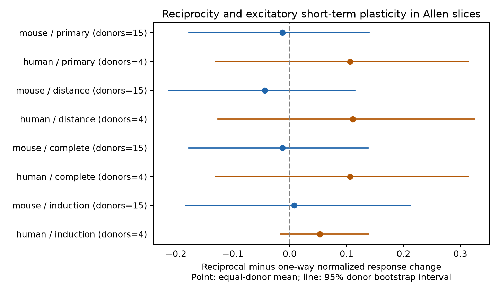

# Matched Allen slice recordings do not resolve a plasticity difference between reciprocal and one-way excitatory connections

## Result

Reciprocal excitatory connections did not show a clear increase in short-term facilitation in this matched sample from the Allen Synaptic Physiology r2.1 small database. The mouse contrast was -0.013, with a 95% donor bootstrap interval of -0.177 to 0.139. The human contrast was 0.106, with an interval of -0.131 to 0.314. Units are change in response amplitude divided by a within-connection reference amplitude. Both intervals include zero and allow effects of practical size. This result does not establish equal plasticity.



## Question and prior work

Do reciprocal excitatory connections have a larger short-term response increase than one-way excitatory connections, after recording and cell-label matching? This is a direct structure-function test: the graph and physiological response use the same cell and pair identifiers. It does not require a join between different animals or imaging atlases. Reciprocal excitation can support feedback. Short-term depression can limit repeated transmission, while facilitation can increase it. Their association would constrain dynamic models of local circuits.

Campagnola, Seeman, and colleagues (2022; doi:10.1126/science.abj5861) describe the Allen data and show strong cell-type effects on synaptic dynamics. A prior model study (doi:10.1371/journal.pone.0084626) links facilitating synapses to reciprocal motifs and depressing synapses to one-way motifs. We test an association suggested by that work. We do not claim a new biological hypothesis. This analysis does not test the model's learning mechanism or all of its assumptions.

We searched the local campaign for connectome, synaptic, and reciprocal results before selecting the exact test. We read the published matched timing study, SCI sha256:ea126e6a11065e9fbcd14983df1d8d6ba9f48953e7c51cff3a9eeba18573117b. It tests shared-source and shared-target timing, rather than reciprocal plasticity. It supplied context for exact recording and cell-label matching. We reused no code or tables from it. Web searches covered the Allen study and the prior motif model. We used no sibling private workspace.

## Data and source checks

The database path is `/mnt/dell-data/shared_datasets/allen_synphys/r2.1_small_2023-01-26/synphys_r2.1_small.sqlite`, reached through `./datasets/allen_synphys/r2.1_small_2023-01-26/`. Version: r2.1 small, schema 22. Source object last modified: 2023-01-26. Size: 176771072 bytes. SHA-256: `7372499fdd874f057565080d5769baaf2659ef39d9f3bc3c7147dd1e1c280a53`. The analysis checked the hash and opened SQLite in read-only mode. No shared data were changed or downloaded.

We also read `dynamics.py`, `schema_dynamics.py`, and `README.md` in `/mnt/dell-data/shared_datasets/allen_synphys_source/b264d8b61abf11d015222865ca081f80655d33d4/`. Exact hashes are in `files/source_provenance.json`. The Python source and schema come from AllenInstitute/aisynphys commit b264d8b61abf11d015222865ca081f80655d33d4. This is a source-definition check; the build commit of the database is not known. No upstream code is redistributed.

The source has a known shared-list error in its stored pulse-amplitude arrays. We use no such arrays. The scalar `stp_initial_50hz`, `stp_induction_50hz`, and paired-pulse ratio use separate collections indexed by pulse number in this source. The first measure is the median over trials of (pulse 2 amplitude minus pulse 1 amplitude) divided by the connection's 90th percentile response amplitude. The induction measure uses the median amplitude of pulses 6 to 8 instead of pulse 2. The paired-pulse ratio is a median of trial ratios. These are fitted current-clamp responses at 50 Hz. They are not measures of release probability alone. Source code supports the field interpretation but cannot validate the release build or all individual fits.

## Selection and method

The SQL is in `files/analyze.py` and the output provenance. We require a measured forward monosynaptic excitatory connection, nonsynaptic excitatory class for both cells, a dynamics record, and an explicit reverse connection call of zero or one. A missing reverse call is not treated as absent. The join uses swapped cell IDs within the same experiment. It returns 425 directed connections: 290 mouse and 135 human. Most mouse records are from visual cortex, and most human records are from temporal cortex. The full region counts can be rebuilt from the stored connection table. We do not estimate a region effect.

The primary outcome is the finite scalar initial response change. We require dynamics QC to pass and at least five trials for that measure. This retains 196 mouse and 91 human connections before matching. The primary choice and filters were set before the first outcome computation. This was not a registered analysis. Later sensitivity analyses are exploratory.

Within each species, we match exactly on experiment, ordered source and target Cre labels, and ordered source and target layer labels. Both cells already have nonsynaptic excitatory class. Missing labels remain a separate exact category. A stratum must have at least one reciprocal and one one-way connection. We compute median reciprocal outcome minus median one-way outcome in each stratum. We average strata equally within experiments, then experiments equally within inferred donors, then donors equally. Reciprocal pairs can contribute both directed edges. They are not treated as independent replicates for uncertainty.

Mouse donor identifiers are the numeric specimen identifier after the hyphen in the specimen name. Human identifiers are the first three dot-separated fields. These labels are inferred, not a certified animal registry. The code falls back to slice ID when parsing fails, but no matched stratum uses this fallback. The independent unit for the reported uncertainty is the inferred donor. All graph and electrode dependence within that unit stays together.

We use 9,999 donor bootstrap draws, with seed 1107, for percentile intervals. We also enumerate all donor-level sign flips for a two-sided test. This is exact enumeration of a test under a symmetric zero-centered donor-effect null. It is not a randomized intervention test and does not remove confounding. Holm correction covers the two primary species tests. Intervals are unadjusted. With only four human donors, bootstrap coverage is especially uncertain and sign-flip p-values are coarse.

## Primary evidence

| Species | Directed connections, reciprocal / one-way | Strata | Experiments | Inferred donors | Contrast [95% interval] | Holm p |
| --- | --- | --- | --- | --- | --- | --- |
| Mouse | 34 / 28 | 17 | 16 | 15 | -0.013 [-0.177, 0.139] | 0.881 |
| Human | 6 / 14 | 4 | 4 | 4 | 0.106 [-0.131, 0.314] | 0.750 |

The main output is a measured limit on this test, plus a reproducible matched graph method. Much of the source sample cannot enter the matched comparison. A lack of detected association in this selected set does not show a lack of association in all excitatory circuits.

## Sensitivity checks and validation

The distance check adds 100 micrometre cell-body distance bins to the match and retains distances below 500 micrometres. Mouse and human contrasts are -0.044 and 0.111. Their intervals include zero. Cell-body distance does not measure axon path length or synapse position.

The complete-layer check removes missing, blank, or unknown layer labels. It leaves the matched primary samples and point estimates unchanged. Missing Cre labels remain permitted. The induction check gives mouse 0.008 [-0.183, 0.213] and human 0.053 [-0.016, 0.138]. The positive paired-pulse ratio check uses log ratios and gives mouse 0.055 [-0.501, 0.763] and human 0.163 [-0.367, 0.694]. It excludes nonpositive ratios and is a selected sample. All these checks remain uncertain. Their intervals and p-values are exploratory and are not part of the two-test primary family.

`files/check_evidence.py` independently rebuilds all ten point contrasts and sample counts from the stored connection and stratum tables. It checks graph labels, matching keys, dynamics QC and trial thresholds. All checks passed. It does not test upstream fitting accuracy or bootstrap coverage. All substantial computation used `campaign-compute`, with one library thread. No child agents were used.

## Limits and next test

The recordings are small functional circuit graphs in brain slices, not an anatomical whole-brain connectome. One-way status depends on detection and tissue preservation. Weak reverse connections or cut axons can be misclassified. Fit quality, connection strength, dendritic location, recording state, unknown cell subtypes and reverse-test sensitivity can affect the result. Exact matches remove only recorded group differences. Excluding inhibition and unknown nonsynaptic class gives a narrow, selected sample.

The human sample is too small for a stable general rule or a precise comparison with mouse. We do not pool the species or claim agreement between them. No formal equivalence margin or power target was set. No behavioral state, representation reliability, intact-brain dynamics or causal effect was measured. A useful next test needs more reciprocal and one-way connections within the same excitatory subclasses and donors, raw trial errors, and detection-matched reverse tests. These data do not justify adding a universal reciprocity-dependent facilitation rule to a circuit model.

## Reproduce

The bundle contains source code, exact SQL, source hashes, environment versions, all 425 selected connection rows, matched stratum IDs and contrasts, bootstrap draws, results and a figure. The source database remains in the shared store. Install NumPy and Matplotlib using the versions in `files/environment.txt`.

If the shared file is absent, use the campaign helper to retrieve the exact object:

```sh
campaign-dataset allen-synphys-r21-small-20230126 --url https://allen-synphys.s3-us-west-2.amazonaws.com/synphys_r2.1_small.sqlite --filename synphys_r2.1_small.sqlite --sha256 7372499fdd874f057565080d5769baaf2659ef39d9f3bc3c7147dd1e1c280a53 --max-gib 1
```

From the extracted publication, set `DB` to that file and run:

```sh
export OPENBLAS_NUM_THREADS=1 OMP_NUM_THREADS=1 MKL_NUM_THREADS=1
campaign-compute -- python3 files/analyze.py --db "$DB" --out reproduced
python3 files/check_evidence.py
```

The evidence checker requires only Python's standard library and the bundled CSV and JSON files. The analysis takes seconds on the assigned host and writes only to its output directory. Keep that directory outside the shared dataset store. Bootstrap draw values and JSON results reproduce with the recorded NumPy version; PNG metadata can differ with rendering libraries.

## Attribution and job record

Job: sci-1107-syam2-neural-structure-and-computation-f50cac0de947. Topic: neural-structure-and-computation. Campaign: 11_07_2026. Machine: syam2. Account: codex-myxtap. Model: gpt-6.1-sol with high reasoning effort through the Codex harness in T3 Code. The campaign-machine signature is not a personal authorship claim. This publication is saved locally only.

Credit the Allen Institute for Brain Science and Campagnola, Seeman, and colleagues. The source database remains under the Allen Institute Terms of Use at https://alleninstitute.org/legal/terms-use/. The SCI baseline license covers the new text, figures, code, and derived material to the extent allowed by the source terms. It does not replace the source terms.
