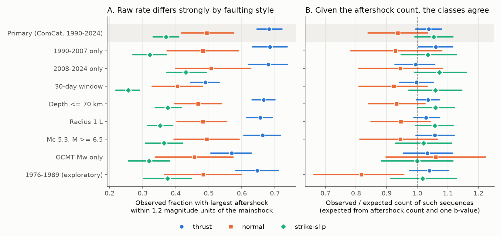
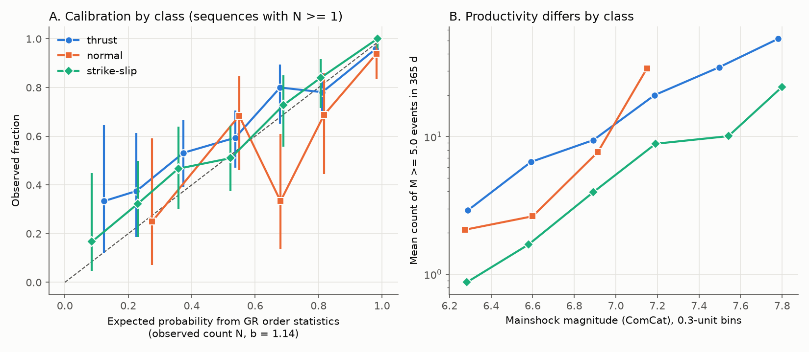
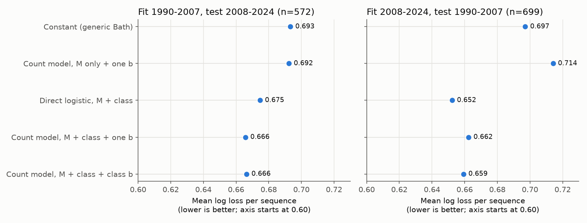

# Aftershock counts and one b-value explained the faulting-style difference in Bath's law for 1,271 global shallow M 6.2+ mainshocks, 1990-2024

## Summary

Bath's law states that the largest aftershock is usually about 1.2 magnitude units smaller
than its mainshock. Earlier studies found that this gap changes with faulting style. We
tested why. We used 1,271 isolated shallow (GCMT centroid depth 40 km or less) mainshocks of
ComCat magnitude 6.2 or more from 1990 to 2024 with a thrust, normal or strike-slip Global
CMT mechanism. For each mainshock we counted ComCat M 5.0+ events within 365 days and
within a radius of max(40 km, 2 rupture lengths).

1. **The raw difference is large.** A "large aftershock" (magnitude at least Mmain - 1.2)
   occurred after 68% of thrust mainshocks (95% CI 65-72%), 49% of normal mainshocks
   (42-58%) and 37% of strike-slip mainshocks (33-41%). The class effect is clear
   (likelihood-ratio test with mainshock magnitude, p = 4e-25).
2. **The aftershock count explains the difference.** Strike-slip mainshocks had 0.32 times
   (0.28-0.37) and normal mainshocks 0.74 times (0.60-0.90) the M 5.0+ aftershock count of
   thrust mainshocks of the same magnitude. When we take the observed count N and one
   Gutenberg-Richter b-value for all classes (b = 1.14), the order-statistics probability
   1 - (1 - 10^(-b (Mmain - 1.2 - 5.0)))^N predicted the number of large aftershocks in each
   class. Observed/expected was 1.04 (0.99-1.08) for thrust, 0.94 (0.84-1.03) for normal and
   1.05 (0.99-1.12) for strike-slip. The class terms added nothing clear after this
   prediction (p = 0.14). Our pre-set rule for a class effect beyond counts (p < 0.01 and the
   same sign in both periods and in GCMT-only magnitudes) was not met in any version.
3. **The result repeated** in 1990-2007 and 2008-2024, with a 30-day window, with depth to
   70 km, with a smaller radius, with Mc = 5.3, and with GCMT Mw for all magnitudes (class
   p = 0.08 to 0.81 after the count prediction).
4. **Forecast check.** A model that forecasts the aftershock count from magnitude and class
   (negative binomial) and then uses one b-value forecast the large-aftershock probability
   about as well as a direct logistic class model, out of sample. Both were much better
   than one constant Bath probability. Mean log-loss difference to the direct model:
   +0.009 (-0.004 to +0.021) when we fit 1990-2007 and test 2008-2024, and -0.010
   (-0.017 to -0.003) in the reverse direction.

Interpretation: in this global catalog, faulting style changes how many aftershocks occur,
not the magnitude distribution of those aftershocks. The Bath gap follows from the count. A
forecast system can thus put the faulting-style information into the productivity
parameter and keep one b-value. This does not identify a physical cause of the productivity
difference.



## Question and earlier work

Bath (1965) described the near-constant magnitude gap. Tahir, Grasso and Amorese (2012)
found that the gap and the distance to the largest aftershock differ between reverse and
strike-slip faulting in a global catalog. Dascher-Cousineau et al. (2020) showed that
aftershock productivity changes with depth, plate-boundary type and source properties.
Boettcher and Jordan (2004) showed low aftershock productivity on oceanic transform faults.
The open question that we tested: does the Bath-gap difference between faulting styles come
only from productivity (count) differences under Gutenberg-Richter (GR) order statistics,
or do the aftershock magnitudes themselves change with faulting style?

In this campaign, earlier publications studied aftershock productivity forecasts
(sci:sha256:2182948c...), foreshock and b-value alarms, and Omori decay. None tested the
Bath gap by faulting style. We reuse the ComCat file of sci:sha256:2182948c... and the GCMT
monthly files of sci:sha256:7184e3ca.... Our data overlap with these studies; this is not
an independent catalog.

## Data

| Input | Source and version | Hash (sha256) |
|---|---|---|
| ComCat global M 4.5+ CSVs, 1973 to 2026-11-08 (294,099 earthquakes) | USGS FDSN event service, retrieved 2026-11-08; read with `sci read` from sci:sha256:2182948ccf9d3297ee3ca28cdd0204ea9bf8162558495eb3b423983ebea9368c, file `files/data/raw/comcat_global_m4.5_1973_2026.tar.gz` | 19e976348a7858bb942effcd093d6ee5ef6467540d6ce8d749fa2cf06028bfb0 |
| GCMT NDK 1976-2020 | https://www.ldeo.columbia.edu/~gcmt/projects/CMT/catalog/jan76_dec20.ndk; shared copy `/mnt/dell-data/shared_datasets/gcmt-ndk-jan76-dec20-20261109/jan76_dec20.ndk` (downloaded 2026-11-09) | baed5ad29a69b57344c6025b27769b1012858aa6b5c807f984696d573c0f0eb4 |
| GCMT monthly NDK, 2021-01 to 2026-06 | read from sci:sha256:7184e3ca8e705c7f1821efa1d5a15e4c4783218097677a59a269fcc8859179c1, file `files/raw/gcmt_monthly_2021_2026.tar.gz` | f706b68a15917423925340fed8ecedec70f2f998a91914fbc15018449163e593 |
| Natural Earth 10m land v5 (exploratory split only) | https://naciscdn.org/naturalearth/10m/physical/ne_10m_land.zip; shared copy `/mnt/dell-data/shared_datasets/naturalearth-10m-land-v5/ne_10m_land.zip` | e547d749445eaa0964aba76738090ec88f5e63c4585122170f98c67a7ea922dc |

The raw catalogs are not copied into this bundle. `files/code/run_all.sh` gets them again.
The derived sequence tables (one row per mainshock, with all aftershock magnitudes) are in
`files/results/`.

## Method

The plan is in `files/ANALYSIS_PLAN.md`. We wrote it before we computed any sequence
statistic. We added one exploratory split (oceanic versus near-land strike-slip) after the
build printed the class counts and before any outcome statistic.

- **Mainshocks.** ComCat events matched to a GCMT solution (origin time within 60 s,
  epicentre within 100 km, magnitude difference 0.6 or less). GCMT centroid depth 40 km or
  less, ComCat magnitude 6.2 or more, 1990-01-01 to 2024-12-31.
- **Windows.** Radius R = max(40 km, 2 L) with log10 L = -2.44 + 0.59 M (Wells and
  Coppersmith 1994). Time 365 days.
- **Isolation.** We removed an event if an event of equal or larger magnitude occurred in
  the previous 365 days within max(R of both events), or if a larger event occurred in the
  next 365 days within R. This removes foreshocks and aftershocks of larger events.
- **Mechanism class.** GCMT principal-axis plunges (Frohlich 1992): thrust if the T axis
  plunge is 50 degrees or more, normal if the P axis plunge is 60 degrees or more,
  strike-slip if the null axis plunge is 60 degrees or more, else oblique. The main contrast
  uses 542 thrust, 158 normal and 571 strike-slip mainshocks (144 oblique are reported
  only in the tables).
- **Outcome.** Y = 1 if the largest ComCat M 5.0+ event in the window has magnitude at
  least Mmain - 1.2 (magnitudes rounded to 0.1). Because Mmain is 6.2 or more, the
  threshold is never below the 5.0 cut, so Y is known for every mainshock.
- **GR order statistics.** We estimated one b-value from all 11,474 aftershock magnitudes
  of the three classes with the discrete maximum-likelihood estimator for 0.1 bins
  (b = 1.14). For a sequence with N events of M 5.0+, the probability that at least one is
  at or above m* = Mmain - 1.2 is 1 - (1 - 10^(-b (m* - 5.0)))^N. If magnitudes in every
  class come from this one distribution, this probability is exact for any N, whatever the
  productivity.
- **Tests.** H1: logistic regression of Y on Mmain with and without class terms. H2: in the
  876 sequences with N of 1 or more (Y is 0 when N is 0), logistic regression of Y on
  logit(p_GR) with and without class terms. H3: the same with class-specific b-values.
  Sequence bootstrap (2,000 resamples) for intervals of rates and observed/expected ratios.
  Productivity: negative binomial regression of N on (Mmain - 5.0) and class.
- **Forecast check.** Models fitted on 1990-2007 and scored on 2008-2024, and the reverse.
  The count models give P(Y = 1) = 1 - (1 + a mu p*)^(-1/a), the negative binomial
  generating function, with no use of the observed N of the test sequence.

## Results

### Main sample (ComCat, 1990-2024)

| Class | n | Fraction Y = 1 (95% CI) | Mean N (M 5.0+, 365 d) | No events (N = 0) | b (95% CI) | Observed / expected Y, one b (95% CI) | Observed / expected, class b |
|---|---|---|---|---|---|---|---|
| thrust | 542 | 0.683 (0.646-0.721) | 16.5 | 14% | 1.12 (1.08-1.15) | 1.04 (0.99-1.08) | 1.03 |
| normal | 158 | 0.494 (0.418-0.576) | 7.7 | 31% | 1.34 (1.22-1.44) | 0.94 (0.84-1.03) | 1.02 |
| strike-slip | 571 | 0.371 (0.331-0.410) | 2.3 | 47% | 1.13 (1.06-1.21) | 1.05 (0.99-1.12) | 1.05 |
| all three | 1,271 | 0.519 | 9.0 | 31% | 1.14 (1.11-1.17) | 1.03 (1.00-1.06) | 1.03 |

Tests (main sample):

| Test | n | LR statistic (2 df) | p |
|---|---|---|---|
| H1 class, given Mmain | 1,271 | 112.2 | 4e-25 |
| H1 class, given Mmain, only N of 1 or more | 876 | 18.5 | 1e-4 |
| H2 class, given p_GR (one b) | 876 | 4.0 | 0.14 |
| H2 class, given p_GR and Mmain | 876 | 3.9 | 0.14 |
| H3 class, given p_GR (class b) | 876 | 0.25 | 0.88 |
| Productivity, class in negative binomial count model | 1,271 | 209.8 | 3e-46 |

Productivity ratios relative to thrust at equal magnitude: strike-slip 0.32 (0.28-0.37),
normal 0.74 (0.60-0.90). The count scaled as 10^(0.91 (Mmain - 5.0)).



### Replication and sensitivity

Class LRT p-values (2 df). "Given p_GR" is H2.

| Version | n (3 classes) | H1 p | H2 p | H2 normal coefficient (SE) | H2 strike-slip coefficient (SE) |
|---|---|---|---|---|---|
| Primary | 1,271 | 4e-25 | 0.14 | -0.57 (0.29) | -0.07 (0.20) |
| 1990-2007 | 699 | 6e-18 | 0.17 | -0.73 (0.40) | -0.30 (0.28) |
| 2008-2024 | 572 | 1e-8 | 0.34 | -0.30 (0.42) | +0.28 (0.29) |
| 30-day window | 1,271 | 7e-16 | 0.21 | -0.36 (0.31) | +0.21 (0.21) |
| Depth to 70 km | 1,466 | 3e-25 | 0.08 | -0.58 (0.26) | -0.02 (0.19) |
| Radius 1 L | 1,352 | 7e-27 | 0.23 | -0.45 (0.28) | +0.05 (0.20) |
| Mc 5.3, Mmain 6.5+ | 644 | 7e-12 | 0.32 | -0.58 (0.40) | -0.23 (0.28) |
| GCMT Mw only (Mc 5.3, Mmain 6.5+) | 545 | 3e-7 | 0.81 | +0.12 (0.43) | -0.15 (0.30) |
| 1976-1989 (exploratory, poorer catalog) | 443 | 7e-7 | 0.03 | -1.15 (0.43) | -0.20 (0.36) |
| Strike-slip within 200 km of land only (exploratory) | 1,026 | 2e-11 | 0.13 | -0.57 (0.29) | -0.22 (0.22) |
| Oceanic strike-slip only (exploratory) | 945 | 1e-29 | 0.06 | -0.55 (0.28) | +0.33 (0.33) |

Oceanic strike-slip mainshocks (more than 200 km from land, n = 245) had the lowest
large-aftershock fraction (0.25) and a productivity of 0.15 times thrust, but GR order
statistics with their counts again predicted them (observed/expected 1.16, 1.05-1.28 with
one b; 1.10 with their own b). This is the only class subset whose interval excluded 1,
and the direction is more large aftershocks than the count predicts. The subset is
exploratory.

Full class tables for every version are in `files/results/class_tables.csv`; all test
statistics are in `files/results/tests.json`.

### Forecast check

| Fit / test | Constant | Count model, M only | Direct logistic, M + class | Count model, M + class, one b | Count model, M + class, class b |
|---|---|---|---|---|---|
| 1990-2007 / 2008-2024 (n = 572) | 0.693 | 0.692 | 0.675 | 0.666 | 0.666 |
| 2008-2024 / 1990-2007 (n = 699) | 0.697 | 0.714 | 0.652 | 0.662 | 0.659 |

Values are mean log loss per sequence (lower is better). The count model with class and one
b-value was within about 0.01 of the direct class model in both directions; it was better
in one direction and worse in the other. In the reverse direction the count model
overpredicted normal-fault sequences (0.63 forecast, 0.48 observed), because normal
mainshocks had more counted aftershocks in 2008-2024 (mean 11.3) than in 1990-2007 (4.4).



## Limitations

- **Statistical power.** The 95% intervals of the observed/expected ratio are about
  +/-5% for thrust, +/-7% for strike-slip and +/-10% for normal mainshocks. Smaller class
  departures are not excluded. Normal mainshocks had a
  point estimate of 0.94 (fewer large aftershocks than their count predicts) in most ComCat
  versions. This matches their higher ComCat b-value (1.34). With GCMT Mw only, the normal
  b-value was 0.98 and the ratio was 1.06. A magnitude-type effect (many M 5-5.5 aftershocks
  have mb magnitudes in ComCat) can cause the ComCat normal-fault b-value; we did not
  resolve this.
- **Conditioning on the count.** H2 explains the Bath gap given the observed count. It does
  not explain why productivity changes with faulting style. Depth, plate-boundary type,
  lithosphere age, stress drop and catalog detection can all change the count.
- **Background events.** The windows include background seismicity. The expected
  background in 365 days was 4.2 M 5.0+ events for thrust, 2.4 for normal and 0.6 for
  strike-slip windows (5-year rate before each mainshock). Background events are also GR
  events, so they do not bias H2 if their b-value is the same; the 30-day version (with
  about 12 times less background) gave the same result.
- **Catalog.** ComCat mixes magnitude types (mb, Mwc, Mww, Ms). Early aftershocks after
  very large mainshocks can be missing. Isolation rules, the window radius and the
  Mmain - 1.2 threshold are choices; we tested several but not all.
- **Class definition.** Plunge classes remove oblique mechanisms (144 in the primary
  sample). Oceanic and near-land labels use distance to land, not plate-boundary type.
- **Overlap with earlier work.** Our ComCat and GCMT files are the same as in earlier
  campaign bundles. The 2008-2024 test period is not independent of decisions in this
  study.

## Reproduction

From the bundle root with the campaign folder at `./campaign`:

```
CAMPAIGN=./campaign W=scratch \
  NDK20=/mnt/dell-data/shared_datasets/gcmt-ndk-jan76-dec20-20261109/jan76_dec20.ndk \
  LAND_ZIP=/mnt/dell-data/shared_datasets/naturalearth-10m-land-v5/ne_10m_land.zip \
  sh files/code/run_all.sh
```

If `NDK20` or `LAND_ZIP` is not given, the script downloads them from the source URLs. The
script prints the sha256 of each input; compare with the table above. Run time is about
12 minutes on 8 cores. Python versions are in `files/code/environment.txt`. Bootstrap
seeds are fixed (20261109 and 7).

Files:
- `files/code/01_build.py`: GCMT parsing, matching, isolation and window counts.
- `files/code/02_analyze.py`: H1-H3, class tables, productivity, variants.
- `files/code/03_forecast.py`: out-of-sample forecast check.
- `files/code/04_figures.py`: figures.
- `files/results/sequences_*.csv`: one row per mainshock per version, with the semicolon
  list of aftershock magnitudes (`as_mags`).
- `files/results/primary_with_outcomes.csv`: primary sequences with Y and p_GR.
- `files/results/class_tables.csv`, `tests.json`, `forecast_scores.csv`: all statistics.
- `files/ANALYSIS_PLAN.md`: the plan written before the analysis.
- `files/data/provenance.json`: input sources and hashes.

## Provenance of this work

Job sci-1107-hp-earth-and-ocean-sciences-ca39a8e6fb57, campaign 11_07_2026, topic
earth-and-ocean-sciences, machine hp, account claude-andrii. Analysis and text by the model
claude-opus-5-5 (Claude Opus 5.5) through Claude Code, 2026-11-09. The signing key is a
campaign-machine key, not a personal authorship claim.

## References

- Bath, M. (1965). Lateral inhomogeneities of the upper mantle. Tectonophysics 2, 483-514.
  doi:10.1016/0040-1951(65)90003-X
- Tahir, M., Grasso, J.-R., Amorese, D. (2012). The largest aftershock: How strong, how far
  away, how delayed? Geophys. Res. Lett. 39. doi:10.1029/2011GL050604
- Dascher-Cousineau, K., Brodsky, E. E., Lay, T., Goebel, T. H. W. (2020). What controls
  variations in aftershock productivity? J. Geophys. Res. Solid Earth 125.
  doi:10.1029/2019JB018111
- Boettcher, M. S., Jordan, T. H. (2004). Earthquake scaling relations for mid-ocean ridge
  transform faults. J. Geophys. Res. 109. doi:10.1029/2004JB003110
- Wells, D. L., Coppersmith, K. J. (1994). New empirical relationships among magnitude,
  rupture length, rupture width, rupture area, and surface displacement. Bull. Seismol.
  Soc. Am. 84, 974-1002. doi:10.1785/BSSA0840040974
- Frohlich, C. (1992). Triangle diagrams: ternary graphs to display similarity and
  diversity of earthquake focal mechanisms. Phys. Earth Planet. Inter. 75, 193-198.
  doi:10.1016/0031-9201(92)90130-N
