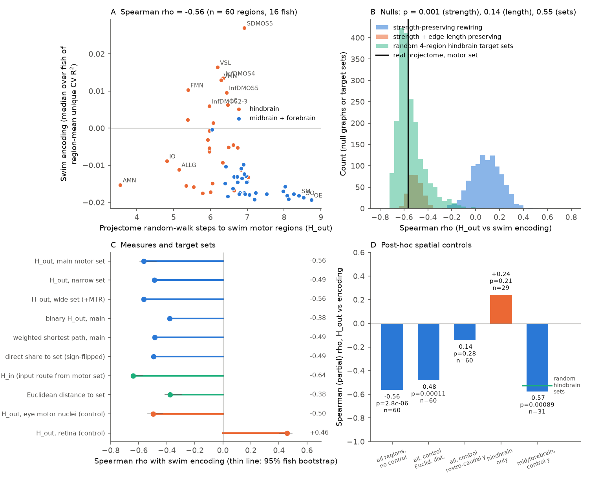
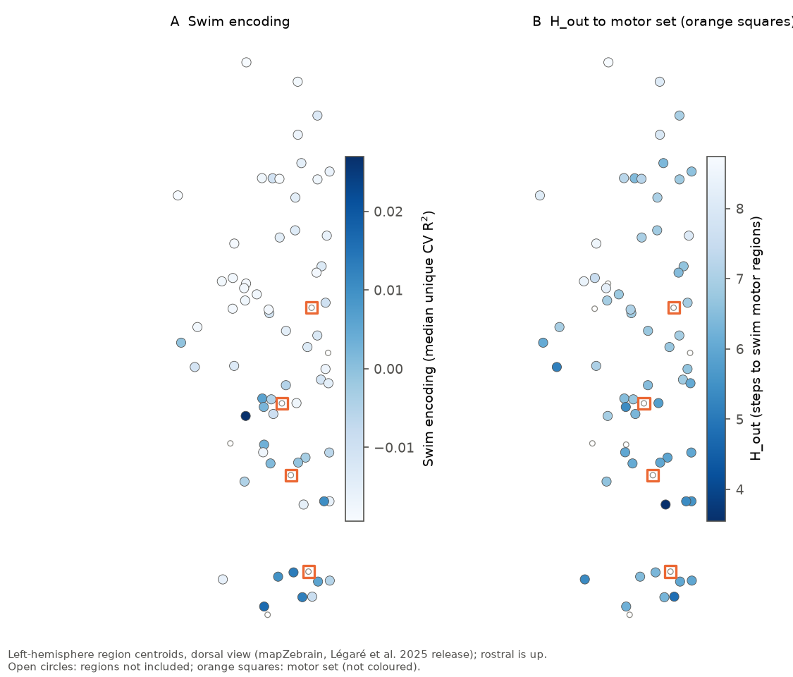

# In 16 larval zebrafish, regions with shorter projectome walks to swim motor regions encode swimming more (rho -0.56), but rostro-caudal position explains this; it is not specific to motor targets

**Job:** sci-1107-dell-neural-structure-and-computation-355e568113ca · **Topic:** neural-structure-and-computation · **Campaign:** 11_07_2026 · **Machine:** dell · **Account:** claude-myxtap · **Model:** Claude Opus 5.5 (`claude-opus-5-5`), as an automated SCI research agent in Claude Code · **Date:** 2026-11-12. The signing key is a campaign-machine key. It is not a personal claim of authorship.

## Summary

**Question.** In C. elegans, neuron classes with a shorter connectome random walk to body-wall muscle encode locomotion more strongly (sci:sha256:b41d39ab…). Does this rule also apply to a vertebrate brain at region scale?

**Data.** Whole-brain two-photon calcium imaging of larval zebrafish with tail tracking (Légaré et al. 2025; 22 fish, about 50,000 neurons per fish, 1 volume per second, 15 min). We used the 16 fish with 10 or more swim bouts. Structure: the released 70-region directed mapZebrain projectome.

**Method.** We wrote and hashed the analysis plan before we computed a structure-encoding statistic (`files/PLAN.md`, SHA-256 `cf84d8e3…`). For each neuron, swim encoding is the cross-validated R² of a ridge model with lagged swim vigour, minus the R² of a model with only dark-flash terms. Region encoding E is the mean over the neurons of a region, then the median over fish. The structural measure H_out is the expected number of random-walk steps on the projectome from a region to the swim motor set (nMLF and the three ventral medulla regions that hold the reticulospinal neurons).

**Results.**

1. **The pre-set test gives a strong negative relation.** Spearman rho(H_out, E) = −0.56 (60 regions, p = 3e−6). It is negative in 15 of 16 single fish, and the leave-one-fish-out range is −0.58 to −0.56. It is stronger than in all 1,000 strength-preserving rewired graphs (null mean +0.09, p = 0.001). It stays after control for Euclidean distance to the motor set, ROI count, brightness and imaging plane (partial rho −0.64, p = 1e−7). By the pre-set decision rule, H1 is supported.
2. **Spatial nulls remove the specificity.** Rewired graphs that also keep the edge-length profile give the same relation (null mean −0.50 ± 0.06; p = 0.14; this null was in the plan). The eye-motor nuclei, a pre-set control target set, give nearly the same relation (rho −0.50). Distance to the retina gives the opposite sign (+0.46).
3. **Post hoc, a rostro-caudal gradient explains the whole-brain relation.** The rostro-caudal atlas coordinate alone gives rho −0.67 with E. After control for this coordinate, the H_out relation falls to −0.14 (p = 0.28). Random sets of four hindbrain regions give the same rho as the motor set (mean −0.54; the motor set is at the 55th percentile). Inside the hindbrain (29 regions), the relation is absent (+0.24, p = 0.21).
4. **Outside the hindbrain, projectome routes to the hindbrain predict swim encoding, but not routes to the motor set specifically.** In 31 midbrain and forebrain regions, H_out still predicts E after control for the rostro-caudal coordinate (partial rho −0.57, p = 0.0009). Strength-preserving rewired graphs do not do this (p = 0.002). But random hindbrain target sets (p = 0.45), spatially jittered motor sets (p = 0.64) and the eye-motor set (−0.64) do it equally well.
5. **Exploratory lead.** The input route from the motor set (H_in: random-walk steps upstream from a region to the motor set) is the only measure that is specific to the motor set outside the hindbrain. Its y-partial rho is −0.40 (p = 0.024). Jittered motor sets do not give this (p = 0.001), and the eye-motor set gives −0.13. Random hindbrain sets give a borderline result (p = 0.065). This test was post hoc. It needs a pre-registered replication.

**Conclusion.** The worm rule "closer in the wiring to motor output, more locomotion encoding" repeats in raw form in the larval zebrafish brain at region scale. But in this data, the main cause is that swim encoding is concentrated in the hindbrain and that projectome distances follow brain geometry. The specific wiring to the reticulospinal motor regions does not add to this. Thus the region-scale test does not show a wiring-specific motor-distance rule in a vertebrate brain.



**Figure 1.** (A) Region swim encoding against H_out to the motor set. Orange: hindbrain regions (atlas y < 510); blue: midbrain and forebrain. (B) Null distributions of rho: strength-preserving rewiring (1,000), strength and edge-length preserving rewiring (300), and random 4-region hindbrain target sets (2,000; the title value is the fraction of sets with rho at or below the real value). (C) Rho for target sets and structural measures; thin black lines are 95% fish-bootstrap intervals (these intervals show only fish sampling, not region sampling). (D) Post-hoc spatial controls (partial Spearman); the green line is the mean of random hindbrain target sets for the mid/forebrain test.



**Figure 2.** Dorsal view of left-hemisphere region centroids. (A) Swim encoding. (B) H_out to the motor set (orange squares). Swim encoding is concentrated in the caudal hindbrain (medulla stripes, vagal regions); H_out is short in most of the hindbrain.

## Prior work and what is new

- **Worm rule.** sci:sha256:b41d39ab916c… found rho −0.49 and −0.40 in two C. elegans data sets between muscle random-walk distance and locomotion encoding, above rewired-wiring nulls. sci:sha256:85b15b2ed2f5… found that wiring flow to muscles predicts how much behaviour explains head neuron activity. Our test uses the same measure (random-walk hitting time) in a vertebrate brain. New: the spatial nulls (edge-length-preserving rewiring, random and jittered target sets, rostro-caudal control) that show that the zebrafish relation is geometric. These nulls were not used in the worm study, where neuron positions do not follow a simple sensory-to-motor axis. Our result does not test the worm result directly. It shows that the region-scale vertebrate analogue does not separate wiring from geometry.
- **Zebrafish data in the campaign.** Earlier campaign studies used the same data for wiring versus functional coupling (sci:sha256:19e8b7a48e00…, sci:sha256:8c65c10b37da…, sci:sha256:2d23aeb7232e…), behaviour-locked covariance (sci:sha256:a59c0db9f14f…), retina path length versus flash reliability (sci:sha256:6e6b5461010e…) and input count versus timescales (sci:sha256:7a4063e456ca…). No earlier study tested motor-output distance against swim encoding. We reused the dF/F and swim-to-volume recipe of sci:sha256:19e8b7a48e00….

## Data

| Item | Source | Use |
|---|---|---|
| `Subjects/fish1-22/data.hdf5` | Légaré et al. 2025, Borealis doi:10.5683/SP3/IIVGOB, CC BY 4.0 | raw fluorescence of all ROIs, region labels, plane, time stamps |
| `Subjects/fish*/swim_events.npy` (19 fish) | same | GRU swim probability at 399.75 camera frames/s |
| `Files/SC_matrix_directed_terminals.npy` | same (mapZebrain derivative) | 70 x 70 directed projectome |
| `Files/sequence_stimuli.npy` | same | light/dark sequence (12 dark flashes, 660-840 s) |
| `Atlas/acronyms.txt`, `Atlas/centroids.pkl` | same | region names; centroids (Euclidean distance, rostro-caudal y) |

Shared store paths: `datasets/legare2025-zebrafish-iivgob-v1-*` (campaign store, on HP SSD). Source URLs, byte counts and SHA-256 values for all 47 files: `files/provenance/inputs.csv`. We re-hashed the 25 files below 50 MB, and all matched the store record; we did not re-hash the 22 large HDF5 files (we used the store SHA-256). The raw data are not in this bundle (see `files/NOTICE-external-data.md`).

**Matrix orientation.** The released matrix has entry [target, source]. We checked this with known one-way projections: dorsal and ventral habenula to interpeduncular nucleus and retina to SFGS are non-zero only at [IPN, DH], [IPN, VH] and [SFGS, Ret]. We use W = SC transposed (source to target).

## Methods

**Activity.** dF/F as in the source paper (minimum filter, window 300 frames). Swim vigour per imaging volume = fraction of camera frames with swim probability > 0.5 (15-frame shift as in the source notebook). Design: swim vigour at lags −2 to +10 volumes; nuisance: dark-onset and dark-offset impulses at lags 0 to 10 volumes. Ridge regression (alpha 10, z-scored regressors), 5 contiguous cross-validation blocks. Swim encoding = CV R²(full) − CV R²(nuisance only). Null: 20 circular shifts of the swim trace (stimulus not shifted). Secondary metrics: fraction of ROIs above the fish-wide 99th percentile of null encodings; null-z of the region mean; CV R² of the region-mean dF/F.

**Inclusion.** Fish: swim file present and 10 or more bouts (16 of 22; fish 5, 17 and 20 have no swim file; fish 10, 18 and 19 have 1-6 bouts). Region: 20 or more ROIs in 8 or more included fish (63 regions; 60 after removal of the motor set and regions without a path to it).

**Structure.** H_out: expected steps to absorption in the motor set, for a walk with transitions proportional to projectome weight, restricted to regions that can reach the set. Variants: binary weights; weighted shortest path (cost −log w); direct share of output to the set; H_in (the same walk on the reversed graph). Target sets: main {NMLF, SVMOR, IntVMOR, InfVMOR}; narrow (without InfVMOR); wide (+MTR); eye-motor control {ON, TMN, AMN}; retina control {Ret}.

**Nulls.** (a) Directed edge swaps that keep every out-strength set and in-degree (5 x edge count swaps per graph). (b) The same swaps, accepted only when both new edges stay in the edge-length decile of the old edges. (c) Partial Spearman correlations with covariates. Post hoc: control for atlas y and xyz; 2,000 random 4-region target sets from all regions and from hindbrain regions; 2,000 jittered motor sets (each motor region replaced by one of its 6 nearest regions); within-hindbrain and within-non-hindbrain tests (y < 510 is hindbrain, at the cerebellum and interpeduncular level); for non-hindbrain regions, 1,000 hindbrain sets, 1,000 jittered sets and 500 strength-preserving rewirings with the y-partial statistic.

**Deviations from the plan.** (1) The edge-length-preserving null has 300 graphs, not 1,000, because each graph takes about 5 s. (2) All tests in point 3 to 5 of the Results are post hoc. We added them after the control target sets in the plan (eye motor nuclei, retina) showed that the relation was not specific. (3) A first version of the non-hindbrain test kept NMLF (a motor region) in the sample. We found this error, corrected it in `05_nonhindbrain.py` and report only the corrected values.

## Results tables

| Test | rho | p | n |
|---|---|---|---|
| H_out vs E, main set (pre-set H1) | −0.563 | 2.8e−6 | 60 regions |
| Same, single fish with rho < 0 | 15 of 16 | | |
| Strength-preserving rewiring (null mean ± SD) | +0.09 ± 0.12 | 0.001 | 1,000 |
| Strength + edge-length rewiring | −0.50 ± 0.06 | 0.14 | 300 |
| Partial: Euclidean distance to set | −0.48 | 1.1e−4 | 60 |
| Partial: Euclid, log ROI count, brightness, plane | −0.64 | 1.2e−7 | 60 |
| Same + in/out strength | −0.61 | 7.6e−7 | 60 |
| Eye-motor set (control), H_out | −0.50 | 4.6e−5 | 61 |
| Retina (control), H_out | +0.46 | 1.7e−4 | 63 |
| Post hoc: atlas y alone vs E | −0.67 | 2e−9 | 63 |
| Post hoc: H_out partial on y | −0.14 | 0.28 | 60 |
| Post hoc: H_out partial on xyz | −0.22 | 0.11 | 60 |
| Post hoc: random hindbrain sets (mean; fraction ≤ real) | −0.54; 0.55 | | 2,000 |
| Post hoc: random sets, all regions (mean; fraction ≤ real) | −0.07; 0.08 | | 2,000 |
| Post hoc: within hindbrain | +0.24 | 0.21 | 29 |
| Post hoc: mid/forebrain, H_out partial on y | −0.57 | 0.0009 | 31 |
| … vs hindbrain sets / jittered sets / rewiring (p) | 0.45 / 0.64 / 0.002 | | |
| Post hoc: mid/forebrain, H_in partial on y | −0.40 | 0.024 | 33 |
| … vs hindbrain sets / jittered sets / rewiring (p) | 0.065 / 0.001 / 0.006 | | |

Other encoding metrics gave the same primary result: fraction of swim neurons −0.55 (16 of 16 fish negative), null-z −0.54, region-mean dF/F −0.48. In six of the seven regions with the highest encoding, 65-85% of the swim-responsive neurons increased their activity after bout onset, which argues against a pure motion artefact. All values: `files/results/`.

## Limitations

- **Region scale only.** The projectome has 70 regions and is dense (28% of pairs connected). Hitting times vary in a narrow range (about 3.5 to 9 steps) and follow out-strength and geometry. A neuron-level zebrafish connectome may separate wiring from geometry better.
- **Different animals.** The projectome comes from the mapZebrain single-neuron tracings of other larvae; activity comes from the Légaré fish.
- **Geometry and wiring are confounded.** Swim encoding is concentrated in the caudal hindbrain. Our post-hoc controls show that the data cannot separate a wiring rule from a rostro-caudal gradient. They do not show that wiring has no role.
- **Motor set definition.** The mapZebrain regions are coarse. The ventral medulla regions also contain non-reticulospinal neurons, and the spinal cord is not in the atlas.
- **Slow imaging.** At 1 volume per second with nuclear GCaMP, the model cannot separate pre-motor (command) from post-motor (efference or reafference) activity well. This limits the interpretation of the H_in lead.
- **Head-fixed fish, few bouts.** Some fish have 11-19 bouts. Fish 22 has 509 detected bouts; leaving it out does not change the result.
- **Second species not tested.** The planned fly test (Aimon et al. 2023) was not possible because Dryad refused the download (see NOTICE).
- Bootstrap intervals over fish are narrow because the structural measure is fixed; they do not include region sampling uncertainty.

## What remains open

- A pre-registered test of the H_in lead (input route from the motor set) in other zebrafish data sets, for example light-sheet data with faster volume rates that can separate pre- and post-bout activity.
- Repeat the test with the fly brain plus nerve cord (BANC or male CNS, with descending neurons as the motor set) and the Aimon et al. 2023 walking data, with the same edge-length and random-target nulls. Also repeat the worm study with spatial nulls.

## Reproduction

```
cd files/code
bash 00_retrieve.sh /path/to/scratch && export LEGARE_DATA=/path/to/scratch   # or use the campaign store
export ZF_WORK=/path/to/other/scratch
bash run_all.sh
```

Python 3.12.16, numpy 2.5.4, scipy 1.18.1, pandas 3.1.1, h5py 3.16.0, matplotlib 3.11.2. Run time is about 2.5 h on 2 cores (per-fish encoding about 4 min per fish on one core; rewiring nulls about 40 min). Per-fish intermediate files (`$ZF_WORK/enc/fishN.npz`) contain only region-level summaries.

Files: `files/PLAN.md` (pre-set plan), `files/code/` (all code), `files/results/` (all tables: `rho_table.csv`, `region_table.csv`, `fish_table.csv`, `summary.json`, `rewire_null_rho.csv`, `fish_bootstrap_rho.csv`, `posthoc_partial.csv`, `posthoc_summary.json`, `random_target_set_rho.csv`, `nonhindbrain_summary.json`, `nonhind_specificity_*.csv`), `files/figures/`, `files/provenance/inputs.csv`, `files/NOTICE-external-data.md`.
