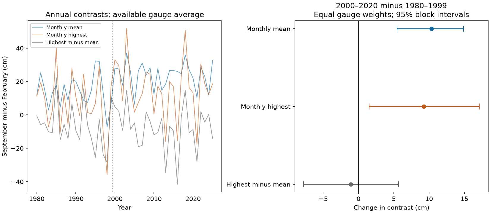

# The September-to-February high-water contrast rose by 9.2 cm at five Mid-Atlantic gauges between 1980-1999 and 2000-2020

We tested whether a reported increase in the seasonal mean sea-level cycle also occurs in monthly highest water. The mean September-minus-February contrast rose by 10.36 cm for monthly mean sea level and by 9.24 cm for monthly highest water. The change in highest water minus monthly mean level was -1.12 cm. Its 95% three-year block interval was -7.78 to +5.67 cm. Thus, the data do not show a clear added seasonal change in the height above the monthly mean. This interval permits changes of practical size. The result does not prove equal change or a physical cause.



## Question and prior work

Seasonal high water can affect coastal flood exposure. Yang and Chen (2025, doi:10.1029/2024GL112273) reported a larger seasonal mean sea-level cycle in 2000-2020 than in 1980-1999 at these five gauges. They used PSMSL data, removed an air-pressure effect, and used an ocean model to study wind forcing. Our test uses NOAA observations without pressure correction. It measures a fixed September-minus-February contrast, not the fitted amplitude or the difference between freely selected peak and low months. It is an extension to monthly highest water, not an exact replication of that study or a test of its wind mechanism. Barroso et al. (doi:10.1029/2023JC020300) studied changes in the annual sea-level cycle at a global set of gauges.

We searched the campaign before the test with terms for earthquakes, oceans, hydrology, seasonal sea level, seasonal amplification, and monthly maxima. We read the verified campaign publication sha256:1a234e05a3537e550a4ca14079e997767c86488f78958e9452d56e7e0a07992b. It studied links between high- and low-water gaps at six other US gauges. We use the idea of a gap from monthly mean level for a different regional and seasonal question. We do not claim a first discovery or a full literature review. This is an exploratory study. The two months, period split, three-year blocks, and listed missing-year and block checks were set in code before numerical results were read. The secular acceleration check was added after those results.

## Data and scope

The input is five shared NOAA CO-OPS monthly_mean JSON snapshots for 1980-2025. The gauges are Sandy Hook (8531680), Atlantic City (8534720), Cape May (8536110), Baltimore (8574680), and Kiptopeke (8632200). The source requests specify metric units, MSL datum, and GMT. NOAA states that the time-zone option does not apply to monthly_mean. Heights are in metres. These are station-relative levels, not levels on a common vertical reference.

`files/provenance.json` records the exact shared path, URL, byte count, acquisition time, and SHA-256 of each file used. The directory pattern is `/mnt/dell-data/shared_datasets/noaa-coops-monthly-STATION-1980-2025-20261109/monthly.json`. These compatibility paths lead to the shared HP SSD store. We read no data from the failed disk. Source versions are the fixed bytes with the listed hashes; the live NOAA API has no immutable release for these queries. We reused these data in place and made no shared downloads or changes.

NOAA defines `highest` as Highest Tide and `MSL` as Mean Sea Level. We call the first field monthly highest water. It is an observed extreme, not an astronomical tide prediction. A gap from monthly mean level contains tidal and weather effects and their interaction. It is not a storm-surge measurement. The record does not give the sampling completeness within each month. We cannot rule out changes in how an extreme was sampled.

For each station and calendar year, we require February and September records, zero `inferred` flags in both, finite mean and highest values, and highest >= mean. All nonzero flags are excluded, including codes beyond 1 whose meaning is not resolved here. Missing months are not filled. `files/paired_years.csv` contains all 230 station-year slots, the retention decision, the reason for rejection, and the four retained heights. There are 219 retained pairs over 1980-2025. The primary sample has 93 early and 101 late pairs. It uses the same years for all three measures within a station. Different stations can have different retained years.

## Method

For station s and year y, let M be the monthly mean and H the monthly highest water. Define C_M = M_September - M_February, C_H = H_September - H_February, and C_G = (H_September - M_September) - (H_February - M_February). Then C_H = C_M + C_G exactly. C_G is the primary added-change target.

For each gauge, we take the mean contrast in 2000-2020 minus its mean in 1980-1999. We then average the five changes with equal gauge weights. This order keeps stations with fewer records from having lower weight. Each year pairs the two months at the same gauge, so a constant datum shift within that year cancels. A rising level during the seven months does not fully cancel.

We use 20,000 circular moving-block bootstrap draws within each period. Each draw selects calendar-year block starts uniformly, wraps at that period's end, joins blocks, and truncates to the period's original number of years. The primary block has three years. The year indices are the same at all gauges. They retain cross-gauge dependence, the paired months, and missingness. We recompute station means, then the regional mean. The 2.5% and 97.5% draw quantiles form approximate 95% intervals. The three components use the same draws, so the decomposition also holds in each draw. We do not treat stations as five independent replicates. The fixed random seed rule and library versions are in `files/environment.json`.

The primary inferential target is the regional gap change. The other component intervals describe this decomposition. Station intervals and checks are descriptive and have no family correction. The bootstrap assumes that short blocks can represent dependence within each period. It does not account for all slow ocean variability, selection across the campaign, or errors in the observations. Percentile intervals are not exact tests. No p value or equivalence test is used.

## Results

All values below are changes in September-minus-February contrast, in cm. Intervals use three-year blocks.

| Measure | Regional change | 95% interval |
|---|---:|---:|
| Monthly mean | 10.36 | 5.48 to 14.89 |
| Monthly highest | 9.24 | 1.51 to 17.12 |
| Highest minus mean | -1.12 | -7.78 to 5.67 |

| Gauge | Early pairs | Late pairs | Mean change | Highest change | Gap change |
|---|---:|---:|---:|---:|---:|
| Sandy Hook | 17 | 20 | 11.01 | 5.67 | -5.34 |
| Atlantic City | 19 | 20 | 9.25 | 7.35 | -1.90 |
| Cape May | 19 | 19 | 9.76 | 4.66 | -5.09 |
| Baltimore | 19 | 21 | 11.12 | 16.58 | 5.46 |
| Kiptopeke | 19 | 21 | 10.65 | 11.94 | 1.29 |

The regional mean-level change is similar in sign at all gauges. Gap point estimates have both signs. Each station gap interval includes zero. Equal changes at different gauges have not been established. The regional result is consistent with a mean-level contribution to the seasonal highest-water change. The decomposition is an identity, so this agreement alone does not identify a cause.

## Checks and limits

- One-, five-, and seven-year block intervals all include zero for the gap change. The one-year interval for monthly highest change is -0.55 to 18.94 cm and includes zero. Thus, a clear increase in monthly highest contrast depends on the uncertainty model. The mean contrast intervals remain above zero.
- Extending the late period through 2025 gives changes of 9.77 cm in mean, 8.50 cm in highest, and -1.27 cm in gap. The three-year gap interval is -7.40 to 5.27 cm. This is a sensitivity test, not independent validation.
- Keeping only years with valid pairs at all five gauges leaves 13 early and 17 late years. Changes are 10.08, 9.01, and -1.07 cm. The gap interval is -9.30 to 7.62 cm.
- Leaving out one gauge at a time gives regional gap changes from -2.76 to -0.06 cm. These point checks do not prove equal site effects.
- A post-result check fits all unflagged monthly MSL records in 1980-2020 to month indicators, linear time, and squared time. The estimated change in the seven-month secular rise averages 0.061 cm across gauges. Subtracting it from both level contrasts would give about 10.30 cm and 9.18 cm. It cancels exactly in the gap. This model-based point check does not remove all slow variability or provide a pressure correction.

February has fewer days than September, so its sampled monthly extreme has fewer opportunities. That fixed difference does not alone explain a between-period change, but changes in sampling or storm occurrence can matter. Monthly maxima do not measure flood-day counts, return levels, or event duration. These five gauges were selected to match the published regional composite. They do not form a random coastal sample. Sea-level pressure, winds, tidal modulation, estuary effects, and vertical land motion were not separately tested. The interval cannot rule out added changes of several cm in the gap. More complete high-frequency records with predicted tides and weather fields are needed to test the physical explanations.

## Reproduction

Use Python 3.12 with NumPy, pandas, and Matplotlib. Exact installed versions are in `files/environment.json`. Run from the unpacked bundle. Write all regenerated results outside the signed folder:

```sh
python files/audit.py
python files/analyze.py --out /tmp/sci-seasonal-repeat
```

This repeats the computation from the fixed paired evidence. `audit.py` independently checks arithmetic with the Python standard library. `files/audit.json` records the pass. `files/repeat_check.json` records exact repeat checks of the numerical output. The primary bootstrap draws are in `files/bootstrap_primary.npz`, in metres, with axes draw, station, measure for the station array. Measure order is mean, highest, gap. Station order is the order listed above. CSV outputs are in cm.

To regenerate the paired evidence from the shared raw data, use:

```sh
python files/analyze.py --raw-root /mnt/dell-data/shared_datasets --out /tmp/sci-seasonal-from-raw
python files/secular_check.py /mnt/dell-data/shared_datasets
```

If the shared data are not available, `python files/retrieve.py /tmp/sci-noaa-raw` retrieves into separate scratch and checks exact source hashes. Then use that scratch root with `--raw-root`. If NOAA revises a response, the retrieval stops. The bundled paired evidence still reproduces the main results, but the old raw response is needed to recheck its extraction and the secular fit. External sources are not copied into the signed bundle.

## Rights and research record

NOAA numeric observations are public-domain US government material. We provide attribution and do not claim ownership of them. The separate notice identifies these external observations. The baseline license applies to our original text, figures, code, and compilation contributions. No article text, outside figure, or restricted database is bundled.

Job: sci-1107-dell-earth-and-ocean-sciences-4df301cbdde7. Topic: earth-and-ocean-sciences. Campaign: 11_07_2026. Machine: dell. Account: codex-andrii. Model: gpt-6.1-sol, high reasoning effort, in T3 Code through the Codex harness. Analysis date: 2026-11-09. No child agents were used. The signature is from the campaign-machine identity, not a personal authorship claim. The bundle is saved locally; this worker does not upload it.
