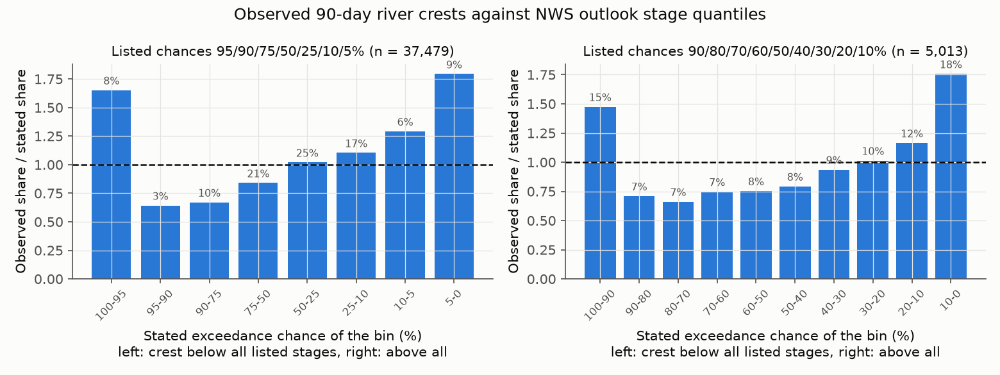
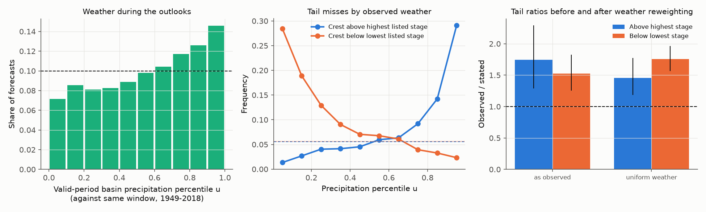
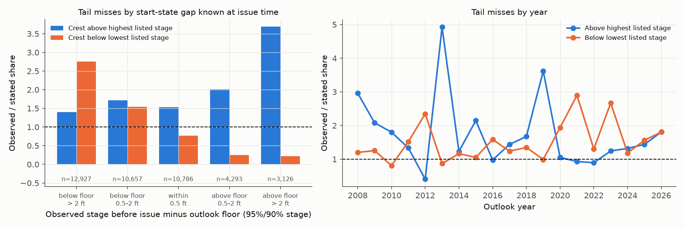

# NWS spring river outlooks put 90-day crests outside their 5-95% stage range 1.6 times as often as stated at 655 US gauges in 2008-2026; wetter weather explains about one third of high misses

**Job** sci-1107-hp-earth-and-ocean-sciences-a4119bb77c01 · **topic** earth-and-ocean-sciences ·
**machine** hp · **model** Claude Opus 5.5 (claude-opus-5-5) in Claude Code · signed with the campaign
machine key (not a personal authorship claim).

## Summary

The National Weather Service (NWS) issues long-range probabilistic river outlooks (product
ESFxxx) each winter and spring. Each outlook gives the stages that the highest river stage in
the next 90 days will exceed with stated chances. Since about 2013, most outlooks also give
the chance of minor, moderate and major flooding. The numbers come from Ensemble Streamflow
Prediction (ESP). ESP runs the River Forecast Center (RFC) model from its current snow, soil and
river states with the weather of each past year. ESP does not sample errors in those states or
in the model. We found no earlier public verification of these issued tables.

We parsed 3,619 outlooks from 41 NWS offices (2006-2026), matched the forecast points to
USGS gauges, and compared each forecast with the observed crest from USGS gauge height. The
plan was written before we joined any outcome (`files/preregistration.md`).

Main results (42,787 forecasts at 655 gauges, 34 offices, 2008-2026; 95% intervals from a
bootstrap over years):

1. **Both tails are too frequent.** For the current table (95/90/75/50/25/10/5%), 8.8%
   (6.2-12.2%) of crests were above the 5% stage and 7.8% (6.3-9.5%) were below the 95% stage.
   The stated values are 5% each. The 5-95% range contained 83.4% (80.5-85.8%) of crests, not 90%.
   For all formats together, the ratio of observed to stated tail frequency was 1.74 (1.31-2.29)
   above the highest listed stage and 1.53 (1.27-1.82) below the lowest listed stage. The older
   decile table (2008-2012) had the same pattern: 17.2% above the 10% stage and 14.1% below the 90% stage.
2. **Weather explains part of the high misses.** We computed the basin precipitation during
   each valid period as a percentile u of the same calendar window in 1949-2018 (about the ESP
   trace years). The weather tended to be wetter than the traces: 42% of forecasts fell in the
   wettest third (first outlook per gauge and year: 39.4%, 31.6-47.4%, so the wet skew is
   marginal). When we reweight the forecasts to a uniform u, the upper ratio falls from 1.74 to
   1.46 (1.19-1.77). Thus about 38% of the upper excess comes from wetter weather; this is a lower
   bound because basin precipitation is only a proxy for the weather that ESP samples. The lower
   ratio rises to 1.76 (1.57-1.96). The ensemble is too narrow also under trace-climate weather.
3. **The other misses concentrate where the start state was far from the outlook.** The
   "floor" is the stage that the outlook gives a 95% (or 90%) chance to exceed. When the
   observed stage on the day before issue was more than 2 ft above the floor (7.5% of
   forecasts), the crest went above the highest listed stage 3.7 times (3.1-4.3) as often as
   stated. When it was more than 2 ft below the floor (31% of forecasts; the outlook expected a
   large rise), the crest stayed below the floor 2.8 times (2.2-3.3) as often as stated. This
   class contains all of the net lower-tail excess. Both gaps are known at issue time.
4. **Flood-category chances were near calibrated in total but over-confident at the ends**
   (37,015 forecasts at 623 gauges, 2013-2026). Observed/expected events for current
   conditions: minor 1.15 (1.00-1.32), moderate 1.07 (0.80-1.37), major 0.78 (0.49-1.14). Minor
   flooding happened in 5.8% of '<5%' forecasts (O/E 2.3, 1.6-3.3). Major flooding happened in
   54.6% of forecasts with a stated chance of 65% or more (O/E 0.61, 0.30-0.82; 91 gauge-years
   in 8 years). Current-condition chances beat normal-condition chances: Brier skill 0.08
   (0.02-0.15) for minor, 0.08 (0.02-0.14) for moderate and 0.05 (-0.03 to 0.12) for major.



## Product and question

NWS offices in the Missouri, Upper Mississippi, Red River of the North, Great Lakes and Ohio
basins issue these outlooks every one to four weeks from January to May. Each table row is one
forecast point. The stage table lists the stages that the maximum stage in the valid period
(normally 90 days) will exceed with chances 95, 90, 75, 50, 25, 10 and 5% (deciles 90..10% in
most offices before 2013). The category table lists the chances to exceed the minor, moderate
and major flood stage under current conditions (CS) and under normal conditions (HS, the same
model run from historical states).

ESP was designed to sample future weather from historical years (Day 1985). The NWS
Hydrologic Ensemble Forecast Service (HEFS; Demargne et al. 2014) adds a post-processor
because ESP has no hydrologic uncertainty. Thus our prior expectation was too-narrow outlooks.
The questions were: (1) how large is the error in the issued tables, and (2) how much of it
comes from weather outside the trace climate, and how much from states or model.

This study extends the campaign series that verifies public hazard products (for example
PTWC tsunami threat categories, NHC wind speed probabilities, Coral Reef Watch outlooks and SPC
hail outlooks). River outlooks were not in that series.

## Data and methods

1. **Outlook text.** All ESF products issued January-May 2006-2026 by 41 offices, from the
   Iowa Environmental Mesonet (IEM) AFOS archive (`files/data/esf_raw_2006_2026.tar.xz`, 856
   office-year files). `03_parse_esf.py` reads the category table and the stage table. It skips
   the low-water (non-exceedance) tables. If a product has no valid period that we can read
   (4.0% of scored rows), we use issue date + 1 to + 90 days. We keep one copy of repeated rows.
2. **Gauge matching.** `04_match_gauges.py` matches the table names (office, river header,
   place) to NWS location identifiers and USGS site numbers in the NOAA HADS USGS site list. IEM
   station names are a second name source. A match needs all place words and a unique best score.
   71% of stage-table rows matched. Most unmatched rows are lock, dam and lake gauges without a
   USGS site number.
3. **Observed crest.** USGS instantaneous gauge height (parameter 00065), reduced to the
   maximum of hourly medians for each day (`05_fetch_usgs_iv.py`). For 124 sites the old NWIS
   service fails (HTTP 503) for any window that contains the spring daylight-saving day. For
   these we request the two sides of that day and lose only that one day
   (`05c_fetch_usgs_iv_split.py`); the OGC API filled 158 site-years before we found this.
   The crest is the highest daily value in the valid period. We score a forecast only if at
   least 80% of its days have 18 or more hours of data.
4. **Datum check.** Outlook stages are NWS stages. We compared the NWS SHEF stage (IEM HADS
   archive) with the USGS gauge height for the same hours on 15-16 March (`07_datum_check.py`),
   first in the first and last outlook year of each gauge. `07b_datum_refine.py` then adds checks
   in the next years when an end year has no data, and bisects over the years when the two end
   offsets differ by more than 0.5 ft. Each gauge-year gets an offset (0 if within 0.5 ft) with a
   status: checked (1,395 gauge-years), bracketed between two agreeing checks (5,886),
   extrapolated before the first or after the last check (1,626), or unknown (464, excluded).
   39 gauges have a nonzero offset in some year. Example: at one North Dakota gauge (BANN8) the
   NWS stage changed from local stage to elevation (+1,428.8 ft) in 2016. A first run with only
   two checks per gauge missed such changes; it gave the same main ratios
   (`files/results/first_run_two_check_datum/`).
5. **Weather percentile (test A5, added after a pilot; see the pre-registration amendment).**
   USGS NLDI upstream basins, monthly nClimGrid precipitation averaged over each basin, and the
   day-weighted total over each valid period. u is its percentile among the same window in
   1949-2018. Reweighting gives each tenth of u the same total weight.
6. **Scoring.** "Above the highest listed stage" means crest > that stage + 0.05 ft; "below the
   lowest listed stage" means crest < that stage - 0.05 ft. Category events use the flood stages
   in the same row. '<5' is scored as 2.5% and '>95' as 97.5%. Intervals: 1,000 resamples of whole
   years (all forecasts of a year together). A site bootstrap is a check.

## Results

### Stage quantiles

| Table format | Forecasts | Gauges | Years | Above highest stage (stated) | Below lowest stage (stated) | Inside range (stated) |
|---|---|---|---|---|---|---|
| 95/90/75/50/25/10/5 | 37,479 | 631 | 2008-2026 | 8.8% (5%), 6.2-12.2 | 7.8% (5%), 6.3-9.5 | 83.4% (90%), 80.5-85.8 |
| 90/80/.../10 deciles | 5,013 | 221 | 2008-2012 | 17.2% (10%), 10.8-24.3 | 14.1% (10%), 10.0-19.3 | 68.7% (80%), 63.5-72.4 |
| 90/75/50/25/10/5 | 294 | 15 | 2008-2012 | 8.5% (5%) | 10.9% (10%) | 80.6% (85%) |

The full histogram (Figure 1) is too high at both ends. In the current format the bin between
the 95% and 90% stages held only 3.2% of crests (stated 5%), while the bin below the 95% stage
held 8.3% and the bin above the 5% stage held 9.0%. The middle bins were near their stated shares.

Sensitivity (all formats, observed/stated ratios, `files/results/primary/sensitivity.csv`):

| Variant | Forecasts | Above ratio | Below ratio |
|---|---|---|---|
| Primary, year bootstrap | 42,787 | 1.74 (1.31-2.29) | 1.53 (1.27-1.82) |
| Primary, site bootstrap | 42,787 | 1.74 (1.60-1.90) | 1.53 (1.36-1.71) |
| Stated valid periods only | 41,079 | 1.77 (1.29-2.39) | 1.52 (1.21-1.83) |
| Tie tolerance 0.25 ft | 42,787 | 1.60 (1.18-2.10) | 1.26 (1.05-1.51) |
| Stage spread >= 1 ft | 42,474 | 1.69 (1.26-2.21) | 1.51 (1.23-1.79) |
| Data coverage >= 95% | 38,981 | 1.71 (1.28-2.27) | 1.51 (1.22-1.83) |
| First outlook per gauge and year | 8,040 | 1.89 (1.33-2.56) | 1.58 (1.36-1.80) |
| Last outlook per gauge and year | 8,040 | 1.67 (1.33-2.02) | 1.50 (1.12-1.89) |
| Checked or bracketed datum years only | 37,927 | 1.74 (1.30-2.34) | 1.51 (1.25-1.79) |
| Gauges with zero offset in all years | 39,997 | 1.72 (1.28-2.25) | 1.48 (1.22-1.77) |

The upper excess is robust. The lower excess becomes smaller (1.26) if we treat crests within
0.25 ft of the floor as inside, so a part of the lower misses is small (0.05-0.25 ft).

By period, the upper ratio was 1.74 in 2008-2012, 2.21 in 2013-2017, 1.78 in 2018-2021 and
1.27 (1.06-1.51) in 2022-2026. The lower ratio was 1.17-1.38 before 2018 and 1.71-1.84 after.
36% of all upper misses came from three years (2013, 2019 and 2008). Ratios by office group
(above / below): Missouri basin offices 1.44 / 2.14; Red River, Upper Mississippi and Great Lakes
offices 1.88 / 1.47; Ohio and Arkansas basin offices 1.96 / 0.71.

### Weather attribution (A5)



Tail misses follow the weather strongly (Figure 3, middle): above-range crests rose from 1.3% in
the driest tenth of u to 29% in the wettest tenth, and below-range crests fell from 29% to 2%. The
distribution of u was skewed wet (mean 0.56; first outlook per gauge-year 0.54, 0.49-0.60). Wet
years 2013, 2019 and 2024 had mean u 0.66-0.79; dry 2012 and 2023 had 0.36 and 0.33.

| | Above ratio | Below ratio |
|---|---|---|
| As observed | 1.74 (1.30-2.29) | 1.53 (1.26-1.82) |
| Reweighted to uniform weather | 1.46 (1.19-1.77) | 1.76 (1.57-1.96) |

After reweighting, both tails are still about 1.5-1.8 times the stated frequency. If ESP
sampled all uncertainty except weather non-stationarity, the reweighted ratios would be near 1.
They are not, so the outlooks are too narrow also for trace-climate weather. Because u is an
imperfect proxy, 38% is a lower bound for the weather share of the upper excess.

### Start-state gap at issue (A1)



| Observed stage before issue minus floor | Forecasts | Above ratio | Below ratio |
|---|---|---|---|
| more than 2 ft below | 12,927 | 1.40 | 2.76 (2.25-3.31) |
| 0.5-2 ft below | 10,657 | 1.71 | 1.55 |
| within 0.5 ft | 10,786 | 1.54 (1.20-1.94) | 0.77 (0.60-0.93) |
| 0.5-2 ft above | 4,293 | 2.00 | 0.25 |
| more than 2 ft above | 3,126 | 3.69 (3.11-4.32) | 0.22 |

The 7.5% of forecasts with the river more than 2 ft above the floor gave 27% of the net upper
excess. These outlooks started below the observed river or expected a fast fall that did not
come. The forecasts with the floor more than 2 ft above the river expected a large rise with
95% (or 90%) certainty, mostly from snowmelt; in 16.0% of them the river did not reach the floor.
A crest can fall below the floor only if the observed stage at the start of the valid period is
already below it. So every lower miss is a case where the outlook ensemble started higher, or
rose more surely, than the river. This points to model states (snow water, soil moisture,
frozen ground) or model response, which ESP treats as known. Public data cannot separate these.

Crest timing agrees: lower misses were most frequent when the crest was in the first 14 days of
the valid period (14.9%), and upper misses when it came after day 44 (11.5%).

### Flood-category chances (2013-2026)


| Category | Events | Expected (CS) | O/E CS | O/E HS | Brier skill CS vs HS |
|---|---|---|---|---|---|
| Minor | 10,820 | 9,423 | 1.15 (1.00-1.32) | 1.13 (0.93-1.39) | 0.08 (0.02-0.15) |
| Moderate | 4,600 | 4,289 | 1.07 (0.80-1.37) | 1.05 (0.74-1.43) | 0.08 (0.02-0.14) |
| Major | 1,369 | 1,752 | 0.78 (0.49-1.14) | 0.77 (0.46-1.20) | 0.05 (-0.03-0.12) |

By range of the stated chance (`cat_oe_by_range.csv`): minor flooding after '<5%' 5.8% (O/E 2.3,
1.6-3.3) and after 5-35% 21.7% (O/E 1.32, 1.05-1.67); moderate flooding after >= 65% 71% (O/E
0.84, 0.73-0.94); major flooding after >= 65% 55% (O/E 0.61, 0.30-0.82). The normal-condition
(HS) chances had the same low-end error (minor after '<5%': 7.9%) and a large high-end error for
major flooding (35-65% stated, 13.6% observed, 100 gauge-years). Thus part of the error is
already in the model climate, not only in the current states.

## Limitations

- Only gauges with a USGS site number and a usable datum status are scored (655 gauges; 71% of
  table rows matched). Lock, dam and lake gauges are mostly absent.
- The observed crest uses the daily maximum of hourly medians of provisional and approved USGS
  data. Spikes shorter than one hour are removed. One day per year is missing at 124 sites.
- Datum offsets for 1,626 extrapolated gauge-years assume no change outside the checked years;
  the sensitivity run without them gives the same ratios.
- Forecasts at one gauge in one year, and gauges in one basin, are strongly dependent. The year
  bootstrap is the main interval; the effective sample is near 19 years. Category results cover
  14 years; the major-flood high-chance result comes from 91 gauge-years in 8 years.
- The weather percentile uses monthly basin precipitation from nClimGrid (no Canadian part of
  the Red and Souris basins, no temperature or snowmelt timing). It underestimates the weather
  share. The trace period differs by RFC (we used 1949-2018 for all).
- The start-state test (A1) uses the observed stage of the last full day before issue. A large
  gap can also come from a fast expected fall before the valid period. It shows where misses
  occur; it does not prove which model state was wrong.
- No ice qualifiers were present in the USGS stage data, so we could not test ice-jam crests.
- Test A5 was added after a pilot on 355 forecasts (2008-2009), and the per-year datum method
  after the first full run; both are marked as amendments in the pre-registration.

## Reproduce

All code is in `files/code/`. `run_all.sh` regenerates everything into a separate local
`scratch/` folder (about 4-5 hours, mostly network time; IEM and USGS throttle requests). The
analysis alone runs from the bundled tables:

```
mkdir -p scratch/build && xz -dc files/results/fc_stage_forecasts.csv.xz > scratch/build/fc_stage.csv
xz -dc files/results/fc_cat_forecasts.csv.xz > scratch/build/fc_cat.csv
xz -dc files/data/basin_precip_monthly.csv.xz > scratch/basin_precip.csv
python files/code/08_analysis.py scratch/build files/data/datum_by_year.csv scratch/results all scratch/basin_precip.csv
python files/code/10_figures.py scratch/results scratch/figures
```

`fc_stage_forecasts.csv.xz` and `fc_cat_forecasts.csv.xz` hold the observed crests on the USGS
datum; `08_analysis.py` adds the per-year offsets. Bundled: the raw ESF text archive, parsed
tables, gauge matches, datum checks and per-year offsets, USGS IV series catalog, basin cell counts
and monthly basin precipitation, per-forecast tables and scores, all result tables
(`files/results/primary`, `datum_bracketed_only`, `first_run_two_check_datum`), figures, the
pre-registration and `files/provenance.json` (source URLs, file-set hashes, software versions).
External sources and attribution: `files/NOTICE_external_data.md`. Python 3.12, numpy, pandas,
xarray, matplotlib.

## References

- Day, G. N. (1985). Extended streamflow forecasting using NWSRFS. J. Water Resour. Plann. Manage. 111(2), 157-170. doi:10.1061/(ASCE)0733-9496(1985)111:2(157)
- Demargne, J., et al. (2014). The science of NOAA's operational Hydrologic Ensemble Forecast Service. Bull. Amer. Meteor. Soc. 95, 79-98. doi:10.1175/BAMS-D-12-00081.1
- Iowa Environmental Mesonet AFOS archive: https://mesonet.agron.iastate.edu/
- USGS Water Data for the Nation and NLDI: https://waterdata.usgs.gov/, https://api.water.usgs.gov/nldi/
- NOAA nClimGrid monthly: https://www.ncei.noaa.gov/data/nclimgrid-monthly/
- Related campaign verifications (cited in sci.json): PTWC tsunami threat categories, Coral Reef Watch outlook rule attribution, SPC hail outlook population result, NHC wind speed probabilities.
