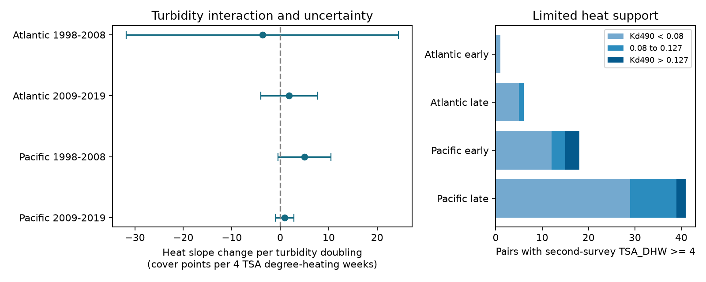

# Turbidity gave no clear heat buffer for annual coral cover change in four Atlantic and Pacific samples in 1998-2019

We did not establish a common turbidity buffer for annual coral-cover change in these selected records. All four corrected intervals include zero. Three point estimates agree with a buffer and one does not. This result does not show that turbidity has no effect.



## Question and prior evidence

Can a proposed light buffer also appear in annual coral-cover change? Sully and van Woesik (2020, DOI:10.1111/gcb.14948) reported less bleaching at moderate optical attenuation, 0.080-0.127 per metre. Morgan et al. (2017, DOI:10.3389/fmars.2017.00224) found high heat tolerance in a nearshore reef study. Reduced light is one possible explanation. Bleaching, growth, death and cover change are different outcomes. A buffer for bleaching need not produce a buffer for net annual cover change.

We searched published campaign results for phenology, climate, pollution, bleaching, HeatCRD and turbidity. Search records are in files/. We read SCI d04096af and SCI 80821c90, cited in sci.json. The first used annual matched HeatCRD cover changes without the turbidity interaction. The second tested bleaching with a different archive. We add a cover-change interaction and adjust both heat endpoints and both heat interactions. These tests reuse source programs and many observations. They are not independent confirmation of earlier archive results. Code was written for this study. The exploratory plan was saved before outcome models. It was not registered.

## Data and observation controls

The source is HeatCRD, BCO-DMO 933334 version 1, dated 2024-08-15. Robert van Woesik and Chelsey Kratochwill created the data (CC BY 4.0). The description is DOI:10.1038/s41597-024-03221-3. Heat fields derive from CoRTAD version 6 (DOI:10.25921/ffw7-cs39). No new download was required.

Exact shared raw path: `/mnt/dell-data/shared_datasets/bcodmo-933334-heatcrd-v1-20261109-ef3604eb/heatcrd.csv`.

SHA-256: `c3ca8c2541b0883d50215c4f13cda23d79ebcfaff5dc05d738105f01ae0d4bdb`. Size: 17,242,977 bytes. files/provenance.json gives the source URL, version and retrieval recipe. Only this raw file is used.

The file has 29,208 rows and 29,205 unique sample IDs. Three IDs repeat with different coral-cover values. We average cover for each such ID and check that the other used fields agree. During validation, a check found these conflicts. We corrected the first-row selection to use the planned mean. These three cells form no modeled annual pair, so primary results did not change.

We select Atlantic and Pacific records in 1997-2019 with valid month, depth 0-30 m and cover 0-100%. We average samples within site, source citation, year, calendar month and exact recorded depth. This gives 18,106 cells. We match these cells across consecutive years at the same site, source, month and depth. Both heat fields must be present. Turbidity must be positive and agree across the two cells within 1e-8. Relative to the prior annual-heat study, this last rule removes five Pacific pairs.

The test has 1,110 pairs at 425 sites in 31 countries. Reef Check supplies 1,045 pairs (94.1%). Sources are in pairs.csv. Site and source matching reduce changes in coverage but do not prove a fixed observer, transect or survey effort. Missing visits are not zero cover. The fraction of baseline cells that yield a complete pair is 111/1,427, 127/3,611, 227/4,115 and 645/8,468, in table order. This is an archive-match fraction, not a field return rate.

Hard-coral cover measures habitat cover, not species richness. The outcome is second cover minus first cover in percentage points. H is TSA_DHW divided by four. This is heat at the survey, over the prior 12 weeks. It is not the heat dose across the full year between surveys. Z is log2(Turbidity/0.08). Turbidity is a site mean optical attenuation proxy at 490 nm, in inverse metres. It does not measure air pollution, a pollutant source or event-specific water conditions. A one-unit increase in Z is a turbidity doubling.

## Model and uncertainty

Separate models use Atlantic and Pacific samples for second-survey years 1998-2008 and 2009-2019:

`cover change = b1 H1 + b0 H0 + c1 H1 Z + c0 H0 Z + a Z + initial cover + depth + year effects + month effects + source effects + error`.

The tested coefficient is c1. Positive values agree with a less harmful second-heat slope at higher turbidity. This is not a causal intervention contrast. The model allows the initial-heat slope to differ with turbidity. Each site-year has total weight one. Differencing removes a stable site intercept in cover levels, but not a site-specific trend or a difference in heat response. Initial cover can carry measurement error; one check omits it.

Pivoted QR removes redundant nuisance columns. All five exposure columns must remain identified. Every primary design has full rank. Standard errors cluster by site, with the usual finite-sample sandwich correction. The critical value is Student t with site clusters minus one degrees of freedom at 1-0.05/8. The four intervals give nominal simultaneous 95% coverage under valid cluster inference. They have no exact small-sample guarantee. Broad spatial or annual shocks can violate site independence.

## Results

Units below are cover percentage points per four TSA degree-heating weeks per turbidity doubling.

| Sample | Pairs | Sites | Interaction | Corrected interval |
| --- | ---: | ---: | ---: | --- |
| Atlantic 1998-2008 | 111 | 35 | -3.69 | -31.79 to +24.41 |
| Atlantic 2009-2019 | 127 | 44 | +1.82 | -4.05 to +7.70 |
| Pacific 1998-2008 | 227 | 144 | +4.99 | -0.47 to +10.44 |
| Pacific 2009-2019 | 645 | 245 | +0.89 | -1.05 to +2.83 |

Only 66 pairs have second-survey TSA_DHW of at least four: 1, 6, 18 and 41. Of those, only 14 have turbidity in 0.080-0.127: 0, 1, 3 and 10. Early Atlantic inference is especially weak. The continuous model also uses heat below four; this count is a support diagnostic, not a model threshold. The positive early Pacific estimate has a wide corrected interval. It does not establish a buffer.

Every estimable sensitivity interval includes zero. Country-cluster intervals permit both signs in all four samples. Country counts are only 9-15, so this is also weak inference. Removing initial cover gives -6.02, +0.62, +3.92 and +0.65. Restricting turbidity to at most 0.127 gives -3.52, +0.51, +5.40 and +0.64. On a linear turbidity scale per +0.05 per metre, estimates are -7.57, +1.49, +2.34 and +0.97; these units differ from the primary units. The Reef Check-only model is rank deficient in early Atlantic records. It is reported as unavailable. Its other estimates are +1.82, +4.99 and +0.91. No alternative is selected as the main result after seeing its estimate. effects.csv preserves all 24 planned fits or skipped fits. Sensitivity intervals use the same four-test critical rule within each family; no correction covers all families together.

## Limits and next use

The current data and model do not resolve a common buffer. The intervals permit both harmful and protective associations. They do not show equivalence, disprove light protection or identify a safe turbidity level. A site mean optical measure can miss event light conditions. It can also reflect habitat, sediment and community differences. Species composition, disease, storms, observer changes, site-specific trends and visit selection are not controlled.

The study has sparse exact follow-up and few high-heat observations. Most source replication comes from one program. Separate ocean-period samples use different records, but sites can recur across periods and share satellite and program errors. The tests do not give four independent data collections. Survey-date heat can miss the event that caused cover loss. Net cover change also includes growth and recovery. Surface heat may differ from heat at depth. These limits prevent causal climate attribution, an air-pollution claim or inference about species loss.

The useful output is an inspectable annual-cover test of a proposed buffer and a clear support audit. A stronger test needs fixed-transect visits, measured light and sediment, coral taxa, observer logs and heat across the full interval. These requirements follow from the tested exposure and observation gaps, not from a claim that the buffer is absent.

## Reproduce and inspect

Use a writable copy of the package. Python package versions are in files/environment.json. Required packages are in files/requirements.txt. No network is needed for the evidence run:

```sh
python files/analyze.py
python files/validate.py
```

The run reads cells.csv, rebuilds pairs, fits all models and writes tables, designs and the figure. To rebuild from raw data:

```sh
python files/analyze.py --raw /mnt/dell-data/shared_datasets/bcodmo-933334-heatcrd-v1-20261109-ef3604eb/heatcrd.csv
python files/validate.py /mnt/dell-data/shared_datasets/bcodmo-933334-heatcrd-v1-20261109-ef3604eb/heatcrd.csv
```

On another host, download source_url from provenance.json to a private path, verify its SHA-256 and supply that path. The analysis rejects different raw bytes. Do not overwrite shared data. The raw file is not duplicated here. cells.csv preserves the analysis frame; pairs.csv preserves every modeled pair. design_*.npz preserves the four weighted model designs. validate.py independently rebuilds cells with the standard CSV reader and computes coefficients and cluster errors from normal equations. validation.json records these checks. They test arithmetic and construction, not causal validity. The signed manifest hashes every package file.

## Campaign record

Campaign: 11_07_2026. Job: sci-1107-dell-climate-pollution-biodiversity-45b2c2182657. Topic: climate-pollution-biodiversity. Machine: dell. Account: codex-andrii. Model: gpt-6.1-sol, high reasoning effort. Date: 2026-11-09. No additional agents were used. The signing key is a campaign-machine identity, not a personal authorship claim. This publication is stored locally; it is not submitted to a remote archive or index.
