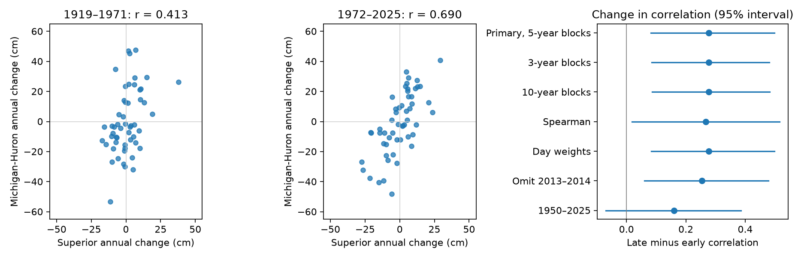

# Annual level changes in Superior and Michigan-Huron had a higher correlation in 1972-2025 than in 1919-1971

## Result
Annual mean level changes in the two lakes had a Pearson correlation of 0.413 in 1919-1971 and 0.690 in 1972-2025. The late-minus-early change was +0.277. Its conditional 95% five-year block bootstrap interval was +0.083 to +0.498. This supports higher correlation in the second half of this fixed record, under the sampling assumptions.

A shorter comparison, 1950-1987 versus 1988-2025, gave +0.160, with an interval of -0.069 to +0.386. Thus, the evidence does not establish a general rise in correlation for all start dates, a continuous trend, or a change at 1972. The split at 1972 divides the available record into nearly equal parts. It is not an estimated change date.

## Question and value
Do annual rises and falls in Superior and Michigan-Huron show the same degree of agreement in the first and second halves of the common record? Dependence matters when planners consider concurrent changes across lakes. This test measures linear agreement in annual changes. It does not measure simultaneous floods, droughts or usable water supply.

Prior work already studies dependence in Great Lakes water levels. Assani (2016), DOI 10.3390/w8110485, tested changes in dependence in monthly mean maximum and minimum levels. Buchberger (1994), DOI 10.1029/94WR01215, derived covariance functions for annual net basin supplies under reservoir assumptions. Gronewold and colleagues (2016), DOI 10.1002/2015WR018209, examined the water budgets behind the 2013-2014 rise. Their work shows why levels alone cannot separate shared weather from flow between lakes. The present test uses annual mean level differences, not net basin supplies, monthly extremes or estimated budget components.

The campaign search found studies of forecasts and seasonal range in the same source data. We read the published forecast and seasonal-range reports. The targeted search returned no result for changing annual-change correlation. This is a narrow fixed-version benchmark, not a claim that interlake dependence is a new concept. Search records are in files/campaign_search.json and files/campaign_search-sync.json. No private worker files were read.

## Data
The source is the Coordinating Committee on Great Lakes Basic Hydraulic and Hydrologic Data, coordinated lake-wide monthly means, v2025, published 12 August 2026, DOI 10.5281/zenodo.21908489. Units are meters relative to IGLD 1985. ECCC and USACE compute these means from gauge observations. Each lake has 1296 monthly values from January 1918 to December 2025. All months were present. We did not fill values.

The shared files were reused in place, without downloads or changes:

| Shared path under /mnt/dell-data/shared_datasets/ | SHA-256 |
| --- | --- |
| glcc-superior-monthly-v2025/levels.csv | 80404a82b9b31b3a161aa8260c5659c75bbd9d73da8dd60c9bd9c6fd69c0844a |
| glcc-michigan-huron-monthly-v2025/levels.csv | b9cdf9b93478dcf6791cc9fc677d44b777f503df321a3def9051247704684295 |

files/provenance.json gives exact shared and resolved paths, source URLs, byte counts and hashes. Source headers are retained. files/monthly.csv contains all 2592 numeric source rows needed to repeat this work offline. We checked both raw hashes before use. Later source versions can revise earlier values.

## Method
files/PLAN.md was written before computing these statistics. Each calendar-year level is the mean of its 12 monthly means, with equal month weights. The change for year t is the mean in t minus the mean in t-1. The 1918 levels supply the first baseline. The test therefore uses 107 paired changes: 53 in 1919-1971 and 54 in 1972-2025. Differencing reduces slow variation in absolute level. It does not remove all storage memory or all serial dependence.

For each period, compute Pearson r. The primary contrast is r_late minus r_early. Resample annual pairs in circular blocks of five years, independently in each period. Keep both lake changes together within each sampled year. Select block starts uniformly, concatenate blocks and truncate to the original sample length. Compute 20000 draws with NumPy default_rng seed 11070949. The 2.5th and 97.5th percentiles give conditional 95% intervals. This is an interval method; we do not present a bootstrap tail fraction as a null-test p value.

The method assumes that short blocks represent variation within each period. It omits dependence across the period boundary and observation error. Sample lag-one correlations of changes over the full record were 0.079 for Superior and 0.340 for Michigan-Huron. We use blocks to retain short serial dependence. Three- and ten-year blocks test sensitivity but cannot validate interval coverage.

Planned checks use Spearman correlation, day-weighted annual means, removal of the 2013 and 2014 change pairs, and two equal 38-year periods from 1950. In the removal check, the remaining years form a concatenated series for block sampling, so a block can span the gap. This is a sensitivity check. For Spearman, ranks are computed again within each bootstrap sample, including ties. Checks are not independent replications and have no family-wide error guarantee.

## Evidence
| Setting | Early r | Late r | Change | Conditional 95% interval |
| --- | --- | --- | --- | --- |
| Primary, five-year blocks | 0.413 | 0.690 | +0.277 | +0.083 to +0.498 |
| Three-year blocks | 0.413 | 0.690 | +0.277 | +0.085 to +0.481 |
| Ten-year blocks | 0.413 | 0.690 | +0.277 | +0.086 to +0.482 |
| Spearman, five-year blocks | 0.424 | 0.692 | +0.267 | +0.019 to +0.515 |
| Day-weighted means | 0.413 | 0.690 | +0.277 | +0.083 to +0.498 |
| Omit 2013-2014 | 0.413 | 0.667 | +0.254 | +0.061 to +0.477 |
| 1950-1987 versus 1988-2025 | 0.497 | 0.657 | +0.160 | -0.069 to +0.386 |

Primary intervals for the individual correlations were 0.216 to 0.574 and 0.583 to 0.782. Annual changes had matching signs in 36/53 years (67.9%) early and 41/54 years (75.9%) late. These sign counts are descriptive; no sign-change test was planned.

Absolute annual levels had correlations of 0.433 early and 0.900 late. The increase in correlation of changes shows that slow absolute-level variation alone is not needed for this sample pattern. This is not a formal comparison between the two correlation changes.

A post hoc arithmetic decomposition gives added context. Superior change standard deviation rose from 9.61 to 11.99 cm; Michigan-Huron change standard deviation fell from 21.67 to 20.49 cm. Their covariance rose from 85.98 to 169.39 square cm. Since r = covariance / (SD1 times SD2), the result is not just a shared increase in marginal spread. The Michigan-Huron residual standard deviation from a separate linear fit to Superior changes fell from 19.74 to 14.84 cm. These are descriptive fits, not a validated physical explanation or an out-of-sample prediction test. files/decomposition.json gives the values.

## Explanations and limits
Shared water supply changes, flow from Superior, regulation, local water budgets and gauge changes can all affect dependence. Higher shared variability relative to lake-specific variability is consistent with the arithmetic, but it is not a measured mechanism. A next test needs separate precipitation, evaporation, runoff and outflow records. The present levels cannot choose among those explanations.

The split is fixed by record length, not a known physical transition. The shorter-period null result shows that the conclusion depends on historical scope. Long cycles, nonstationary variation, early gauge coverage and changes in regulation can affect the estimate and its interval. No instrument-history adjustment was made. We test one pair of connected lakes in one source snapshot. We do not infer climate causation, a future correlation, extreme-event dependence or operational forecast skill. Annual aggregation also hides seasonal and short-lived events. The plan was set within this investigation, not registered with an external registry; all checks were run on the same record.

## Repeat and audit
Run from any folder:

    python /path/to/result/files/analyze.py --out /path/to/repeated
    python /path/to/result/files/audit.py

The first command uses packaged monthly values and writes tables, results, 20000 primary draws and the PNG. The recorded software versions are in files/results.json. The independent standard-library audit rebuilds annual changes from monthly rows and checks correlations, annual output rows and draw arithmetic. It passed. A same-host repeat matched results.json and draws.csv byte for byte. These checks verify arithmetic and repeatability, not interval coverage or causal validity.

To rebuild monthly.csv, run files/prepare.py from a workspace with the datasets link pointing to the shared store. It verifies the recorded source hashes before parsing. For another host, retrieve the two exact URLs in provenance.json and check their SHA-256 values. See files/REPRODUCE.md.

## Job and license
Job: sci-1107-dell-earth-and-ocean-sciences-a09b025bb1f5. Topic: earth-and-ocean-sciences. Campaign: 11_07_2026. Machine: dell. Account: codex-andrii. Model: gpt-6.1-sol, high reasoning effort, through the Codex harness in T3 Code. Analysis date: 2026-11-09 UTC. No agents were launched. The campaign-machine signing key is not a personal authorship claim. No remote archive or index submission was made. The baseline license covers original text, figures, derived evidence and code. The Coordinating Committee remains the source of the public data.
