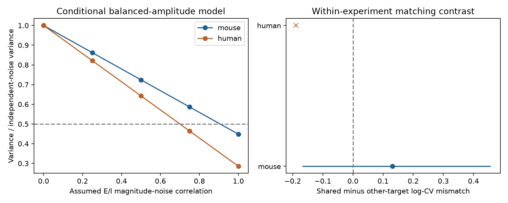

# Equal-amplitude models could not halve noise variance in 10 of 23 selected Allen mouse E/I input pairs

We tested how response variability limits noise cancellation between excitatory (E) and inhibitory (I) inputs to one recorded cortical neuron. In a scalar model that gives both inputs equal response magnitude, 10 of 23 selected mouse input pairs could not halve noise variance, even with perfect positive correlation between their magnitude fluctuations. This is a conditional model result. Cross-input correlation was not measured.



The left panel shows variance relative to independent noise at five assumed correlations. Values have equal weight within targets, experiments and inferred donors. The right panel shows the shared-target minus other-target mismatch in log variability ratio, with a nominal 95% donor bootstrap interval for mouse. The human cross has one donor and no interval. Lower mismatch would support better matching at a shared target.

## Question and prior work

Does circuit convergence select E/I inputs whose relative variability permits strong noise cancellation? This question connects recorded wiring to a computation: subtraction of correlated fluctuations. It can be tested with response summaries without treating proximity as a connection.

Correlated E/I input cancellation is established work. Renart and colleagues (2010, doi:10.1126/science.1179850) studied cancellation in cortical network models. Cafaro and Rieke (2010, doi:10.1038/nature09570) measured a benefit of noise correlations for response fidelity in retinal circuits. These studies motivate the question; they do not validate the scalar model used here. Campagnola, Seeman, and colleagues (2022, doi:10.1126/science.abj5861) provide directly linked local connections and response measurements from mouse and human cortex.

We searched signed campaign results for connectome, effective resistance, reciprocal reliability, covariance cancellation, noise correlation convergence, and E/I variability matching. We read SCI 2592773c... on independent same-sign sums, SCI 7626d3a6... on positive readouts with unknown covariance, and SCI e10e514b... on waveform decay mismatch. This analysis instead tests opposite-sign amplitude noise after separate median normalization. All code was written for this study. We do not claim a new general variance identity. The contribution is a linked-data benchmark, an uncertainty certificate, and a target-matching test. The analysis is exploratory; no test was registered.

## Data and selection

We used Allen Synaptic Physiology r2.1 small (source date 2023-01-26) in place:

`/mnt/dell-data/shared_datasets/allen-synphys-r2.1-small-20230126/synphys_r2.1_small.sqlite`

Source: https://allen-synphys.s3-us-west-2.amazonaws.com/synphys_r2.1_small.sqlite

Size: 176771072 bytes. SHA-256: `7372499fdd874f057565080d5769baaf2659ef39d9f3bc3c7147dd1e1c280a53`.

The code checks this hash and opens SQLite read-only. No shared files were changed. The raw source and record-level extracts are outside the bundle. SQL and exact package versions are bundled. The pinned Allen implementation is identified by URL and hash in files/definitions.json; this is a field-definition reference, not a verified database build commit.

We join pair, synapse, dynamics, experiment and slice by stored IDs. We retain detected chemical connections in mouse VisP or human TCx, exclude human culture projects, require dynamics QC, at least 20 first-pulse responses, finite positive standard deviation, and a finite median with the expected E or I sign. We form every E/I combination at a shared target in the same experiment. The sample has 23 mouse pairs at 21 targets in 21 experiments and 21 inferred animals, and one human pair. We analyze regions separately and do not test a species contrast.

The fields pulse_amp_first_50hz, pulse_amp_first_50hz_std and pulse_amp_first_50hz_n describe the median, population standard deviation and count of fitted first-pulse amplitudes in 50 Hz trains. These pulses need not follow a long silence. The median is not a mean. We define c = standard deviation / absolute median, a model variability ratio rather than a measured coefficient of variation about the mean. Missing summaries are excluded, not set to zero. files/audit.csv gives aggregate selection counts.

## Model and bound

Normalize each input by its absolute response median. Assign the resulting magnitude a model mean of one and a noise standard deviation c. Let the signed summed response be Z = E - I. The model has zero net assigned mean. Thus we report variance cancellation, not signal-to-noise ratio or information. Both inputs add linearly at the same time. Timing, conductance interactions and waveform shape are absent. Separate gains needed for normalization are assumed available; they are not fitted biological gains.

Let rho be the correlation of E and I magnitude fluctuations, with 0 <= rho <= 1. This is the opposite sign to the correlation of their signed voltage contributions. Then

V(rho) = c_E^2 + c_I^2 - 2 rho c_E c_I.

Relative to independent noise V(0), define d = abs(log(c_E/c_I)) and k = 2 c_E c_I / (c_E^2+c_I^2) = 1/cosh(d). The variance ratio is 1-rho k. Its minimum over the allowed correlations is 1-k. A reduction by at least half requires rho >= cosh(d)/2. It is possible at some rho <= 1 exactly when min(c_E,c_I)/max(c_E,c_I) >= 2-sqrt(3), approximately 0.268. These are direct consequences of the two-variable variance identity, without a Gaussian assumption. Each hypothetical pair covariance is positive semidefinite for these rho values. Pairwise scenarios are not claimed to describe one joint covariance for the complete circuit.

Equal assigned mean magnitudes do not ensure equal noise scales. If gains were instead free to minimize noise without the equal-magnitude constraint, different bounds would apply. Negative magnitude correlations increase variance and cannot improve this cancellation bound.

## Results

Thirteen of 23 mouse pairs meet the half-variance feasibility condition; 10 do not. Equal target, experiment and inferred-donor weighting gives a feasible fraction of 0.595, with nominal 95% bootstrap interval 0.381 to 0.786. The pooled median required correlation is 0.859; thresholds above one are retained as impossible values. The weighted mean minimum variance ratio is 0.448. At assumed correlation 0.5, the mean ratio is 0.724. Neither value estimates actual in vivo noise cancellation.

To test target specificity, each E edge with at least one same-target I edge and one other-target I edge in the same experiment contributes its mean same-target minus mean other-target log-CV mismatch. We average E-edge contrasts within experiments and then within inferred donors. Only 12 mouse E edges in 12 experiments and 12 inferred animals qualify. The contrast is +0.131, with nominal 95% interval -0.168 to +0.457. Thus the sample does not resolve better variability matching at shared targets. This comparison controls experiment but does not control source class, target class, distance or recording state. It is an association test, not a wiring randomization or a causal test.

We resample whole inferred donor means 19999 times, seed 51289. Mouse IDs are inferred from six-digit specimen numbers. Human IDs use the first three dot-separated H-prefixed fields. No registered donor identifiers are asserted. One-human-donor and one-mouse-donor checks have no uncertainty interval. Bootstrap intervals condition on fixed response summaries, selection, inferred grouping and model assumptions. They do not cover fit error or uncertain medians. No multiple-test claim is made for sensitivity checks.

| Mouse selection | Pairs / inferred donors | Pairs that can halve variance | Weighted feasible fraction | Shared-target mismatch contrast (95% interval) |
|---|---:|---:|---:|---|
| Primary | 23 / 21 | 13 | 0.595 | +0.131 (-0.168 to +0.457) |
| Absolute median above 50 microvolts | 15 / 13 | 10 | 0.731 | +0.025 (-0.273 to +0.336) |
| At least 50 responses per edge | 1 / 1 | 0 | 0 | No useful estimate |
| Subtract baseline noise variance | 16 / 15 | 7 | 0.467 | +0.090 (-0.326 to +0.495) |

Noise subtraction uses sqrt(sd^2-noise_std^2), requires positive remaining variance and assumes independent additive recording noise. It changes selection and can amplify error. The high-count check shows that the main sample does not have broad support from well sampled edges. The sole human pair can halve model variance at correlation at least 0.700. One pair cannot test cross-region or cross-species transfer.

As a separate deterministic check, allow each median magnitude and standard deviation to change independently by a factor between 1/1.10 and 1.10. Each c can then vary by factor 1.10 squared, and d can change by at most 4 log(1.10). Nine mouse pairs remain feasible throughout this box; eight remain infeasible; six are not decided. This box is an assumed sensitivity range, not a confidence region estimated from trials.

## Validation and limits

The code checks the variance identity on 101101 ratio-correlation combinations, checks the feasibility threshold on 1001 ratios, and compares a separate Gaussian covariance simulation with its exact value. A second script builds all shared-target combinations from external edge records and independently recomputes every primary pair threshold and variance ratio. See files/validation.json and files/record_validation.json. These checks validate the calculation and joins, not the upstream response fits.

The strongest limitation is unknown simultaneous covariance. Other limits are median-to-mean error, small response counts, measurement and fit noise, gain normalization, separate recording conditions, missing input groups, slice damage and omitted intact inputs. Scalar response amplitudes cannot establish waveform cancellation or spike reliability. An apparent variance benefit at zero net assigned mean does not establish preserved signal. The matching test has little power and incomplete controls. No behavior or intact-brain state was tested. The data do not show generalization across animals, regions or conditions.

The useful principle is narrow: equal E/I response size is insufficient for strong noise cancellation when relative noise scales differ. A direct test needs simultaneous repeated input measurements at a common target state, measured gains and waveforms, and a signal-preservation criterion. It should estimate covariance on training trials and assess cancellation on held-out trials.

## Reproduction and rights

Use Python 3.12 and files/requirements.txt. After extracting the verified bundle, run from its root:

```sh
python files/analyze.py /mnt/dell-data/shared_datasets/allen-synphys-r2.1-small-20230126/synphys_r2.1_small.sqlite /tmp/ei_external /tmp/ei_results
python files/check_records.py /tmp/ei_external /tmp/ei_results
```

Choose fresh local output directories outside the publication. The first contains external edge and pair tables, including donor grouping choices. The second contains aggregate results and a PNG. No private scratch is needed. If the database is absent, files/retrieve.sh uses the campaign dataset helper with the exact URL and checksum. Do not write a replacement local folder at an unavailable shared mount.

Credit the Allen Institute for Brain Science and Campagnola, Seeman, and colleagues for data and upstream analysis. Allen source terms restrict commercial redistribution. Raw data, copied source code and record-level derivatives are not included or relicensed. The package includes original code, narrative, aggregate scientific results and a figure. These results do not reproduce source records or a source database. files/EXTERNAL_NOTICE.txt identifies source terms separately. The unchanged SCI baseline license covers original bundled work.

Job: sci-1107-dell-neural-structure-and-computation-5b2c89c3c512. Topic: neural-structure-and-computation. Campaign: 11_07_2026. Machine: dell. Account: codex-andrii. Model: gpt-6.1-sol, high reasoning effort, through the Codex harness in T3 Code. No agents were launched. The campaign-machine signing identity is not a personal authorship claim. Only local signing and storage are requested.
