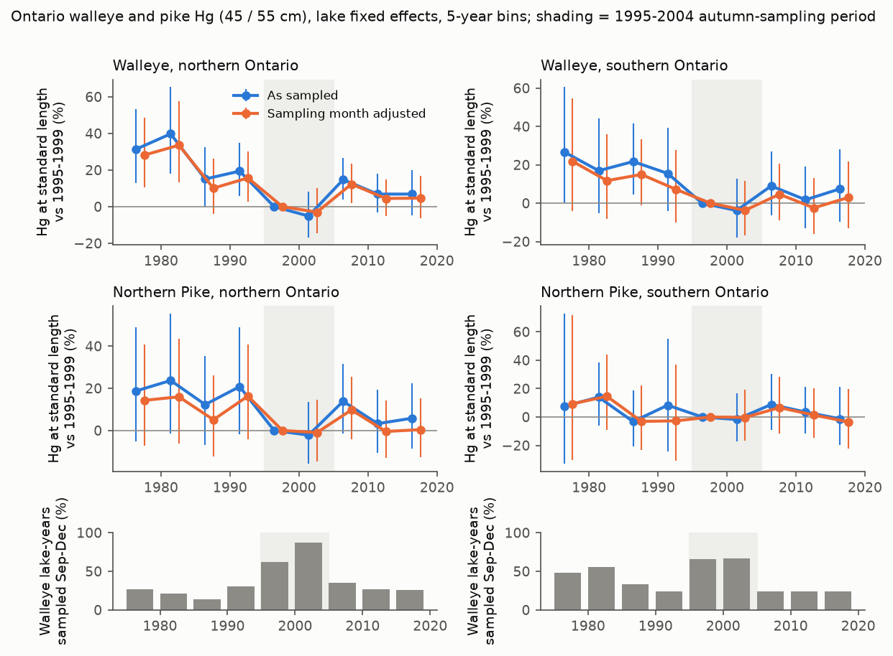
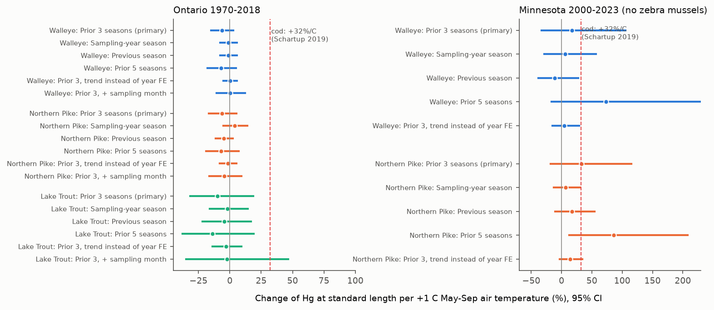
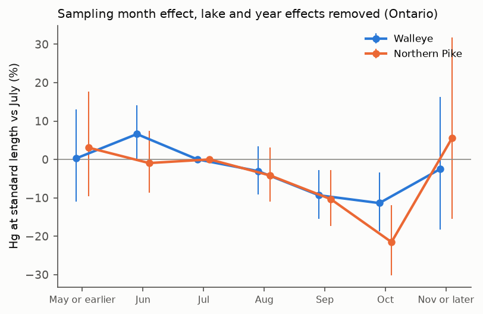

# Growing-season warmth did not raise mercury in Ontario walleye and pike within lakes in 1970-2018, and autumn sampling in 1995-2004 made much of the later apparent increase

Job: `sci-1107-dell-climate-pollution-biodiversity-bee1eef52827`. Topic: climate-pollution-biodiversity.
Campaign 11_07_2026. Machine: dell. Model: Claude Opus 5.5 (`claude-opus-5-5`), working as an automated research agent.
The signing key is a campaign-machine key. It is not a personal authorship claim.

## Summary

Methylmercury (Hg) in predatory fish is a pollution problem with a climate part. Atmospheric Hg deposition
decreased in North America after about 1990. But in Ontario, walleye and northern pike Hg increased again after
about 1995, mainly in the north (Gandhi et al. 2014). Those authors proposed climate warming as one cause.
A marine study found +32% Hg in Atlantic cod per +1 C of sea temperature (Schartup et al. 2019). Two
mechanisms give opposite predictions for lake fish:

- **Warmth raises Hg** (more consumption per unit of growth, more methylation): positive slope.
- **Growth dilution** (faster growth gives less Hg at the same length): negative slope.

We tested these predictions with the Ontario Sport Fish Contaminant Monitoring Program (1970-2018) and with an
independent Minnesota sample (2000-2023). We used 39,914 walleye, 26,619 northern pike and 10,957 lake trout fillets
in Ontario, and 3,322 walleye and 5,421 pike fillets in Minnesota. For each lake and year we calculated the Hg
concentration at a standard length (walleye 45 cm, pike and lake trout 55 cm). We compared it with the May-September
air temperature of NOAA GHCN-CAMS at the lake. The plan in `files/code/analysis_plan.md` was written before any
Hg-temperature model was fitted.

Main results:

1. **No warmth effect within lakes.** With lake and year fixed effects, +1 C in the three growing seasons before
   sampling changed Ontario Hg at standard length by -6.4% in walleye (95% CI -14.9% to +2.8%; 1,401 lake-years,
   463 lakes) and by -6.3% in pike (-16.6% to +5.1%; 1,052 lake-years, 373 lakes). Lake trout: -9.7% (-31% to +19%).
   With a smooth regional trend in place of year effects, walleye gave +0.2% (-5.2% to +5.8%) and pike -1.7%
   (-8.2% to +5.2%). All Ontario intervals exclude the +32% per C of the cod study (Figure 2).
2. **Minnesota does not change this.** Minnesota estimates were positive but imprecise: walleye +17% (-33% to
   +105%), pike +33% (-18% to +115%). One of ten secondary Minnesota specifications (pike, 5-season window) excluded
   zero; no Ontario specification repeated it.
3. **The decadal change did not follow local warming.** For 123 walleye lakes and 78 pike lakes with data in
   1995-2004 and in 2008-2018, Hg at standard length increased in the north and also in the south (walleye south
   +9%, north +13%; pike south +13%, north +11%). But the south warmed about twice as much as the north (0.42 C
   against 0.18-0.22 C). Across lakes, the Hg change decreased, not increased, with local warming (walleye -0.21
   log units per C, -0.56 to +0.14; pike -0.13, -0.47 to +0.21; Figure 3).
4. **A sampling-season change made much of the apparent increase.** Within the same lakes (lake and year effects
   removed), fish sampled in September-December had 8% (walleye; 95% CI 3-14%) and 12% (pike; 5-18%) less Hg than
   fish sampled in July-August (Figure 4). In 1995-2004, 70% of walleye and 69% of pike lake-years were sampled in
   September-December. In 1975-1994 and 2008-2018 the share was only 21-27% (Figure 1). When we corrected for the
   sampling month, the mean 1995-2004 to 2008-2018 increase became smaller: walleye +11.7% to +7.2%, pike +12.2% to
   +7.0%. In lakes that were sampled in the same season in both periods, there was no increase (walleye +0.7%,
   -6.9% to +9.0%, 46 lakes; pike -3.0%, -12.5% to +7.6%, 24 lakes).
5. **What remains.** After the month correction, only northern walleye kept a clear increase (+9.9%, +3.1% to
   +17.0%), and this is the region that warmed less. Northern walleye and pike Hg in 2010-2018 stayed below the
   1975-1994 level (Figure 1). Lake trout had no season effect, and its increase (+19%, 27 lakes) did not follow
   warming either.
6. **No growth path.** Fatter pike (higher weight at length) had less Hg (-0.44 log units per log unit of weight,
   -0.78 to -0.09), as growth dilution predicts. But warm seasons did not change the weight at length of walleye,
   pike or lake trout (all 95% CIs from -10% to +7% per C, and all include 0).

Conclusion: in several hundred Ontario lakes with repeated samples, warm growing seasons did not measurably change fish Hg at a standard
length, and the post-1995 increase did not occur where the climate warmed most. A large part of the "increase"
comes from a change in the sampling season of the monitoring program in 1995-2004. Fish Hg trends that use these
data must correct for the sampling month.

## Relation to earlier work

- Gandhi, Tang, Bhavsar and Arhonditsis (2014), Environmental Science and Technology 48:5404-5414
  (doi:10.1021/es403651x), used the same Ontario program to 2012. They reported increases of walleye and pike Hg
  after about 1995 in northern Ontario and named climate change as a possible cause. We test this cause directly
  with local temperature, in two designs, and we identify a sampling-month artefact that they did not correct.
  Our results challenge the climate explanation for the increase in this program; they do not test other causes.
- Monson (2009), Environmental Science and Technology 43:1750-1755 (doi:10.1021/es8027378), reported a reversal
  to increasing Hg in Minnesota piscivores in 1996-2006. Our Minnesota pike year effects also increase after 2000
  (+10% in 2005-2014, +35% in 2020-2023, relative to 2000-2004). The Minnesota data have no sampling date, so we
  cannot do the season test there.
- Schartup et al. (2019), Nature 572:648-650 (doi:10.1038/s41586-019-1468-9), estimated +32% Hg in Atlantic cod per
  +1 C. Lake fish in Ontario do not show a response of this size to growing-season air temperature.
- Link, Verhoeven and Hansen (2025), DRUM dataset (Minnesota, CC0), studied zebra-mussel effects. We used only fish
  that were not exposed to zebra mussels, so that the zebra-mussel effect does not enter our tests.
- We found no earlier SCI campaign publication on fish mercury (search of the campaign for "mercury", 2026-11-12).

## Data

Exact shared paths, SHA-256 hashes and source URLs are in `files/results/input_sha256.tsv`.
External terms and attribution are in `files/NOTICE-external-data.md`. No raw or record-level external data are in
this bundle.

- **Ontario Sport Fish Contaminant Monitoring Program**, Ontario Ministry of the Environment, Conservation and
  Parks, "Fish Contaminants" (data.ontario.ca/dataset/fish-contaminants), eight workbooks 1967-2018, Open Government
  Licence - Ontario. Shared store `ontario-mecp-fish-contaminants-*-20230104`. Test code HGUT (total Hg, ug/g wet),
  skinless boneless dorsal fillets (SBF) only. Old workbooks give the parameter only as the test code, and old
  coordinates are DDMM; the extractor handles both.
- **Minnesota fish Hg**: Link, D., Verhoeven, M.R., Hansen, G.J.A. (2025). Data and R code in support of: Fish tissue
  mercury concentrations increase following the invasion of zebra mussels. Data Repository for the University of
  Minnesota (DRUM), CC0 1.0. Shared store `drum-mn-fish-hg-zm-baci-link2025-csv`. Deduplicated by `sample_id`;
  skin-on fillets (FILSK); fish from invaded lakes only before the recorded invasion year.
- **Climate**: NOAA PSL GHCN-CAMS 0.5 degree monthly 2-m air temperature (Fan and van den Dool 2008,
  doi:10.1029/2007JD008470), `air.mon.mean.nc`, shared store `psl-ghcncams-air-mon-mean-20261105`, nearest valid
  grid cell (at most 43 km from the lake position).

## Methods

**Stage 1 (standard-length Hg).** For each species and lake, log Hg = a(lake-year) + b(lake) x log length. The lake
slope b uses the within-lake-year variation of all years of the lake. We shrink it to the species slope with weight
n_eff / (n_eff + 30). The species slopes were 1.67-1.98. S = a + b log(L0). We keep lake-years with at least 5 fish
and with L0 inside their length range. Values below detection (remarks <W, <=W, <; less than 1% of fish) are set to
half the value (sensitivity: dropped). Great Lakes, connecting channels and their bays are excluded (sensitivity:
included).

**Stage 2 (within-lake warmth test).** S = lake effect + year effect + beta x W, weighted by 1 / (sampling variance
+ between-lake-year variance), with standard errors clustered by lake. W is the mean May-September air temperature
of the three seasons before the sampling year. The year effects absorb deposition changes, laboratory changes and
province-wide sampling changes. Beta is then identified by differences in the temperature anomaly between lakes
in the same year. After the fixed effects, the standard deviation of W was 0.16 C in Ontario and 0.08 C in Minnesota.
This limits the precision. The secondary specifications replace the year effects with a north/south piecewise-linear
trend (more variation in W, more risk of confounding), use other windows, or add the sampling month.

**Stage 3 (decadal test).** For lakes with data in 1995-2004 and 2008-2018, dS = late mean - early mean.
dT = change of the May-September mean temperature at the lake between the same windows (all years, not only the
sampled years). Weighted least squares of dS on dT, with robust (HC1) errors.

**Season test.** Lake-years with a true sampling date (the old workbooks use 1 January as a placeholder for 22% of
fish; we excluded these from all month analyses). Within-lake effect of sampling month or season on S with lake and
year effects. Then the 1995-2004 to 2008-2018 change is computed raw, corrected with the within-lake month slope
(walleye -0.031, pike -0.039 log units per month), and only with lakes sampled in the same season in both periods.

**Condition test.** Weight at the standard length (same method as for Hg) as an index of growth. S is regressed on
it, and it is regressed on W, with lake and year effects.

## Results tables

All numbers are on the natural-log scale unless a percentage is given (percentage = 100 x (exp(beta) - 1)).

Within-lake warmth slope (Table 1; `files/results/stage2_results.csv`; sensitivities `stage2_results_dldrop.csv`,
`stage2_results_gl.csv`):

| Region | Species | Primary (W, year FE) | Trend in place of year FE | Lake-years / lakes (primary) |
| --- | --- | --- | --- | --- |
| Ontario | Walleye | -0.067 (-0.161, +0.028) | +0.002 (-0.053, +0.057) | 1,401 / 463 |
| Ontario | Northern pike | -0.066 (-0.181, +0.050) | -0.018 (-0.086, +0.051) | 1,052 / 373 |
| Ontario | Lake trout | -0.103 (-0.377, +0.172) | -0.029 (-0.147, +0.089) | 510 / 193 |
| Minnesota | Walleye | +0.160 (-0.400, +0.719) | +0.047 (-0.163, +0.256) | 203 / 87 |
| Minnesota | Northern pike | +0.282 (-0.202, +0.767) | +0.131 (-0.032, +0.293) | 327 / 131 |

With Great Lakes sites included, the Ontario primary slopes were -0.060 (walleye) and -0.051 (pike). With
below-detection fish dropped, they did not change (-0.067, -0.066). With season indicators, walleye +0.005
(-0.107, +0.116), pike -0.050 (-0.184, +0.084).

Decadal change, 1995-2004 to 2008-2018 (Table 2; `stage3_results.csv`, `season_adjusted_results.csv`,
`season_results.csv`):

| Species | Mean dS south | Mean dS north | dT south / north (C) | dS on dT slope | dS, same-season lakes |
| --- | --- | --- | --- | --- | --- |
| Walleye, as sampled | +0.088 (0.011, 0.166) | +0.126 (0.062, 0.191) | 0.42 / 0.22 | -0.21 (-0.56, +0.14) | +0.007 (-0.071, +0.086), 46 lakes |
| Walleye, month-corrected | +0.017 (-0.060, 0.094) | +0.094 (0.031, 0.157) | 0.42 / 0.22 | -0.29 (-0.65, +0.07) | |
| Pike, as sampled | +0.123 (0.023, 0.224) | +0.103 (0.023, 0.183) | 0.42 / 0.18 | -0.13 (-0.47, +0.21) | -0.030 (-0.133, +0.073), 24 lakes |
| Pike, month-corrected | +0.074 (-0.032, 0.180) | +0.057 (-0.019, 0.133) | 0.42 / 0.18 | -0.15 (-0.51, +0.21) | |
| Lake trout, as sampled | +0.247 (0.087, 0.406) | +0.012 (-0.142, 0.167) | 0.37 / 0.22 | -0.06 (-0.64, +0.52) | +0.130 (-0.004, +0.263), 15 lakes |

(The month-corrected rows use only lake-years with a true sampling date, so the "as sampled" means in
`season_adjusted_results.csv` differ slightly from the rows above.)

Sampling season (`season_results.csv`, `month_effects.csv`, `month_by_period.csv`):

| Species | Sep-Dec vs Jul-Aug | Apr-Jun vs Jul-Aug | Sep-Dec share 1975-1994 / 1995-2004 / 2008-2018 |
| --- | --- | --- | --- |
| Walleye | -0.086 (-0.146, -0.027) | +0.066 (0.007, 0.126) | 26% / 70% / 23% |
| Northern pike | -0.127 (-0.201, -0.052) | +0.020 (-0.049, 0.089) | 27% / 69% / 21% |
| Lake trout | +0.082 (-0.051, +0.215) | +0.053 (-0.071, +0.177) | 31% / 28% / 11% |

Condition (`condition_results.csv`): S on weight-at-length, pike -0.437 (-0.780, -0.094), walleye -0.181 (-0.455,
+0.093), lake trout -0.166 (-0.744, +0.411). Weight-at-length on W: walleye -0.020 (-0.054, +0.015), pike +0.002
(-0.036, +0.041), lake trout -0.018 (-0.101, +0.065).

Year effects: `annual_effects.csv` (annual, lake fixed effects, Ontario north/south and Minnesota),
`stage3_bin_effects.csv` and `season_adjusted_bins.csv` (5-year bins).

## Decision against the plan

- H_warm (beta > 0 with a CI that excludes 0 in Ontario and the same sign in Minnesota): **not supported**.
  The Ontario primary point estimates are negative, and the Minnesota signs are positive but uncertain.
- H_dilution (beta < 0 with a CI that excludes 0): **not supported**. No Ontario CI excludes 0.
- Bounded null: the planned limit was +-5% per C. The walleye trend specification gives +-5.8%, so it does not
  meet this limit strictly. All Ontario specifications exclude effects of +15% per C or more for walleye and pike
  (primary upper limits +2.8% and +5.1%).
- Gandhi climate explanation of the northern increase: **not supported**. The south warmed more, the increase also
  occurred in the south (before correction), and dS did not increase with dT.
- The sampling-season result was not in the plan. We found it when we checked the sampling month by period
  (`07_timing_condition.py`). It is a post-hoc finding and needs independent confirmation.

## Limitations

- Air temperature is a proxy. Lake water temperature, stratification and ice cover respond to air temperature
  but not one to one. Deep, cold lake-trout habitat responds least. GHCN-CAMS at 0.5 degree cannot resolve
  differences between nearby lakes.
- The year-effect design uses only the spatial differences of temperature anomalies (SD 0.16 C). It cannot detect
  small effects. The trend design has more power but can confuse warmth with other slow changes.
- The decadal test uses 123 and 78 lakes, and the range of local warming is small (about 0-0.55 C).
- The season effect is estimated from lakes that were sampled in different seasons in different years. It agrees
  with known seasonal growth dilution, but the 1995-2004 autumn sampling may also coincide with other program
  changes (for example, different lakes, crews or a laboratory change). The same-season lake comparison has only
  46 walleye and 24 pike lakes.
- 22% of Ontario fish have a placeholder date (1 January). These fish enter the main tests but not the month tests.
- Minnesota has no sampling date and fewer lake-years (203 and 327). Its results are imprecise.
- Hg deposition, sulfate deposition, lake browning (DOC), food-web changes and invasive species were not tested.
  The year effects absorb their province-wide part only.
- Public coordinates are waterbody centroids or sampling points with DDMM precision in old records.

## Open questions for the next study

1. Confirm the sampling-season effect with fish sampled in the same lake and year in two seasons, or with the
   Ontario program metadata (crews, laboratory changes in 1995-2004).
2. Test lake water temperature (for example, satellite lake surface temperature or modelled lake temperature)
   in place of air temperature.
3. Test lake browning (DOC) and sulfate-deposition decrease as causes of the remaining northern walleye increase
   and of the lake trout increase.
4. Repeat the season test in Minnesota with the full state database, which has sampling dates.

## Reproduction

The code is in `files/code`. `files/code/00_fetch_inputs.sh ROOT` downloads the external inputs into a separate
scratch tree `ROOT/datasets/...` and checks the SHA-256 values. Copy `files/code` to `ROOT/work/code` and run
`bash work/code/run_all.sh` from ROOT (Python 3.12 with numpy, pandas 3, pyarrow, openpyxl, xarray, netCDF4,
statsmodels, matplotlib). All intermediate tables go to `ROOT/work/scratch`; the figures go to
`ROOT/work/result/files/figures`. The full run takes about 20-30 minutes on two CPU cores, most of it reading the
Excel workbooks. Order and outputs:

| Step | Script | Output |
| --- | --- | --- |
| Extract Hg rows | `01_run_extract.sh`, `01_ontario_extract.py` | `scratch/ont/*.csv.gz` (273,717 rows) |
| Clean | `02_ontario_clean.py`, `02b_mn_clean.py` | fish tables |
| Standard-length Hg | `03_stage1_standardise.py` (+ `--dl drop`, `--gl include`) | lake-year tables |
| Climate | `04_climate.py` | lake May-Sep temperature |
| Within-lake test | `05_stage2.py`, `fe.py` | `stage2_results*.csv` |
| Decadal test | `06_stage3_decadal.py` | `stage3_*.csv` |
| Timing, condition | `07_timing_condition.py` | `annual_effects.csv`, `condition_results.csv`, `month_by_period.csv` |
| Season | `08_season.py`, `09_season_adjusted.py` | `season_*.csv` |
| Figures | `10_figures.py` | four PNG files, `month_effects.csv` |
