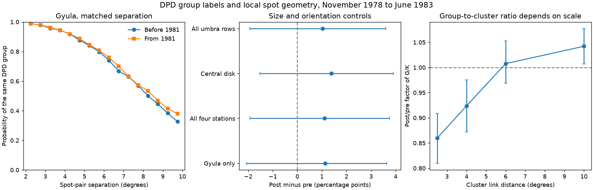

# A DPD spot-pair audit does not detect a local group-label change across 1981

Job: sci-1107-dell-astronomy-08695d768542. Topic: astronomy. Campaign: 11_07_2026. Machine: dell. Account: codex-myxtap. Model: gpt-6.1-sol, high reasoning effort, in T3 Code through the Codex harness. The campaign-machine key signs this work. The key does not state personal authorship.

## Result

We test whether the DPD rule for assigning nearby spots to groups changed across January 1981. The test compares spot pairs at the same separation and from the same observing station. The estimated change in same-group probability is small and its interval includes zero. Size, orientation, central-disk and Gyula-only tests give the same result. This is a conditional null result, not proof of equal counting rules.

In the four-station sample, the same-group probability is 0.7863 before 1981 and 0.7972 after 1981. The difference is +1.09 percentage points. Its conditional 95% six-month block interval is -1.94 to +3.73 points. With size and orientation controls, the difference is +1.11 points (-1.93 to +3.75). In the Gyula-only sample with these controls, it is +1.14 points (-2.06 to +3.64). These bounds apply to the tested local pair statistic. They are not bounds on the change in sunspot number or group count.



## Why this test is needed

The starting question asks whether an emission change or a counting change caused the sunspot-number fall near 1981. The cited DPD study, sci:sha256:d5a98c6aa279838aea450785770e823b226ac10b61570961aaeac942fe6a1267, does not report stable position clusters at every scale. Its 6-degree and 10-degree clusters fall at matched emission, while 2.5-degree clusters stay stable in its flat time model. The source interprets this as partly a change in spot concentration. Thus, the claim that this source points only to grouping practice is not supported by its full results.

A fixed-distance cluster count is not the same as an observer group count. A group can contain several distance clusters. A distance cluster can contain several observer groups. A fall in G/K at one distance can therefore be a change in the structure within groups. It need not be a new group boundary rule. We use two related tests:

1. Compare the group label of spot pairs, conditional on separation and other observed pair properties.
2. Measure the exact overlap between observer groups and position clusters at several distances.

Automatic spatial grouping is an established method. For example, SunSCC (doi:10.1029/2023JA031548) uses an automatic grouping method for solar images. Our contribution is an audit of the stability of historical group assignments, with a time comparison at fixed local geometry and an exact overlap decomposition. It is not a new physical definition of a solar active region.

## Data and sample

We use DPD yearly ASCII files for 1978-1983, accessed on 2026-11-10. All six files match the SHA-256 values in the earlier DPD SCI publication. No date has more than one daily record. The analysis window is November 1978 to June 1983, split at January 1981: 26 pre months and 30 post months. The window and split come from prior work, not a search for a large pair effect.

The stations are Gyula, Debrecen, Kislovodsk and Mitaka (GYUL, DEBR, KISL, MITA). We use valid spot positions inside 0.85 solar radii. The central-disk test uses 0.70 radii. The main representation keeps DPD spot rows with nonnegative projected whole-spot area. This keeps one representative per shared penumbra. It is not an area-weighted centroid of all umbrae in that penumbra. A separate test keeps all umbra rows. The DPD format specifies the negative-area references for shared penumbrae.

Only days with at least one eligible pair at 2-10 degrees enter. The four-station penumbra sample has 1,647 days and 1,271,967 eligible pairs. The Gyula sample has 1,158 days and 1,113,187 pairs. These large pair totals do not state the independent sample size. Repeated days can follow the same long-lived region.

DPD group labels start from NOAA numbers and are not independent of historical group catalogues. DPD 1979-1983 remains preliminary. The data policy, source release dates, source URLs, file sizes and hashes are in EXTERNAL_DATA.md and provenance.json. No external raw data or record-level derivative database is in this bundle.

## Pair method

For each day, we form all unordered pairs with great-circle separation from 2 degrees inclusive to 10 degrees exclusive. The outcome is one if both rows have the same DPD group label. The pair mass on each day sums to one. Thus a day with many pairs does not get greater total weight.

The base strata are observing station and half-degree separation bin. The extended strata add two whole-spot area classes (the smaller and larger member, with edges at 10 and 100 millionths of a solar hemisphere) and an orientation class. A pair is more north-south than east-west when its latitude separation exceeds its longitude separation after the cosine-latitude correction. In the all-umbra sensitivity, negative shared-area entries have area class zero; that size-controlled variant is a diagnostic, not a penumbra-size measurement.

A stratum must occur in at least six months on each side. Within each period, we sum same-group mass and total mass in each stratum. The standardized probability is the weighted mean of their ratios. Each fixed stratum weight is proportional to the smaller of its pre and post shares of total pair mass. We normalize these weights to one. The weights emphasize common support and are the same on both sides.

The base four-station test retains 99.4% of pre mass and 86.5% of post mass. With size and orientation controls it retains 97.7% and 81.0%. The Gyula extended test retains more than 99.98% on both sides. Therefore, the Gyula result also checks whether the four-station result depends on dropping late source mixtures.

We use 3,000 circular block bootstrap draws, separately within each period, with blocks of three and six calendar months. All strata within a month use the same draw. The standardization weights and original support are fixed. When a resampled stratum is empty on either side, its weight is removed from that draw and the remaining weights are normalized again. The maximum lost mass is 3.71% in the base four-station test and 0.015% in the extended Gyula test. Full diagnostics are in estimates.csv. This correction avoids treating an empty cell as a zero probability.

Intervals are conditional on the window, support, bins, representation and resampling model. They assume that blocks within each side can be resampled. They do not include uncertainty in smooth cycle trends. The study is exploratory. It was not preregistered. All eight sample/control combinations and both block lengths are reported.

## Pair results

The table uses size and orientation controls and six-month blocks. Differences and intervals are in percentage points.

| Sample | Pre probability | Post probability | Difference | 95% interval |
| --- | ---: | ---: | ---: | --- |
| Four stations, penumbra representatives | 0.7865 | 0.7976 | +1.11 | -1.93 to +3.75 |
| Gyula only | 0.7847 | 0.7960 | +1.14 | -2.06 to +3.64 |
| Central disk | 0.7819 | 0.7958 | +1.38 | -1.52 to +3.91 |
| All umbra rows | 0.8093 | 0.8196 | +1.03 | -1.93 to +3.60 |

No tested interval excludes zero. Separate exploratory Gyula checks in 2-degree distance bands give differences of +0.14 points at 2-4 degrees (95% six-month interval -0.76 to +1.13), +0.59 at 4-6 degrees (-2.98 to +3.72), +1.47 at 6-8 degrees (-4.13 to +6.45), and +3.48 at 8-10 degrees (-3.82 to +9.84). These checks keep the original equal-day pair masses and fix the distance weights within each band. They do not normalize each day again within the band. Larger separations have weaker limits. The pooled null must not be read as a tight bound at every separation. These estimates are in band_estimates.csv.

The tests permit modest changes in local group assignment. They do not show a large shift in this probability. This is not an equivalence test of the full grouping procedure.

## Exact group-cluster overlap

For each day and each link distance D, we build a graph of spot positions. Edges join spots no more than D degrees apart. Its K connected components are position clusters. A second, bipartite graph has one node for each DPD group and each position cluster. A shared spot joins its group node to its cluster node. Let C be the number of components of this overlap graph. Then the exact identity is:

G - K = (G - C) - (K - C).

G-C measures excess group labels joined through clusters; K-C measures excess position clusters joined through labels. Both can be positive on one day, so G-K alone can hide disagreement in both directions. These are graph quantities, not counts of historical observer decisions. The code checks the identity on every day and at every distance. Five synthetic cases test identical, split, merged, crossed and renamed assignments.

The post/pre factor of the ratio of summed G to summed K is 0.860 at 2.5 degrees (six-month 95% interval 0.810-0.909), 0.924 at 4 degrees (0.872-0.976), 1.008 at 6 degrees (0.969-1.053), and 1.042 at 10 degrees (1.007-1.077). The 10-degree interval includes one with three-month blocks (0.993-1.092), so that weak positive result depends on block choice.

At 6 degrees, the pre daily means are G=11.628, K=10.219, G-C=2.138 and K-C=0.729. Post means are G=9.510, K=8.294, G-C=1.987 and K-C=0.771. Thus group labels and group-scale clusters fall together in this selected sample. At 2.5 degrees, most disagreement comes from several position clusters within one group. These are raw period comparisons. They do not match F10.7, Mg II or cycle phase and do not replace the earlier emission-controlled estimates.

## What this evidence changes

A drop in G relative to fine-scale clusters is not enough to identify a change in grouping practice. The scale dependence and the stable local pair probabilities give a direct reason to retain changes in spot arrangement as a possible explanation. Our test adds no evidence for a distinct local label-rule change near 1981. It also does not prove a physical cause.

The pair test has important blind spots. It does not test isolated spots that have no partner at 2-10 degrees. Label changes outside this range or within a very compact feature can change G without changing this statistic. The probability depends on spot multiplicity within groups. Equal-day weights and size controls do not hold all global morphology fixed. A real magnetic change can also affect group assignments at fixed optical geometry. DPD cannot test changes in the weighting of spots at Locarno or changes in the detection of spots that never entered DPD. A common measurement change could affect both positions and labels. No magnetic polarity information is used.

The result therefore supports a narrower statement than either a solar-cause claim or a counting-cause claim. Local DPD labels are consistent with stable assignment probabilities across the tested periods. A correction to long sunspot records needs stronger evidence than a one-scale group/cluster comparison. We do not supply such a correction, and we make no new claim about the Cycle 25 radio excess.

## Reproduce

Use Python 3.12 with numpy, pandas, scipy and matplotlib. From an extracted bundle, run:

```sh
python files/retrieve.py /absolute/path/to/external_dpd
OPENBLAS_NUM_THREADS=1 python files/analyze.py /absolute/path/to/external_dpd /absolute/path/to/scratch /absolute/path/to/new_results
OPENBLAS_NUM_THREADS=1 python files/fit.py /absolute/path/to/scratch /absolute/path/to/new_results
OPENBLAS_NUM_THREADS=1 python files/graph_fit.py /absolute/path/to/scratch /absolute/path/to/new_results
OPENBLAS_NUM_THREADS=1 python files/bands.py /absolute/path/to/scratch /absolute/path/to/new_results
python files/test_graph.py
python files/figures.py /absolute/path/to/new_results
```

Keep every destination outside the signed publication. retrieve.py checks all expected hashes and stops if the source has changed. HTTP transport is not authenticated. The hashes allow exact comparison with the tested files. The code records raw paths for the run; the original scratch path need not survive. Only external source retrieval, not a private workspace, is required. Monthly pair cells and daily graph rows remain in external scratch. The full code and pooled outputs are in this bundle. Source terms remain those of the provider.
